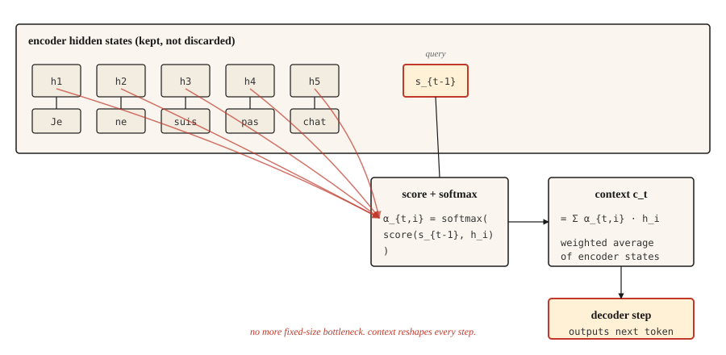

# Mekanisme Atensi — Terobosannya

> Decoder berhenti menyipitkan mata pada ringkasan yang terkompresi dan mulai melihat seluruh sumber. Semua setelah ini adalah atensi ditambah rekayasa.

**Jenis:** Build
**Bahasa:** Python, TypeScript
**Prasyarat:** Fase 5 · 09 (Model Sequence-to-Sequence)
**Waktu:** ~45 menit

## Masalah

Pelajaran 09 berakhir pada sebuah kegagalan yang terukur. Encoder-decoder GRU yang dilatih pada tugas salin mainan turun dari akurasi 89% pada panjang 5 menjadi mendekati kebetulan pada panjang 80. Penyebabnya bersifat struktural, bukan bug pelatihan: setiap bit informasi yang dikumpulkan encoder harus muat dalam satu keadaan tersembunyi berukuran tetap, dan decoder tidak pernah melihat apa pun selain itu.

Bahdanau, Cho, dan Bengio mempublikasikan perbaikan tiga baris pada 2014. Alih-alih hanya memberikan decoder keadaan encoder terakhir, simpanlah semua keadaan encoder. Pada setiap langkah decoder, hitung rata-rata terbobot dari keadaan-keadaan encoder di mana bobotnya menyatakan "seberapa besar decoder perlu melihat posisi encoder `i` sekarang?" Rata-rata terbobot itu adalah konteks, dan ia berubah pada setiap langkah decoder.

Itulah seluruh idenya. Transformer mengembangkannya. Self-attention menerapkannya pada satu sekuens. Multi-head attention menjalankannya secara paralel. Namun versi 2014 sudah memecahkan hambatan itu, dan begitu Anda memilikinya, peralihan ke transformer adalah rekayasa, bukan lompatan konseptual.

## Konsep



Pada setiap langkah decoder `t`:

1. Gunakan keadaan tersembunyi decoder sebelumnya `s_{t-1}` sebagai **query**.
2. Skorkan ia terhadap setiap keadaan tersembunyi encoder `h_1, ..., h_T`. Satu skalar per posisi encoder.
3. Terapkan softmax pada skor untuk mendapatkan bobot atensi `α_{t,1}, ..., α_{t,T}` yang berjumlah 1.
4. Vektor konteks `c_t = Σ α_{t,i} * h_i`. Rata-rata terbobot dari keadaan-keadaan encoder.
5. Decoder mengambil `c_t` plus token keluaran sebelumnya, lalu menghasilkan token berikutnya.

Rata-rata terbobot adalah intinya. Saat decoder perlu menerjemahkan "Je" menjadi "I", ia memberi bobot tinggi pada keadaan encoder di atas "Je" dan rendah pada yang lain. Saat ia perlu "not", ia memberi bobot tinggi pada "pas". Vektor konteks dibentuk kembali pada setiap langkah.

## Bentuk (hal yang menjebak semua orang)

Di sinilah setiap implementasi atensi pertama kali salah. Bacalah perlahan.

| Hal | Bentuk | Catatan |
|-----|--------|---------|
| Keadaan tersembunyi encoder `H` | `(T_enc, d_h)` | Jika BiLSTM, `d_h = 2 * d_hidden` |
| Keadaan tersembunyi decoder `s_{t-1}` | `(d_s,)` | Satu vektor |
| Skor atensi `e_{t,i}` | skalar | Satu per posisi encoder |
| Bobot atensi `α_{t,i}` | skalar | Setelah softmax atas semua `i` |
| Vektor konteks `c_t` | `(d_h,)` | Bentuk yang sama dengan keadaan encoder |

**Skor Bahdanau (aditif).** `e_{t,i} = v_α^T * tanh(W_a * s_{t-1} + U_a * h_i)`.

- `s_{t-1}` berbentuk `(d_s,)`, `h_i` berbentuk `(d_h,)`.
- `W_a` berbentuk `(d_attn, d_s)`. `U_a` berbentuk `(d_attn, d_h)`.
- Jumlah keduanya di dalam tanh berbentuk `(d_attn,)`.
- `v_α` berbentuk `(d_attn,)`. Hasil perkalian dalam dengan `v_α` menyusut menjadi skalar. **Itulah fungsi `v_α`.** Bukan sihir. Ia adalah proyeksi yang mengubah vektor berdimensi atensi menjadi skor skalar.

**Skor Luong (multiplikatif).** Tiga varian:

- `dot`: `e_{t,i} = s_t^T * h_i`. Mensyaratkan `d_s == d_h`. Kendala yang kaku. Lewati jika encoder Anda bidirectional.
- `general`: `e_{t,i} = s_t^T * W * h_i` dengan `W` berbentuk `(d_s, d_h)`. Menghilangkan kendala dimensi yang sama.
- `concat`: pada dasarnya bentuk Bahdanau. Jarang dipakai karena dua varian pertama lebih murah.

**Satu jebakan Bahdanau/Luong yang perlu disebut.** Bahdanau menggunakan `s_{t-1}` (keadaan decoder *sebelum* menghasilkan kata saat ini). Luong menggunakan `s_t` (keadaan *sesudahnya*). Mencampur keduanya menghasilkan gradien yang salah secara halus dan sangat sulit di-debug. Pilih satu makalah dan ikuti konvensinya.

```figure
attention-heatmap
```

## Bangun Sendiri

### Langkah 1: atensi aditif (Bahdanau)

```python
import numpy as np


def additive_attention(decoder_state, encoder_states, W_a, U_a, v_a):
    projected_dec = W_a @ decoder_state
    projected_enc = encoder_states @ U_a.T
    combined = np.tanh(projected_enc + projected_dec)
    scores = combined @ v_a
    weights = softmax(scores)
    context = weights @ encoder_states
    return context, weights


def softmax(x):
    x = x - np.max(x)
    e = np.exp(x)
    return e / e.sum()
```

Periksa bentuk Anda terhadap tabel di atas. `encoder_states` berbentuk `(T_enc, d_h)`. `projected_enc` berbentuk `(T_enc, d_attn)`. `projected_dec` berbentuk `(d_attn,)` dan disiarkan (broadcast). `combined` berbentuk `(T_enc, d_attn)`. `scores` berbentuk `(T_enc,)`. `weights` berbentuk `(T_enc,)`. `context` berbentuk `(d_h,)`. Kirim.

### Langkah 2: dot dan general ala Luong

```python
def dot_attention(decoder_state, encoder_states):
    scores = encoder_states @ decoder_state
    weights = softmax(scores)
    return weights @ encoder_states, weights


def general_attention(decoder_state, encoder_states, W):
    projected = W.T @ decoder_state
    scores = encoder_states @ projected
    weights = softmax(scores)
    return weights @ encoder_states, weights
```

Masing-masing tiga baris. Itulah sebabnya makalah Luong berdampak besar. Akurasi sama pada sebagian besar tugas, dengan jauh lebih sedikit kode.

### Langkah 3: contoh numerik yang dikerjakan

Diberikan tiga keadaan encoder (kira-kira "cat", "sat", "mat") dan keadaan decoder yang paling selaras dengan yang pertama, distribusi atensi terkonsentrasi pada posisi 0. Jika keadaan decoder bergeser agar selaras dengan yang terakhir, atensi bergeser ke posisi 2. Vektor konteks mengikutinya.

```python
H = np.array([
    [1.0, 0.0, 0.2],
    [0.5, 0.5, 0.1],
    [0.1, 0.9, 0.3],
])

s_close_to_cat = np.array([0.9, 0.1, 0.2])
ctx, w = dot_attention(s_close_to_cat, H)
print("weights:", w.round(3))
```

```
weights: [0.464 0.305 0.231]
```

Baris pertama menang. Sekarang pindahkan keadaan decoder lebih dekat ke keadaan encoder ketiga dan lihat bobotnya bergeser. Selesai. Atensi adalah penyejajaran eksplisit.

### Langkah 4: mengapa ini jembatan menuju transformer

Terjemahkan bahasa di atas ke dalam Q/K/V:

- **Query** = keadaan decoder `s_{t-1}`
- **Key** = keadaan-keadaan encoder (yang kami skorkan)
- **Value** = keadaan-keadaan encoder (yang kami boboti dan jumlahkan)

Pada atensi klasik, key dan value adalah hal yang sama. Self-attention memisahkannya: Anda dapat mengueri sebuah sekuens terhadap dirinya sendiri, dengan proyeksi K dan V yang berbeda dan dipelajari. Multi-head attention menjalankannya secara paralel dengan proyeksi berbeda yang dipelajari pula. Transformer menumpukkan seluruh tahap ini berkali-kali dan meninggalkan RNN.

Matematikanya sama. Bentuknya sama. Lompatan pedagogis dari atensi Bahdanau ke scaled dot-product attention sebagian besar hanya soal notasi.

## Gunakan

PyTorch dan TensorFlow menyediakan atensi secara langsung.

```python
import torch
import torch.nn as nn

mha = nn.MultiheadAttention(embed_dim=128, num_heads=8, batch_first=True)
query = torch.randn(2, 5, 128)
key = torch.randn(2, 10, 128)
value = torch.randn(2, 10, 128)

output, weights = mha(query, key, value)
print(output.shape, weights.shape)
```

```
torch.Size([2, 5, 128]) torch.Size([2, 5, 10])
```

Itulah satu lapisan atensi transformer. Batch query berisi 5 posisi, batch key/value berisi 10 posisi, masing-masing 128 dimensi, 8 head. `output` adalah query baru yang telah diperkuat konteks. `weights` adalah matriks penyejajaran 5x10 yang dapat Anda visualisasi.

### Kapan atensi klasik tetap relevan

- Pengajaran. Versi single-head, single-layer, berbasis RNN membuat setiap konsep terlihat jelas.
- Tugas sekuens pada perangkat di mana transformer tidak muat.
- Makalah apa pun dari 2014-2017. Anda akan salah membacanya tanpa mengetahui konvensi Bahdanau.
- Analisis penyejajaran butir halus dalam MT. Bobot atensi mentah adalah alat interpretabilitas bahkan pada model transformer, dan membacanya memerlukan pemahaman tentang apa bobot itu.

### Jebakan bobot atensi sebagai penjelasan

Bobot atensi tampak dapat diinterpretasi. Ia adalah bobot yang berjumlah satu lintas posisi; Anda dapat memplotnya; nilai tinggi berarti "melihat ini." Peninjau makalah menyukainya.

Namun bobot itu tidak seinterpretable tampaknya. Jain and Wallace (2019) menunjukkan bahwa distribusi atensi dapat diubah dan diganti dengan alternatif sembarangan tanpa mengubah prediksi model pada beberapa tugas. Jangan pernah melaporkan bobot atensi sebagai bukti penalaran tanpa ablasi atau pemeriksaan kontrafaktual.

## Kirim

Simpan sebagai `outputs/prompt-attention-shapes.md`:

```markdown
---
name: attention-shapes
description: Debug bug bentuk pada implementasi atensi.
phase: 5
lesson: 10
---

Diberikan implementasi atensi yang rusak, Anda mengidentifikasi ketidakcocokan bentuknya. Hasilkan:

1. Matriks mana yang salah bentuk. Sebutkan tensor-nya.
2. Apa bentuk seharusnya, diturunkan dari (d_s, d_h, d_attn, T_enc, T_dec, batch_size).
3. Perbaikan satu baris. Transpos, bentuk ulang, atau proyeksikan.
4. Tes untuk menangkap regresi. Biasanya: tegaskan `output.shape == (batch, T_dec, d_h)` dan `weights.shape == (batch, T_dec, T_enc)` serta `weights.sum(dim=-1)` mendekati 1.

Tolak merekomendasikan perbaikan yang diam-diam melakukan broadcast. Bug yang disembunyikan broadcast muncul kemudian sebagai penurunan akurasi senyap — jenis bug atensi terburuk.

Untuk kebingungan Bahdanau, tegaskan bahwa masukan decoder adalah `s_{t-1}` (keadaan sebelum langkah). Untuk Luong, `s_t` (keadaan sesudah langkah). Untuk dot-product, tandai ketidakcocokan dimensi antara query dan key sebagai kesalahan pemula yang paling umum.
```

## Latihan

1. **Mudah.** Implementasikan masking pada `softmax` agar token padding pada encoder mendapat bobot atensi nol. Uji pada batch dengan sekuens berpanjang variabel.
2. **Sedang.** Tambahkan multi-head attention pada bentuk Luong `general`. Bagi `d_h` menjadi `n_heads` kelompok, jalankan atensi per head, lalu gabungkan. Verifikasi bahwa kasus single-head cocok dengan implementasi Anda sebelumnya.
3. **Sulit.** Latih encoder-decoder GRU dengan atensi Bahdanau pada tugas salin mainan dari pelajaran 09. Plot akurasi terhadap panjang sekuens. Bandingkan dengan baseline tanpa atensi. Anda akan melihat kesenjangan melebar seiring panjang bertambah, yang mengonfirmasi bahwa atensi mengangkat hambatan.

## Istilah Kunci

| Istilah | Yang orang katakan | Yang sebenarnya dimaksud |
|---------|--------------------|--------------------------|
| Atensi | Melihat hal-hal | Rata-rata terbobot dari sekuens value, dengan bobot dihitung dari kesamaan query-key. |
| Query, Key, Value | QKV | Tiga proyeksi: Q bertanya, K adalah yang dicocokkan, V adalah yang dikembalikan. |
| Atensi aditif | Bahdanau | Skor feed-forward: `v^T tanh(W q + U k)`. |
| Atensi multiplikatif | Luong dot / general | Skor berupa `q^T k` atau `q^T W k`. Lebih murah, akurasi sama pada sebagian besar tugas. |
| Matriks penyejajaran | Gambar yang cantik | Bobot atensi sebagai grid `(T_dec, T_enc)`. Bacalah untuk melihat apa yang diperhatikan model. |

## Bacaan Lanjutan

- [Bahdanau, Cho, Bengio (2014). Neural Machine Translation by Jointly Learning to Align and Translate](https://arxiv.org/abs/1409.0473) — makalahnya.
- [Luong, Pham, Manning (2015). Effective Approaches to Attention-based Neural Machine Translation](https://arxiv.org/abs/1508.04025) — tiga varian skor dan perbandingannya.
- [Jain and Wallace (2019). Attention is not Explanation](https://arxiv.org/abs/1902.10186) — catatan hati-hati tentang interpretabilitas.
- [Dive into Deep Learning — Bahdanau Attention](https://d2l.ai/chapter_attention-mechanisms-and-transformers/bahdanau-attention.html) — penelusuran yang dapat dijalankan dengan PyTorch.
