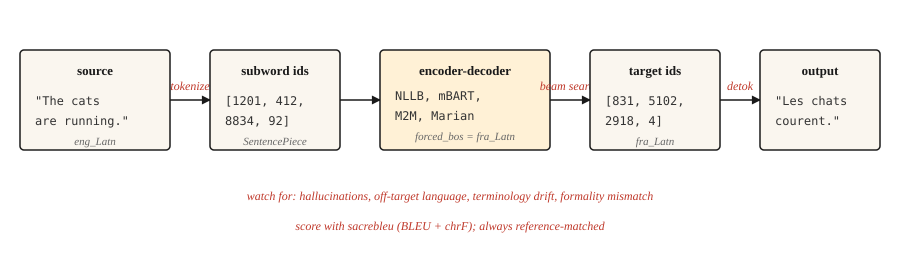

# Terjemahan Mesin

> Terjemahan adalah tugas yang membiayai riset NLP selama tiga dekade dan masih terus membiayainya sampai sekarang.

**Jenis:** Build
**Bahasa:** Python, TypeScript
**Prasyarat:** Fase 5 · 10 (Mekanisme Atensi), Fase 5 · 04 (GloVe, FastText, Subword)
**Waktu:** ~75 menit

## Masalah

Sebuah model membaca kalimat dalam satu bahasa dan menghasilkan kalimat dalam bahasa lain. Panjangnya bervariasi. Urutan kata bervariasi. Beberapa kata sumber dipetakan menjadi beberapa kata target, dan sebaliknya. Idiom menolak pemetaan satu-ke-satu. "I miss you" dalam bahasa Prancis adalah "tu me manques" — secara harfiah "kamu kekurangan bagiku." Tidak ada penyejajaran tingkat kata yang bertahan dari hal itu.

Terjemahan mesin adalah tugas yang memaksa NLP untuk menemukan encoder-decoder, atensi, transformer, dan akhirnya seluruh paradigma LLM. Setiap langkah maju terjadi karena kualitas terjemahan dapat diukur dan kesenjangan antara manusia dan mesin tetap membandel.

Pelajaran ini melewati pelajaran sejarah dan mengajarkan pipeline kerja tahun 2026: encoder-decoder multilingual terlatih (NLLB-200 atau mBART), tokenisasi subword, beam search, evaluasi BLEU dan chrF, serta segelintir mode kegagalan yang masih lolos ke produksi tanpa terdeteksi.

## Konsep



MT modern adalah encoder-decoder transformer yang dilatih pada teks paralel. Encoder membaca sumber dengan tokenisasi bahasanya. Decoder menghasilkan target, satu subword per waktu, menggunakan keluaran encoder melalui cross-attention (pelajaran 10). Dekode menggunakan beam search untuk menghindari jebakan dekode greedy. Keluaran di-detokenisasi, di-detruecase, dan diskor terhadap referensi.

Tiga pilihan operasional mendorong kualitas MT di dunia nyata.

- **Tokenizer.** SentencePiece BPE yang dilatih pada korpus campur bahasa. Kosakata bersama lintas bahasa adalah yang memungkinkan pasangan zero-shot pada NLLB.
- **Ukuran model.** NLLB-200 distilled 600M muat di laptop. NLLB-200 3.3B adalah standar produksi yang dipublikasikan. 54.5B adalah batas atas riset.
- **Dekode.** Lebar beam 4-5 untuk konten umum. Penalti panjang untuk menghindari keluaran yang terlalu pendek. Dekode terbatas bila Anda memerlukan konsistensi terminologi.

```figure
seq2seq-alignment
```

## Bangun Sendiri

### Langkah 1: panggilan MT terlatih

```python
from transformers import AutoTokenizer, AutoModelForSeq2SeqLM

model_id = "facebook/nllb-200-distilled-600M"
tok = AutoTokenizer.from_pretrained(model_id, src_lang="eng_Latn")
model = AutoModelForSeq2SeqLM.from_pretrained(model_id)

src = "The cats are running."
inputs = tok(src, return_tensors="pt")

out = model.generate(
    **inputs,
    forced_bos_token_id=tok.convert_tokens_to_ids("fra_Latn"),
    num_beams=5,
    length_penalty=1.0,
    max_new_tokens=64,
)
print(tok.batch_decode(out, skip_special_tokens=True)[0])
```

```text
Les chats courent.
```

Tiga hal penting di sini. `src_lang` memberi tahu tokenizer aksara dan segmentasi mana yang diterapkan. `forced_bos_token_id` memberi tahu decoder bahasa apa yang harus dihasilkan. Keduanya adalah trik khusus NLLB; mBART dan M2M-100 memakai konvensi mereka sendiri dan keduanya tidak dapat saling ditukar.

### Langkah 2: BLEU dan chrF

BLEU mengukur tumpang tindih n-gram antara keluaran dan referensi. Empat ukuran n-gram referensi (1-4), rata-rata geometrik dari presisi, dan penalti singkat untuk keluaran yang terlalu pendek. Skornya dalam rentang [0, 100]. Umum digunakan. Menjengkelkan untuk diinterpretasi: 30 BLEU itu "dapat dipakai"; 40 itu "bagus"; 50 itu "luar biasa"; perbedaan di bawah 1 BLEU adalah noise.

chrF mengukur skor-F tingkat karakter. Lebih sensitif pada bahasa yang kaya morfologi, di mana BLEU kurang menghitung kecocokan. Sering dilaporkan bersama BLEU.

```python
import sacrebleu

hypotheses = ["Les chats courent."]
references = [["Les chats courent."]]

bleu = sacrebleu.corpus_bleu(hypotheses, references)
chrf = sacrebleu.corpus_chrf(hypotheses, references)
print(f"BLEU: {bleu.score:.1f}  chrF: {chrf.score:.1f}")
```

Selalu gunakan `sacrebleu`. Ia menormalkan tokenisasi sehingga skor dapat dibandingkan lintas makalah. Membuat perhitungan BLEU sendiri adalah cara benchmark yang menyesatkan muncul.

### Hierarki evaluasi tiga tingkat (2026)

Evaluasi MT modern memakai tiga keluarga metrik yang saling melengkapi. Kirim dengan setidaknya dua.

- **Heuristik** (BLEU, chrF). Cepat, berbasis referensi, dapat diinterpretasi, tidak sensitif terhadap parafrasa. Pakai untuk perbandingan lawas dan deteksi regresi.
- **Terpelajar** (COMET, BLEURT, BERTScore). Model neural yang dilatih pada penilaian manusia; membandingkan kesamaan semantik terjemahan dengan sumber dan referensi. COMET memiliki asosiasi tertinggi dengan riset MT sejak 2023 dan merupakan standar produksi 2026 di mana kualitas menjadi prioritas.
- **LLM-sebagai-hakim** (tanpa referensi). Minta model besar memberi skor terjemahan pada kelancaran, kecukupan, nada, dan kesesuaian budaya. GPT-4-sebagai-hakim cocok dengan penilaian manusia sekitar 80% dari waktu bila rubriknya dirancang dengan baik. Pakai untuk konten terbuka di mana tidak ada referensi.

Tumpukan praktis 2026: `sacrebleu` untuk BLEU dan chrF, `unbabel-comet` untuk COMET, dan LLM yang diprompt untuk sinyal akhir yang dilihat manusia. Kalibrasi setiap metrik terhadap 50-100 contoh berlabel manusia sebelum mempercayainya pada data produksi.

Metrik tanpa referensi (COMET-QE, BLEURT-QE, LLM-sebagai-hakim) memungkinkan Anda mengevaluasi terjemahan tanpa referensi, yang penting untuk pasangan bahasa ekor panjang di mana terjemahan referensi tidak ada.

### Langkah 3: apa yang rusak di produksi

Pipeline kerja di atas akan menerjemahkan dengan lancar 80% dari waktu dan gagal secara senyap pada 20% sisanya. Mode kegagalan yang diberi nama:

- **Halusinasi.** Model mengarang konten yang tidak ada di sumber. Umum pada kosakata domain yang asing. Gejala: keluaran lancar tetapi menyatakan fakta yang tidak disebutkan sumber. Mitigasi: dekode terbatas pada istilah domain, tinjauan manusia pada konten yang diatur, pemantauan keluaran yang jauh lebih panjang daripada masukan.
- **Generasi di luar target.** Model menerjemahkan ke bahasa yang salah. NLLB sangat rentan pada pasangan bahasa langka. Mitigasi: verifikasi `forced_bos_token_id` dan selalu dekode dengan pemeriksaan pengenal bahasa pada keluaran.
- **Pergeseran terminologi.** "Sign up" menjadi "s'inscrire" di dok 1 dan "créer un compte" di dok 2. Untuk teks UI dan string yang dilihat pengguna, konsistensi lebih penting daripada kualitas mentah. Mitigasi: dekode terbatas glosarium atau kamus pasca-sunting.
- **Ketidakcocokan formalitas.** "tu" versus "vous" dalam bahasa Prancis, tingkat kesopanan dalam bahasa Jepang. Model memilih bentuk yang lebih umum di data pelatihan. Untuk konten yang menghadap pelanggan, ini biasanya salah. Mitigasi: awalan prompt dengan token formalitas bila model mendukungnya, atau fine-tune model kecil pada korpus formal saja.
- **Ledakan panjang pada masukan pendek.** Kalimat masukan yang sangat pendek sering menghasilkan terjemahan yang terlalu panjang karena penalti panjang turun tajam di bawah ~5 token sumber. Mitigasi: batas panjang maksimum keras yang sebanding dengan panjang sumber.

### Langkah 4: fine-tuning untuk sebuah domain

Model terlatih adalah generalis. Terjemahan domain hukum, medis, atau dialog game mendapat manfaat yang terukur dari fine-tuning pada data paralel domain. Resepnya tidak eksotis:

```python
from transformers import Trainer, TrainingArguments
from datasets import Dataset

pairs = [
    {"src": "The defendant pleaded guilty.", "tgt": "L'accusé a plaidé coupable."},
]

ds = Dataset.from_list(pairs)


def preprocess(ex):
    return tok(
        ex["src"],
        text_target=ex["tgt"],
        truncation=True,
        max_length=128,
        padding="max_length",
    )


ds = ds.map(preprocess, remove_columns=["src", "tgt"])

args = TrainingArguments(output_dir="out", per_device_train_batch_size=4, num_train_epochs=3, learning_rate=3e-5)
Trainer(model=model, args=args, train_dataset=ds).train()
```

Beberapa ribu contoh paralel berkualitas tinggi mengalahkan beberapa ratus ribu contoh bising hasil scraping web. Kualitas data pelatihan adalah tuas produksi terbesar.

## Gunakan

Tumpukan produksi 2026 untuk MT:

| Kasus penggunaan | Titik awal yang disarankan |
|------------------|----------------------------|
| Mana-ke-mana, 200 bahasa | `facebook/nllb-200-distilled-600M` (laptop) atau `nllb-200-3.3B` (produksi) |
| Berpusat pada Inggris, kualitas tinggi, 50 bahasa | `facebook/mbart-large-50-many-to-many-mmt` |
| Jalankan singkat, inferensi murah, Inggris-Prancis/Jerman/Spanyol | Model Helsinki-NLP / Marian |
| Kritis latensi, sisi browser | ONNX-quantized Marian (~50 MB) |
| Kualitas maksimal, bersedia membayar | GPT-4 / Claude / Gemini dengan prompt terjemahan |

Pada 2026 LLM kini mengungguli model MT khusus pada beberapa pasangan bahasa, terutama pada konten idiomatik dan konteks panjang. Komprominya adalah biaya per token dan latensi. Pilih LLM ketika panjang konteks, konsistensi gaya, atau adaptasi domain lewat prompt lebih penting daripada throughput.

## Kirim

Simpan sebagai `outputs/skill-mt-evaluator.md`:

```markdown
---
name: mt-evaluator
description: Evaluasi keluaran terjemahan mesin untuk keperluan pengiriman.
version: 1.0.0
phase: 5
lesson: 11
tags: [nlp, translation, evaluation]
---

Diberikan teks sumber dan kandidat terjemahan, hasilkan:

1. Estimasi skor otomatis. Rentang BLEU dan chrF yang Anda perkirakan. Nyatakan apakah referensi tersedia.
2. Daftar periksa lima poin yang dapat diverifikasi manusia: (a) keutuhan konten (tanpa halusinasi), (b) bahasa target yang benar, (c) kesesuaian register / formalitas, (d) konsistensi terminologi dengan glosarium bila diberikan, (e) tanpa pemotongan atau ledakan panjang.
3. Satu isu spesifik domain yang perlu diselidiki. Misalnya, untuk hukum: entitas bernama dan kutipan pasal. Untuk medis: nama obat dan dosis. Untuk UI: variabel placeholder `{name}`.
4. Bendera keyakinan. "Ship" / "Ship with review" / "Do not ship". Kaitkan dengan tingkat keparahan isu yang ditemukan pada langkah 2.

Tolak mengirim terjemahan tanpa pemeriksaan pengenal bahasa pada keluaran. Tolak mengevaluasi tanpa referensi kecuali pengguna secara eksplisit memilih penilaian tanpa referensi (COMET-QE, BLEURT-QE). Tandai konten apa pun di atas 1000 token sebagai kemungkinan besar memerlukan terjemahan per potongan.
```

## Latihan

1. **Mudah.** Terjemahkan paragraf bahasa Inggris lima kalimat ke bahasa Prancis dan kembali ke bahasa Inggris dengan `nllb-200-distilled-600M`. Ukur seberapa dekat hasil pergi-balik itu dengan aslinya. Anda akan melihat keutuhan makna disertai pergeseran pilihan kata.
2. **Sedang.** Implementasikan pemeriksaan pengenal bahasa pada keluaran terjemahan dengan `fasttext lid.176` atau `langdetect`. Integrasikan ke dalam panggilan MT agar generasi di luar target tertangkap sebelum dikembalikan.
3. **Sulit.** Fine-tune `nllb-200-distilled-600M` pada korpus domain 5.000 pasangan pilihan Anda. Ukur BLEU pada himpunan yang disisihkan sebelum dan sesudah fine-tuning. Laporkan jenis kalimat mana yang membaik dan mana yang memburuk.

## Istilah Kunci

| Istilah | Yang orang katakan | Yang sebenarnya dimaksud |
|---------|--------------------|--------------------------|
| BLEU | Skor terjemahan | Presisi n-gram dengan penalti singkat. [0, 100]. |
| chrF | Skor-F karakter | Skor-F tingkat karakter. Lebih sensitif pada bahasa kaya morfologi. |
| NMT | MT neural | Encoder-decoder transformer yang dilatih pada teks paralel. Standar sejak 2017+. |
| NLLB | No Language Left Behind | Keluarga model MT 200 bahasa dari Meta. |
| Dekode terbatas | Keluaran terkendali | Memaksa token atau n-gram tertentu agar muncul / tidak muncul dalam keluaran. |
| Halusinasi | Konten karangan | Keluaran model yang tidak didukung oleh sumber. |

## Bacaan Lanjutan

- [Costa-jussà et al. (2022). No Language Left Behind: Scaling Human-Centered Machine Translation](https://arxiv.org/abs/2207.04672) — makalah NLLB.
- [Post (2018). A Call for Clarity in Reporting BLEU Scores](https://aclanthology.org/W18-6319/) — mengapa `sacrebleu` adalah satu-satunya cara yang benar untuk melaporkan BLEU.
- [Popović (2015). chrF: character n-gram F-score for automatic MT evaluation](https://aclanthology.org/W15-3049/) — makalah chrF.
- [Panduan MT Hugging Face](https://huggingface.co/docs/transformers/tasks/translation) — penelusuran fine-tuning praktis.
