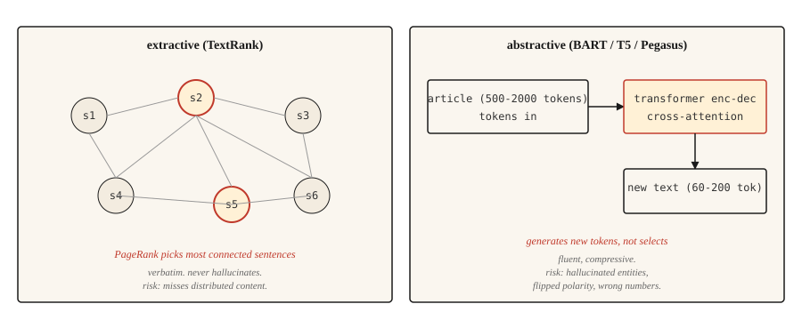

# Peringkasan Teks

> Sistem ekstraktif memberi tahu Anda apa yang dikatakan dokumen. Sistem abstraktif memberi tahu Anda apa yang dimaksud penulis. Tugas berbeda, jebakan berbeda.

**Jenis:** Bangun
**Bahasa:** Python, TypeScript
**Prasyarat:** Fase 5 · 02 (BoW + TF-IDF), Fase 5 · 11 (Terjemahan Mesin)
**Waktu:** ~75 menit

## Masalahnya

Artikel berita 2.000 kata mendarat di umpan Anda. Anda memerlukan 120 kata yang menangkap isinya. Anda bisa memilih tiga kalimat paling penting dari artikel itu (ekstraktif) atau menulis ulang isinya dengan kata-kata Anda sendiri (abstraktif). Keduanya disebut peringkasan. Keduanya adalah masalah yang sama sekali berbeda.

Peringkasan ekstraktif adalah masalah peringkatan. Beri skor setiap kalimat, kembalikan `k` teratas. Keluarannya selalu gramatikal karena diambil kata demi kata dari sumber. Risikonya adalah konten yang tersebar di seluruh artikel menjadi terlewat.

Peringkasan abstraktif adalah masalah generasi. Sebuah transformer menghasilkan teks baru dengan syarat masukan. Keluarannya lancar dan ringkas, tetapi dapat mengarang fakta yang tidak ada di sumber. Risikonya adalah pengarangan fakta yang meyakinkan.

Pelajaran ini membangun keduanya, beserta mode kegagalan yang melekat pada masing-masing.

## Konsepnya



**Ekstraktif.** Perlakukan artikel sebagai graf tempat simpulnya adalah kalimat dan tepinya adalah kesamaan. Jalankan PageRank (atau semacamnya) pada graf itu untuk memberi skor kalimat berdasarkan seberapa terhubungnya kalimat tersebut dengan segala hal lainnya. Kalimat dengan skor tertinggi menjadi ringkasan. Implementasi kanoniknya adalah **TextRank** (Mihalcea dan Tarau, 2004).

**Abstraktif.** Lakukan fine-tuning pada encoder-decoder transformer (BART, T5, Pegasus) dengan pasangan dokumen-ringkasan. Saat inferensi, model membaca dokumen dan menghasilkan ringkasan token demi token melalui cross-attention. Pegasus khususnya memakai objektif pra-pelatihan gap-sentence yang membuatnya sangat unggul dalam peringkasan tanpa banyak fine-tuning.

Evaluasi dengan **ROUGE** (Recall-Oriented Understudy for Gisting Evaluation). ROUGE-1 dan ROUGE-2 menilai tumpang tindih unigram dan bigram. ROUGE-L menilai subderet terpanjang yang sama. Lebih tinggi lebih baik, tetapi ROUGE-L 40 itu "cukup bagus" dan 50 "luar biasa". Setiap makalah melaporkan ketiganya. Gunakan paket `rouge-score`.

```figure
summarize-collapse
```

## Bangunlah

### Langkah 1: TextRank (ekstraktif)

```python
import math
import re
from collections import Counter


def sentence_split(text):
    return re.split(r"(?<=[.!?])\s+", text.strip())


def similarity(s1, s2):
    w1 = Counter(s1.lower().split())
    w2 = Counter(s2.lower().split())
    intersection = sum((w1 & w2).values())
    denom = math.log(len(w1) + 1) + math.log(len(w2) + 1)
    if denom == 0:
        return 0.0
    return intersection / denom


def textrank(text, top_k=3, damping=0.85, iterations=50, epsilon=1e-4):
    sentences = sentence_split(text)
    n = len(sentences)
    if n <= top_k:
        return sentences

    sim = [[0.0] * n for _ in range(n)]
    for i in range(n):
        for j in range(n):
            if i != j:
                sim[i][j] = similarity(sentences[i], sentences[j])

    scores = [1.0] * n
    for _ in range(iterations):
        new_scores = [1 - damping] * n
        for i in range(n):
            total_out = sum(sim[i]) or 1e-9
            for j in range(n):
                if sim[i][j] > 0:
                    new_scores[j] += damping * sim[i][j] / total_out * scores[i]
        if max(abs(s - ns) for s, ns in zip(scores, new_scores)) < epsilon:
            scores = new_scores
            break
        scores = new_scores

    ranked = sorted(range(n), key=lambda k: scores[k], reverse=True)[:top_k]
    ranked.sort()
    return [sentences[i] for i in ranked]
```

Ada dua hal yang layak disebut. Fungsi kesamaan memakai tumpang tindih kata yang dinormalisasi secara logaritmik, yaitu varian TextRank original. Cosine vektor TF-IDF juga bisa dipakai. Faktor peredaman 0,85 dan jumlah iterasi adalah nilai default PageRank.

### Langkah 2: abstraktif dengan BART

```python
from transformers import pipeline

summarizer = pipeline("summarization", model="facebook/bart-large-cnn")

article = """(long news article text)"""

summary = summarizer(article, max_length=120, min_length=60, do_sample=False)
print(summary[0]["summary_text"])
```

BART-large-CNN melakukan fine-tuning pada korpus CNN/DailyMail. Model ini menghasilkan ringkasan bergaya berita langsung dari kotaknya. Untuk domain lain (makalah ilmiah, dialog, hukum), gunakan checkpoint Pegasus yang sesuai atau lakukan fine-tuning pada data target Anda.

### Langkah 3: evaluasi ROUGE

```python
from rouge_score import rouge_scorer

scorer = rouge_scorer.RougeScorer(["rouge1", "rouge2", "rougeL"], use_stemmer=True)
scores = scorer.score(reference_summary, generated_summary)
print({k: round(v.fmeasure, 3) for k, v in scores.items()})
```

Selalu gunakan stemming. Tanpa itu, "running" dan "run" dihitung sebagai kata yang berbeda sehingga ROUGE menjadi kurang menghitung.

### Selain ROUGE (evaluasi peringkasan 2026)

ROUGE telah menjadi metrik peringkasan dominan selama dua dekade dan pada 2026 tidak lagi cukup jika berdiri sendiri. Sebuah meta-analisis berskala besar pada makalah NLG menunjukkan:

- **BERTScore** (kesamaan embedding kontekstual) terus mendapat tempat hingga 2023 dan kini dilaporkan bersama ROUGE di sebagian besar makalah peringkasan.
- **BARTScore** memperlakukan evaluasi sebagai generasi: ringkasan diberi skor berdasarkan seberapa besar kemungkinan BART yang telah dilatih awal menetapkannya, dengan sumber sebagai syaratnya.
- **MoverScore** (Earth Mover's Distance atas embedding kontekstual) mencapai posisi teratas pada benchmark peringkasan 2025 karena menangkap tumpang tindih semantik lebih baik daripada ROUGE.
- **FactCC** dan **fakta berbasis QA** umum pada 2021-2023, kini sering digantikan oleh **G-Eval** (rantai prompt GPT-4 yang memberi skor koherensi, konsistensi, kelancaran, dan relevansi dengan penalaran chain-of-thought).
- **G-Eval** dan pendekatan LLM-judge serupa cocok dengan penilaian manusia sekitar 80% kasus bila rubriknya dirancang dengan baik.

Rekomendasi produksi: laporkan ROUGE-L untuk perbandingan warisan, BERTScore untuk tumpang tindih semantik, dan G-Eval untuk koherensi serta fakta. Kalibrasikan terhadap 50-100 ringkasan berlabel manusia.

### Langkah 4: masalah fakta

Ringkasan abstraktif rentan terhadap halusinasi. Ringkasan ekstraktif membawa risiko halusinasi jauh lebih rendah karena keluarannya diambil kata demi kata dari sumber, meskipun tetap dapat menyesatkan bila kalimat sumber kehilangan konteks, menjadi usang, atau dikutip di luar urutan. Ini adalah alasan tunggal terbesar mengapa sistem produksi masih lebih memilih metode ekstraktif untuk konten yang terkait kepatuhan.

Jenis halusinasi yang perlu disebut:

- **Pertukaran entitas.** Sumber mengatakan "John Smith." Ringkasan mengatakan "John Brown."
- **Pergeseran angka.** Sumber mengatakan "25,000." Ringkasan mengatakan "25 juta."
- **Pembalikan polaritas.** Sumber mengatakan "menolak tawaran." Ringkasan mengatakan "menerima tawaran."
- **Rekayasa fakta.** Sumber tidak menyebut CEO. Ringkasan mengatakan CEO menyetujuinya.

Pendekatan evaluasi yang benar-benar bekerja:

- **FactCC.** Pengklasifikasi biner yang dilatih pada entailment antara kalimat sumber dan kalimat ringkasan. Memprediksi faktual/tidak faktual.
- **Fakta berbasis QA.** Ajukan pertanyaan kepada model QA yang jawabannya ada di sumber. Jika ringkasan mendukung jawaban yang berbeda, beri tanda.
- **F1 level entitas.** Bandingkan named entity di sumber dan di ringkasan. Entitas yang hanya muncul di ringkasan patut dicurigai.

Untuk apa pun yang menghadap pengguna dan mengutamakan fakta (berita, medis, hukum, keuangan), ekstraktif adalah pilihan default yang lebih aman. Abstraktif memerlukan pemeriksaan fakta di dalam alurnya.

## Gunakan

Tumpukan teknologi 2026:

| Kasus penggunaan | Rekomendasi |
|---------|-------------|
| Berita, ringkasan 3-5 kalimat, bahasa Inggris | `facebook/bart-large-cnn` |
| Makalah ilmiah | `google/pegasus-pubmed` atau T5 yang disetel |
| Multi-dokumen, bentuk panjang | LLM apa pun dengan konteks 32k+, diprompt |
| Peringkasan dialog | `philschmid/bart-large-cnn-samsum` |
| Ekstraktif, risiko halusinasi rendah secara konstruksi | TextRank atau LSA / LexRank dari `sumy` |

LLM dengan konteks panjang sering mengalahkan model khusus pada 2026 bila komputasi bukan kendala. Trade-off-nya adalah biaya dan keterulangan; model khusus memberi keluaran yang lebih konsisten.

## Kirimkan

Simpan sebagai `outputs/skill-summary-picker.md`:

```markdown
---
name: summary-picker
description: Pilih ekstraktif atau abstraktif, sebutkan pustakanya, tambahkan pemeriksaan fakta.
version: 1.0.0
phase: 5
lesson: 12
tags: [nlp, summarization]
---

Diberikan sebuah tugas (jenis dokumen, persyaratan kepatuhan, panjang, anggaran komputasi), keluarkan:

1. Pendekatan. Ekstraktif atau abstraktif. Jelaskan dalam satu kalimat mengapa.
2. Model/pustaka awal. Sebutkan namanya. `sumy.TextRankSummarizer`, `facebook/bart-large-cnn`, `google/pegasus-pubmed`, atau sebuah prompt LLM.
3. Rencana evaluasi. ROUGE-1, ROUGE-2, ROUGE-L (pakai rouge-score dengan stemming). Tambahkan pemeriksaan fakta jika abstraktif.
4. Satu mode kegagalan untuk diuji. Pertukaran entitas adalah yang paling umum pada peringkasan berita abstraktif; beri tanda pada sampel yang entitas sumbernya tidak muncul di ringkasan.

Tolak peringkasan abstraktif untuk konten medis, hukum, keuangan, atau yang diatur tanpa gerbang fakta. Beri tanda pada input yang melebihi jendela konteks model sebagai perlu peringkasan map-reduce bertahap, bukan sekadar pemotongan.
```

## Latihan

1. **Mudah.** Jalankan TextRank pada 5 artikel berita. Bandingkan 3 kalimat teratas dengan ringkasan referensi. Ukur ROUGE-L. Anda seharusnya melihat 30-45 ROUGE-L pada artikel bergaya CNN/DailyMail.
2. **Sedang.** Terapkan fakta level entitas: ekstrak named entity dari sumber dan ringkasan (spaCy), hitung recall entitas sumber di ringkasan dan precision entitas ringkasan terhadap sumber. Precision tinggi dan recall rendah berarti aman tetapi terlalu singkat; precision rendah berarti ada entitas yang diarang.
3. **Sulit.** Bandingkan BART-large-CNN dengan sebuah LLM (Claude atau GPT-4) pada 50 artikel CNN/DailyMail. Laporkan ROUGE-L, fakta (lewat F1 entitas), dan biaya per ringkasan. Dokumentasikan di mana masing-masing menang.

## Istilah Kunci

| Istilah | Yang dikatakan orang | Yang sebenarnya dimaksud |
|------|-----------------|-----------------------|
| Ekstraktif | Memilih kalimat | Mengembalikan kalimat kata demi kata dari sumber. Tidak pernah berhalusinasi. |
| Abstraktif | Menulis ulang | Menghasilkan teks baru dengan syarat sumber. Dapat berhalusinasi. |
| ROUGE | Metrik ringkasan | Tumpang tindih n-gram / LCS antara keluaran sistem dan referensi. |
| TextRank | Ekstraktif berbasis graf | PageRank atas graf kesamaan kalimat. |
| Fakta | Apakah benar | Apakah klaim ringkasan didukung oleh sumber. |
| Halusinasi | Konten karangan | Konten di ringkasan yang tidak didukung oleh sumber. |

## Bacaan Lanjutan

- [Mihalcea dan Tarau (2004). TextRank: Bringing Order into Texts](https://aclanthology.org/W04-3252/) — makalah kanonik untuk pendekatan ekstraktif.
- [Lewis dkk. (2019). BART: Denoising Sequence-to-Sequence Pre-training](https://arxiv.org/abs/1910.13461) — makalah BART.
- [Zhang dkk. (2019). PEGASUS: Pre-training with Extracted Gap-sentences](https://arxiv.org/abs/1912.08777) — Pegasus dan objektif gap-sentence.
- [Lin (2004). ROUGE: A Package for Automatic Evaluation of Summaries](https://aclanthology.org/W04-1013/) — makalah ROUGE.
- [Maynez dkk. (2020). On Faithfulness and Factuality in Abstractive Summarization](https://arxiv.org/abs/2005.00661) — makalah tentang lanskap fakta.
