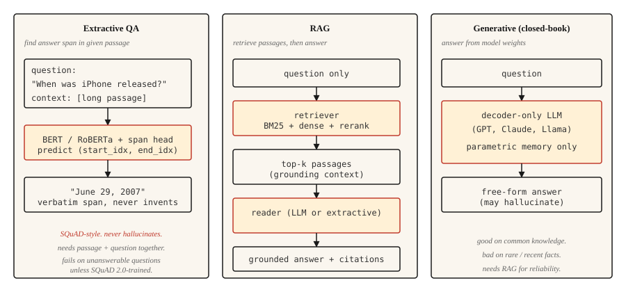

# Sistem Tanya Jawab

> Tiga sistem membentuk QA modern. Ekstraktif menemukan rentang teks. Retrieval-augmented membumikannya pada dokumen. Generatif menghasilkan jawaban. Setiap asisten AI modern adalah campuran ketiganya.

**Jenis:** Bangun
**Bahasa:** Python, TypeScript
**Prasyarat:** Fase 5 · 11 (Terjemahan Mesin), Fase 5 · 10 (Mekanisme Atensi)
**Waktu:** ~75 menit

## Masalahnya

Seorang pengguna mengetik "Kapan iPhone pertama diluncurkan?" dan mengharapkan "29 Juni 2007". Bukan "Sejarah Apple itu panjang dan beragam." Bukan pula "2007" yang berdiri sendiri tanpa kalimat. Jawaban yang langsung, berpijak pada sumber, dan benar.

Tiga arsitektur mendominasi QA selama dekade terakhir.

- **QA ekstraktif.** Diberikan pertanyaan dan suatu bagian teks yang diketahui memuat jawaban, temukan indeks awal dan akhir dari rentang jawaban di dalam bagian teks itu. SQuAD adalah benchmark kanoniknya.
- **QA domain terbuka.** Bagian teks tidak diberikan. Ambil dulu bagian teks yang relevan, lalu ekstrak atau hasilkan jawaban. Ini adalah landasan setiap pipeline RAG saat ini.
- **QA generatif / buku tertutup.** Model bahasa besar menjawab dari memori parametriknya. Tanpa retrieval. Paling cepat saat inferensi, paling tidak andal soal fakta.

Tren pada 2026 adalah hibrida: ambil beberapa bagian teks terbaik, lalu prompt model generatif untuk menjawab dengan berpijak pada bagian-bagian itu. Itulah RAG, dan pelajaran 14 membahas sisi retrieval secara mendalam. Pelajaran ini membangun sisi QA-nya.

## Konsepnya



**Ekstraktif.** Enkode pertanyaan dan bagian teks bersama-sama dengan sebuah transformer (keluarga BERT). Latih dua head yang memprediksi indeks token awal dan akhir dari jawaban. Loss berupa cross-entropy atas posisi-posisi yang valid. Keluarannya adalah rentang dari bagian teks tersebut. Tidak pernah berhalusinasi (secara konstruksi), dan tidak pernah menangani pertanyaan yang tidak bisa dijawab oleh bagian teks itu (secara konstruksi).

**Retrieval-augmented (RAG).** Dua tahap. Pertama, retriever menemukan bagian-bagian teks teratas (top-`k`) dari sebuah korpus. Kedua, reader (ekstraktif atau generatif) menghasilkan jawaban dengan memakai bagian-bagian itu. Pemisahan retriever-reader memungkinkan masing-masing dilatih dan dievaluasi secara terpisah. RAG modern sering menambahkan reranker di antaranya.

**Generatif.** LLM decoder-only (GPT, Claude, Llama) menjawab dari bobot yang telah dipelajarinya. Tanpa tahap retrieval. Sangat baik pada pengetahuan umum, buruk sekali pada fakta langka atau baru. Tingkat halusinasi berkorelasi terbalik dengan frekuensi fakta tersebut dalam data pra-pelatihan.

```figure
qa-span
```

## Bangunlah

### Langkah 1: QA ekstraktif dengan model yang telah dilatih

```python
from transformers import pipeline

qa = pipeline("question-answering", model="deepset/roberta-base-squad2")

passage = (
    "Apple Inc. released the first iPhone on June 29, 2007. "
    "The device was announced by Steve Jobs at Macworld in January 2007."
)
question = "When was the first iPhone released?"

answer = qa(question=question, context=passage)
print(answer)
```

```python
{'score': 0.98, 'start': 57, 'end': 70, 'answer': 'June 29, 2007'}
```

`deepset/roberta-base-squad2` dilatih pada SQuAD 2.0, yang memuat pertanyaan yang tidak dapat dijawab. Secara default, pipeline `question-answering` mengembalikan rentang dengan skor tertinggi bahkan bila skor nol (null) model menang — pipeline itu *tidak* otomatis mengembalikan jawaban kosong. Untuk mendapatkan perilaku "tidak ada jawaban" secara eksplisit, berikan `handle_impossible_answer=True` pada panggilan pipeline: pipeline lalu mengembalikan jawaban kosong hanya ketika skor null melebihi semua skor rentang. Tetap periksa kolom `score` dalam kedua kasus.

### Langkah 2: pipeline retrieval-augmented (sketsa)

```python
from sentence_transformers import SentenceTransformer
import numpy as np

encoder = SentenceTransformer("sentence-transformers/all-MiniLM-L6-v2")

corpus = [
    "Apple Inc. released the first iPhone on June 29, 2007.",
    "Macworld 2007 featured the iPhone announcement by Steve Jobs.",
    "Android launched in 2008 as Google's mobile operating system.",
    "The first iPod was released in 2001.",
]
corpus_embeddings = encoder.encode(corpus, normalize_embeddings=True)


def retrieve(question, top_k=2):
    q_emb = encoder.encode([question], normalize_embeddings=True)
    sims = (corpus_embeddings @ q_emb.T).squeeze()
    order = np.argsort(-sims)[:top_k]
    return [corpus[i] for i in order]


def answer(question):
    passages = retrieve(question, top_k=2)
    combined = " ".join(passages)
    return qa(question=question, context=combined)


print(answer("When was the first iPhone released?"))
```

Pipeline dua tahap. Retriever padat (Sentence-BERT) menemukan bagian teks yang relevan lewat kesamaan semantik. Reader ekstraktif (RoBERTa-SQuAD) menarik rentang jawaban dari gabungan bagian teks teratas. Ini bekerja pada korpus kecil. Untuk korpus sejuta dokumen, gunakan FAISS atau basis data vektor.

### Langkah 3: generatif dengan RAG

```python
def rag_generate(question, llm):
    passages = retrieve(question, top_k=3)
    prompt = f"""Context:
{chr(10).join('- ' + p for p in passages)}

Question: {question}

Answer using only the context above. If the context does not contain the answer, say "I don't know."
"""
    return llm(prompt)
```

Pola prompt ini penting. Dengan secara eksplisit memerintahkan model untuk berpijak pada konteks dan menjawab "I don't know." bila konteksnya tidak cukup, tingkat halusinasi turun 40-60% dibandingkan prompting naif. Pola yang lebih rumit menambahkan sitasi, skor keyakinan, dan ekstraksi terstruktur.

### Langkah 4: evaluasi yang mencerminkan dunia nyata

SQuAD memakai **Exact Match (EM)** dan **F1 level token**. EM adalah pencocokan ketat setelah normalisasi (huruf kecil, hapus tanda baca, hapus artikel) — baik prediksi cocok persis atau skornya 0. F1 dihitung dari tumpang tindih token antara prediksi dan referensi serta memberi kredit sebagian. Keduanya kurang menghargai parafrasa: "June 29, 2007" berbanding "June 29th, 2007" biasanya mendapat EM 0 (bentuk ordinal merusak normalisasi), tetapi tetap memperoleh F1 substantial dari token yang tumpang tindih.

Untuk QA produksi:

- **Akurasi jawaban** (dinilai LLM atau manusia, karena metrik tidak menangkap kesetaraan semantik).
- **Akurasi sitasi.** Apakah bagian teks yang dikutip benar-benar mendukung jawaban? Ini mudah dicek otomatis dengan pencocokan string antara sitasi yang dihasilkan dan bagian teks yang diambil.
- **Kalibrasi penolakan.** Bila jawaban tidak ada di bagian teks yang diambil, apakah sistem benar mengatakan "I don't know"? Ukur tingkat keyakinan palsu.
- **Recall retrieval.** Sebelum mengevaluasi reader, ukurlah apakah retriever berhasil memasukkan bagian teks yang tepat ke dalam top-`k`. Reader tidak dapat memperbaiki bagian teks yang hilang.

### RAGAS: kerangka evaluasi produksi 2026

`RAGAS` dibangun khusus untuk sistem RAG dan menjadi pilihan utama produksi pada 2026. Ia memberi skor pada empat dimensi tanpa memerlukan referensi emas:

- **Kesetiaan (faithfulness).** Apakah setiap klaim dalam jawaban berasal dari konteks yang diambil? Diukur dengan entailment berbasis NLI. Ini adalah metrik halusinasi utama Anda.
- **Relevansi jawaban.** Apakah jawaban menjawab pertanyaan? Diukur dengan menghasilkan pertanyaan hipotetis dari jawaban, lalu membandingkannya dengan pertanyaan asli.
- **Presisi konteks.** Dari potongan-potongan (chunk) yang diambil, berapa bagian yang benar-benar relevan? Presisi rendah berarti ada noise dalam prompt.
- **Recall konteks.** Apakah himpunan yang diambil memuat semua informasi yang dibutuhkan? Recall rendah berarti reader tidak bisa berhasil.

Penilaian tanpa referensi memungkinkan Anda mengevaluasi lalu lintas produksi langsung tanpa jawaban emas yang dikurasi. Tambahkan LLM-as-judge di atasnya untuk pertanyaan terbuka yang tidak berguna dinilai dengan metrik pencocokan persis.

`pip install ragas`. Sambungkan retriever + reader Anda. Dapatkan empat skalar per kueri. Pasang peringatan atas regresi.

## Gunakan

Tumpukan teknologi 2026.

| Kasus penggunaan | Rekomendasi |
|---------|-------------|
| Bagian teks diberikan, cari rentang jawaban | `deepset/roberta-base-squad2` |
| Di atas korpus tetap, buku tertutup tidak diterima | RAG: retriever padat + reader LLM |
| Waktu nyata di atas penyimpanan dokumen | RAG dengan retriever hibrida (BM25 + padat) + reranker (pelajaran 14) |
| QA percakapan (pertanyaan lanjutan) | LLM dengan riwayat percakapan + RAG pada setiap giliran |
| Domain yang sangat faktual dan diatur | Ekstraktif atas korpus otoritatif; jangan pernah generatif saja |

QA ekstraktif kurang modis pada 2026 karena RAG dengan LLM menangani lebih banyak kasus. Ia tetap dipakai dalam konteks yang mensyaratkan kutipan harfiah: riset hukum, kepatuhan regulasi, dan alat audit.

## Kirimkan

Simpan sebagai `outputs/skill-qa-architect.md`:

```markdown
---
name: qa-architect
description: Pilih arsitektur QA, strategi retrieval, dan rencana evaluasi.
version: 1.0.0
phase: 5
lesson: 13
tags: [nlp, qa, rag]
---

Diberikan persyaratan (ukuran korpus, jenis pertanyaan, batasan fakta, anggaran latensi), keluarkan:

1. Arsitektur. Ekstraktif, RAG dengan reader ekstraktif, RAG dengan reader generatif, atau LLM buku tertutup. Alasan satu kalimat.
2. Retriever. Tidak ada, BM25, padat (sebutkan encodernya), atau hibrida.
3. Reader. Model yang disetel pada SQuAD, LLM yang disebut nama, atau "DistilBERT yang di-fine-tune untuk domain tertentu".
4. Evaluasi. EM + F1 untuk benchmark ekstraktif; akurasi jawaban + akurasi sitasi + kalibrasi penolakan untuk produksi. Sebutkan apa yang Anda ukur dan bagaimana cara mengukurnya.

Tolak jawaban LLM buku tertutup untuk pertanyaan yang sensitif terhadap regulasi atau kepatuhan. Tolak sistem QA apa pun tanpa baseline recall retrieval (Anda tidak bisa mengevaluasi reader tanpa mengetahui bahwa retriever memunculkan bagian teks yang tepat). Beri tanda pada pertanyaan yang memerlukan penalaran multi-hop sebagai perlu retriever multi-hop khusus seperti sistem yang dilatih pada HotpotQA.
```

## Latihan

1. **Mudah.** Siapkan pipeline QA ekstraktif di atas pada 10 bagian teks Wikipedia. Buatlah 10 pertanyaan dengan tangan. Ukur seberapa sering jawabannya benar. Anda seharusnya melihat 7-9 jawaban benar bila bagian teks dan pertanyaan bersih.
2. **Sedang.** Tambahkan pengklasifikasi penolakan. Bila skor retrieval teratas di bawah ambang batas (misalnya 0,3 cosine), kembalikan "I don't know." alih-alih memanggil reader. Setel ambang batas itu pada himpunan validasi terpisah.
3. **Sulit.** Bangun pipeline RAG di atas korpus 10.000 dokumen pilihan Anda. Terapkan retrieval hibrida (BM25 + padat) dengan fusi RRF (lihat pelajaran 14). Ukur akurasi jawaban dengan dan tanpa langkah hibrida tersebut. Dokumentasikan jenis pertanyaan yang paling banyak untung.

## Istilah Kunci

| Istilah | Yang dikatakan orang | Yang sebenarnya dimaksud |
|------|-----------------|-----------------------|
| QA ekstraktif | Temukan rentang jawaban | Prediksi indeks awal dan akhir jawaban di dalam bagian teks yang diberikan. |
| QA domain terbuka | QA atas korpus | Tidak ada bagian teks yang diberikan; harus mengambil lalu menjawab. |
| RAG | Ambil lalu hasilkan | Retrieval-augmented generation. Pipeline retriever + reader. |
| SQuAD | Benchmark kanonik | Stanford Question Answering Dataset. Metrik EM + F1. |
| Halusinasi | Jawaban karangan | Keluaran reader yang tidak didukung oleh konteks yang diambil. |
| Kalibrasi penolakan | Tahu kapan harus diam | Sistem benar mengatakan "I don't know." bila tidak dapat menjawab. |

## Bacaan Lanjutan

- [Rajpurkar dkk. (2016). SQuAD: 100,000+ Questions for Machine Comprehension of Text](https://arxiv.org/abs/1606.05250) — makalah benchmark tersebut.
- [Karpukhin dkk. (2020). Dense Passage Retrieval for Open-Domain QA](https://arxiv.org/abs/2004.04906) — DPR, retriever padat kanonik untuk QA.
- [Lewis dkk. (2020). Retrieval-Augmented Generation for Knowledge-Intensive NLP Tasks](https://arxiv.org/abs/2005.11401) — makalah yang memperkenalkan istilah RAG.
- [Gao dkk. (2023). Retrieval-Augmented Generation for Large Language Models: A Survey](https://arxiv.org/abs/2312.10997) — tinjauan RAG yang komprehensif.
