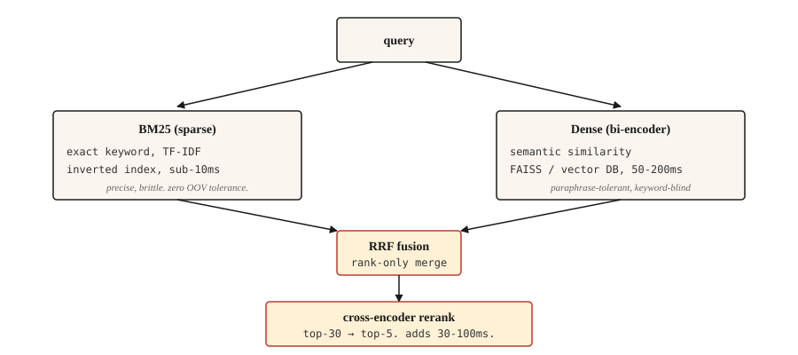

# Pengambilan Informasi dan Pencarian

> BM25 presisi tetapi rapuh. Dense meraih jaringan luas tetapi meleset pada kata kunci. Hibrida adalah pilihan utama 2026. Selain itu, semuanya tinggal penyetelan.

**Jenis:** Bangun
**Bahasa:** Python, TypeScript
**Prasyarat:** Fase 5 · 02 (BoW + TF-IDF), Fase 5 · 04 (GloVe, FastText, Subword)
**Waktu:** ~75 menit

## Masalahnya

Pengguna mengetik "apa yang terjadi jika seseorang berbohong untuk mendapatkan uang" dan berharap menemukan pasal yang benar-benar mengaturnya: "Pasal 420 KUHP". Pencarian kata kunci meleset seluruhnya (tidak ada kosakata yang sama). Pencarian semantik juga meleset bila embedding-nya tidak dilatih pada teks hukum. Pencarian nyata harus menangani keduanya.

IR adalah pipeline yang ada di bawah setiap sistem RAG, setiap bilah pencarian, dan setiap pencarian kabur di situs dokumentasi. Arsitektur 2026 yang terbukti di produksi bukanlah satu metode tunggal. Ia adalah rantai metode yang saling melengkapi, masing-masing menangkap kegagalan metode sebelumnya.

Pelajaran ini membangun setiap bagian dan menyebutkan kegagalan apa yang ditangkap oleh masing-masing.

## Konsepnya



Empat lapisan. Pilih yang Anda butuhkan.

1. **Retrieval sparse (BM25).** Cepat, presisi pada pencocokan persis, buruk sekali pada semantik. Berjalan di atas indeks terbalik. Di bawah 10 ms per kueri pada jutaan dokumen. Ini yang membuat referensi pasal, kode produk, pesan galat, dan named entity menjadi tepat.
2. **Retrieval dense.** Enkode kueri dan dokumen menjadi vektor. Cari tetangga terdekat. Menangkap parafrasa dan kesamaan semantik. Meleset pada pencocokan kata kunci persis yang beda satu karakter. 50-200 ms per kueri dengan FAISS atau basis data vektor.
3. **Fusi.** Gabungkan daftar peringkat dari sparse dan dense. Reciprocal Rank Fusion (RRF) adalah pilihan default yang mudah karena mengabaikan skor mentah (yang berada pada skala berbeda) dan hanya memakai posisi peringkat. Fusi berbobot menjadi pilihan bila Anda tahu satu sinyal mendominasi untuk domain Anda.
4. **Rerank cross-encoder.** Ambil 30 teratas dari fusi. Jalankan cross-encoder (kueri + dokumen bersama-sama, memberi skor setiap pasangan). Simpan 5 teratas. Cross-encoder lebih lambat per pasangan daripada bi-encoder, tetapi jauh lebih akurat. Anda mengamortisasi biayanya dengan menjalankannya hanya pada 30 teratas.

Retrieval tiga arah (BM25 + dense + sparse terpelajar seperti SPLADE) mengungguli dua arah pada benchmark 2026, tetapi memerlukan infrastruktur untuk indeks sparse terpelajar. Bagi kebanyakan tim, dua arah plus rerank cross-encoder adalah titik optimalnya.

```figure
gx-hybrid-retrieval
```

## Bangunlah

### Langkah 1: BM25 dari awal

```python
import math
import re
from collections import Counter

TOKEN_RE = re.compile(r"[a-z0-9]+")


def tokenize(text):
    return TOKEN_RE.findall(text.lower())


class BM25:
    def __init__(self, corpus, k1=1.5, b=0.75):
        if not corpus:
            raise ValueError("corpus must not be empty")
        self.corpus = [tokenize(d) for d in corpus]
        self.k1 = k1
        self.b = b
        self.n_docs = len(self.corpus)
        self.avg_dl = sum(len(d) for d in self.corpus) / self.n_docs
        self.df = Counter()
        for doc in self.corpus:
            for term in set(doc):
                self.df[term] += 1

    def idf(self, term):
        n = self.df.get(term, 0)
        return math.log(1 + (self.n_docs - n + 0.5) / (n + 0.5))

    def score(self, query, doc_idx):
        q_tokens = tokenize(query)
        doc = self.corpus[doc_idx]
        dl = len(doc)
        freq = Counter(doc)
        score = 0.0
        for term in q_tokens:
            f = freq.get(term, 0)
            if f == 0:
                continue
            numerator = f * (self.k1 + 1)
            denominator = f + self.k1 * (1 - self.b + self.b * dl / self.avg_dl)
            score += self.idf(term) * numerator / denominator
        return score

    def rank(self, query, top_k=10):
        scored = [(self.score(query, i), i) for i in range(self.n_docs)]
        scored.sort(reverse=True)
        return scored[:top_k]
```

Ada dua parameter yang perlu diketahui. `k1=1.5` mengontrol saturasi frekuensi istilah; nilai lebih besar memberi bobot lebih pada pengulangan istilah. `b=0.75` mengontrol normalisasi panjang; 0 mengabaikan panjang dokumen, 1 menormalkan sepenuhnya. Nilai default tersebut adalah rekomendasi Robertson dari makalah aslinya dan jarang perlu disetel ulang.

### Langkah 2: retrieval dense dengan bi-encoder

```python
from sentence_transformers import SentenceTransformer
import numpy as np


def build_dense_index(corpus, model_id="sentence-transformers/all-MiniLM-L6-v2"):
    encoder = SentenceTransformer(model_id)
    embeddings = encoder.encode(corpus, normalize_embeddings=True)
    return encoder, embeddings


def dense_search(encoder, embeddings, query, top_k=10):
    q_emb = encoder.encode([query], normalize_embeddings=True)
    sims = (embeddings @ q_emb.T).flatten()
    order = np.argsort(-sims)[:top_k]
    return [(float(sims[i]), int(i)) for i in order]
```

Lakukan normalisasi L2 pada embedding agar hasil dot product sama dengan cosine. `all-MiniLM-L6-v2` berdimensi 384, cepat, dan cukup kuat untuk sebagian besar retrieval bahasa Inggris. Untuk pekerjaan multibahasa, gunakan `paraphrase-multilingual-MiniLM-L12-v2`. Untuk akurasi tertinggi, `bge-large-en-v1.5` atau `e5-large-v2`.

### Langkah 3: Reciprocal Rank Fusion

```python
def reciprocal_rank_fusion(rankings, k=60):
    scores = {}
    for ranking in rankings:
        for rank, (_, doc_idx) in enumerate(ranking):
            scores[doc_idx] = scores.get(doc_idx, 0.0) + 1.0 / (k + rank + 1)
    fused = sorted(scores.items(), key=lambda x: x[1], reverse=True)
    return [(score, doc_idx) for doc_idx, score in fused]
```

Konstanta `k=60` berasal dari makalah RRF asli. `k` yang lebih besar meratakan kontribusi perbedaan peringkat; `k` yang lebih kecil membuat peringkat teratas mendominasi. Nilai 60 adalah default yang dipublikasikan dan jarang perlu disetel ulang.

### Langkah 4: pencarian hibrida + rerank

```python
from sentence_transformers import CrossEncoder

reranker = CrossEncoder("cross-encoder/ms-marco-MiniLM-L-6-v2")


def hybrid_search(query, bm25, encoder, dense_embeddings, corpus, top_k=5, pool_size=30, reranker=reranker):
    sparse_ranking = bm25.rank(query, top_k=pool_size)
    dense_ranking = dense_search(encoder, dense_embeddings, query, top_k=pool_size)
    fused = reciprocal_rank_fusion([sparse_ranking, dense_ranking])[:pool_size]

    pairs = [(query, corpus[doc_idx]) for _, doc_idx in fused]
    scores = reranker.predict(pairs)
    reranked = sorted(zip(scores, [doc_idx for _, doc_idx in fused]), reverse=True)
    return reranked[:top_k]
```

Tiga tahap dirangkai. BM25 menemukan kecocokan leksikal. Dense menemukan kecocokan semantik. RRF menggabungkan kedua peringkat tanpa perlu kalibrasi skor. Cross-encoder menilai ulang 30 teratas dengan memakai pasangan kueri-dokumen secara bersamaan, sehingga menangkap relevansi butir halus yang terlewat oleh bi-encoder. Simpan 5 teratas.

### Langkah 5: evaluasi

| Metrik | Makna |
|--------|---------|
| Recall@k | Dari kueri yang dokumen benarnya memang ada, seberapa sering dokumen itu masuk dalam k teratas? |
| MRR (Mean Reciprocal Rank) | Rata-rata dari 1/peringkat dokumen relevan pertama. |
| nDCG@k | Memperhitungkan tingkatan relevansi, bukan hanya relevan/tidak relevan biner. |

Secara khusus untuk RAG, **Recall@k** dari retriever adalah angka paling penting. Reader Anda tidak dapat menjawab bila bagian teks yang tepat tidak ada dalam himpunan yang diambil.

Tips debugging: untuk kueri yang gagal, bedakan peringkat sparse dan dense. Bila satu menemukan dokumen yang tepat dan yang lain tidak, Anda menghadapi ketidaksesuaian kosakata (perbaikan: tambahkan bagian yang hilang) atau ambiguitas semantik (perbaikan: embedding yang lebih baik atau sebuah reranker).

## Gunakan

Tumpukan teknologi 2026:

| Skala | Tumpukan |
|-------|-------|
| 1rb-100rb dokumen | BM25 dalam memori + embedding `all-MiniLM-L6-v2` + RRF. Tanpa basis data terpisah. |
| 100rb-10jt dokumen | FAISS atau pgvector untuk dense + Elasticsearch / OpenSearch untuk BM25. Jalankan secara paralel. |
| 10jt+ dokumen | Qdrant / Weaviate / Vespa / Milvus dengan dukungan hibrida. Rerank cross-encoder pada 30 teratas. |
| Batas kualitas terbaik | Tiga arah (BM25 + dense + SPLADE) + reranking interaksi akhir dengan ColBERT |

Apa pun yang Anda pilih, siapkan anggaran untuk evaluasi. Ukur recall retrieval terlebih dahulu sebelum mengukur akurasi RAG ujung-ke-ujung. Reader tidak dapat memperbaiki apa yang terlewat oleh retriever.

### Pelajaran berharga dari RAG produksi 2026

- **80% kegagalan RAG berasal dari ingestion dan chunking, bukan dari model.** Tim menghabiskan berminggu-minggu mengganti LLM dan menyetel prompt, sementara retrieval diam-diam mengembalikan konteks yang salah setiap kueri ketiga. Perbaiki chunking lebih dulu.
- **Strategi chunking lebih penting daripada ukuran chunk.** Pembagian berukuran tetap merusak tabel, kode, dan judul bertingkat. Yang sadar kalimat adalah default; chunking semantik atau berbasis LLM membuahkan hasil untuk dokumen teknis dan manual produk.
- **Pola dokumen-induk.** Ambil potongan "anak" kecil untuk presisi. Bila beberapa anak dari bagian induk yang sama muncul, ganti dengan blok induk agar konteks tetap terjaga. Ini secara konsisten menaikkan kualitas jawaban tanpa pelatihan ulang.
- **k_rerank=3 biasanya optimal.** Setiap potongan tambahan setelah itu menambah biaya token dan latensi generasi tanpa menaikkan kualitas jawaban. Bila k=8 masih lebih baik daripada k=3 bagi Anda, berarti reranker-nya kurang baik.
- **HyDE / perluasan kueri.** Hasilkan jawaban hipotetis dari kueri, enkode jawaban itu, lalu ambil dokumen. Ini menjembatani kesenjangan antara pertanyaan pendek dan dokumen panjang. Kenaikan presisi gratis tanpa pelatihan.
- **Anggaran konteks di bawah 8rb token.** Temuan yang konsisten pada batas itu berarti ambang reranker terlalu longgar.
- **Versi segalanya.** Prompt, aturan chunking, model embedding, reranker. Setiap pergeseran (drift) diam-diam merusak kualitas jawaban. Gerbang CI pada faithfulness, presisi konteks, dan tingkat pertanyaan yang tidak terjawab mencegah regresi sebelum dilihat pengguna.
- **Retrieval tiga arah (BM25 + dense + sparse terpelajar seperti SPLADE) mengungguli dua arah** pada benchmark 2026, terutama untuk kueri yang mencampurkan nama yang tepat dengan semantik. Terapkan bila infrastruktur mendukung indeks SPLADE.

Desain retrieval yang baik mengurangi halusinasi 70-90% menurut pengukuran industri 2026. Sebagian besar peningkatan kinerja RAG berasal dari retrieval yang lebih baik, bukan dari fine-tuning model.

## Kirimkan

Simpan sebagai `outputs/skill-retrieval-picker.md`:

```markdown
---
name: retrieval-picker
description: Pilih tumpukan retrieval untuk korpus dan pola kueri tertentu.
version: 1.0.0
phase: 5
lesson: 14
tags: [nlp, retrieval, rag, search]
---

Diberikan persyaratan (ukuran korpus, pola kueri, anggaran latensi, standar kualitas, batasan infrastruktur), keluarkan:

1. Tumpukan. Hanya BM25, hanya dense, hibrida (BM25 + dense + RRF), hibrida + rerank cross-encoder, atau tiga arah (BM25 + dense + sparse terpelajar).
2. Encoder dense. Sebutkan model spesifiknya. Sesuaikan dengan bahasa, domain, dan panjang konteks.
3. Reranker. Sebutkan model cross-encoder spesifik bila dipakai. Beri tanda bahwa rerank menambah latensi 30-100 ms pada 30 teratas.
4. Rencana evaluasi. Recall@10 adalah metrik utama retriever. MRR untuk jawaban ganda. Buat baseline dulu, lalu ukur peningkatan inkremental terhadapnya.

Tolak merekomendasikan dense-only untuk korpus yang memuat named entity, kode galat, atau SKU produk kecuali pengguna memiliki bukti bahwa dense menangani pencocokan persis. Tolak melewati reranking untuk retrieval berisiko tinggi (hukum, medis) yang 5 teratasnya menentukan jawaban pengguna.
```

## Latihan

1. **Mudah.** Terapkan `hybrid_search` di atas pada korpus 500 dokumen. Uji 20 kueri. Bandingkan recall@5 antara hanya BM25, hanya dense, dan hibrida.
2. **Sedang.** Tambahkan perhitungan MRR. Untuk setiap kueri uji yang dokumen benarnya diketahui, temukan peringkat dokumen itu pada peringkat BM25, dense, dan hibrida. Laporkan MRR untuk masing-masing.
3. **Sulit.** Lakukan fine-tuning pada encoder dense untuk domain Anda dengan MultipleNegativesRankingLoss (Sentence Transformers). Bangun himpunan pelatihan dari 500 pasangan kueri-dokumen. Bandingkan recall sebelum dan sesudah fine-tuning.

## Istilah Kunci

| Istilah | Yang dikatakan orang | Yang sebenarnya dimaksud |
|------|-----------------|-----------------------|
| BM25 | Pencarian kata kunci | Okapi BM25. Menilai dokumen berdasarkan frekuensi istilah, IDF, dan panjang. |
| Retrieval dense | Pencarian vektor | Enkode kueri + dokumen menjadi vektor, lalu cari tetangga terdekat. |
| Bi-encoder | Model embedding | Mengenkode kueri dan dokumen secara terpisah. Cepat saat kueri. |
| Cross-encoder | Model reranker | Mengenkode kueri + dokumen bersama-sama. Lambat tetapi akurat. |
| RRF | Fusi peringkat | Gabungkan dua peringkat dengan menjumlahkan `1/(k + rank)`. |
| Recall@k | Metrik retrieval | Fraksi kueri yang dokumen relevannya masuk dalam k teratas. |

## Bacaan Lanjutan

- [Robertson dan Zaragoza (2009). The Probabilistic Relevance Framework: BM25 and Beyond](https://www.staff.city.ac.uk/~sbrp622/papers/foundations_bm25_review.pdf) — pembahasan definitif tentang BM25.
- [Karpukhin dkk. (2020). Dense Passage Retrieval for Open-Domain QA](https://arxiv.org/abs/2004.04906) — DPR, bi-encoder kanonik.
- [Formal dkk. (2021). SPLADE: Sparse Lexical and Expansion Model](https://arxiv.org/abs/2107.05720) — retriever sparse terpelajar yang menutup jarak dengan dense.
- [Cormack, Clarke, Büttcher (2009). Reciprocal Rank Fusion outperforms Condorcet and individual Rank Learning Methods](https://plg.uwaterloo.ca/~gvcormac/cormacksigir09-rrf.pdf) — makalah RRF.
- [Khattab dan Zaharia (2020). ColBERT: Efficient and Effective Passage Search](https://arxiv.org/abs/2004.12832) — retrieval interaksi akhir.
