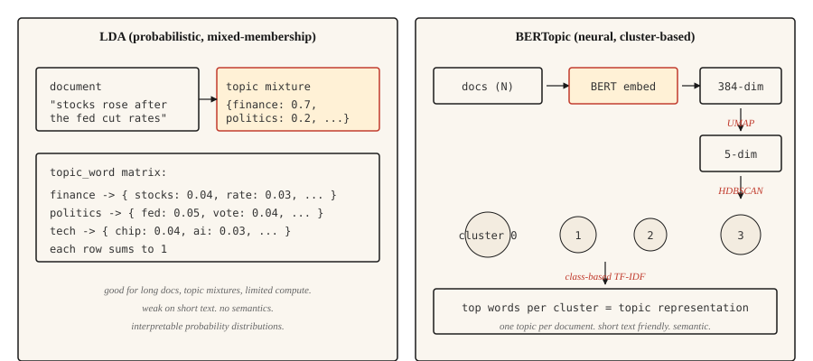

# Pemodelan Topik — LDA dan BERTopic

> LDA: dokumen adalah campuran topik, topik adalah distribusi atas kata. BERTopic: dokumen mengelompok dalam ruang embedding, kelompok itu menjadi topik. Tujuan sama, dekomposisi berbeda.

**Jenis:** Pelajari
**Bahasa:** Python, TypeScript
**Prasyarat:** Fase 5 · 02 (BoW + TF-IDF), Fase 5 · 03 (Word2Vec)
**Waktu:** ~45 menit

## Masalahnya

Anda punya 10.000 tiket dukungan pelanggan, 50.000 artikel berita, atau 200.000 tweet. Anda perlu tahu tentang apa kumpulan itu tanpa membacanya. Anda tidak memiliki kategori berlabel. Anda bahkan tidak tahu berapa banyak kategori yang ada.

Pemodelan topik menjawabnya tanpa pengawasan. Berikan korpus, dan Anda mendapatkan sekumpulan kecil topik yang koheren serta, untuk setiap dokumen, distribusi atas topik-topik itu.

Dua keluarga algoritme mendominasi. LDA (2003) memperlakukan setiap dokumen sebagai campuran topik laten dan setiap topik sebagai distribusi atas kata. Inferensinya Bayes. Ia tetap dipakai di produksi bila Anda memerlukan penugasan topik dengan keanggotaan campuran dan distribusi probabilitas tingkat kata yang dapat dijelaskan.

BERTopic (2020) mengenkode dokumen dengan BERT, menurunkan dimensi dengan UMAP, mengelompokkan dengan HDBSCAN, dan mengekstrak kata topik lewat TF-IDF berbasis kelas. Ia menang pada teks pendek, media sosial, dan apa pun yang kesamaan semantiknya lebih penting daripada tumpang tindih kata. Satu dokumen mendapat satu topik, yang merupakan keterbatasan untuk konten bentuk panjang.

Pelajaran ini membangun intuisi untuk keduanya dan menyebutkan mana yang dipilih untuk korpus tertentu.

## Konsepnya



**Cerita generatif LDA.** Setiap topik adalah distribusi atas kata. Setiap dokumen adalah campuran topik. Untuk menghasilkan sebuah kata dalam dokumen, ambil sampel sebuah topik dari campuran dokumen itu, lalu ambil sampel sebuah kata dari distribusi topik tersebut. Inferensi membaliknya: dari kata-kata yang teramati, simpulkan distribusi topik per dokumen dan distribusi kata per topik. Collapsed Gibbs sampling atau Bayes variasional yang mengerjakan perhitungannya.

Keluaran utama LDA:

- `doc_topic`: matriks `(n_docs, n_topics)`, setiap baris berjumlah 1 (campuran topik dokumen).
- `topic_word`: matriks `(n_topics, vocab_size)`, setiap baris berjumlah 1 (distribusi kata topik).

**Pipeline BERTopic.**

1. Enkode setiap dokumen dengan sentence transformer (misalnya `all-MiniLM-L6-v2`). Vektor berdimensi 384.
2. Turunkan dimensi dengan UMAP menjadi sekitar 5 dimensi. Embedding BERT terlalu berdimensi tinggi untuk pengelompokan.
3. Kelompokkan dengan HDBSCAN. Berbasis kepadatan, menghasilkan kelompok berukuran beragam dan label "pencilan".
4. Untuk setiap kelompok, hitung TF-IDF berbasis kelas atas dokumen-dokumen dalam kelompok itu untuk mengekstrak kata-kata teratas.

Keluarannya adalah satu topik per dokumen (ditambah label pencilan -1). Secara opsional, keanggotaan lunak lewat vektor probabilitas HDBSCAN.

```figure
topic-drift
```

## Bangunlah

### Langkah 1: LDA lewat scikit-learn

```python
from sklearn.feature_extraction.text import CountVectorizer
from sklearn.decomposition import LatentDirichletAllocation
import numpy as np


def fit_lda(documents, n_topics=5, max_features=1000):
    cv = CountVectorizer(
        max_features=max_features,
        stop_words="english",
        min_df=2,
        max_df=0.9,
    )
    X = cv.fit_transform(documents)
    lda = LatentDirichletAllocation(
        n_components=n_topics,
        random_state=42,
        max_iter=50,
        learning_method="online",
    )
    doc_topic = lda.fit_transform(X)
    feature_names = cv.get_feature_names_out()
    return lda, cv, doc_topic, feature_names


def print_top_words(lda, feature_names, n_top=10):
    for idx, topic in enumerate(lda.components_):
        top_idx = np.argsort(-topic)[:n_top]
        words = [feature_names[i] for i in top_idx]
        print(f"topic {idx}: {' '.join(words)}")
```

Perhatikan: kata henti dibuang, min_df dan max_df menyaring istilah yang langka dan yang terlalu umum, serta CountVectorizer dipakai (bukan TfidfVectorizer) karena LDA mengharapkan hitungan mentah.

### Langkah 2: BERTopic (produksi)

```python
from bertopic import BERTopic

topic_model = BERTopic(
    embedding_model="sentence-transformers/all-MiniLM-L6-v2",
    min_topic_size=15,
    verbose=True,
)

topics, probs = topic_model.fit_transform(documents)
info = topic_model.get_topic_info()
print(info.head(20))
valid_topics = info[info["Topic"] != -1]["Topic"].tolist()
for topic_id in valid_topics[:5]:
    print(f"topic {topic_id}: {topic_model.get_topic(topic_id)[:10]}")
```

Filter pada `Topic != -1` membuang keranjang pencilan BERTopic (dokumen yang tidak dapat dikelompokkan HDBSCAN). `min_topic_size` mengontrol ukuran kelompok minimum HDBSCAN; default pustaka BERTopic adalah 10. Contoh ini menetapkannya secara eksplisit menjadi 15 sesuai skala pelajaran ini. Untuk korpus lebih dari 10.000 dokumen, naikkan menjadi 50 atau 100.

### Langkah 3: evaluasi

Kedua metode menghasilkan kata-kata topik. Pertanyaannya adalah apakah kata-kata itu saling koheren.

- **Koherensi topik (c_v).** Menggabungkan NPMI (normalized pointwise mutual information) dari pasangan kata teratas atas konteks jendela geser, mengagregasi skor menjadi vektor topik, lalu membandingkan vektor-vektor itu dengan cosine similarity. Lebih tinggi lebih baik. Gunakan `gensim.models.CoherenceModel` dengan `coherence="c_v"`.
- **Keragaman topik.** Fraksi kata unik di seluruh kata teratas dari semua topik. Lebih tinggi lebih baik (topik tidak tumpang tindih).
- **Inspeksi kualitatif.** Bacalah kata teratas dari setiap topik. Apakah kata-kata itu menyebut sesuatu yang nyata? Penilaian manusia masih menjadi benteng terakhir.

## Kapan memilih mana

| Situasi | Pilihan |
|-----------|------|
| Teks pendek (tweet, ulasan, judul) | BERTopic |
| Dokumen panjang dengan campuran topik | LDA |
| Tanpa GPU / komputasi terbatas | LDA atau NMF |
| Perlu distribusi multi-topik tingkat dokumen | LDA |
| Integrasi LLM untuk penamaan topik | BERTopic (dukungan langsung) |
| Penerapan edge dengan sumber daya terbatas | LDA |
| Koherensi semantik maksimal | BERTopic |

Pertimbangan praktis terbesar adalah panjang dokumen. Embedding BERT memotong teks; hitungan LDA bekerja pada panjang berapa pun. Untuk dokumen yang lebih panjang dari jendela konteks model embedding, lakukan pemotongan lalu agregasi, atau gunakan LDA.

## Gunakan

Tumpukan teknologi 2026:

- **BERTopic.** Default untuk teks pendek dan apa pun yang mengutamakan semantik.
- **`gensim.models.LdaModel`.** LDA klasik untuk produksi, matang, dan teruji.
- **`sklearn.decomposition.LatentDirichletAllocation`.** LDA yang mudah untuk eksperimen.
- **NMF.** Faktorisasi matriks non-negatif. Alternatif cepat untuk LDA, dengan kualitas sebanding pada teks pendek.
- **Top2Vec.** Desain serupa BERTopic. Komunitas lebih kecil, tetapi baik pada beberapa benchmark.
- **FASTopic.** Lebih baru, lebih cepat daripada BERTopic pada korpus sangat besar.
- **Penamaan berbasis LLM.** Jalankan pengelompokan apa pun, lalu prompt model untuk memberi nama setiap kelompok.

## Kirimkan

Simpan sebagai `outputs/skill-topic-picker.md`:

```markdown
---
name: topic-picker
description: Pilih LDA atau BERTopic untuk sebuah korpus. Sebutkan pustaka, parameter, dan evaluasi.
version: 1.0.0
phase: 5
lesson: 15
tags: [nlp, topic-modeling]
---

Diberikan deskripsi korpus (jumlah dokumen, panjang rata-rata, domain, bahasa, anggaran komputasi), keluarkan:

1. Algoritme. LDA / NMF / BERTopic / Top2Vec / FASTopic. Alasan satu kalimat.
2. Konfigurasi. Jumlah topik: `recommended = max(5, round(sqrt(n_docs)))`, dibatasi 200 untuk korpus di bawah 40.000 dokumen; izinkan >200 hanya bila korpus benar-benar besar (>40rb) dan catat biaya komputasi yang meningkat. Filter `min_df` / `max_df` dan model embedding untuk pendekatan neural juga masuk di sini.
3. Evaluasi. Koherensi topik (c_v) via `gensim.models.CoherenceModel`, keragaman topik, serta bacaan manusia atas 20 sampel.
4. Mode kegagalan untuk diuji. Pada LDA, "topik sampah" yang menyerap kata henti dan istilah frekuen. Pada BERTopic, kelompok pencilan -1 yang menelan dokumen ambigu.

Tolak BERTopic pada dokumen yang lebih panjang dari jendela konteks model embedding tanpa strategi pemotongan. Tolak LDA pada teks sangat pendek (tweet, ulasan di bawah 10 token) karena koherensi hancur. Beri tanda pada pilihan n_topics di bawah 5 sebagai kemungkinan salah; beri tanda pada >200 untuk korpus di bawah 40rb dokumen sebagai kemungkinan pemecahan berlebih.
```

## Latihan

1. **Mudah.** Latih LDA dengan 5 topik pada dataset 20 Newsgroups. Cetak 10 kata teratas per topik. Beri label setiap topik dengan tangan. Apakah algoritme menemukan kategori yang sebenarnya?
2. **Sedang.** Latih BERTopic pada subhimpunan 20 Newsgroups yang sama. Bandingkan jumlah topik yang ditemukan, kata teratas, dan koherensi kualitatif terhadap LDA. Mana yang menampilkan kategori asli lebih bersih?
3. **Sulit.** Hitung koherensi c_v untuk LDA dan BERTopic pada korpus Anda. Jalankan masing-masing dengan 5, 10, 20, dan 50 topik. Plot koherensi terhadap jumlah topik. Laporkan metode mana yang lebih stabil di berbagai jumlah topik.

## Istilah Kunci

| Istilah | Yang dikatakan orang | Yang sebenarnya dimaksud |
|------|-----------------|-----------------------|
| Topik | Sesuatu yang dibahas korpus | Distribusi probabilitas atas kata (LDA) atau kelompok dokumen serupa (BERTopic). |
| Keanggotaan campuran | Dokumen adalah beberapa topik | LDA memberi setiap dokumen distribusi atas semua topik. |
| UMAP | Penurunan dimensi | Pembelajaran manifold yang menjaga struktur lokal; dipakai dalam BERTopic. |
| HDBSCAN | Pengelompokan berbasis kepadatan | Menemukan kelompok berukuran beragam; menghasilkan label "noise" (-1) untuk pencilan. |
| Koherensi c_v | Metrik kualitas topik | NPMI kata topik atas jendela geser, diubah menjadi vektor konteks dan dibandingkan dengan cosine similarity. |

## Bacaan Lanjutan

- [Blei, Ng, Jordan (2003). Latent Dirichlet Allocation](https://www.jmlr.org/papers/volume3/blei03a/blei03a.pdf) — makalah LDA.
- [Grootendorst (2022). BERTopic: Neural topic modeling with a class-based TF-IDF procedure](https://arxiv.org/abs/2203.05794) — makalah BERTopic.
- [Röder, Both, Hinneburg (2015). Exploring the Space of Topic Coherence Measures](https://svn.aksw.org/papers/2015/WSDM_Topic_Evaluation/public.pdf) — makalah yang memperkenalkan c_v dan metrik sejenis.
- [Dokumentasi BERTopic](https://maartengr.github.io/BERTopic/) — referensi produksi. Contoh-contohnya sangat bagus.
