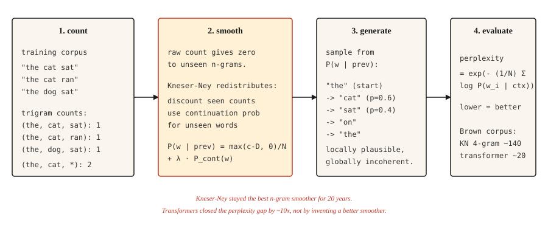

# Pembangkitan Teks Sebelum Transformer — Model Bahasa N-gram

> Bila sebuah kata mengejutkan, modelnya buruk. Perplexity mengubah kejutan menjadi angka. Smoothing menjaga angka itu tetap berhingga.

**Jenis:** Bangun
**Bahasa:** Python, TypeScript
**Prasyarat:** Fase 5 · 01 (Pemrosesan Teks), Fase 2 · 14 (Naive Bayes)
**Waktu:** ~45 menit

## Masalahnya

Sebelum transformer, sebelum RNN, sebelum embedding kata, sebuah model bahasa memprediksi kata berikutnya dengan menghitung seberapa sering kata itu mengikuti `n-1` kata sebelumnya. Hitung "the cat" → "sat" sebanyak 47 kali, "the cat" → "jumped" sebanyak 12 kali, "the cat" → "refrigerator" sebanyak 0 kali. Normalisasi untuk mendapatkan distribusi probabilitas.

Itulah model bahasa n-gram. Model ini menjalankan setiap pengenal suara, setiap pemeriksa ejaan, dan setiap sistem terjemahan mesin berbasis frasa dari 1980 sampai 2015. Model ini masih dipakai bila Anda memerlukan pemodelan bahasa di perangkat dengan biaya rendah.

Masalah yang menarik adalah apa yang harus dilakukan terhadap n-gram yang belum pernah terlihat. Model berbasis hitungan mentah memberi probabilitas nol pada apa pun yang belum pernah dilihatnya, dan itu bersifat katastropik karena kalimat itu panjang dan hampir setiap kalimat panjang memuat setidaknya satu urutan yang belum terlihat. Lima dekade riset smoothing memperbaikinya. Smoothing Kneser-Ney adalah hasilnya, dan pembelajaran modern mewarisi tradisi empirisnya.

## Konsepnya



### Permainan prediksi

Sebelum mesin-mesin ini ada, sebuah eksperimen mendefinisikan apa itu model bahasa. Tutup huruf berikutnya dari sebuah kalimat bahasa Inggris. Minta seseorang menebaknya, satu tebakan setiap kali, sampai tebakan itu benar. Catat jumlah tebakannya. Ulangi untuk beberapa ratus huruf.

Jumlah tebakan itu bukan sekadar hal sepele. Jumlah tersebut adalah pengodean ulang teks tanpa kehilangan informasi: berikan urutan jumlah tebakan kepada seorang penebak kedua yang identik, dan ia dapat membangun kembali setiap huruf, karena pada setiap posisi ia tahu persis tebakan mana yang datang lebih dulu. Pesan yang dapat dikodekan ulang dengan lebih sedikit simbol membawa lebih sedikit informasi per simbol, jadi statistik jumlah tebakan memasang batas atas pada entropi bahasa Inggris.

Shannon menjalankan eksperimen ini pada 1951 dan mendapatkan angka yang masih mengatur bidang ini. Alfabet 27 simbol (26 huruf ditambah spasi) dapat membawa `log2(27) ≈ 4.75` bit per huruf. Penebak manusia dengan 100 huruf konteks berada di antara 0,6 dan 1,3 bit per huruf. Sekitar tiga perempat bahasa Inggris adalah langkah yang sudah ditentukan. Struktur yang harus dipelajari model telah diukur sebelum ada model yang mampu mempelajarinya.

Setiap model bahasa sejak itu adalah pemain mekanis dalam permainan ini, dan setiap angka evaluasi dalam pelajaran ini adalah skor permainan tersebut:

- **Rugi cross-entropy** adalah jumlah rata-rata bit yang dibutuhkan model per simbol. Melatih model bahasa pada dasarnya meminimalkan skornya dalam permainan menebak ini.
- **Perplexity** adalah `2^bits` (atau `e^nats`): faktor percabangan yang masih dihadapi model setelah segala tebakannya. Menebak secara seragam atas 27 simbol berarti perplexity 27; pemain dengan 1 bit per huruf memiliki perplexity 2.
- **Panjang konteks adalah memori pemain.** Model trigram bermain dengan memori dua token. Transformer memainkan permainan yang sama dengan 100rb token. Aturannya tidak pernah berubah; pemainnya yang menjadi lebih baik.

Ada satu perpindahan satuan yang perlu dicatat: permainan ini memberi skor per huruf dalam bit (`log2`), sementara rumus n-gram di bawah memberi skor per token kata dalam nat (logaritma natural) — dan karena perplexity `e^H` dalam nat sama dengan `2^H` dalam bit, kedua pandangan itu adalah pengukuran yang sama dalam satuan berbeda.

```figure
prediction-game
```

**Probabilitas n-gram:** `P(w_i | w_{i-n+1}, ..., w_{i-1})`. Tetapkan `n` (biasanya 3 untuk trigram, 4 untuk 4-gram). Hitung dari hitungan:

```math
P(w \mid \text{context}) = \frac{\mathop{\mathrm{count}}(\text{context}, w)}{\mathop{\mathrm{count}}(\text{context})}
```

**Masalah hitungan nol.** Semua n-gram yang tidak muncul dalam pelatihan mendapat probabilitas nol. Sebuah studi 2007 pada korpus Brown menemukan bahwa bahkan model 4-gram pun memiliki 30% 4-gram data uji yang tidak terlihat saat pelatihan. Anda tidak dapat mengevaluasi teks nyata apa pun tanpa smoothing.

**Pendekatan smoothing, dari yang paling sederhana ke yang paling canggih:**

1. **Laplace (add-one).** Tambahkan 1 pada setiap hitungan. Sederhana, sangat buruk untuk peristiwa langka.
2. **Good-Turing.** Mengalokasikan ulang massa probabilitas dari peristiwa frekuensi tinggi ke peristiwa yang belum terlihat, berdasarkan frekuensi dari frekuensi.
3. **Interpolasi.** Gabungkan estimasi n-gram, (n-1)-gram, dan seterusnya dengan bobot yang dapat disetel.
4. **Backoff.** Bila hitungan n-gram nol, jatuh ke (n-1)-gram. Katz backoff menormalkan ini.
5. **Diskonto absolut.** Kurangi diskonto tetap `D` dari semua hitungan, lalu distribusikan ulang ke peristiwa yang belum terlihat.
6. **Kneser-Ney.** Diskonto absolut ditambah pilihan cerdas untuk model orde lebih rendah: gunakan *probabilitas kelanjutan* (berapa banyak konteks munculnya sebuah kata) alih-alih frekuensi mentah.

Wawasan Kneser-Ney itu dalam. "San Francisco" adalah bigram yang umum. Unigram "Francisco" terutama muncul setelah "San." Diskonto absolut naif memberi "Francisco" probabilitas unigram tinggi (karena hitungannya tinggi). Kneser-Ney menyadari bahwa "Francisco" hanya muncul dalam satu konteks dan menurunkan probabilitas kelanjutannya sesuai hal itu. Hasilnya: bigram baru yang berakhir dengan "Francisco" mendapat probabilitas rendah yang tepat.

**Evaluasi: perplexity.** Eksponen dari rata-rata negative log-likelihood per kata pada himpunan uji terpisah. Lebih rendah lebih baik. Perplexity 100 berarti model itu sama bingungnya dengan memilih secara seragam dari 100 kata.

```math
\text{perplexity} = \exp\left(-\frac{1}{N} \sum_i \log P(w_i \mid \text{context}_i)\right)
```

```figure
ngram-backoff
```

## Bangunlah

### Langkah 1: hitungan trigram

```python
from collections import Counter, defaultdict


def train_ngram(corpus_tokens, n=3):
    ngrams = Counter()
    contexts = Counter()
    for sentence in corpus_tokens:
        padded = ["<s>"] * (n - 1) + sentence + ["</s>"]
        for i in range(len(padded) - n + 1):
            ctx = tuple(padded[i:i + n - 1])
            word = padded[i + n - 1]
            ngrams[ctx + (word,)] += 1
            contexts[ctx] += 1
    return ngrams, contexts


def raw_probability(ngrams, contexts, context, word):
    ctx = tuple(context)
    if contexts.get(ctx, 0) == 0:
        return 0.0
    return ngrams.get(ctx + (word,), 0) / contexts[ctx]
```

Masukannya adalah daftar kalimat yang sudah di-tokenisasi. Keluarannya adalah hitungan n-gram dan hitungan konteks. `<s>` dan `</s>` adalah batas kalimat.

### Langkah 2: smoothing Laplace

```python
def laplace_probability(ngrams, contexts, vocab_size, context, word):
    ctx = tuple(context)
    numerator = ngrams.get(ctx + (word,), 0) + 1
    denominator = contexts.get(ctx, 0) + vocab_size
    return numerator / denominator
```

Tambahkan 1 pada setiap hitungan. Ini melakukan smoothing, tetapi mengalokasikan terlalu banyak massa pada peristiwa yang belum terlihat sehingga juga merugikan peristiwa langka yang sebenarnya diketahui.

### Langkah 3: Kneser-Ney (bigram, interpolasi)

```python
def kneser_ney_bigram_model(corpus_tokens, discount=0.75):
    unigrams = Counter()
    bigrams = Counter()
    unigram_contexts = defaultdict(set)

    for sentence in corpus_tokens:
        padded = ["<s>"] + sentence + ["</s>"]
        for i, w in enumerate(padded):
            unigrams[w] += 1
            if i > 0:
                prev = padded[i - 1]
                bigrams[(prev, w)] += 1
                unigram_contexts[w].add(prev)

    total_unique_bigrams = sum(len(ctx_set) for ctx_set in unigram_contexts.values())
    continuation_prob = {
        w: len(ctx_set) / total_unique_bigrams for w, ctx_set in unigram_contexts.items()
    }

    context_totals = Counter()
    for (prev, w), count in bigrams.items():
        context_totals[prev] += count

    unique_follow = defaultdict(set)
    for (prev, w) in bigrams:
        unique_follow[prev].add(w)

    def prob(prev, w):
        count = bigrams.get((prev, w), 0)
        denom = context_totals.get(prev, 0)
        if denom == 0:
            return continuation_prob.get(w, 1e-9)
        first_term = max(count - discount, 0) / denom
        lambda_prev = discount * len(unique_follow[prev]) / denom
        return first_term + lambda_prev * continuation_prob.get(w, 1e-9)

    return prob
```

Ada tiga bagian yang bergerak. `continuation_prob` menangkap pertanyaan "dalam berapa banyak konteks berbeda kata ini muncul?" (inovasi Kneser-Ney). `lambda_prev` adalah massa yang dibebaskan oleh diskonto, dipakai untuk memberi bobot pada backoff. Probabilitas akhir adalah suku utama yang didiskonto ditambah suku kelanjutan yang diberi bobot.

### Langkah 4: membangkitkan teks dengan pengambilan sampel

```python
import random


def generate(prob_fn, vocab, prefix, max_len=30, seed=0):
    rng = random.Random(seed)
    tokens = list(prefix)
    for _ in range(max_len):
        candidates = [(w, prob_fn(tokens[-1], w)) for w in vocab]
        total = sum(p for _, p in candidates)
        r = rng.random() * total
        acc = 0.0
        for w, p in candidates:
            acc += p
            if r <= acc:
                tokens.append(w)
                break
        if tokens[-1] == "</s>":
            break
    return tokens
```

Ambil sampel sebanding dengan probabilitas. Setiap seed selalu memberi keluaran yang berbeda. Untuk keluaran yang mirip beam search, pilih argmax pada setiap langkah (greedy) dan tambahkan kenop acakan kecil (temperatur).

### Langkah 5: perplexity

```python
import math


def perplexity(prob_fn, sentences):
    total_log_prob = 0.0
    total_tokens = 0
    for sentence in sentences:
        padded = ["<s>"] + sentence + ["</s>"]
        for i in range(1, len(padded)):
            p = prob_fn(padded[i - 1], padded[i])
            total_log_prob += math.log(max(p, 1e-12))
            total_tokens += 1
    return math.exp(-total_log_prob / total_tokens)
```

Lebih rendah lebih baik. Pada korpus Brown, model 4-gram KN yang disetel dengan baik mencapai perplexity sekitar 140. Model bahasa transformer mencapai 15-30 pada himpunan uji yang sama. Selisihnya sekitar 10 kali lipat. Selisih itulah yang membuat bidang ini bergerak maju.

## Gunakan

- **Pengajaran NLP klasik.** Paparan paling jelas tentang smoothing, MLE, dan perplexity yang bisa Anda dapatkan.
- **KenLM.** Pustaka n-gram produksi. Dipakai sebagai penilai ulang dalam sistem pengenalan suara dan MT yang mengutamakan latensi rendah.
- **Autocomplete di perangkat.** Model trigram pada papan ketik. Masih.
- **Baseline.** Selalu hitung perplexity model bahasa n-gram sebelum menyatakan model neural Anda bagus. Bila transformer Anda tidak mengalahkan KN dengan margin jauh, ada yang salah.

## Kirimkan

Simpan sebagai `outputs/prompt-lm-baseline.md`:

```markdown
---
name: lm-baseline
description: Bangun baseline model bahasa n-gram yang dapat diulang sebelum melatih model bahasa neural.
phase: 5
lesson: 16
---

Diberikan korpus dan penggunaan sasaran (prediksi kata berikutnya, penilaian ulang, baseline perplexity), keluarkan:

1. Orde n-gram. Trigram untuk bahasa Inggris umum, 4-gram bila korpus besar, 5-gram untuk penilaian ulang pengenalan suara.
2. Smoothing. Kneser-Ney termodifikasi adalah default; Laplace hanya untuk pengajaran.
3. Pustaka. `kenlm` untuk produksi, `nltk.lm` untuk pengajaran, buat sendiri hanya untuk mempelajari matematikanya.
4. Evaluasi. Perplexity pada data terpisah dengan tokenisasi yang konsisten antara himpunan latih dan uji.

Tolak melaporkan perplexity yang dihitung dengan tokenisasi berbeda antara sistem yang dibandingkan — angka perplexity hanya dapat dibandingkan di bawah tokenisasi yang identik. Beri tanda pada tingkat OOV dalam himpunan uji; KN menangani OOV dengan buruk kecuali Anda menyediakan token <UNK> khusus selama pelatihan.
```

## Latihan

1. **Mudah.** Latih model bahasa trigram pada korpus Shakespeare berisi 1.000 kalimat. Hasilkan 20 kalimat. Kalimat-kalimat itu akan tampak masuk akal secara lokal tetapi tidak koheren secara global. Itu demo kanoniknya.
2. **Sedang.** Terapkan perplexity untuk model KN Anda pada pembagian Shakespeare yang terpisah. Bandingkan dengan Laplace. Anda seharusnya melihat KN menurunkan perplexity 30-50%.
3. **Sulit.** Bangun korektor ejaan trigram: diberikan sebuah kata yang salah eja dan konteksnya, hasilkan koreksi dan urutkan berdasarkan probabilitas konteks di bawah model bahasa. Evaluasi pada korpus ejaan Birkbeck (publik).

## Istilah Kunci

| Istilah | Yang dikatakan orang | Yang sebenarnya dimaksud |
|------|-----------------|-----------------------|
| N-gram | Urutan kata | Urutan `n` token berurutan. |
| Smoothing | Menghindari nol | Mengalokasikan ulang massa probabilitas agar peristiwa yang belum terlihat mendapat probabilitas bukan nol. |
| Perplexity | Metrik kualitas model bahasa | `exp(-average log-prob)` pada data terpisah. Lebih rendah lebih baik. |
| Backoff | Jatuh ke konteks lebih pendek | Bila hitungan trigram nol, gunakan bigram. Katz backoff meresmikan ini. |
| Kneser-Ney | Smoothing terbaik untuk n-gram | Diskonto absolut + probabilitas kelanjutan untuk model orde lebih rendah. |
| Probabilitas kelanjutan | Khusus KN | `P(w)` yang dibobot oleh banyaknya konteks kemunculan `w`, bukan oleh hitungan mentah. |
| Entropi teks | Informasi per simbol | Rata-rata bit yang dibutuhkan untuk mengode simbol berikutnya dengan konteks sebagai syaratnya. Estimasi Shannon 1951 untuk bahasa Inggris cetak dengan konteks hingga 100 huruf: 0,6-1,3 bit/huruf, diukur sebelum ada model apa pun. |

## Bacaan Lanjutan

- [Shannon (1951). Prediction and Entropy of Printed English](https://www.princeton.edu/~wbialek/rome/refs/shannon_51.pdf) — eksperimen permainan menebak yang mendefinisikan sasaran yang masih dioptimalkan setiap model bahasa.
- [Jurafsky dan Martin — Speech and Language Processing, Bab 3 (draf 2026)](https://web.stanford.edu/~jurafsky/slp3/3.pdf) — pembahasan kanonik model bahasa n-gram dan smoothing.
- [Chen dan Goodman (1998). An Empirical Study of Smoothing Techniques for Language Modeling](https://dash.harvard.edu/handle/1/25104739) — makalah yang menetapkan Kneser-Ney sebagai smoothing n-gram terbaik.
- [Kneser dan Ney (1995). Improved Backing-off for M-gram Language Modeling](https://ieeexplore.ieee.org/document/479394) — makalah KN asli.
- [KenLM](https://kheafield.com/code/kenlm/) — model bahasa n-gram produksi yang cepat, masih dipakai pada 2026 untuk aplikasi yang sensitif terhadap latensi.
