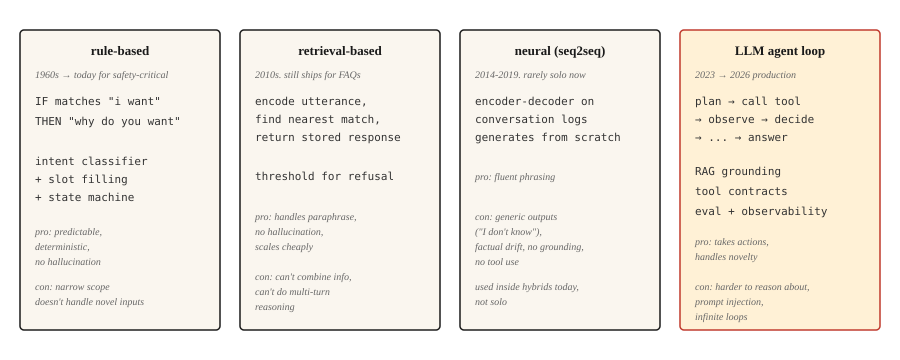

# Chatbot — Dari Berbasis Aturan ke Neural ke Agen LLM

> ELIZA menjawab dengan pencocokan pola. DialogFlow memetakan intent. GPT menjawab dari bobot. Claude menjalankan alat dan memverifikasi. Setiap era menyelesaikan kegagalan terburuk era sebelumnya.

**Jenis:** Learn
**Bahasa:** Python, TypeScript
**Prasyarat:** Fase 5 · 13 (Question Answering), Fase 5 · 14 (Information Retrieval)
**Waktu:** ~75 menit

## Masalahnya

Seorang pengguna berkata "I want to change my flight." Sistem harus mencari tahu apa yang diinginkan pengguna, informasi apa yang hilang, bagaimana cara mendapatkannya, dan bagaimana menyelesaikan tindakannya. Lalu pengguna berkata "wait, what if I cancel instead?" dan sistem harus mengingat konteks, beralih tugas, dan menjaga keadaan (state).

Percakapan itu sulit bagi sistem ML. Masukannya terbuka. Keluarannya harus koheren selama banyak giliran. Sistem mungkin perlu bertindak pada dunia nyata (mengubah penerbangan, mendebit kartu). Setiap langkah yang salah terlihat oleh pengguna.

Arsitektur chatbot telah menyusuri empat paradigma, masing-masing muncul karena paradigma sebelumnya gagal dengan cara yang terlalu jelas. Pelajaran ini menelusurinya secara berurutan. Lanskap produksi 2026 adalah perpaduan dari dua paradigma terakhir.

## Konsepnya



### Setengah abad berskrip, 1950-2001

Paradigma pertama tidak bertahan lima tahun. Ia bertahan lima puluh. Mengetahui lintasannya penting karena setiap sistem di dalamnya adalah mesin yang sama — cocokkan masukan, keluarkan tanggapan siap pakai, perbarui sedikit keadaan — dan lima puluh tahun menambahkan aturan pada mesin itu tidak pernah menghasilkan kasus umum. Batas itulah yang menjadi alasan paradigma dua hingga empat ada.

**1950.** Turing menghindari pertanyaan "can machines think?" dengan mengajukan pengganti operasional: jika seorang interogator tidak dapat membedakan mesin dari manusia melalui teleks, pertanyaan filosofis itu menjadi gugur. Percakapan menjadi benchmark bidang ini sebelum bidang ini punya nama.

**1956.** Namanya muncul — lokakarya musim panas di Dartmouth menciptakan istilah "artificial intelligence" dengan dugaan bahwa setiap ciri kecerdasan "can in principle be so precisely described that a machine can be made to simulate it." Usulan itu menganggarkan dua bulan untuk kemajuan yang substansial.

**1966.** ELIZA menghadirkan trik refleksi yang Anda bangun di Langkah 1: aturan dekomposisi menarik potongan dari masukan, aturan reassembly menggemakannya kembali sebagai pertanyaan. Sekitar 200 pola, nol keadaan, nol pemahaman — dan pengguna tetap mencurahkan isi hati kepadanya. Weizenbaum menghabiskan sisa kariernya dengan terkejut atas betapa sedikit mesin yang dibutuhkan.

**1972.** PARRY, dibangun di Stanford untuk memodelkan paranoia, menambahkan kepingan yang tidak dimiliki ELIZA: keadaan internal. Variabel numerik untuk ketakutan, kemarahan, dan ketidakpercayaan diperbarui pada setiap giliran dan menentukan skrip mana yang menyala berikutnya, sehingga masukan yang identik menghasilkan tanggapan berbeda sesuai percakapan sejauh ini. Dalam uji transkrip buta, psikiater membedakan PARRY dari pasien manusia hanya secara kebetulan. Ia adalah leluhur langsung dari persona conditioning — system prompt yang diwujudkan sebagai tiga bilangan float. Tahun yang sama, kedua bot diarahkan satu ke lain melalui ARPANET: skrip terapis mewawancarai mesin keadaan paranoia, percakapan bot-ke-bot pertama di jaringan.

**1995.** ALICE menskalakan resep ELIZA dengan AIML, dialek XML untuk pasangan pola-templat. Sekitar 40.000 kategori yang ditulis tangan, tiga kemenangan Loebner Prize. Ia membuktikan hukum penskalaan sistem berbasis aturan: lebih banyak aturan membeli cakupan, tidak pernah keumuman. Setiap aturan adalah liabilitas yang harus dipelihara seseorang.

**2001.** SmarterChild membawa resep itu ke hadapan 30 juta pengguna pesan instan dan menambahkan pencarian backend — cuaca, saham, jadwal film — yang disisipkan ke dalam templat. Jika Anda menyipitkan mata, itu adalah pemanggilan alat dengan kostum tahun 2001: uraikan intent, panggil layanan, render hasil ke dalam balasan.

Lima puluh tahun, satu mekanisme, jumlah aturan yang terus naik. Paradigma ini berakhir bukan karena seseorang membuktikannya salah, melainkan karena biaya pemeliharaan mesin keadaan yang ditulis tangan tumbuh secara linear dengan cakupan, sementara ekspektasi pengguna tumbuh mengikuti apa pun yang mereka lihat minggu lalu.

```figure
chatbot-lineage
```

**Berbasis aturan (ELIZA, AIML, DialogFlow).** Pola yang ditulis manual mencocokkan masukan pengguna dan menghasilkan tanggapan. Klasifier intent mengarahkan ke alur yang sudah ditentukan. Mesin keadaan pengisian slot mengumpulkan informasi yang dibutuhkan. Bekerja dengan sangat baik dalam ruang lingkup sempit yang menjadi tujuannya. Gagal seketika di luar itu. Masih dirilis di domain kritis-keamanan (autentikasi perbankan, pemesanan maskapai) di mana halusinasi tidak ditoleransi.

**Berbasis pengambilan (retrieval).** Sistem bergaya FAQ. Encode setiap pasangan (ucapan, tanggapan). Saat berjalan, encode pesan pengguna dan ambil tanggapan tersimpan yang terdekat. Pikirkan fitur klasik "similar articles" milik Zendesk. Menangani parafrasa lebih baik daripada aturan. Tidak ada generasi, jadi tidak ada halusinasi.

**Neural (seq2seq).** Encoder-decoder yang dilatih pada log percakapan. Menghasilkan tanggapan dari nol. Lancar, tetapi rentan terhadap keluaran generik ("I don't know") dan pergeseran fakta. Tidak pernah bisa diandalkan tetap pada topik. Itulah sebabnya Google, Facebook, dan Microsoft semuanya punya chatbot yang mengecewakan pada 2016-2019.

**Agen LLM.** Model bahasa yang dibungkus dalam loop yang merencanakan, memanggil alat, dan memverifikasi hasil. Bukan chatbot dengan prompt panjang. Sebuah loop agen: rencanakan → panggil alat → amati hasil → putuskan langkah berikutnya. Penumpuan yang mengutamakan pengambilan (RAG) mencegahnya berhalusinasi. Panggilan alat membuatnya benar-benar melakukan sesuatu. Inilah arsitektur tahun 2026.

Keempat paradigma bukanlah pengganti yang berurutan. Chatbot produksi 2026 melewati keempatnya: berbasis aturan untuk autentikasi dan tindakan destruktif, pengambilan untuk FAQ, generasi neural untuk frasa yang alami, agen LLM untuk pertanyaan terbuka yang ambigu.

## Bangunlah

### Langkah 1: pencocokan pola berbasis aturan

```python
import re


class RulePattern:
    def __init__(self, pattern, response_template):
        self.regex = re.compile(pattern, re.IGNORECASE)
        self.template = response_template


PATTERNS = [
    RulePattern(r"my name is (\w+)", "Nice to meet you, {0}."),
    RulePattern(r"i (need|want) (.+)", "Why do you {0} {1}?"),
    RulePattern(r"i feel (.+)", "Why do you feel {0}?"),
    RulePattern(r"(.*)", "Tell me more about that."),
]


def rule_based_respond(user_input):
    for pattern in PATTERNS:
        m = pattern.regex.match(user_input.strip())
        if m:
            return pattern.template.format(*m.groups())
    return "I don't understand."
```

ELIZA dalam 20 baris. Trik refleksi ("I feel sad" → "Why do you feel sad") adalah demo psikoterapis kanonik dari Weizenbaum 1966. Masih tetap instruktif.

### Langkah 2: berbasis pengambilan (FAQ)

Cuplikan ilustratif ini memerlukan `pip install sentence-transformers` (yang menarik torch). `code/main.py` yang dapat dijalankan untuk pelajaran ini menggunakan kesamaan Jaccard dari pustaka standar sebagai gantinya, agar pelajaran ini berjalan tanpa dependensi eksternal.

```python
from sentence_transformers import SentenceTransformer
import numpy as np


FAQ = [
    ("how do i reset my password", "Go to Settings > Security > Reset Password."),
    ("how do i cancel my order", "Go to Orders, find the order, click Cancel."),
    ("what is your return policy", "30-day returns on unused items, original packaging."),
]


encoder = SentenceTransformer("sentence-transformers/all-MiniLM-L6-v2")
faq_questions = [q for q, _ in FAQ]
faq_embeddings = encoder.encode(faq_questions, normalize_embeddings=True)


def faq_respond(user_input, threshold=0.5):
    q_emb = encoder.encode([user_input], normalize_embeddings=True)[0]
    sims = faq_embeddings @ q_emb
    best = int(np.argmax(sims))
    if sims[best] < threshold:
        return None
    return FAQ[best][1]
```

Penolakan berbasis ambang batas adalah keputusan desain kuncinya. Jika kecocokan terbaik tidak cukup dekat, kembalikan `None` dan biarkan sistem melakukan eskalasi.

### Langkah 3: generasi neural (baseline)

Gunakan encoder-decoder kecil yang disetel dengan instruksi (FLAN-T5) atau model percakapan yang disetel halus. Sendirian tidak bisa dipakai untuk produksi pada 2026 (kontradiksi, pergeseran topik, omong kosong faktual), tetapi tetap dirilis di dalam sistem hibrida untuk frasa yang alami. Model decoder-only bergaya DialoGPT memerlukan pemisah giliran dan penanganan EOS yang eksplisit untuk menghasilkan balasan yang koheren; pipeline text2text FLAN-T5 bekerja langsung untuk contoh pengajaran.

```python
from transformers import pipeline

chatbot = pipeline("text2text-generation", model="google/flan-t5-small")

response = chatbot("Respond politely to: Hi there!", max_new_tokens=40)
print(response[0]["generated_text"])
```

### Langkah 4: loop agen LLM

Bentuk produksi tahun 2026:

```python
def agent_loop(user_message, tools, llm, max_steps=5):
    history = [{"role": "user", "content": user_message}]
    for _ in range(max_steps):
        response = llm(history, tools=tools)
        tool_call = response.get("tool_call")
        if tool_call:
            tool_name = tool_call.get("name")
            args = tool_call.get("arguments")
            if not isinstance(tool_name, str) or tool_name not in tools:
                history.append({"role": "assistant", "tool_call": tool_call})
                history.append({"role": "tool", "name": str(tool_name), "content": f"error: unknown tool {tool_name!r}"})
                continue
            if not isinstance(args, dict):
                history.append({"role": "assistant", "tool_call": tool_call})
                history.append({"role": "tool", "name": tool_name, "content": f"error: arguments must be a dict, got {type(args).__name__}"})
                continue
            fn = tools[tool_name]
            result = fn(**args)
            history.append({"role": "assistant", "tool_call": tool_call})
            history.append({"role": "tool", "name": tool_name, "content": result})
        else:
            return response["content"]
    return "I could not complete the task in the step budget."
```

Ada tiga hal yang perlu disebut. Alat adalah fungsi yang dapat dipanggil LLM. Loop berhenti ketika LLM mengembalikan jawaban akhir alih-alih panggilan alat. Anggaran langkah mencegah loop tak berujung pada tugas yang ambigu.

Produksi sungguhan menambahkan: penumpuan yang mengutamakan pengambilan (menyuntik dokumen relevan sebelum setiap panggilan LLM), pagar pengaman (guardrails) (menolak tindakan destruktif tanpa konfirmasi), observabilitas (mencatat setiap langkah), dan evaluasi (pemeriksaan otomatis bahwa perilaku agen tetap sesuai spesifikasi).

### Langkah 5: routing hibrida

```python
def hybrid_chat(user_input):
    if is_destructive_action(user_input):
        return structured_flow(user_input)

    faq_answer = faq_respond(user_input, threshold=0.6)
    if faq_answer:
        return faq_answer

    return agent_loop(user_input, tools, llm)


def is_destructive_action(text):
    danger_words = ["delete", "cancel", "charge", "refund", "transfer"]
    return any(w in text.lower() for w in danger_words)
```

Pola ini: aturan deterministik untuk apa pun yang destruktif, pengambilan untuk FAQ siap pakai, agen LLM untuk sisanya. Itulah yang dirilis dalam sistem dukungan pelanggan tahun 2026.

## Gunakan

Tumpukan tahun 2026:

| Kasus penggunaan | Arsitektur |
|---------|---------------|
| Pemesanan, pembayaran, autentikasi | Mesin keadaan berbasis aturan + pengisian slot |
| FAQ dukungan pelanggan | Pengambilan atas jawaban yang dikurasi |
| Percakapan bantuan terbuka | Agen LLM dengan RAG + panggilan alat |
| Alat internal / asisten IDE | Agen LLM dengan panggilan alat (cari, baca, tulis) |
| Chatbot pendamping / tokoh | LLM tersetel dengan system prompt persona, pengambilan pada pengetahuan |

Selalu gunakan routing hibrida dalam produksi. Tidak ada satu arsitektur pun yang menangani setiap permintaan dengan baik. Lapisan routing itu sendiri biasanya berupa klasifier intent kecil.

## Mode kegagalan yang tetap dirilis

- **Fabrikasi yakin.** Agen LLM mengklaim telah menyelesaikan tindakan yang tidak dilakukannya. Mitigasi: verifikasi hasil, catat panggilan alat, jangan pernah biarkan LLM mengklaim telah melakukan sesuatu tanpa pengembalian alat yang berhasil.
- **Prompt injection.** Pengguna menyisipkan teks yang menimpa system prompt. Peringkat LLM01 dalam OWASP Top 10 for LLM Applications 2025. Dua jenis: injeksi langsung (ditempel ke dalam percakapan) dan injeksi tidak langsung (disembunyikan dalam dokumen, surel, atau keluaran alat yang dibaca agen).

  Tingkat serangan bervariasi menurut skenario. Tingkat keberhasilan yang terukur berkisar ~0,5-8,5% pada berbagai model frontier dalam benchmark penggunaan alat umum dan pemrograman. Pengaturan berisiko tinggi tertentu (serangan adaptif terhadap agen pemrograman AI, orkestrasi yang rentan) telah mencapai ~84%. CVE produksi mencakup EchoLeak (CVE-2025-32711, CVSS 9,3) — cacat eksfiltrasi data zero-click di Microsoft 365 Copilot yang dipicu oleh surel yang dikendalikan penyerang.

  Mitigasi: perlakukan masukan pengguna sebagai tidak tepercaya di seluruh loop; bersihkan sebelum panggilan alat; isolasi keluaran alat dari prompt utama; gunakan pola Plan-Verify-Execute (PVE) di mana agen merencanakan terlebih dahulu, lalu memverifikasi setiap tindakan terhadap rencana itu sebelum menjalankannya (ini mencegah hasil alat menyuntikkan tindakan baru yang tidak direncanakan); minta konfirmasi pengguna untuk tindakan destruktif; terapkan prinsip hak least-privilege pada cakupan alat.

  Tidak ada teknik prompt engineering yang sepenuhnya menghilangkan risiko ini. Lapisan pertahanan runtime eksternal (LLM Guard, validasi allowlist, deteksi anomali semantik) tetap diperlukan.
- **Scope creep.** Agen keluar dari tugas karena panggilan alat mengembalikan info yang hanya terkait pinggiran. Mitigasi: persempit kontrak alat; jaga agar system prompt tetap terfokus; tambahkan evaluasi untuk laju keluar dari topik.
- **Loop tak berujung.** Agen terus memanggil alat yang sama. Mitigasi: anggaran langkah, deduplikasi panggilan alat, LLM judge untuk "are we making progress."
- **Kehabisan jendela konteks.** Percakapan panjang mendorong giliran paling awal keluar dari konteks. Mitigasi: ringkas giliran lama, ambil giliran masa lalu yang relevan berdasarkan kesamaan, atau gunakan model konteks panjang.

## Kirimkan

Simpan sebagai `outputs/skill-chatbot-architect.md`:

```markdown
---
name: chatbot-architect
description: Rancang tumpukan chatbot untuk suatu kasus penggunaan tertentu.
version: 1.0.0
phase: 5
lesson: 17
tags: [nlp, agents, chatbot]
---

Dengan konteks produk tertentu (kebutuhan pengguna, batasan kepatuhan, alat yang tersedia, volume data), keluarkan:

1. Arsitektur. Berbasis aturan, berbasis pengambilan (retrieval), neural, agen LLM, atau hibrida (tentukan jalur mana yang menuju ke mana).
2. Pilihan LLM jika berlaku. Sebutkan keluarga model (Claude, GPT-4, Llama-3.1, Mixtral). Sesuaikan dengan kualitas penggunaan alat dan biaya.
3. Strategi penumpuan (grounding). Sumber RAG, metode pengambilan (lihat pelajaran 14), kontrak alat.
4. Rencana evaluasi. Tingkat keberhasilan tugas, kebenaran panggilan alat, tingkat keluar dari topik, tingkat halusinasi pada dialog yang disisihkan.

Tolak merekomendasikan agen LLM murni untuk tindakan destruktif apa pun (pembayaran, penghapusan akun, modifikasi data) tanpa alur konfirmasi terstruktur. Tolak melewati audit prompt injection jika agen memiliki akses tulis ke apa pun.
```

## Latihan

1. **Mudah.** Terapkan fungsi tanggapan berbasis aturan di atas dengan 10 pola untuk bot pemesanan kedai kopi. Uji kasus tepi: pesanan ganda, perubahan, pembatalan, intent yang tidak jelas.
2. **Sedang.** Bangun FAQ hibrida + fallback LLM. 50 entri FAQ siap pakai untuk produk SaaS, fallback LLM dengan pengambilan atas situs dokumentasi. Ukur laju penolakan dan akurasi pada 100 pertanyaan dukungan nyata.
3. **Sulit.** Terapkan loop agen di atas dengan tiga alat (cari, baca-data-pengguna, kirim-surel). Jalankan evaluasi dengan 50 skenario uji termasuk percobaan prompt injection. Laporkan laju keluar topik, laju tugas gagal, dan keberhasilan injeksi apa pun.

## Istilah Kunci

| Istilah | Yang orang katakan | Yang sebenarnya dimaksud |
|------|-----------------|-----------------------|
| Intent | Apa yang diinginkan pengguna | Label kategori (book_flight, reset_password). Diarahkan ke sebuah handler. |
| Slot | Sepotong informasi | Parameter yang dibutuhkan bot (tanggal, tujuan). Pengisian slot adalah urutan pertanyaan. |
| RAG | Pengambilan plus generasi | Ambil dokumen relevan, lalu penuhi (ground) tanggapan LLM. |
| Panggilan alat | Pemanggilian fungsi | LLM mengeluarkan panggilan terstruktur dengan nama + argumen. Runtime menjalankan, mengembalikan hasil. |
| Loop agen | Rencanakan, bertindak, verifikasi | Kontroler yang menjalankan panggilan LLM bergantian dengan panggilan alat sampai tugas selesai. |
| Prompt injection | Pengguna menyerang prompt | Masukan jahat yang mencoba menimpa system prompt. |

## Bacaan Lebih Lanjut

- [Turing (1950). Computing Machinery and Intelligence](https://academic.oup.com/mind/article/LIX/236/433/986238) — makalah yang menjadikan percakapan sebagai benchmark bidang ini.
- [Weizenbaum (1966). ELIZA — A Computer Program For the Study of Natural Language Communication](https://web.stanford.edu/class/cs124/p36-weizenabaum.pdf) — makalah chatbot berbasis aturan yang asli.
- [Colby, Weber, Hilf (1971). Artificial Paranoia](https://doi.org/10.1016/0004-3702(71)90002-6) — arsitektur variabel afek PARRY, chatbot pertama yang memiliki keadaan.
- [Thoppilan et al. (2022). LaMDA: Language Models for Dialog Applications](https://arxiv.org/abs/2201.08239) — makalah chatbot neural akhir Google, tepat sebelum agen LLM mengambil alih.
- [Yao et al. (2022). ReAct: Synergizing Reasoning and Acting in Language Models](https://arxiv.org/abs/2210.03629) — makalah yang memberi nama pada pola loop agen.
- [Panduan Anthropic tentang membangun agen yang efektif](https://www.anthropic.com/research/building-effective-agents) — panduan produksi 2024 yang masih berlaku pada 2026.
- [Greshake et al. (2023). Not what you've signed up for: Compromising Real-World LLM-Integrated Applications with Indirect Prompt Injection](https://arxiv.org/abs/2302.12173) — makalah prompt injection.
- [OWASP Top 10 for LLM Applications 2025 — LLM01 Prompt Injection](https://genai.owasp.org/llmrisk/llm01-prompt-injection/) — peringkat yang menjadikan prompt injection sebagai perhatian keamanan utama.
- [AWS — Securing Amazon Bedrock Agents against Indirect Prompt Injections](https://aws.amazon.com/blogs/machine-learning/securing-amazon-bedrock-agents-a-guide-to-safeguarding-against-indirect-prompt-injections/) — pertahanan orkestrasi praktis termasuk Plan-Verify-Execute dan alur konfirmasi pengguna.
- [EchoLeak (CVE-2025-32711)](https://www.vectra.ai/topics/prompt-injection) — CVE kanonik eksfiltrasi data zero-click dari prompt injection tidak langsung. Kasus referensi untuk alasan agen dengan akses tulis memerlukan pertahanan runtime.
