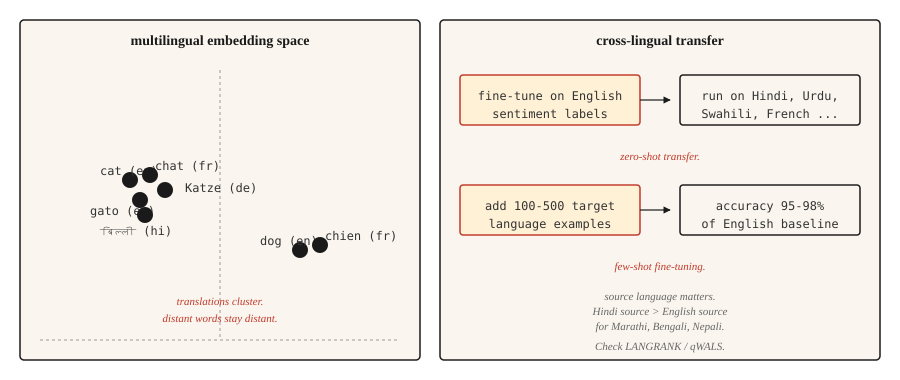

# NLP Multibahasa

> Satu model, 100+ bahasa, nol data pelatihan untuk sebagian besar bahasa itu. Transfer lintas bahasa adalah keajaiban praktis dekade 2020-an.

**Jenis:** Learn
**Bahasa:** Python, TypeScript
**Prasyarat:** Fase 5 · 04 (GloVe, FastText, Subword), Fase 5 · 11 (Machine Translation)
**Waktu:** ~45 menit

## Masalahnya

Bahasa Inggris punya miliaran contoh berlabel. Bahasa Urdu punya ribuan. Bahasa Maithili hampir tidak punya. Sistem NLP praktis apa pun yang melayani audiens global harus bekerja pada ekor panjang bahasa-bahasa yang tidak memiliki data pelatihan spesifik tugas.

Model multibahasa mengatasi ini dengan melatih satu model pada banyak bahasa secara bersamaan. Representasi bersama membuat model dapat mentransfer keterampilan yang dipelajari di bahasa sumber daya tinggi ke bahasa sumber daya rendah. Setel model dengan analisis sentimen bahasa Inggris, dan model itu menghasilkan prediksi sentimen yang mengejutkan baik pada bahasa Urdu langsung dari kotaknya. Itulah transfer zero-shot lintas bahasa, dan ia telah membentuk ulang cara NLP dirilis ke seluruh dunia.

Pelajaran ini menyebut trade-off, model-model kanonik, dan satu keputusan yang sering membuat tim baru dalam kerja multibahasa tersandung: memilih bahasa sumber untuk transfer.

## Konsepnya



**Kosakata bersama.** Model multibahasa menggunakan tokenizer SentencePiece atau WordPiece yang dilatih pada teks dari semua bahasa target. Kosakatanya dibagi: unit subkata yang sama mewakili morfem yang sama di bahasa-bahasa yang terkait. `anti-` dalam bahasa Inggris dan Italia mendapat token yang sama.

**Representasi bersama.** Transformer yang pra-dilatih dengan masked language modeling pada banyak bahasa mempelajari bahwa kalimat yang serupa secara semantik dalam bahasa berbeda menghasilkan keadaan tersembunyi yang serupa. mBERT, XLM-R, dan NLLB semuanya menunjukkan ini. Embedding untuk "cat" dalam bahasa Inggris berkerumun dekat "chat" dalam bahasa Prancis dan "gato" dalam bahasa Spanyol, dan embedding kalimat lengkap juga demikian.

**Transfer zero-shot.** Setel model dengan data berlabel dalam satu bahasa (biasanya Inggris). Saat inferensi, jalankan pada bahasa lain pun yang didukung model. Tidak diperlukan label bahasa target. Hasilnya kuat untuk bahasa yang secara tipologis terkait dan lebih lemah untuk yang jauh.

**Fine-tuning few-shot.** Tambahkan 100-500 contoh berlabel dalam bahasa target. Akurasi melonjak ke 95-98% dari baseline Inggris pada tugas klasifikasi. Ini adalah tuas paling hemat biaya dalam NLP multibahasa.

## Model-modelnya

| Model | Tahun | Cakupan | Catatan |
|-------|------|----------|-------|
| mBERT | 2018 | 104 bahasa | Dilatih pada Wikipedia. LM multibahasa praktis pertama. Lemah pada bahasa sumber daya rendah. |
| XLM-R | 2019 | 100 bahasa | Dilatih pada CommonCrawl (jauh lebih besar daripada Wikipedia). Menetapkan baseline lintas bahasa. Base 270M, Large 550M. |
| XLM-V | 2023 | 100 bahasa | XLM-R dengan kosakata 1 juta token (vs 250 ribu). Lebih baik pada bahasa sumber daya rendah. |
| mT5 | 2020 | 101 bahasa | Arsitektur T5 untuk generasi multibahasa. |
| NLLB-200 | 2022 | 200 bahasa | Model terjemahan Meta; mencakup 55 bahasa sumber daya rendah. |
| BLOOM | 2022 | 46 bahasa + 13 bahasa pemrograman | LLM terbuka 176B yang dilatih secara multibahasa. |
| Aya-23 | 2024 | 23 bahasa | LLM multibahasa dari Cohere. Kuat pada bahasa Arab, Hindi, Swahili. |

Pilih berdasarkan kasus penggunaan. Klasifikasi bekerja baik dengan XLM-R-base sebagai pilihan default yang masuk akal. Tugas generasi memerlukan mT5 atau NLLB tergantung terjemahan versus generasi terbuka. Pekerjaan bergaya LLM dipasangkan dengan Aya-23 atau Claude menggunakan prompt multibahasa eksplisit.

## Keputusan bahasa sumber (riset 2026)

Kebanyakan tim menjadikan Inggris sebagai sumber fine-tuning secara default. Riset terkini (2026) menunjukkan ini sering salah.

Kesamaan bahasa memprediksi kualitas transfer lebih baik daripada ukuran korpus mentah. Untuk target bahasa Slavia, Jerman atau Rusia sering mengalahkan Inggris. Untuk target bahasa Indo-Arya, Hindi sering mengalahkan Inggris. Metrik kesamaan **qWALS** (2026, berbasis fitur World Atlas of Language Structures) mengkuantifikasi hal ini. **LANGRANK** (Lin et al., ACL 2019) adalah metode terpisah yang lebih awal, yang memberi peringkat calon bahasa sumber dari kombinasi kesamaan linguistik, ukuran korpus, dan kekerabatan genetik.

Aturan praktis: jika bahasa target Anda memiliki kerabat sumber daya tinggi yang secara tipologis dekat, coba fine-tuning pada bahasa itu terlebih dahulu, lalu bandingkan dengan fine-tuning Inggris.

```figure
n5-crosslingual-bridge
```

## Bangunlah

### Langkah 1: klasifikasi lintas bahasa zero-shot

```python
from transformers import AutoTokenizer, AutoModelForSequenceClassification
import torch

tok = AutoTokenizer.from_pretrained("joeddav/xlm-roberta-large-xnli")
model = AutoModelForSequenceClassification.from_pretrained("joeddav/xlm-roberta-large-xnli")


def classify(text, candidate_labels, hypothesis_template="This text is about {}."):
    scores = {}
    for label in candidate_labels:
        hypothesis = hypothesis_template.format(label)
        inputs = tok(text, hypothesis, return_tensors="pt", truncation=True)
        with torch.no_grad():
            logits = model(**inputs).logits[0]
        entail_score = torch.softmax(logits, dim=-1)[2].item()
        scores[label] = entail_score
    return dict(sorted(scores.items(), key=lambda x: -x[1]))


print(classify("I love this product!", ["positive", "negative", "neutral"]))
print(classify("मुझे यह उत्पाद पसंद है!", ["positive", "negative", "neutral"]))
print(classify("J'adore ce produit !", ["positive", "negative", "neutral"]))
```

Satu model, tiga bahasa, API yang sama. XLM-R yang dilatih pada data NLI mentransfer dengan baik ke klasifikasi melalui trik entailment.

### Langkah 2: ruang embedding multibahasa

```python
from sentence_transformers import SentenceTransformer
import numpy as np

model = SentenceTransformer("sentence-transformers/paraphrase-multilingual-MiniLM-L12-v2")

pairs = [
    ("The cat is sleeping.", "Le chat dort."),
    ("The cat is sleeping.", "El gato está durmiendo."),
    ("The cat is sleeping.", "Die Katze schläft."),
    ("The cat is sleeping.", "The dog is barking."),
]

for eng, other in pairs:
    emb_eng = model.encode([eng], normalize_embeddings=True)[0]
    emb_other = model.encode([other], normalize_embeddings=True)[0]
    sim = float(np.dot(emb_eng, emb_other))
    print(f"  {eng!r} <-> {other!r}: cos={sim:.3f}")
```

Terjemahan mendarat dekat satu sama lain dalam ruang embedding. Kalimat Inggris yang berbeda mendarat lebih jauh. Inilah yang membuat pengambilan, pengelompokan, dan kesamaan lintas bahasa bekerja.

### Langkah 3: strategi fine-tuning few-shot

```python
from transformers import TrainingArguments, Trainer
from datasets import Dataset


def few_shot_finetune(base_model, base_tokenizer, examples):
    ds = Dataset.from_list(examples)

    def tokenize_fn(ex):
        out = base_tokenizer(ex["text"], truncation=True, max_length=128)
        out["labels"] = ex["label"]
        return out

    ds = ds.map(tokenize_fn)
    args = TrainingArguments(
        output_dir="out",
        per_device_train_batch_size=8,
        num_train_epochs=5,
        learning_rate=2e-5,
        save_strategy="no",
    )
    trainer = Trainer(model=base_model, args=args, train_dataset=ds)
    trainer.train()
    return base_model
```

Untuk 100-500 contoh bahasa target, `num_train_epochs=5` dan `learning_rate=2e-5` adalah default yang aman. Laju pembelajaran yang lebih tinggi menyebabkan penyelarasan multibahasa runtuh dan Anda mendapat model yang hanya bisa Inggris.

## Evaluasi yang benar-benar bekerja

- **Akurasi per bahasa pada himpunan yang disisihkan.** Bukan agregat. Nilai agregat menyembunyikan ekor panjang.
- **Benchmark terhadap baseline monolingua.** Untuk bahasa dengan data cukup, model monolingua yang dilatih dari awal kadang mengalahkan model multibahasa. Ujilah.
- **Uji tingkat entitas.** Entitas bernama dalam bahasa target. Model multibahasa sering memiliki tokenisasi yang lemah untuk aksara yang jauh dari Latin.
- **Konsistensi lintas bahasa.** Makna yang sama dalam dua bahasa seharusnya menghasilkan prediksi yang sama. Ukur selisihnya.

## Gunakan

Tumpukan tahun 2026:

| Tugas | Rekomendasi |
|-----|-------------|
| Klasifikasi, 100 bahasa | XLM-R-base (~270M) yang disetel halus |
| Klasifikasi teks zero-shot | `joeddav/xlm-roberta-large-xnli` |
| Embedding kalimat multibahasa | `sentence-transformers/paraphrase-multilingual-MiniLM-L12-v2` |
| Terjemahan, 200 bahasa | `facebook/nllb-200-distilled-600M` (lihat pelajaran 11) |
| Generatif multibahasa | Claude, GPT-4, Aya-23, mT5-XXL |
| NLP bahasa sumber daya rendah | XLM-V atau fine-tuning spesifik domain pada bahasa sumber daya tinggi yang terkait |

Selalu anggarkan fine-tuning dalam bahasa target jika kinerja penting. Zero-shot adalah titik awal, bukan jawaban akhir.

### Pajak tokenisasi (apa yang salah pada bahasa sumber daya rendah)

Model multibahasa berbagi satu tokenizer di semua bahasanya. Kosakata itu dilatih pada korpus yang didominasi Inggris, Prancis, Spanyol, Tionghoa, Jerman. Untuk bahasa apa pun di luar kelompok dominan, tiga pajak bergabung secara diam-diam:

- **Pajak kesuburan (fertility).** Teks bahasa sumber daya rendah tertokenisasi menjadi jauh lebih banyak token per kata daripada bahasa Inggris. Kalimat Hindi dapat memerlukan 3-5 kali token dari kalimat Inggris yang setara. Faktor 3-5 kali itu memakan jendela konteks, efisiensi pelatihan, dan latensi Anda.
- **Pajak pemulihan varian.** Setiap salah ketik, varian diakritik, ketidaksesuaian normalisasi Unicode, atau variasi huruf besar-kecil menjadi urutan yang tidak terkait dan mulai dingin (cold-start) dalam ruang embedding. Model tidak dapat mempelajari korespondensi ortografis yang dianggap jelas oleh penutur asli.
- **Pajak tumpahan kapasitas.** Pajak 1 dan 2 mengonsumsi posisi konteks, kedalaman lapisan, dan dimensi embedding. Apa yang tersisa untuk penalaran nyata secara sistematis lebih kecil daripada yang diperoleh bahasa sumber daya tinggi dari model yang sama.

Gejala praktisnya: model Anda berlatih normal pada bahasa Hindi, kurva loss terlihat benar, perplexity evaluasi terlihat wajar, tetapi keluaran produksi salah secara halus. Morfologi runtuh di tengah kalimat. Infleksi langka tetap tidak dapat dipulihkan. **Anda tidak bisa keluar dari tokenizer yang rusak dengan menambah data.**

Mitigasi: pilih tokenizer dengan cakupan baik untuk bahasa target Anda (kosakata 1 juta token XLM-V adalah perbaikan langsung); verifikasi kesuburan tokenisasi pada teks target yang disisihkan sebelum melatih; gunakan fallback tingkat byte (SentencePiece `byte_fallback=True`, BPE tingkat byte bergaya GPT-2) untuk aksara yang benar-benar ekor panjang agar tidak ada satu pun yang OOV.

## Kirimkan

Simpan sebagai `outputs/skill-multilingual-picker.md`:

```markdown
---
name: multilingual-picker
description: Pilih bahasa sumber, model target, dan rencana evaluasi untuk suatu tugas NLP multibahasa.
version: 1.0.0
phase: 5
lesson: 18
tags: [nlp, multilingual, cross-lingual]
---

Dengan persyaratan yang diberikan (bahasa target, jenis tugas, data berlabel yang tersedia per bahasa), keluarkan:

1. Bahasa sumber untuk fine-tuning. Default bahasa Inggris; periksa LANGRANK atau qWALS jika bahasa target memiliki kerabat sumber daya tinggi yang secara tipologis dekat.
2. Model dasar. XLM-R (klasifikasi), mT5 (generasi), NLLB (terjemahan), Aya-23 (LLM generatif).
3. Anggaran few-shot. Mulai dengan 100-500 contoh bahasa target jika tersedia. Zero-shot hanya jika pelabelan tidak memungkinkan.
4. Rencana evaluasi. Akurasi per bahasa (bukan agregat), konsistensi lintas bahasa, F1 tingkat entitas pada aksara non-Latin.

Tolak merilis model multibahasa tanpa evaluasi per bahasa — metrik agregat menyembunyikan kegagalan ekor panjang. Tandai aksara dengan cakupan tokenisasi rendah (Amhara, Tigrinya, banyak bahasa Afrika) sebagai memerlukan model dengan byte-fallback (SentencePiece dengan byte_fallback=True, atau tokenizer tingkat byte seperti GPT-2).
```

## Latihan

1. **Mudah.** Jalankan pipeline klasifikasi zero-shot pada 10 kalimat per bahasa dalam bahasa Inggris, Prancis, Hindi, dan Arab. Laporkan akurasi masing-masing. Anda seharusnya melihat Prancis kuat, Hindi lumayan, Arab bervariasi.
2. **Sedang.** Gunakan `paraphrase-multilingual-MiniLM-L12-v2` untuk membangun pengambilan lintas bahasa atas korpus campuran kecil. Ajukan kueri dalam bahasa Inggris, ambil dokumen dalam bahasa apa pun. Ukur recall@5.
3. **Sulit.** Bandingkan fine-tuning sumber-Inggris dan sumber-Hindi untuk tugas klasifikasi bahasa Hindi. Gunakan 500 contoh bahasa target untuk fine-tuning few-shot pada kedua rezim. Laporkan sumber mana yang menghasilkan akurasi Hindi lebih baik dan seberapa besar selisihnya. Ini adalah tesis LANGRANK dalam skala mini.

## Istilah Kunci

| Istilah | Yang orang katakan | Yang sebenarnya dimaksud |
|------|-----------------|-----------------------|
| Model multibahasa | Satu model, banyak bahasa | Kosakata dan parameter yang dibagi antarbahasa. |
| Transfer lintas bahasa | Latih di satu bahasa, jalankan di bahasa lain | Fine-tuning pada sumber, evaluasi pada target tanpa label bahasa target. |
| Zero-shot | Tanpa label bahasa target | Transfer tanpa fine-tuning pada bahasa target. |
| Few-shot | Label target dalam jumlah kecil | 100-500 contoh bahasa target yang dipakai untuk fine-tuning. |
| mBERT | LM multibahasa pertama | BERT 104 bahasa yang pra-dilatih pada Wikipedia. |
| XLM-R | Baseline lintas bahasa standar | RoBERTa 100 bahasa yang pra-dilatih pada CommonCrawl. |
| NLLB | MT 200 bahasa dari Meta | No Language Left Behind. Mencakup 55 bahasa sumber daya rendah. |

## Bacaan Lebih Lanjut

- [Conneau et al. (2019). Unsupervised Cross-lingual Representation Learning at Scale](https://arxiv.org/abs/1911.02116) — makalah XLM-R.
- [Pires, Schlinger, Garrette (2019). How Multilingual is Multilingual BERT?](https://arxiv.org/abs/1906.01502) — makalah analisis yang memulai garis riset transfer lintas bahasa.
- [Costa-jussà et al. (2022). No Language Left Behind](https://arxiv.org/abs/2207.04672) — makalah NLLB-200.
- [Üstün et al. (2024). Aya Model: An Instruction Finetuned Open-Access Multilingual Language Model](https://arxiv.org/abs/2402.07827) — Aya, LLM multibahasa dari Cohere.
- [Language Similarity Predicts Cross-Lingual Transfer Learning Performance (2026)](https://www.mdpi.com/2504-4990/8/3/65) — makalah sumber qWALS / LANGRANK.
