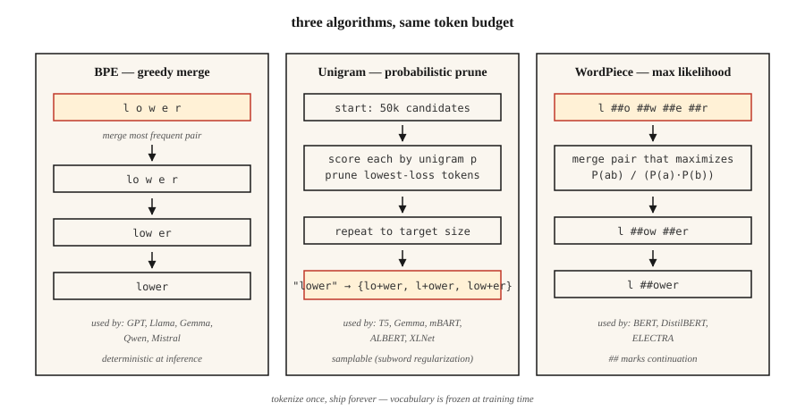

# Tokenisasi Subkata — BPE, WordPiece, Unigram, SentencePiece

> Tokenizer kata tersedak pada kata yang belum pernah dilihat. Tokenizer karakter membuat panjang urutan meledak. Tokenizer subkata mengambil jalan tengah. Setiap LLM modern dirilis dengan salah satunya.

**Jenis:** Learn
**Bahasa:** Python
**Prasyarat:** Fase 5 · 01 (Text Processing), Fase 5 · 04 (GloVe / FastText / Subword)
**Waktu:** ~60 menit

## Masalahnya

Kosakata Anda punya 50.000 kata. Seorang pengguna mengetik "untokenizable". Tokenizer Anda mengembalikan `[UNK]`. Model kini tidak punya sinyal apa pun tentang kata itu. Lebih buruk lagi: dokumen persentil ke-90 dalam korpus Anda memiliki 40 kata langka, yang berarti 40 bit informasi yang hilang per dokumen.

Tokenisasi subkata mengatasi ini. Kata-kata umum tetap menjadi token tunggal. Kata langka terurai menjadi potongan bermakna: `untokenizable` → `un`, `token`, `izable`. Data pelatihan mencakup semuanya karena string apa pun pada akhirnya adalah urutan byte.

Setiap LLM frontier pada 2026 dirilis dengan salah satu dari tiga algoritma (BPE, Unigram, WordPiece), yang dibungkus dalam salah satu dari tiga pustaka (tiktoken, SentencePiece, HF Tokenizers). Anda tidak bisa merilis model bahasa tanpa memilih salah satunya.

## Konsepnya



**BPE (Byte-Pair Encoding).** Mulai dengan kosakata tingkat karakter. Hitung setiap pasangan yang bersebelahan. Gabungkan pasangan paling sering menjadi token baru. Ulangi sampai mencapai ukuran kosakata target. Algoritma dominan: GPT-2/3/4, Llama, Gemma, Qwen2, Mistral.

**BPE tingkat byte.** Algoritma yang sama, tetapi atas byte mentah (256 token dasar) alih-alih karakter Unicode. Menjamin nol token `[UNK]` — urutan byte apa pun dapat dikodekan. GPT-2 memakai 50.257 token (256 byte + 50.000 penggabungan + 1 khusus).

**Unigram.** Mulai dengan kosakata yang sangat besar. Beri setiap token probabilitas unigram. Secara iteratif pangkas token yang penghapusannya paling sedikit menaikkan log-likelihood korpus. Bersifat probabilistik saat inferensi: dapat mengambil sampel tokenisasi (berguna untuk augmentasi data melalui regularisasi subkata). Dipakai oleh T5, mBART, ALBERT, XLNet, Gemma.

**WordPiece.** Menggabungkan pasangan yang memaksimalkan likelihood korpus pelatihan, bukan frekuensi mentah. Dipakai oleh BERT, DistilBERT, ELECTRA.

**SentencePiece vs tiktoken.** SentencePiece adalah pustaka yang *melatih* kosakata (BPE atau Unigram) langsung pada teks Unicode mentah, mengodekan spasi sebagai `▁`. tiktoken adalah *encoder* cepat milik OpenAI untuk kosakata yang sudah dibangun; pustaka ini tidak melatih.

Aturan praktis:

- **Melatih kosakata baru:** SentencePiece (multibahasa, tanpa pratokenisasi) atau HF Tokenizers.
- **Inferensi cepat pada kosakata GPT:** tiktoken (cl100k_base, o200k_base).
- **Keduanya:** HF Tokenizers — satu pustaka, pelatihan + pelayanan.

```figure
bpe-merge
```

## Bangunlah

### Langkah 1: BPE dari awal

Lihat `code/main.py`. Loop-nya:

```python
def train_bpe(corpus, num_merges):
    vocab = {tuple(word) + ("</w>",): count for word, count in corpus.items()}
    merges = []
    for _ in range(num_merges):
        pairs = Counter()
        for symbols, freq in vocab.items():
            for a, b in zip(symbols, symbols[1:]):
                pairs[(a, b)] += freq
        if not pairs:
            break
        best = pairs.most_common(1)[0][0]
        merges.append(best)
        vocab = apply_merge(vocab, best)
    return merges
```

Tiga fakta yang terkandung dalam algoritma ini. `</w>` menandai akhir kata sehingga "low" (sufiks) dan "lower" (prefiks) tetap berbeda. Pembobotan frekuensi membuat pasangan berfrekuensi tinggi menang lebih awal. Daftar penggabungan bersifat berurutan — inferensi menerapkan penggabungan sesuai urutan pelatihan.

### Langkah 2: encode dengan penggabungan yang dipelajari

```python
def encode_bpe(word, merges):
    symbols = list(word) + ["</w>"]
    for a, b in merges:
        i = 0
        while i < len(symbols) - 1:
            if symbols[i] == a and symbols[i + 1] == b:
                symbols = symbols[:i] + [a + b] + symbols[i + 2:]
            else:
                i += 1
    return symbols
```

Secara naif $O(n \cdot \lvert \text{merges} \rvert)$. Implementasi produksi (tiktoken, HF Tokenizers) memakai pencarian peringkat penggabungan dengan antrean prioritas dan berjalan dalam waktu hampir linear.

### Langkah 3: SentencePiece dalam praktik

```python
import sentencepiece as spm

spm.SentencePieceTrainer.train(
    input="corpus.txt",
    model_prefix="my_tokenizer",
    vocab_size=8000,
    model_type="bpe",          # atau "unigram"
    character_coverage=0.9995, # lebih rendah untuk CJK (mis. 0.9995 untuk Inggris, 0.995 untuk Jepang)
    normalization_rule_name="nmt_nfkc",
)

sp = spm.SentencePieceProcessor(model_file="my_tokenizer.model")
print(sp.encode("untokenizable", out_type=str))
# ['▁un', 'token', 'izable']
```

Perhatikan: tidak diperlukan pratokenisasi, spasi dikodekan sebagai `▁`, `character_coverage` mengontrol seberapa agresif karakter langka dipertahankan versus dipetakan ke `<unk>`.

### Langkah 4: tiktoken untuk kosakata kompatibel OpenAI

```python
import tiktoken
enc = tiktoken.get_encoding("o200k_base")
print(enc.encode("untokenizable"))        # [127340, 101028]
print(len(enc.encode("Hello, world!")))   # 4
```

Hanya encoding. Cepat (backend Rust). Cocok persis dengan tokenisasi GPT-4/5 untuk penghitungan byte, estimasi biaya, dan penganggaran jendela konteks.

## Jebakan yang masih dirilis pada 2026

- **Pergeseran tokenizer.** Melatih dengan kosakata A, deploying dengan kosakata B. ID token berbeda; keluaran model menjadi omong kosong. Periksa hash `tokenizer.json` di CI.
- **Ambiguitas spasi.** BPE "hello" versus " hello" menghasilkan token berbeda. Selalu tentukan `add_special_tokens` dan `add_prefix_space` secara eksplisit.
- **Kurang pelatihan multibahasa.** Korpus yang berat Inggris menghasilkan kosakata yang memecah aksara non-Latin menjadi 5-10 kali lebih banyak token. Prompt yang sama biayanya 5-10 kali lebih mahal dalam bahasa Jepang/Arab pada GPT-3.5. o200k_base sebagian memperbaiki ini.
- **Pemecahan emoji.** Satu emoji saja bisa memakan 5 token. Periksa penanganan emoji saat menganggarkan konteks.

## Gunakan

Tumpukan tahun 2026:

| Situasi | Pilih |
|-----------|------|
| Melatih model monolingua dari awal | HF Tokenizers (BPE) |
| Melatih model multibahasa | SentencePiece (Unigram, `character_coverage=0.9995`) |
| Melayani API kompatibel OpenAI | tiktoken (`o200k_base` untuk GPT-4+) |
| Kosakata spesifik domain (kode, matematika, protein) | Latih BPE khusus pada korpus domain, gabungkan dengan kosakata dasar |
| Inferensi edge, model kecil | Unigram (kosakata lebih kecil bekerja lebih baik) |

Ukuran kosakata adalah keputusan penskalaan, bukan konstanta. Heuristik kasar: 32k untuk <1B parameter, 50-100k untuk 1-10B, 200k+ untuk multibahasa/frontier.

## Kirimkan

Simpan sebagai `outputs/skill-bpe-vs-wordpiece.md`:

```markdown
---
name: tokenizer-picker
description: Pilih algoritma tokenizer, ukuran kosakata, dan pustaka untuk suatu korpus dan target deployment tertentu.
version: 1.0.0
phase: 5
lesson: 19
tags: [nlp, tokenization]
---

Dengan suatu korpus (ukuran, bahasa, domain) dan target deployment (pelatihan dari awal / fine-tuning / inferensi kompatibel API), keluarkan:

1. Algoritma. BPE, Unigram, atau WordPiece. Alasan satu kalimat.
2. Pustaka. SentencePiece, HF Tokenizers, atau tiktoken. Alasan.
3. Ukuran kosakata. Dibulatkan ke kelipatan 1 ribu terdekat. Alasan yang terkait dengan ukuran model dan cakupan bahasa.
4. Pengaturan cakupan. `character_coverage`, `byte_fallback`, daftar token khusus.
5. Rencana validasi. Rata-rata token per kata pada himpunan yang disisihkan, laju OOV, rasio kompresi, kesamaan dekode pulang-pergi.

Tolak melatih tokenizer dengan character-coverage <0,995 pada korpus yang memuat konten aksara langka. Tolak merilis kosakata tanpa pemeriksaan hash `tokenizer.json` yang dibekukan di CI. Tandai tokenizer monolingua mana pun dengan kosakata di bawah 16k sebagai kemungkinan kurang spesifikasi.
```

## Latihan

1. **Mudah.** Latih BPE 500 penggabungan pada korpus kecil di `code/main.py`. Encode tiga kata yang disisihkan. Berapa banyak yang menghasilkan tepat 1 token dibandingkan >1 token?
2. **Sedang.** Bandingkan jumlah token pada 100 kalimat Wikipedia bahasa Inggris antara `cl100k_base`, `o200k_base`, dan BPE SentencePiece yang Anda latih dengan vocab=32k. Laporkan rasio kompresi masing-masing.
3. **Sulit.** Latih korpus yang sama dengan BPE, Unigram, dan WordPiece. Ukur akurasi hilir saat menggunakan masing-masing pada klasifier sentimen kecil. Apakah pilihan itu menggeser hasil lebih dari 1 poin F1?

## Istilah Kunci

| Istilah | Yang orang katakan | Yang sebenarnya dimaksud |
|------|-----------------|-----------------------|
| BPE | Byte-Pair Encoding | Penggabungan serakah pasangan karakter paling sering sampai ukuran kosakata target tercapai. |
| BPE tingkat byte | Tidak ada token tak dikenal sama sekali | BPE atas 256 byte mentah; GPT-2 / Llama memakai ini. |
| Unigram | Tokenizer probabilistik | Memangkas dari himpunan kandidat besar memakai log-likelihood; dipakai T5, Gemma. |
| SentencePiece | Yang urusan spasi itu | Pustaka yang melatih BPE/Unigram pada teks mentah; spasi dikodekan sebagai `▁`. |
| tiktoken | Yang cepat itu | Encoder BPE milik OpenAI dengan backend Rust untuk kosakata yang sudah dibangun. Tanpa pelatihan. |
| Daftar penggabungan | Angka-angka ajaib | Daftar berurutan penggabungan `(a, b) → ab`; inferensi menerapkannya berurutan. |
| Cakupan karakter | Seberapa langka itu terlalu langka? | Fraksi karakter dalam korpus pelatihan yang harus dicakup tokenizer; ~0,9995 umumnya. |

## Bacaan Lebih Lanjut

- [Sennrich, Haddow, Birch (2015). Neural Machine Translation of Rare Words with Subword Units](https://arxiv.org/abs/1508.07909) — makalah BPE.
- [Kudo (2018). Subword Regularization with Unigram Language Model](https://arxiv.org/abs/1804.10959) — makalah Unigram.
- [Kudo, Richardson (2018). SentencePiece: A simple and language independent subword tokenizer](https://arxiv.org/abs/1808.06226) — pustakanya.
- [Hugging Face — Summary of the tokenizers](https://huggingface.co/docs/transformers/tokenizer_summary) — referensi ringkas.
- [Repo tiktoken OpenAI](https://github.com/openai/tiktoken) — buku resep + daftar encoding.
