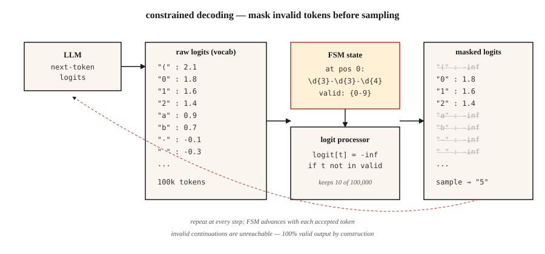

# Keluaran Terstruktur & Dekode Terkendali

> Minta JSON pada LLM. Anda mendapat JSON hampir setiap kali. Dalam produksi, "hampir" itulah masalahnya. Dekode terkendali mengubah "hampir" menjadi "selalu" dengan menyunting logits sebelum pengambilan sampel.

**Jenis:** Build
**Bahasa:** Python, TypeScript
**Prasyarat:** Fase 5 · 17 (Chatbots), Fase 5 · 19 (Tokenisasi Subkata)
**Waktu:** ~60 menit

## Masalahnya

Sebuah klasifier memberi prompt pada LLM: "Return one of {positive, negative, neutral}." Model mengembalikan "The sentiment is positive — this review is overwhelmingly favorable because the customer explicitly states that they ...". Parser Anda mogok. F1 klasifier Anda menjadi 0,0.

Generasi bebas bukanlah kontrak. Ia hanya saran. Sistem produksi memerlukan kontrak.

Pada 2026 ada tiga lapisan.

1. **Prompting.** Minta dengan sopan. "Return only the JSON object." Berhasil ~80% pada model frontier, lebih rendah pada model kecil.
2. **API keluaran terstruktur native.** `response_format` milik OpenAI, penggunaan alat Anthropic, mode JSON Gemini. Andal pada skema yang didukung. Terkunci pada vendor.
3. **Dekode terkendali.** Ubah logits pada setiap langkah generasi sehingga model *tidak dapat* mengeluarkan token yang tidak valid. 100% valid secara konstruksi. Bekerja pada model lokal mana pun.

Pelajaran ini membangun intuisi untuk ketiganya dan menyebut kapan sebaiknya memakai masing-masing.

## Konsepnya



**Bagaimana dekode terkendali bekerja.** Pada setiap langkah generasi, LLM menghasilkan vektor logits atas seluruh kosakata (~100 ribu token). Sebuah *logit processor* duduk di antara model dan sampler. Processor itu menghitung token mana yang valid given posisi saat ini dalam grammar target — JSON Schema, regex, grammar bebas konteks — dan menetapkan logits semua token tidak valid menjadi negatif tak hingga. Softmax atas logits yang tersisa menempatkan massa probabilitas hanya pada kelanjutan yang valid.

Implementasi pada 2026:

- **Outlines.** Mengompilasi JSON Schema atau regex menjadi mesin keadaan hingga. Setiap token mendapat pencarian token-valid-berikutnya $O(1)$. Berbasis FSM, sehingga skema rekursif perlu diratakan.
- **XGrammar / llguidance.** Mesin grammar bebas konteks. Menangani skema JSON rekursif. Overhead dekode hampir nol. OpenAI menyebut llguidance dalam implementasi keluaran terstruktur mereka tahun 2025.
- **vLLM guided decoding.** `guided_json`, `guided_regex`, `guided_choice`, `guided_grammar` bawaan melalui backend Outlines, XGrammar, atau lm-format-enforcer.
- **Instructor.** Pembungkus berbasis Pydantic untuk LLM mana pun. Mengulang saat validasi gagal. Lintas penyedia, tetapi tidak mengubah logits — ia mengandalkan percobaan ulang + prompt yang sadar keluaran terstruktur.

### Hasil yang kontraintuitif

Dekode terkendali sering *lebih cepat* daripada generasi tanpa kendala. Dua alasan. Pertama, ia menyempitkan ruang pencarian token berikutnya. Kedua, implementasi cerdas melewati pembangkitan token sama sekali untuk token yang dipaksakan (kerangka seperti `{"name": "` — setiap byte sudah ditentukan).

### Jebakan yang merugikan Anda

Urutan field penting. Taruh `answer` sebelum `reasoning`, dan model berkomitmen pada jawaban sebelum ia berpikir. JSON tetap valid. Jawabannya salah. Tidak ada validasi yang menangkapnya.

```json
// BURUK
{"answer": "yes", "reasoning": "because ..."}

// BAIK
{"reasoning": "... therefore ...", "answer": "yes"}
```

Urutan field skema adalah logika, bukan format.

```figure
constrained-decoder
```

## Bangunlah

### Langkah 1: generasi terkendali regex dari awal

Lihat `code/main.py` untuk implementasi FSM mandiri. Ide intinya dalam 30 baris:

```python
def mask_logits(logits, valid_token_ids):
    mask = [float("-inf")] * len(logits)
    for tid in valid_token_ids:
        mask[tid] = logits[tid]
    return mask


def generate_constrained(model, tokenizer, prompt, fsm):
    ids = tokenizer.encode(prompt)
    state = fsm.initial_state
    while not fsm.is_accept(state):
        logits = model.next_token_logits(ids)
        valid = fsm.valid_tokens(state, tokenizer)
        logits = mask_logits(logits, valid)
        tok = sample(logits)
        ids.append(tok)
        state = fsm.transition(state, tok)
    return tokenizer.decode(ids)
```

FSM melacak bagian grammar mana yang sudah kita penuhi sejauh ini. `valid_tokens(state, tokenizer)` menghitung token kosakata mana yang dapat memajukan FSM tanpa meninggalkan jalur yang masih menerima.

### Langkah 2: Outlines untuk JSON Schema

```python
from pydantic import BaseModel
from typing import Literal
import outlines


class Review(BaseModel):
    sentiment: Literal["positive", "negative", "neutral"]
    confidence: float
    evidence_span: str


model = outlines.models.transformers("meta-llama/Llama-3.2-3B-Instruct")
generator = outlines.generate.json(model, Review)

result = generator("Classify: 'The wait staff was attentive and the food arrived hot.'")
print(result)
# Review(sentiment='positive', confidence=0.93, evidence_span='attentive ... hot')
```

Nol galat validasi. Selamanya. FSM membuat keluaran yang tidak valid menjadi tidak mungkin dicapai.

### Langkah 3: Instructor untuk Pydantic yang agnostik penyedia

```python
import instructor
from anthropic import Anthropic
from pydantic import BaseModel, Field


class Invoice(BaseModel):
    vendor: str
    total_usd: float = Field(ge=0)
    line_items: list[str]


client = instructor.from_anthropic(Anthropic())
invoice = client.messages.create(
    model="claude-opus-4-7",
    max_tokens=1024,
    response_model=Invoice,
    messages=[{"role": "user", "content": "Extract from: 'Acme Corp $420. Widget, Gizmo.'"}],
)
```

Mekanismenya berbeda. Instructor tidak menyentuh logits. Ia memformat skema ke dalam prompt, mengurai keluaran, dan mengulang saat validasi gagal (default 3 kali). Bekerja dengan penyedia mana pun. Percobaan ulang menambah latensi dan biaya. Portabilitas lintas penyedia adalah daya jualnya.

### Langkah 4: API vendor native

```python
from openai import OpenAI

client = OpenAI()
response = client.responses.create(
    model="gpt-5",
    input=[{"role": "user", "content": "Classify: 'The food was cold.'"}],
    text={"format": {"type": "json_schema", "name": "sentiment",
          "schema": {"type": "object", "required": ["sentiment"],
                     "properties": {"sentiment": {"type": "string",
                                                  "enum": ["positive", "negative", "neutral"]}}}}},
)
print(response.output_parsed)
```

Dekode terkendali di sisi server. Keandalan setara dengan Outlines untuk skema yang didukung. Tanpa pengelolaan model lokal. Mengunci Anda pada vendor itu.

## Jebakan

- **Skema rekursif.** Outlines meratakan rekursi menjadi kedalaman tetap. Keluaran berstruktur pohon (komentar bertingkat, AST) memerlukan XGrammar atau llguidance (berbasis CFG).
- **Enum besar.** Enum dengan 10.000 pilihan lambat dikompilasi atau mengalami timeout. Beralih ke pengambilan: prediksi kandidat top-k terlebih dahulu, lalu batasi hanya pada kandidat itu.
- **Grammar terlalu ketat.** Paksa regex `date: "YYYY-MM-DD"` dan model tidak bisa mengeluarkan `"unknown"` untuk tanggal yang tidak ada. Model mengompensasi dengan mengarang tanggal. Izinkan `null` atau nilai sentinel.
- **Komitemen dini.** Lihat jebakan urutan field di atas. Selalu taruh penalaran terlebih dahulu.
- **Mode JSON vendor tanpa skema.** Mode JSON murni hanya menjamin JSON yang valid, bukan JSON yang valid *untuk kasus Anda*. Selalu berikan skema lengkap.

## Gunakan

Tumpukan tahun 2026:

| Situasi | Pilih |
|-----------|------|
| Model OpenAI/Anthropic/Google, skema sederhana | Keluaran terstruktur native vendor |
| Penyedia apa pun, alur kerja Pydantic, bisa toleran percobaan ulang | Instructor |
| Model lokal, butuh 100% valid, skema datar | Outlines (FSM) |
| Model lokal, skema rekursif | XGrammar atau llguidance |
| Server inferensi self-hosted | vLLM guided decoding |
| Pemrosesan batch dengan percobaan ulang yang bisa diterima | Instructor + model termurah |

## Kirimkan

Simpan sebagai `outputs/skill-structured-output-picker.md`:

```markdown
---
name: structured-output-picker
description: Pilih pendekatan keluaran terstruktur, desain skema, dan rencana validasi.
version: 1.0.0
phase: 5
lesson: 20
tags: [nlp, llm, structured-output]
---

Dengan suatu kasus penggunaan (penyedia, anggaran latensi, kompleksitas skema, toleransi kegagalan), keluarkan:

1. Mekanisme. Keluaran terstruktur native vendor, percobaan ulang Instructor, FSM Outlines, atau CFG XGrammar. Alasan satu kalimat.
2. Desain skema. Urutan field (penalaran terlebih dahulu, jawaban terakhir), field nullable untuk "tidak diketahui", enum versus regex, field wajib.
3. Strategi kegagalan. Jumlah percobaan ulang maksimum, model cadangan, penanganan `null` yang anggun, penolakan terhadap data di luar distribusi.
4. Rencana validasi. Tingkat kepatuhan skema (target 100%), validitas semantik (LLM-judge), tingkat cakupan field, latensi p50/p99.

Tolak desain apa pun yang menaruh `answer` atau `decision` sebelum field penalaran. Tolak menggunakan mode JSON polos tanpa skema. Tandai skema rekursif yang berada di balik pustaka yang hanya mendukung FSM.
```

## Latihan

1. **Mudah.** Beri prompt pada model open-weights kecil (mis. Llama-3.2-3B) tanpa dekode terkendali untuk `Review(sentiment, confidence, evidence_span)`. Ukur fraksi yang terurai sebagai JSON valid pada 100 ulasan.
2. **Sedang.** Korpus yang sama dengan mode JSON Outlines. Bandingkan tingkat kepatuhan, latensi, dan akurasi semantik.
3. **Sulit.** Terapkan dekoder terkendali regex dari awal untuk nomor telepon (`\d{3}-\d{3}-\d{4}`). Verifikasi 0 keluaran tidak valid pada 1000 sampel.

## Istilah Kunci

| Istilah | Yang orang katakan | Yang sebenarnya dimaksud |
|------|-----------------|-----------------------|
| Dekode terkendali | Paksa keluaran valid | Tutup logits token tidak valid pada setiap langkah generasi. |
| Logit processor | Hal yang mengendalikan | Fungsi: `(logits, state) -> masked_logits`. |
| FSM | Mesin keadaan hingga | Representasi grammar hasil kompilasi; pencarian token-valid-berikutnya $O(1)$. |
| CFG | Grammar bebas konteks | Grammar yang menangani rekursi; lebih lambat tetapi lebih ekspresif daripada FSM. |
| Urutan field skema | Apakah penting? | Ya — field pertama berkomitmen; selalu taruh penalaran sebelum jawaban. |
| Guided decoding | Nama vLLM untuk ini | Konsep yang sama, terintegrasi ke dalam server inferensi. |
| Mode JSON | Versi awal OpenAI | Menjamin sintaks JSON; TIDAK menjamin kesesuaian dengan skema. |

## Bacaan Lebih Lanjut

- [Willard, Louf (2023). Efficient Guided Generation for LLMs](https://arxiv.org/abs/2307.09702) — makalah Outlines.
- [XGrammar paper (2024)](https://arxiv.org/abs/2411.15100) — dekode terkendali cepat berbasis CFG.
- [vLLM — Structured Outputs](https://docs.vllm.ai/en/latest/features/structured_outputs.html) — integrasi server inferensi.
- [OpenAI — Structured Outputs guide](https://platform.openai.com/docs/guides/structured-outputs) — referensi API + jebakan.
- [Pustaka Instructor](https://python.useinstructor.com/) — Pydantic + percobaan ulang lintas penyedia.
- [JSONSchemaBench (2025)](https://arxiv.org/abs/2501.10868) — benchmark enam kerangka dekode terkendali.
