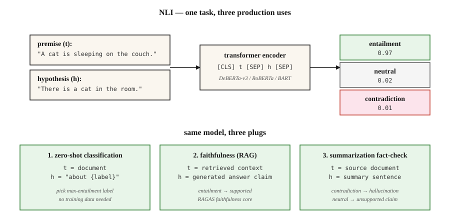

# Natural Language Inference — Textual Entailment

> "t entails h" berarti manusia yang membaca t akan menyimpulkan h benar. NLI adalah tugas memprediksi entailment / contradiction / neutral. Terlihat membosankan di permukaan, tetapi menopang produksi.

**Jenis:** Learn
**Bahasa:** Python, TypeScript
**Prasyarat:** Fase 5 · 05 (Sentiment Analysis), Fase 5 · 13 (Question Answering)
**Waktu:** ~60 menit

## Masalahnya

Anda membangun peringkas. Peringkas itu menghasilkan ringkasan. Bagaimana Anda tahu ringkasan itu tidak mengandung halusinasi?

Anda membangun chatbot. Bot menjawab "yes." Bagaimana Anda tahu jawaban itu didukung oleh lakon yang diambil?

Anda perlu mengklasifikasikan 10.000 artikel berita menurut topik. Anda tidak punya label pelatihan. Bisakah Anda memakai ulang sebuah model?

Ketiga masalah itu tereduksi menjadi Natural Language Inference. NLI bertanya: dengan premis `t` dan hipotesis `h`, apakah `h` tersirat oleh `t`, bertentangan, atau netral (tidak terkait)?

- **Pemeriksaan halusinasi:** `t` = dokumen sumber, `h` = klaim dalam ringkasan. Bukan entailment = halusinasi.
- **QA terpaut (grounded):** `t` = lakon yang diambil, `h` = jawaban yang dihasilkan. Bukan entailment = fabrikasi.
- **Klasifikasi zero-shot:** `t` = dokumen, `h` = label yang diverbalkan ("This is about sports"). Entailment = label yang diprediksi.

Satu tugas, tiga kegunaan produksi. Itulah sebabnya setiap kerangka evaluasi RAG menyertakan model NLI di dalamnya.

## Konsepnya



**Ketiga label.**

- **Entailment.** `t` → `h`. "The cat is on the mat" menyiratkan "There is a cat."
- **Contradiction.** `t` → ¬`h`. "The cat is on the mat" bertentangan dengan "There is no cat."
- **Neutral.** Tidak ada inferensi ke arah mana pun. "The cat is on the mat" netral terhadap "The cat is hungry."

**Bukan entailment logis.** NLI adalah inferensi bahasa *alami* — apa yang akan disimpulkan pembaca manusia pada umumnya, bukan logika ketat. "John walked his dog" menyiratkan "John has a dog" dalam NLI, tetapi logika orde pertama yang ketat hanya akan mengakuinya jika Anda mengaksiomatisasi kepemilikan.

**Dataset.**

- **SNLI** (2015). 570 ribu pasangan beranotasi manusia, dengan caption gambar sebagai premis. Domain sempit.
- **MultiNLI** (2017). 433 ribu pasangan lintas 10 genre. Korpus pelatihan standar pada 2026.
- **ANLI** (2019). Adversarial NLI. Manusia menulis contoh yang sengaja dirancang untuk mengalahkan model yang ada. Lebih sulit.
- **DocNLI, ConTRoL** (2020–21). Premis sepanjang dokumen. Menguji inferensi multilompat dan jarak jauh.

**Arsitekturnya.** Encoder transformer (BERT, RoBERTa, DeBERTa) membaca `[CLS] premise [SEP] hypothesis [SEP]`. Representasi `[CLS]` masuk ke softmax tiga arah. Latih pada MNLI, evaluasi pada benchmark yang disisihkan, dapatkan akurasi 90%+ pada pasangan dalam distribusi.

**Zero-shot melalui NLI.** Dengan dokumen dan label kandidat, ubah setiap label menjadi hipotesis ("This text is about sports"). Hitung probabilitas entailment untuk masing-masing. Pilih yang terbesar. Itulah mekanisme di balik pipeline `zero-shot-classification` milik Hugging Face.

```figure
nli-router
```

## Bangunlah

### Langkah 1: jalankan model NLI yang sudah dilatih

```python
from transformers import pipeline

nli = pipeline("text-classification",
               model="facebook/bart-large-mnli",
               top_k=None)  # kembalikan semua label; menggantikan return_all_scores=True yang sudah usang

premise = "The cat is sleeping on the couch."
hypothesis = "There is a cat in the room."

result = nli({"text": premise, "text_pair": hypothesis})[0]
print(result)
# [{'label': 'entailment', 'score': 0.97},
#  {'label': 'neutral', 'score': 0.02},
#  {'label': 'contradiction', 'score': 0.01}]
```

Untuk NLI produksi, `facebook/bart-large-mnli` dan `MoritzLaurer/DeBERTa-v3-large-mnli-fever-anli-ling-wanli` adalah pilihan terbuka default. DeBERTa-v3 memimpin papan peringkat.

### Langkah 2: klasifikasi zero-shot

```python
zs = pipeline("zero-shot-classification", model="facebook/bart-large-mnli")

text = "The stock market rallied after the central bank cut interest rates."
labels = ["finance", "sports", "politics", "technology"]

result = zs(text, candidate_labels=labels)
print(result)
# {'labels': ['finance', 'politics', 'technology', 'sports'],
#  'scores': [0.92, 0.05, 0.02, 0.01]}
```

Templatenya adalah "This example is about {label}." secara default. Sesuaikan dengan `hypothesis_template`. Tidak perlu data pelatihan. Tidak ada fine-tuning. Bekerja langsung dari kotaknya.

### Langkah 3: pemeriksaan kepercayaan untuk RAG

```python
def is_faithful(answer, context, threshold=0.5):
    result = nli({"text": context, "text_pair": answer})[0]
    entail = next(s for s in result if s["label"] == "entailment")
    return entail["score"] > threshold
```

Ini adalah inti faithfulness RAGAS. Urai jawaban yang dihasilkan menjadi klaim-klaim atomik. Periksa setiap klaim terhadap konteks yang diambil. Laporkan fraksi yang tersirat.

### Langkah 4: klasifier NLI buatan sendiri (konseptual)

Lihat `code/main.py` untuk mainan tanpa dependensi selain pustaka standar: premis dan hipotesis dibandingkan melalui tumpangan leksikal + deteksi negasi. Tidak sekelas model transformer — tetapi menunjukkan bentuk tugasnya: dua teks masuk, label tiga arah keluar, loss = cross-entropy atas `{entail, contradict, neutral}`.

## Jebakan

- **Pintasan hanya-hipotesis.** Model dapat memprediksi label hanya dari hipotesis dengan akurasi ~60% pada SNLI karena "not", "nobody", "never" berkorelasi dengan contradiction. Baseline yang kuat untuk mendeteksi kebocoran label.
- **Heuristik tumpangan leksikal.** Heuristik subsequence ("setiap subsequence tersirat") lolos SNLI tetapi gagal pada HANS/ANLI. Gunakan benchmark adversarial.
- **Penurunan pada panjang dokumen.** Model NLI kalimat tunggal turun 20+ F1 pada premis sepanjang dokumen. Gunakan model yang dilatih pada DocNLI untuk konteks panjang.
- **Sensitivitas template zero-shot.** "This example is about {label}" versus "{label}" versus "The topic is {label}" dapat menggeser akurasi lebih dari 10 poin. Setel templatenya.
- **Ketidakcocokan domain.** MNLI dilatih pada bahasa Inggris umum. Teks hukum, medis, dan ilmiah memerlukan model NLI spesifik domain (mis. SciNLI, MedNLI).

## Gunakan

Tumpukan tahun 2026:

| Kasus penggunaan | Model |
|---------|-------|
| NLI serbaguna | `MoritzLaurer/DeBERTa-v3-large-mnli-fever-anli-ling-wanli` |
| Cepat / edge | `cross-encoder/nli-deberta-v3-base` |
| Klasifikasi zero-shot (ringan) | `facebook/bart-large-mnli` |
| NLI tingkat dokumen | `MoritzLaurer/DeBERTa-v3-large-mnli-fever-anli-ling-wanli` |
| Multibahasa | `MoritzLaurer/multilingual-MiniLMv2-L6-mnli-xnli` |
| Deteksi halusinasi dalam RAG | Lapisan NLI di dalam RAGAS / DeepEval |

Meta-pola tahun 2026: NLI adalah isolasi kain perekat untuk pemahaman teks. Setiap kali Anda perlu bertanya "apakah A mendukung B?" atau "apakah A bertentangan dengan B?" — raih NLI sebelum melakukan panggilan LLM lain.

## Kirimkan

Simpan sebagai `outputs/skill-nli-picker.md`:

```markdown
---
name: nli-picker
description: Pilih model NLI, template label, dan pengaturan evaluasi untuk tugas klasifikasi / kepercayaan / zero-shot.
version: 1.0.0
phase: 5
lesson: 21
tags: [nlp, nli, zero-shot]
---

Dengan suatu kasus penggunaan (pemeriksaan kepercayaan, klasifikasi zero-shot, inferensi tingkat dokumen), keluarkan:

1. Model. Checkpoint NLI yang disebut nama. Alasan yang terkait dengan domain, panjang, dan bahasa.
2. Template (jika zero-shot). Pola verbalasi. Contoh.
3. Ambang batas. Batas entailment untuk aturan keputusan. Alasan berdasarkan kalibrasi.
4. Evaluasi. Akurasi pada himpunan berlabel yang disisihkan, baseline hypothesis-only, subhimpunan adversarial.

Tolak merilis klasifikasi zero-shot tanpa pemeriksaan kewarasan berlabel 100 contoh. Tolak menggunakan model NLI tingkat kalimat pada premis sepanjang dokumen. Tandai klaim apa pun bahwa NLI menyelesaikan halusinasi — NLI menguranginya, bukan menghilangkannya.
```

## Latihan

1. **Mudah.** Jalankan `facebook/bart-large-mnli` pada 20 triple buatan tangan (premis, hipotesis, label) yang mencakup ketiga kelas. Ukur akurasi. Tambahkan jebakan adversarial "heuristik subsequence" ("I did not eat the cake" versus "I ate the cake") dan lihat apakah model itu pecah.
2. **Sedang.** Bandingkan template zero-shot `"This text is about {label}"` dengan `"The topic is {label}"` dan `"{label}"` pada 100 judul AG News. Laporkan ayunan akurasi.
3. **Sulit.** Bangun pemeriksa faithfulness RAG: dekomposisi klaim atomik + NLI per klaim. Evaluasi pada 50 jawaban hasil RAG dengan konteks gold. Ukur laju positif palsu dan negatif palsu terhadap label manusia.

## Istilah Kunci

| Istilah | Yang orang katakan | Yang sebenarnya dimaksud |
|------|-----------------|-----------------------|
| NLI | Natural Language Inference | Klasifikasi tiga arah atas hubungan premis-hipotesis. |
| RTE | Recognizing Textual Entailment | Nama lama NLI; tugas yang sama. |
| Entailment | "t menyiratkan h" | Pembaca pada umumnya akan menyimpulkan h benar given t. |
| Contradiction | "t menyingkirkan h" | Pembaca pada umumnya akan menyimpulkan h salah given t. |
| Neutral | "belum diputuskan" | Tidak ada inferensi dari t ke h ke arah mana pun. |
| Klasifikasi zero-shot | NLI sebagai klasifier | Verbalkan label sebagai hipotesis, pilih entailment terbesar. |
| Faithfulness | Apakah jawabannya didukung? | NLI atas (konteks yang diambil, jawaban yang dihasilkan). |

## Bacaan Lebih Lanjut

- [Bowman et al. (2015). A large annotated corpus for learning natural language inference](https://arxiv.org/abs/1508.05326) — SNLI.
- [Williams, Nangia, Bowman (2017). A Broad-Coverage Challenge Corpus for Sentence Understanding through Inference](https://arxiv.org/abs/1704.05426) — MultiNLI.
- [Nie et al. (2019). Adversarial NLI](https://arxiv.org/abs/1910.14599) — benchmark ANLI.
- [Yin, Hay, Roth (2019). Benchmarking Zero-shot Text Classification](https://arxiv.org/abs/1909.00161) — NLI sebagai klasifier.
- [He et al. (2021). DeBERTa: Decoding-enhanced BERT with Disentangled Attention](https://arxiv.org/abs/2006.03654) — kuda beban NLI tahun 2026.
