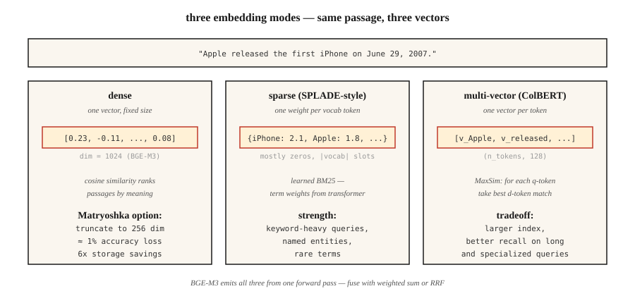

# Model Embedding — Telaah Mendalam 2026

> Word2Vec memberi Anda satu vektor per kata. Model embedding modern memberi Anda satu vektor per bagian teks, lintas bahasa, dengan tampilan jarang (sparse), padat (dense), dan multi-vektor, yang ukurannya disesuaikan dengan indeks Anda. Salah pilih dan RAG Anda mengambil hal yang salah.

**Jenis:** Belajar
**Bahasa:** Python, TypeScript
**Prasyarat:** Fase 5 · 03 (Word2Vec), Fase 5 · 14 (Information Retrieval)
**Waktu:** ~60 menit

## Masalahnya

Sistem RAG Anda mengambil bagian teks yang salah 40% dari waktu. Pelakunya jarang berupa basis data vektor atau prompt. Pelakunya adalah model embedding.

Memilih embedding pada 2026 berarti memilih di lima sumbu:

1. **Padat vs jarang vs multi-vektor.** Satu vektor per bagian teks, atau satu per token, atau kantong kata (bag of words) berbobot yang jarang.
2. **Cakupan bahasa.** Model monobahasa Inggris masih menang pada tugas khusus Inggris. Model multibahasa menang ketika korpusnya campuran.
3. **Panjang konteks.** 512 token versus 8.192 versus 32.768 — dan kapasitas efektif sebenarnya sering kali hanya 60-70% dari maksimum yang diiklankan.
4. **Anggaran dimensi.** 3.072 bilangan floating-point dengan presisi penuh = 12 KB per vektor. Pada 100 juta vektor, penyimpanan menghabiskan $1.300/bulan. Pemotongan Matryoshka menguranginya 4×.
5. **Terbuka vs terhosting.** Bobot terbuka (open-weight) berarti Anda mengendalikan tumpukan teknologi dan data. Terhosting berarti Anda menukar kendali dengan versi yang selalu terbaru.

Pelajaran ini menyebut trade-off tersebut agar Anda dapat memilih berdasarkan bukti, bukan berdasarkan apa yang populer kuartal lalu.

## Konsepnya



**Embedding padat.** Satu vektor per bagian teks (biasanya 384-3.072 dimensi). Kesamaan kosinus memberi peringkat bagian teks berdasarkan kedekatan semantik. OpenAI `text-embedding-3-large`, mode padat BGE-M3, Voyage-3. Pilihan bawaan.

**Embedding jarang.** Bergaya SPLADE. Sebuah transformer memprediksi bobot untuk setiap token kosakata, lalu mengosongkan sebagian besar di antaranya. Hasilnya adalah vektor jarang berukuran |vocab|. Menangkap pencocokan leksikal (seperti BM25), tetapi dengan bobot istilah yang dipelajari. Kuat pada kueri yang banyak mengandung kata kunci.

**Multi-vektor (interaksi akhir).** ColBERTv2, Jina-ColBERT. Satu vektor per token. Penilaian dengan MaxSim: untuk setiap token kueri, cari token dokumen yang paling mirip, lalu jumlahkan skornya. Lebih mahal untuk disimpan dan dinilai, tetapi menang pada kueri panjang dan korpus spesifik-domain.

**BGE-M3: ketiganya sekaligus.** Satu model menghasilkan representasi padat, jarang, dan multi-vektor secara bersamaan. Masing-masing dapat dikueri secara independen; skor digabungkan melalui penjumlahan berbobot (weighted sum). Pilihan bawaan 2026 ketika Anda menginginkan fleksibilitas dari satu checkpoint.

**Pembelajaran Representasi Matryoshka.** Dilatih agar N dimensi pertama vektor membentuk embedding mandiri yang berguna. Potong vektor 1.536 dimensi menjadi 256 dimensi dan bayar ~1% akurasi demi penghematan penyimpanan 6×. Didukung oleh OpenAI text-3, Cohere v4, Voyage-4, Jina v5, Gemini Embedding 2, Nomic v1.5+.

### Papan peringkat MTEB hanya menceritakan sebagian

Massive Text Embedding Benchmark — 56 tugas dalam 8 jenis tugas saat peluncurannya (2022), berkembang menjadi 100+ tugas pada MTEB v2. Pada awal 2026, Gemini Embedding 2 memimpin pengambilan (67,71 MTEB-R). Cohere embed-v4 memimpin kategori umum (65,2 MTEB). BGE-M3 memimpin kategori multibahasa bobot-terbuka (63,0). Papan peringkat itu perlu tetapi tidak cukup — selalu lakukan benchmark pada domain Anda.

### Pola tiga tingkat

| Kasus penggunaan | Pola |
|----------|---------|
| Lolosan cepat pertama | Bi-encoder padat (BGE-M3, text-3-small) |
| Dorongan recall | Jarang (SPLADE, BGE-M3 sparse) + gabungan RRF |
| Presisi pada 50 teratas | Multi-vektor (ColBERTv2) atau reranker cross-encoder |

Kebanyakan tumpukan produksi menggunakan ketiganya.

```figure
gx-matryoshka
```

## Bangunlah

### Langkah 1: baseline — embedding padat dengan Sentence-BERT

```python
from sentence_transformers import SentenceTransformer
import numpy as np

encoder = SentenceTransformer("BAAI/bge-small-en-v1.5")
corpus = [
    "The first iPhone launched in 2007.",
    "Apple released the iPod in 2001.",
    "Android is an operating system from Google.",
]
emb = encoder.encode(corpus, normalize_embeddings=True)

query = "When was the iPhone released?"
q_emb = encoder.encode([query], normalize_embeddings=True)[0]
scores = emb @ q_emb
print(sorted(enumerate(scores), key=lambda x: -x[1]))
```

`normalize_embeddings=True` membuat hasil kali titik sama dengan kesamaan kosinus. Selalu aktifkan.

### Langkah 2: Pemotongan Matryoshka

```python
def truncate(vectors, dim):
    out = vectors[:, :dim]
    return out / np.linalg.norm(out, axis=1, keepdims=True)

emb_256 = truncate(emb, 256)
emb_128 = truncate(emb, 128)
```

Normalisasi ulang setelah pemotongan. Nomic v1.5, OpenAI text-3, dan Voyage-4 dilatih sehingga hal ini tanpa rugi pada beberapa tingkat pertama. Model non-Matryoshka (Sentence-BERT original) memburuk tajam ketika dipotong.

### Langkah 3: Multifungsi BGE-M3

```python
from FlagEmbedding import BGEM3FlagModel

model = BGEM3FlagModel("BAAI/bge-m3", use_fp16=True)

output = model.encode(
    corpus,
    return_dense=True,
    return_sparse=True,
    return_colbert_vecs=True,
)
# output["dense_vecs"]:      (n_docs, 1024)
# output["lexical_weights"]: daftar dict {token_id: weight}
# output["colbert_vecs"]:    daftar array (n_tokens, 1024)
```

Tiga indeks, satu panggilan inferensi. Penggabungan skor:

```python
dense_score = ... # kesamaan kosinus pada dense_vecs
sparse_score = model.compute_lexical_matching_score(q_lex, d_lex)
colbert_score = model.colbert_score(q_col, d_col)
final = 0.4 * dense_score + 0.2 * sparse_score + 0.4 * colbert_score
```

Sesuaikan bobot tersebut pada domain Anda.

### Langkah 4: Evaluasi MTEB pada tugas khusus

```python
from mteb import MTEB

tasks = ["ArguAna", "SciFact", "NFCorpus"]
evaluation = MTEB(tasks=tasks)
results = evaluation.run(encoder, output_folder="./mteb-results")
```

Jalankan model kandidat Anda pada subset yang *representatif*. Jangan percaya begitu saja pada peringkat papan skor — domain Anda yang menentukan.

### Langkah 5: kosinus buatan sendiri dari awal

Lihat `code/main.py`. Embedding Hashing Trick yang dirata-ratakan (hanya stdlib). Tidak sebanding dengan embedding transformer, tetapi menunjukkan bentuknya: tokenisasi → vektor → normalisasi → hasil kali titik.

## Jebakan

- **Model yang sama untuk kueri dan dokumen.** Beberapa model (Voyage, Jina-ColBERT) menggunakan penyandian asimetris — kueri dan dokumen melalui jalur yang berbeda. Selalu periksa kartu model.
- **Awalan yang hilang.** Model `bge-*` memerlukan `"Represent this sentence for searching relevant passages: "` ditambahkan di depan kueri. Selisih recall 3-5 poin jika Anda lupa.
- **Pemotongan Matryoshka berlebihan.** 1.536 → 256 biasanya aman. 1.536 → 64 tidak. Validasi pada himpunan evaluasi Anda.
- **Pemotongan konteks.** Kebanyakan model memotong input melebihi panjang maksimum tanpa pemberitahuan. Dokumen panjang perlu pemotongan (chunking) — lihat pelajaran 23.
- **Mengabaikan ekor latensi.** Skor MTEB menyembunyikan latensi p99. Model 600M mungkin mengalahkan model 335M dengan selisih 2 poin, tetapi biayanya 3× lebih besar per kueri.

## Gunakanlah

Tumpukan teknologi 2026:

| Situasi | Pilihan |
|----------|----------|
| Khusus Inggris, cepat, API | `text-embedding-3-large` atau `voyage-3-large` |
| Bobot terbuka, Inggris | `BAAI/bge-large-en-v1.5` |
| Bobot terbuka, multibahasa | `BAAI/bge-m3` atau `Qwen3-Embedding-8B` |
| Konteks panjang (32k+) | Voyage-3-large, Cohere embed-v4, Qwen3-Embedding-8B |
| Deploy hanya CPU | Nomic Embed v2 (137M parameter, MoE) |
| Penyimpanan terbatas | Pemotongan Matryoshka + kuantisasi int8 |
| Kueri banyak kata kunci | Tambahkan SPLADE jarang, gabungkan dengan RRF bersama mode padat |

Pola 2026: mulailah dengan BGE-M3 atau text-3-large, evaluasi pada domain Anda dengan MTEB, ganti jika model spesifik-domain menang lebih dari 3 poin.

## Kirimkan

Simpan sebagai `outputs/skill-embedding-picker.md`:

```markdown
---
name: embedding-picker
description: Pilih model embedding, dimensi, dan mode pengambilan untuk korpus dan target deploy tertentu.
version: 1.0.0
phase: 5
lesson: 22
tags: [nlp, embeddings, retrieval]
---

Dengan korpus (ukuran, bahasa, domain, panjang rata-rata), target deploy (cloud / edge / on-prem), anggaran latensi, dan anggaran penyimpanan, hasilkan:

1. Model. Checkpoint atau API bernama. Alasan satu kalimat.
2. Dimensi. Penuh / dipotong Matryoshka / dikuantisasi int8. Alasan yang terkait anggaran penyimpanan.
3. Mode. Padat / jarang / multi-vektor / hibrida. Alasan.
4. Awalan kueri / templat jika diperlukan oleh kartu model.
5. Rencana evaluasi. Tugas MTEB yang relevan dengan domain + evaluasi domain tersembunyi dengan nDCG@10.

Tolak rekomendasi yang memotong Matryoshka menjadi <64 dimensi tanpa validasi domain. Tolak ColBERTv2 untuk korpus di bawah 10k bagian teks (overhead tidak sepadan). Tandai korpus dokumen panjang (>8k token) yang diarahkan ke model dengan jendela 512 token.
```

## Latihan

1. **Mudah.** Encode 100 kalimat dengan `bge-small-en-v1.5` pada dimensi penuh (384), lalu pada Matryoshka 128. Ukur penurunan MRR pada 10 kueri.
2. **Sedang.** Bandingkan BGE-M3 mode padat, jarang, dan colbert pada 500 bagian teks dari domain Anda. Mana yang menang pada recall@10? Apakah gabungan RRF mengalahkan mode tunggal terbaik?
3. **Sulit.** Jalankan MTEB pada tiga model kandidat untuk dua tugas domain teratas Anda. Laporkan skor MTEB, latensi p99 pada batch 100 kueri, dan $/1 juta kueri. Pilih yang Pareto-optimal.

## Istilah Kunci

| Istilah | Yang orang katakan | Arti sebenarnya |
|------|-----------------|-----------------------|
| Embedding padat | Vektor itu | Satu vektor berukuran tetap per teks. Kesamaan kosinus untuk peringkat. |
| Embedding jarang | BM25 yang dipelajari | Satu bobot per token kosakata; sebagian besar nol; dilatih ujung ke ujung. |
| Multi-vektor | Bergaya ColBERT | Satu vektor per token; penilaian MaxSim; indeks lebih besar, recall lebih baik. |
| Matryoshka | Trik boneka Rusia | N dimensi pertama sudah merupakan embedding lebih kecil yang valid dengan sendirinya. |
| MTEB | Benchmark-nya | Massive Text Embedding Benchmark — 56 tugas saat peluncuran, 100+ di v2. |
| BEIR | Benchmark pengambilan | 18 tugas pengambilan zero-shot; sering dikutip untuk ketahanan lintas domain. |
| Penyandian asimetris | Jalur kueri ≠ dokumen | Model menggunakan proyeksi berbeda untuk kueri dan dokumen. |

## Bacaan Lebih Lanjut

- [Reimers, Gurevych (2019). Sentence-BERT](https://arxiv.org/abs/1908.10084) — makalah bi-encoder.
- [Muennighoff et al. (2022). MTEB: Massive Text Embedding Benchmark](https://arxiv.org/abs/2210.07316) — makalah papan peringkat.
- [Chen et al. (2024). BGE-M3: Multi-lingual, Multi-functionality, Multi-granularity](https://arxiv.org/abs/2402.03216) — model tiga mode yang terpadu.
- [Kusupati et al. (2022). Matryoshka Representation Learning](https://arxiv.org/abs/2205.13147) — objektif pelatihan tangga dimensi.
- [Santhanam et al. (2022). ColBERTv2: Effective and Efficient Retrieval via Lightweight Late Interaction](https://arxiv.org/abs/2112.01488) — interaksi akhir dalam produksi.
- [Papan peringkat MTEB di Hugging Face](https://huggingface.co/spaces/mteb/leaderboard) — peringkat langsung.
