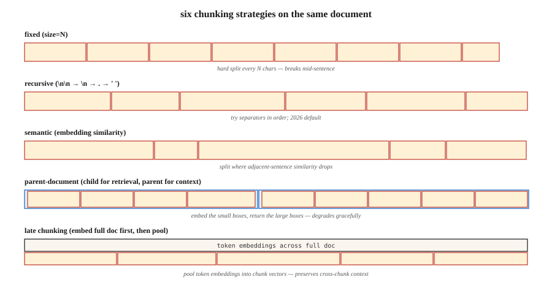

# Strategi Pemotongan untuk RAG

> Konfigurasi pemotongan memengaruhi kualitas pengambilan sama besarnya dengan pilihan model embedding (Vectara NAACL 2025). Salah memotong dan tidak ada jumlah peringkasan ulang pun yang menyelamatkan Anda.

**Jenis:** Bangun
**Bahasa:** Python
**Prasyarat:** Fase 5 · 14 (Information Retrieval), Fase 5 · 22 (Embedding Models)
**Waktu:** ~60 menit

## Masalahnya

Anda memasukkan kontrak 50 halaman ke dalam sistem RAG. Pengguna bertanya: "Apa klausul pemutusan kontrak?" Pengambil mengembalikan halaman sampul. Mengapa? Karena model dilatih pada potongan 512 token, sementara klausul pemutusan berada 20 halaman di dalam, terbelah oleh jeda halaman, dan tidak ada kata kunci lokal yang mengaitkannya dengan kueri.

Solusinya bukan "beli model embedding yang lebih baik." Solusinya adalah pemotongan (chunking). Seberapa besar? Tumpang tindih? Di mana memotong? Dengan konteks di sekitarnya?

Benchmark Februari 2026 menunjukkan hasil yang mengejutkan:

- Studi Vectara 2026: pemotongan rekursif 512 token mengalahkan pemotongan semantik, dengan akurasi 69% → 54%.
- SPLADE + Mistral-8B pada Natural Questions: tumpang tindih memberi manfaat terukur nol.
- Tebing konteks: kualitas respons turun tajam di sekitar 2.500 token konteks.

Jawaban yang "jelas" (pemotongan semantik, tumpang tindih 20%, 1.000 token) sering kali salah. Pelajaran ini membangun intuisi untuk enam strategi dan memberi tahu Anda kapan harus menggunakan masing-masing.

## Konsepnya



**Pemotongan tetap.** Potong setiap N karakter atau token. Baseline paling sederhana. Memutus di tengah kalimat. Kompresi baik, koherensi buruk.

**Rekursif.** `RecursiveCharacterTextSplitter` dari LangChain. Coba potong pada `\n\n` terlebih dahulu, lalu `\n`, lalu `.`, lalu spasi. Kembali secara bersih. Pilihan bawaan 2026.

**Semantik.** Embedding setiap kalimat. Hitung kesamaan kosinus antarkalimat yang berdekatan. Potong ketika kesamaan turun di bawah ambang batas. Menjaga koherensi topik. Lebih lambat; kadang menghasilkan fragmen 40 token yang merusak pengambilan.

**Kalimat.** Potong pada batas kalimat. Satu kalimat per potongan atau jendela N kalimat. Setara dengan pemotongan semantik hingga ~5k token dengan biaya sebagian kecilnya.

**Induk-dokumen.** Simpan potongan anak kecil untuk pengambilan *dan* potongan induk yang lebih besar untuk konteks. Ambil berdasarkan anak; kembalikan induk. Memburuk secara anggun: potongan anak yang buruk tetap mengembalikan induk yang masuk akal.

**Pemotongan akhir (2024).** Embedding seluruh dokumen terlebih dahulu pada tingkat token, lalu gabungkan embedding token menjadi embedding potongan. Menjaga konteks lintas potongan. Bekerja dengan embedder konteks-panjang (BGE-M3, Jina v3). Komputasi lebih tinggi.

**Pengambilan kontekstual (Anthropic, 2024).** Tambahkan di depan setiap potongan ringkasan yang dihasilkan LLM tentang posisinya dalam dokumen ("Potongan ini adalah bagian 3.2 dari klausul pemutusan..."). Peningkatan pengambilan 35-50% pada benchmark internal Anthropic. Mahal untuk diindeks.

### Aturan yang mengalahkan semua nilai bawaan

Samakan ukuran potongan dengan jenis kueri:

| Jenis kueri | Ukuran potongan |
|------------|-----------|
| Faktoid ("siapa nama CEO?") | 256-512 token |
| Analitis / multi-lompat | 512-1.024 token |
| Pemahaman seluruh bagian | 1.024-2.048 token |

Benchmark NVIDIA 2026. Potongan harus cukup besar untuk memuat jawaban beserta konteks lokal, dan cukup kecil sehingga top-K pengambil berfokus pada jawaban, bukan pada derau konteks.

```figure
n5-chunk-cuts
```

## Bangunlah

### Langkah 1: pemotongan tetap dan rekursif

```python
def chunk_fixed(text, size=512, overlap=0):
    step = size - overlap
    return [text[i:i + size] for i in range(0, len(text), step)]


def chunk_recursive(text, size=512, seps=("\n\n", "\n", ". ", " ")):
    if len(text) <= size:
        return [text]
    for sep in seps:
        if sep not in text:
            continue
        parts = text.split(sep)
        chunks = []
        buf = ""
        for p in parts:
            if len(p) > size:
                if buf:
                    chunks.append(buf)
                    buf = ""
                chunks.extend(chunk_recursive(p, size=size, seps=seps[1:] or (" ",)))
                continue
            candidate = buf + sep + p if buf else p
            if len(candidate) <= size:
                buf = candidate
            else:
                if buf:
                    chunks.append(buf)
                buf = p
        if buf:
            chunks.append(buf)
        return [c for c in chunks if c.strip()]
    return chunk_fixed(text, size)
```

### Langkah 2: pemotongan semantik

```python
def chunk_semantic(text, encoder, threshold=0.6, min_chars=200, max_chars=2048):
    sentences = split_sentences(text)
    if not sentences:
        return []
    embs = encoder.encode(sentences, normalize_embeddings=True)
    chunks = [[sentences[0]]]
    for i in range(1, len(sentences)):
        sim = float(embs[i] @ embs[i - 1])
        current_len = sum(len(s) for s in chunks[-1])
        if sim < threshold and current_len >= min_chars:
            chunks.append([sentences[i]])
        else:
            chunks[-1].append(sentences[i])

    result = []
    for group in chunks:
        text_group = " ".join(group)
        if len(text_group) > max_chars:
            result.extend(chunk_recursive(text_group, size=max_chars))
        else:
            result.append(text_group)
    return result
```

Sesuaikan `threshold` pada domain Anda. Terlalu tinggi → fragmen. Terlalu rendah → satu potongan raksasa.

### Langkah 3: induk-dokumen

```python
def chunk_parent_child(text, parent_size=2048, child_size=256):
    parents = chunk_recursive(text, size=parent_size)
    mapping = []
    for p_idx, parent in enumerate(parents):
        children = chunk_recursive(parent, size=child_size)
        for child in children:
            mapping.append({"child": child, "parent_idx": p_idx, "parent": parent})
    return mapping


def retrieve_parent(child_query, mapping, encoder, top_k=3):
    child_embs = encoder.encode([m["child"] for m in mapping], normalize_embeddings=True)
    q_emb = encoder.encode([child_query], normalize_embeddings=True)[0]
    scores = child_embs @ q_emb
    top = np.argsort(-scores)[:top_k]
    seen, parents = set(), []
    for i in top:
        if mapping[i]["parent_idx"] not in seen:
            parents.append(mapping[i]["parent"])
            seen.add(mapping[i]["parent_idx"])
    return parents
```

Wawasan kunci: hilangkan duplikat induk. Beberapa anak dapat memetakan ke induk yang sama; mengembalikan semuanya akan membuang konteks.

### Langkah 4: pengambilan kontekstual (pola Anthropic)

```python
def contextualize_chunks(document, chunks, llm):
    context_prompts = [
        f"""<document>{document}</document>
Here is the chunk to situate: <chunk>{c}</chunk>
Write 50-100 words placing this chunk in the document's context."""
        for c in chunks
    ]
    contexts = llm.batch(context_prompts)
    return [f"{ctx}\n\n{c}" for ctx, c in zip(contexts, chunks)]
```

Indeks potongan yang telah dikontekstualisasi. Saat kueri, pengambilan memanfaatkan sinyal tambahan di sekitarnya.

### Langkah 5: evaluasi

```python
def recall_at_k(queries, corpus_chunks, encoder, k=5):
    chunk_embs = encoder.encode(corpus_chunks, normalize_embeddings=True)
    hits = 0
    for q_text, gold_idxs in queries:
        q_emb = encoder.encode([q_text], normalize_embeddings=True)[0]
        top = np.argsort(-(chunk_embs @ q_emb))[:k]
        if any(i in gold_idxs for i in top):
            hits += 1
    return hits / len(queries)
```

Selalu lakukan benchmark. Strategi "terbaik" untuk korpus Anda mungkin tidak cocok dengan postingan blog mana pun.

## Jebakan

- **Pemotongan hanya dievaluasi pada kueri faktoid.** Kueri multi-lompat mengungkap pemenang yang sangat berbeda. Gunakan himpunan evaluasi yang dikelompokkan menurut jenis kueri.
- **Pemotongan semantik tanpa ukuran minimum.** Menghasilkan fragmen 40 token yang merusak pengambilan. Selalu terapkan `min_tokens`.
- **Tumpang tindih sebagai kebiasaan tanpa dasar.** Studi 2026 menemukan tumpang tindih sering kali memberi manfaat nol dan menggandakan biaya indeks. Ukur, jangan berasumsi.
- **Tanpa penerapan min/maks.** Potongan 5 token maupun 5.000 token sama-sama merusak pengambilan. Batasi.
- **Pemotongan lintas dokumen.** Jangan pernah membiarkan potongan melintasi dua dokumen. Selalu potong per dokumen, lalu gabungkan.

## Gunakanlah

Tumpukan teknologi 2026:

| Situasi | Strategi |
|----------|----------|
| Build awal, korpus tak dikenal | Rekursif, 512 token, tanpa tumpang tindih |
| Tanya-jawab faktoid | Rekursif, 256-512 token |
| Analitis / multi-lompat | Rekursif, 512-1.024 token + induk-dokumen |
| Banyak rujukan silang (kontrak, makalah) | Pemotongan akhir atau pengambilan kontekstual |
| Korpus percakapan / dialog | Potongan tingkat giliran + metadata pembicara |
| Ujaran pendek (tweet, ulasan) | Satu dokumen = satu potongan |

Mulailah dengan rekursif 512. Ukur recall@5 pada himpunan evaluasi 50 kueri. Sesuaikan dari situ.

## Kirimkan

Simpan sebagai `outputs/skill-chunker.md`:

```markdown
---
name: chunker
description: Pilih strategi pemotongan, ukuran, dan tumpang tindih untuk korpus dan distribusi kueri tertentu.
version: 1.0.0
phase: 5
lesson: 23
tags: [nlp, rag, chunking]
---

Dengan korpus (jenis dokumen, panjang rata-rata, domain) dan distribusi kueri (faktoid / analitis / multi-lompat), hasilkan:

1. Strategi. Rekursif / kalimat / semantik / induk-dokumen / akhir / kontekstual. Alasan.
2. Ukuran potongan. Jumlah token. Alasan yang terkait jenis kueri.
3. Tumpang tindih. Bawaan 0; beri justifikasi jika >0.
4. Penerapan min/maks. Pengaman `min_tokens`, `max_tokens`.
5. Rencana evaluasi. Recall@5 pada himpunan evaluasi berstrata 50 kueri (faktoid, analitis, multi-lompat).

Tolak strategi pemotongan apa pun tanpa penerapan ukuran potongan min/maks. Tolak tumpang tindih di atas 20% tanpa ablasi yang menunjukkan manfaatnya. Tandai rekomendasi pemotongan semantik tanpa batas bawah jumlah token.
```

## Latihan

1. **Mudah.** Potong satu dokumen 20 halaman dengan fixed(512, 0), recursive(512, 0), dan recursive(512, 100). Bandingkan jumlah potongan dan kualitas batas.
2. **Sedang.** Bangun himpunan evaluasi 30 kueri atas 5 dokumen. Ukur recall@5 untuk rekursif, semantik, dan induk-dokumen. Mana yang menang? Apakah sesuai dengan postingan blog?
3. **Sulit.** Terapkan pengambilan kontekstual. Ukur peningkatan MRR dibanding baseline rekursif. Laporkan biaya indeks (panggilan LLM) versus perolehan akurasi.

## Istilah Kunci

| Istilah | Yang orang katakan | Arti sebenarnya |
|------|-----------------|-----------------------|
| Potongan (chunk) | Bagian dari dokumen | Unit sub-dokumen yang diembedding, diindeks, dan diambil. |
| Tumpang tindih (overlap) | Margin pengaman | N token yang dibagikan antar potongan bersebelahan; sering tak berguna pada benchmark 2026. |
| Pemotongan semantik | Pemotongan cerdas | Potong ketika kesamaan embedding kalimat bersebelahan turun. |
| Induk-dokumen | Pengambilan dua tingkat | Ambil anak kecil, kembalikan induk lebih besar. |
| Pemotongan akhir | Potong setelah embedding | Embedding dokumen penuh pada tingkat token, gabungkan menjadi vektor potongan. |
| Pengambilan kontekstual | Trik Anthropic | Ringkasan yang dihasilkan LLM ditambahkan di depan setiap potongan sebelum diindeks. |
| Tebing konteks | Dinding 2.500 token | Penurunan kualitas yang diamati di sekitar 2,5k token konteks pada RAG (Jan 2026). |

## Bacaan Lebih Lanjut

- [Yepes et al. / LangChain — Dokumentasi Recursive Character Splitting](https://python.langchain.com/docs/how_to/recursive_text_splitter/) — nilai bawaan dalam produksi.
- [Vectara (2024, NAACL 2025). Analisis konfigurasi pemotongan](https://arxiv.org/abs/2410.13070) — pemotongan sama pentingnya dengan pilihan embedding.
- [Jina AI — Late Chunking in Long-Context Embedding Models (2024)](https://jina.ai/news/late-chunking-in-long-context-embedding-models/) — makalah pemotongan akhir.
- [Anthropic — Contextual Retrieval](https://www.anthropic.com/news/contextual-retrieval) — peningkatan pengambilan 35-50% dengan awalan konteks yang dihasilkan LLM.
- [Benchmark ukuran potongan NVIDIA 2026 — ringkasan Premai](https://blog.premai.io/rag-chunking-strategies-the-2026-benchmark-guide/) — ukuran potongan menurut jenis kueri.
