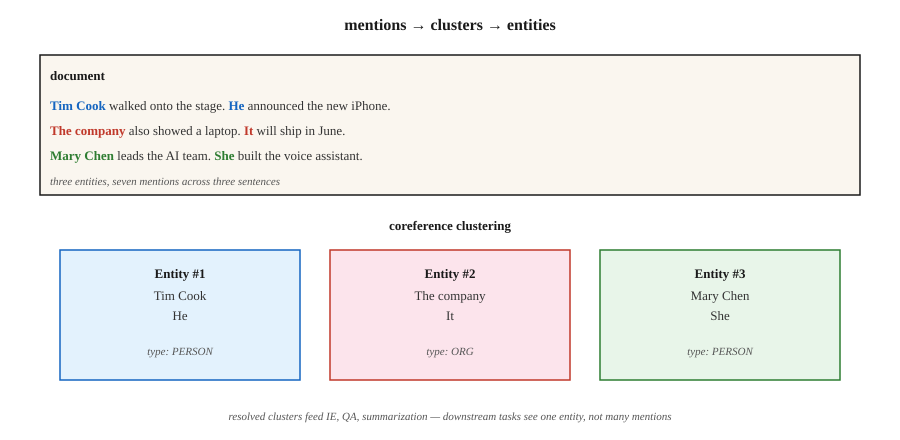

# Resolusi Koreferensi

> "Ia meneleponnya. Ia tidak menjawab. Sang dokter sedang makan siang." Tiga rujukan kepada dua orang dan tidak ada yang disebut namanya. Resolusi koreferensi mencari tahu siapa itu siapa.

**Jenis:** Belajar
**Bahasa:** Python, TypeScript
**Prasyarat:** Fase 5 · 06 (NER), Fase 5 · 07 (POS & Parsing)
**Waktu:** ~60 menit

## Masalahnya

Ekstrak setiap penyebutan Apple Inc. dari artikel 300 kata. Mudah ketika artikel menulis "Apple." Sulit ketika menulis "perusahaan itu," "mereka," "raksasa teknologi dari Cupertino," atau "perusahaan Jobs." Tanpa menyelesaikan penyebutan-penyebutan ini ke entitas yang sama, pipeline NER Anda melewatkan 60-80% penyebutan.

Resolusi koreferensi menghubungkan setiap ungkapan yang merujuk ke entitas dunia nyata yang sama ke dalam satu klaster. Resolusi koreferensi adalah perekat antara NLP permukaan (NER, parsing) dan semantik hilir (IE, QA, ringkasan, KG).

Mengapa ini penting pada 2026:

- Ringkasan: "CEO mengumumkan..." versus "Tim Cook mengumumkan..." — ringkasan sebaiknya menyebut nama CEO.
- Tanya-jawab: "Siapa yang ia telepon?" memerlukan resolusi untuk "ia".
- Ekstraksi informasi: graf pengetahuan dengan "PER1 mendirikan Apple" dan "Jobs mendirikan Apple" sebagai entri terpisah itu salah.
- IE multidokumen: menggabungkan penyebutan lintas artikel tentang peristiwa yang sama adalah koreferensi lintas dokumen.

## Konsepnya



**Tugasnya.** Masukan: sebuah dokumen. Keluaran: pengklasteran penyebutan (span) yang setiap klaster merujuk ke satu entitas.

**Jenis penyebutan.**

- **Entitas bernama.** "Tim Cook"
- **Nominal.** "CEO itu", "perusahaan itu"
- **Pronominal.** "he", "she", "they", "it"
- **Aposisi.** "Tim Cook, CEO Apple,"

**Arsitektur.**

1. **Berbasis aturan (Hobbs, 1978).** Resolusi kata ganti berbasis pohon sintaksis menggunakan aturan tata bahasa. Baseline yang baik. Sulit dikalahkan pada kata ganti.
2. **Klasifikasi pasangan penyebutan.** Untuk setiap pasangan penyebutan $(m_i, m_j)$, prediksi apakah keduanya korefer. Klasterkan dengan penutupan transitif. Standar sebelum 2016.
3. **Peringkatan penyebutan.** Untuk setiap penyebutan, beri peringkat kandidat anteseden (termasuk "tanpa anteseden"). Pilih yang teratas.
4. **Ujung ke ujung berbasis span (Lee et al., 2017).** Encoder transformer. Enumerasi semua kandidat span hingga batas panjang. Prediksi skor penyebutan. Prediksi probabilitas anteseden untuk setiap span. Klasterkan secara serakah. Pilihan bawaan modern.
5. **Generatif (2024+).** Beri prompt LLM: "Daftarkan setiap kata ganti dalam teks ini dan antesedennya." Bekerja baik pada kasus mudah, kesulitan pada dokumen panjang dan referen langka.

**Metrik evaluasi.** Lima metrik standar (MUC, B³, CEAF, BLANC, LEA) karena tidak ada satu metrik pun yang menangkap kualitas pengklasteran. Laporkan rata-rata tiga metrik pertama sebagai CoNLL F1. State-of-the-art pada 2026 di CoNLL-2012: ~83 F1.

**Kasus sulit yang diketahui.**

- Deskripsi definit yang merujuk ke entitas yang diperkenalkan beberapa halaman sebelumnya.
- Anafora jembatan ("roda itu" → mobil yang disebut sebelumnya).
- Anafora nol pada bahasa seperti Tionghoa dan Jepang.
- Katafora (kata ganti sebelum referen): "Ketika **ia** masuk, Mary tersenyum."

```figure
coref-links
```

## Bangunlah

### Langkah 1: koreferensi neural terlatih (AllenNLP / spaCy-experimental)

```python
import spacy
nlp = spacy.load("en_coreference_web_trf")   # model eksperimental
doc = nlp("Apple announced new products. The company said it would ship them soon.")
for cluster in doc._.coref_clusters:
    print(cluster, "->", [m.text for m in cluster])
```

Pada dokumen yang lebih panjang, Anda mendapatkan seperti:
- Klaster 1: [Apple, The company, it]
- Klaster 2: [new products, them]

### Langkah 2: resolver kata ganti berbasis aturan (pengajaran)

Lihat `code/main.py` untuk implementasi hanya dengan stdlib:

1. Ekstrak penyebutan: entitas bernama (span dengan huruf kapital), kata ganti (pencarian dict), deskripsi definit ("the X").
2. Untuk setiap kata ganti, lihat K penyebutan sebelumnya dan beri skor berdasarkan:
   - kesepakatan gender/jumlah (heuristik)
   - kedekatan (yang lebih dekat menang)
   - peran sintaksis (subjek diutamakan)
3. Hubungkan dengan anteseden ber-skor tertinggi.

Tidak sebanding dengan model neural. Tetapi ini menunjukkan ruang pencarian dan keputusan yang harus dibuat model ujung ke ujung.

### Langkah 3: menggunakan LLM untuk koreferensi

```python
prompt = f"""Text: {text}

List every pronoun and noun phrase that refers to a person or company.
Cluster them by what they refer to. Output JSON:
[{{"entity": "Apple", "mentions": ["Apple", "the company", "it"]}}, ...]
"""
```

Dua mode kegagalan yang perlu diwaspadai. Pertama, LLM menggabungkan berlebihan ("him" dan "her" yang merujuk ke dua orang berbeda). Kedua, LLM diam-diam menghilangkan penyebutan dalam dokumen panjang. Selalu verifikasi dengan pemeriksaan offset span.

### Langkah 4: evaluasi

Skrip conll-2012 standar menghitung MUC, B³, CEAF-φ4 dan melaporkan rata-ratanya. Untuk evaluasi internal, mulailah dengan presisi dan recall tingkat span pada himpunan uji beranotasi, lalu tambahkan F1 penghubung penyebutan.

## Jebakan

- **Ledakan singleton.** Beberapa sistem melaporkan setiap penyebutan sebagai klasternya sendiri. B³ longgar. MUC menghukum ini. Selalu periksa ketiga metrik.
- **Kata ganti dalam konteks panjang.** Kinerja turun ~15 F1 pada dokumen lebih dari 2.000 token. Potong dengan hati-hati.
- **Asumsi gender.** Aturan gender yang ditanam tetap gagal pada referen non-biner, organisasi, dan hewan. Gunakan model terlatih atau penilaian netral.
- **Pergeseran LLM pada dokumen panjang.** Satu panggilan API tidak dapat mengklasterkan penyebutan secara andal lintas 50+ paragraf. Gunakan jendela geser + penggabungan.

## Gunakanlah

Tumpukan teknologi 2026:

| Situasi | Pilihan |
|----------|----------|
| Inggris, satu dokumen | `en_coreference_web_trf` (spaCy-experimental) atau koref neural AllenNLP |
| Multibahasa | SpanBERT / XLM-R yang dilatih pada OntoNotes atau CoNLL Multibahasa |
| Koref peristiwa lintas dokumen | Model ujung ke ujung khusus (SOTA 2025–26) |
| Baseline LLM cepat | GPT-4o / Claude dengan prompt koref berkeluaran terstruktur |
| Sistem dialog produksi | Fallback berbasis aturan + utama neural + tinjauan manual untuk slot kritis |

Pola integrasi yang dikirim pada 2026: jalankan NER terlebih dahulu, jalankan koref, gabungkan klaster koref ke entitas NER. Tugas hilir melihat satu entitas per klaster, bukan satu entitas per penyebutan.

## Kirimkan

Simpan sebagai `outputs/skill-coref-picker.md`:

```markdown
---
name: coref-picker
description: Pilih pendekatan resolusi koreferensi, rencana evaluasi, dan strategi integrasi.
version: 1.0.0
phase: 5
lesson: 24
tags: [nlp, coref, information-extraction]
---

Dengan kasus penggunaan (satu dokumen / banyak dokumen, domain, bahasa), hasilkan:

1. Pendekatan. Berbasis aturan / span neural / berbasis prompt LLM / hibrida. Alasan satu kalimat.
2. Model. Checkpoint bernama jika neural.
3. Integrasi. Urutan operasi: tokenisasi → NER → koref → tugas hilir.
4. Evaluasi. CoNLL F1 (rata-rata MUC + B³ + CEAF-φ4) pada himpunan tersembunyi + tinjauan klaster manual pada 20 dokumen.

Tolak koref hanya-LLM untuk dokumen lebih dari 2.000 token tanpa penggabungan jendela geser. Tolak pipeline apa pun yang menjalankan koref tanpa laporan presisi-recall tingkat penyebutan. Tandai sistem berheuristik gender yang diterapkan pada teks dengan keragaman demografi.
```

## Latihan

1. **Mudah.** Jalankan resolver berbasis aturan di `code/main.py` pada 5 paragraf buatan manual. Ukur akurasi penghubung penyebutan terhadap kebenaran dasar (ground truth).
2. **Sedang.** Gunakan model koref neural terlatih pada artikel berita. Bandingkan klaster dengan anotasi manual Anda sendiri. Di mana ia gagal?
3. **Sulit.** Bangun pipeline NER yang ditingkatkan koref: NER terlebih dahulu, lalu gabungkan melalui klaster koref. Ukur peningkatan cakupan entitas versus NER saja pada 100 artikel.

## Istilah Kunci

| Istilah | Yang orang katakan | Arti sebenarnya |
|------|-----------------|-----------------------|
| Penyebutan (mention) | Sebuah rujukan | Span teks yang merujuk ke entitas (nama, kata ganti, frasa nomina). |
| Anteseden | Yang dimaksud "ia" | Penyebutan lebih awal yang dikorefer oleh penyebutan berikutnya. |
| Klaster | Penyebutan entitas itu | Himpunan penyebutan yang semuanya merujuk ke entitas dunia nyata yang sama. |
| Anafora | Rujukan ke belakang | Penyebutan kemudian merujuk ke yang lebih awal ("he" → "John"). |
| Katafora | Rujukan ke depan | Penyebutan lebih awal merujuk ke yang kemudian ("When he arrived, John..."). |
| Pengjembatan | Rujukan implisit | "Saya membeli mobil. Rodanya buruk." (roda mobil ITU.) |
| CoNLL F1 | Angka di papan peringkat | Rata-rata skor F1 MUC, B³, CEAF-φ4. |

## Bacaan Lebih Lanjut

- [Jurafsky & Martin, SLP3 Bab 26 — Resolusi Koreferensi dan Penautan Entitas](https://web.stanford.edu/~jurafsky/slp3/26.pdf) — bab buku teks kanonik.
- [Lee et al. (2017). End-to-end Neural Coreference Resolution](https://arxiv.org/abs/1707.07045) — ujung ke ujung berbasis span.
- [Joshi et al. (2020). SpanBERT](https://arxiv.org/abs/1907.10529) — pra-pelatihan yang meningkatkan koref.
- [Pradhan et al. (2012). CoNLL-2012 Shared Task](https://aclanthology.org/W12-4501/) — benchmark-nya.
- [Hobbs (1978). Resolving Pronoun References](https://www.sciencedirect.com/science/article/pii/0024384178900064) — klasik berbasis aturan.
