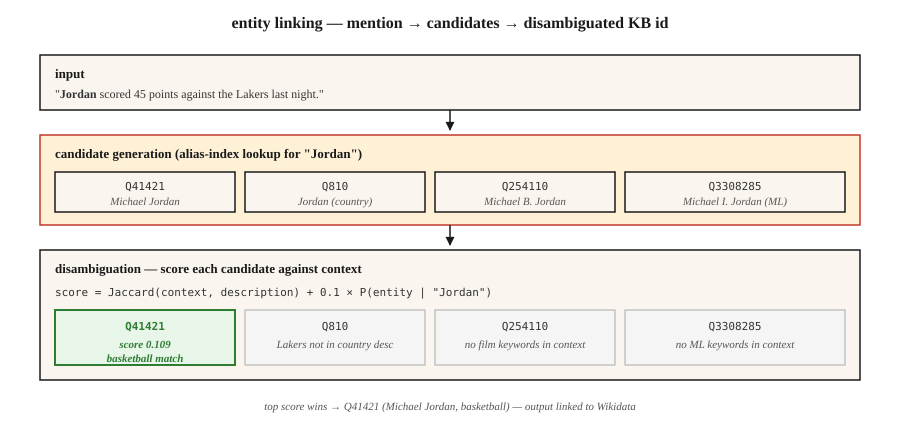

# Penautan Entitas & Disambiguasi

> NER menemukan "Paris." Penautan entitas memutuskan: Paris, Prancis? Paris Hilton? Paris, Texas? Paris (pangeran Troya)? Tanpa penautan, graf pengetahuan Anda tetap ambigu.

**Jenis:** Bangun
**Bahasa:** Python, TypeScript
**Prasyarat:** Fase 5 · 06 (NER), Fase 5 · 24 (Coreference Resolution)
**Waktu:** ~60 menit

## Masalahnya

Sebuah kalimat berbunyi: "Jordan mengalahkan pers." NER Anda menandai "Jordan" sebagai PERSON. Bagus. Tetapi *Jordan* yang mana?

- Michael Jordan (bola basket)?
- Michael B. Jordan (aktor)?
- Michael I. Jordan (profesor ML Berkeley — ya, kebingungan ini nyata dalam makalah ML)?
- Jordan (negara)?
- Jordan (nama depan Ibrani)?

Penautan entitas (EL) menyelesaikan setiap penyebutan menjadi entri unik dalam basis pengetahuan: Wikidata, Wikipedia, DBpedia, atau KB domain Anda. Dua sub-tugas:

1. **Pembangkitan kandidat.** Dengan "Jordan," entri KB mana yang masuk akal?
2. **Disambiguasi.** Dengan konteks yang ada, kandidat mana yang benar?

Kedua langkah dapat dipelajari. Keduanya memiliki benchmark. Pipeline gabungan ini stabil selama satu dekade — yang berubah adalah kualitas disambiguasinya.

## Konsepnya



**Pembangkitan kandidat.** Dengan bentuk permukaan penyebutan ("Jordan"), cari kandidat dalam indeks alias. Kamus alias Wikipedia mencakup sebagian besar entitas bernama: "JFK" → John F. Kennedy, Jacqueline Kennedy, bandara JFK, JFK (film). Indeks umumnya mengembalikan 10-30 kandidat per penyebutan.

**Disambiguasi: tiga pendekatan.**

1. **Prior + konteks (Milne & Witten, 2008).** `P(entity | mention) × context-similarity(entity, text)`. Bekerja baik, cepat, tanpa pelatihan.
2. **Berbasis embedding (ESS / REL / Blink).** Encode penyebutan + konteks. Encode deskripsi setiap kandidat. Pilih kosinus maksimum. Pilihan bawaan 2020-2024.
3. **Generatif (GENRE, 2021; berbasis LLM, 2023+).** Dekode nama kanonik entitas token per token. Dibatasi oleh trie nama entitas yang valid sehingga keluaran dijamin berupa id KB yang valid.

**Ujung ke ujung versus pipeline.** Model modern (ELQ, BLINK, ExtEnD, GENRE) menjalankan NER + pembangkitan kandidat + disambiguasi dalam satu lintasan. Sistem pipeline masih mendominasi produksi karena komponennya dapat diganti.

### Dua pengukuran

- **Recall penyebutan (pembangkitan kandidat).** Fraksi penyebutan emas yang entri KB benarnya muncul dalam daftar kandidat. Batas bawah untuk seluruh pipeline.
- **Akurasi / F1 disambiguasi.** Dengan kandidat yang benar tersedia, seberapa sering top-1 tepat.

Selalu laporkan keduanya. Sistem dengan disambiguasi 99% pada recall kandidat 80% adalah pipeline 80%.

```figure
gx-entity-linking
```

## Bangunlah

### Langkah 1: membangun indeks alias dari pengalihan Wikipedia

```python
alias_to_entities = {
    "jordan": ["Q41421 (Michael Jordan)", "Q810 (Jordan, country)", "Q254110 (Michael B. Jordan)"],
    "paris":  ["Q90 (Paris, France)", "Q663094 (Paris, Texas)", "Q55411 (Paris Hilton)"],
    "apple":  ["Q312 (Apple Inc.)", "Q89 (apple, fruit)"],
}
```

Data alias Wikipedia: ~18 juta pasangan (alias, entitas). Unduh dari dump Wikidata. Simpan sebagai indeks terbalik (inverted index).

### Langkah 2: disambiguasi berbasis konteks

```python
def disambiguate(mention, context, alias_index, entity_desc):
    candidates = alias_index.get(mention.lower(), [])
    if not candidates:
        return None, 0.0
    context_words = set(tokenize(context))
    best, best_score = None, -1
    for entity_id in candidates:
        desc_words = set(tokenize(entity_desc[entity_id]))
        union = len(context_words | desc_words)
        score = len(context_words & desc_words) / union if union else 0.0
        if score > best_score:
            best, best_score = entity_id, score
    return best, best_score
```

Tumpang tindih Jaccard hanyalah mainan. Ganti dengan kesamaan kosinus pada embedding (lihat `code/main.py` langkah-2 untuk versi transformer).

### Langkah 3: berbasis embedding (gaya BLINK)

```python
from sentence_transformers import SentenceTransformer
encoder = SentenceTransformer("sentence-transformers/all-MiniLM-L6-v2")

def embed_mention(text, mention_span):
    start, end = mention_span
    marked = f"{text[:start]} [MENTION] {text[start:end]} [/MENTION] {text[end:]}"
    return encoder.encode([marked], normalize_embeddings=True)[0]

def embed_entity(entity_id, description):
    return encoder.encode([f"{entity_id}: {description}"], normalize_embeddings=True)[0]
```

Saat pengindeksan, embedding setiap entitas KB sekali. Saat kueri, embedding penyebutan + konteks sekali, hasil kali titik terhadap kumpulan kandidat, pilih yang maksimum.

### Langkah 4: penautan entitas generatif (konsep)

GENRE mendekode judul Wikipedia entitas karakter per karakter. Dekode terbatas (lihat pelajaran 20) memastikan hanya judul valid yang dapat dikeluarkan. Integrasi ketat dengan trie yang didukung KB. Keturunan modernnya adalah REL-GEN dan EL berbasis prompt LLM dengan keluaran terstruktur.

```python
prompt = f"""Text: {text}
Mention: {mention}
List the best Wikipedia title for this mention.
Respond with JSON: {{"title": "..."}}"""
```

Dikombinasikan dengan daftar putih (Outlines `choice`), ini adalah pipeline EL paling sederhana yang bisa dikirim pada 2026.

### Langkah 5: evaluasi pada AIDA-CoNLL

AIDA-CoNLL adalah benchmark EL standar: 1.393 artikel Reuters, 34k penyebutan, entitas Wikipedia. Laporkan akurasi dalam-KB (`P@1`) dan laju deteksi NIL di luar KB.

## Jebakan

- **Penanganan NIL.** Beberapa penyebutan tidak ada di KB (entitas baru, orang yang tidak dikenal). Sistem harus memprediksi NIL alih-alih menebak entitas yang salah. Diukur terpisah.
- **Kesalahan batas penyebutan.** NER hulu melewatkan span sebagian ("Bank of America" ditandai hanya sebagai "Bank"). Recall EL turun.
- **Bias popularitas.** Sistem terlatih memprediksi secara berlebihan entitas yang sering muncul. Penyebutan "Michael I. Jordan" dalam makalah ML sering ditautkan ke Jordan si pebasket.
- **EL lintas bahasa.** Memetakan penyebutan dalam teks Tionghoa ke entitas Wikipedia Inggris. Memerlukan encoder multibahasa atau langkah terjemahan.
- **KB usang.** Perusahaan, peristiwa, dan orang baru tidak ada dalam dump Wikipedia tahun lalu. Pipeline produksi memerlukan siklus penyegaran.

## Gunakanlah

Tumpukan teknologi 2026:

| Situasi | Pilihan |
|----------|----------|
| Umum, Inggris + Wikipedia | BLINK atau REL |
| Lintas bahasa, KB = Wikipedia | mGENRE |
| Ramah LLM, beberapa penyebutan per hari | Prompt Claude/GPT-4 dengan daftar kandidat + JSON terbatas |
| KB spesifik domain (medis, hukum) | BERT khusus dengan pengambilan sadar-KB + fine-tuning pada himpunan bergaya AIDA domain |
| Latensi sangat rendah | Hanya prior pencocokan persis (baseline Milne-Witten) |
| SOTA riset | GENRE / ExtEnD / EL-LLM generatif |

Pola produksi yang dikirim pada 2026: NER → koref → EL pada setiap penyebutan → rangkum klaster menjadi satu entitas kanonik per klaster. Keluaran: satu id KB per entitas dalam dokumen, bukan satu per penyebutan.

## Kirimkan

Simpan sebagai `outputs/skill-entity-linker.md`:

```markdown
---
name: entity-linker
description: Rancang pipeline penautan entitas — KB, pembangkit kandidat, disambiguator, evaluasi.
version: 1.0.0
phase: 5
lesson: 25
tags: [nlp, entity-linking, knowledge-graph]
---

Dengan kasus penggunaan (KB domain, bahasa, volume, anggaran latensi), hasilkan:

1. Basis pengetahuan. Wikidata / Wikipedia / KB khusus. Tanggal versi. Kadenesi penyegaran.
2. Pembangkit kandidat. Indeks alias, embedding, atau hibrida. Target recall penyebutan @ K.
3. Disambiguator. Prior + konteks, berbasis embedding, generatif, atau berbasis prompt LLM.
4. Strategi NIL. Ambang batas pada skor teratas, classifier, atau kandidat NIL eksplisit.
5. Evaluasi. Recall penyebutan @ 30, akurasi top-1, F1 deteksi NIL pada himpunan tersembunyi.

Tolak pipeline EL apa pun tanpa baseline recall penyebutan (Anda tidak dapat mengevaluasi disambiguator tanpa mengetahui apakah pembangkit kandidat menemukan entitas yang benar). Tolak pipeline apa pun yang menggunakan EL berbasis prompt LLM tanpa keluaran terbatas pada id KB yang valid. Tandai sistem yang bias popularitasnya merugikan entitas minoritas (misalnya bentrok nama) tanpa fine-tuning domain.
```

## Latihan

1. **Mudah.** Terapkan disambiguator prior+konteks di `code/main.py` pada 10 penyebutan ambigu (Paris, Jordan, Apple). Beri label manual entitas yang benar. Ukur akurasi.
2. **Sedang.** Encode 50 penyebutan ambigu dengan sentence transformer. Embedding deskripsi setiap kandidat. Bandingkan disambiguasi berbasis embedding dengan tumpang tindih konteks Jaccard.
3. **Sulit.** Bangun KB domain 1k entitas (misalnya karyawan + produk di perusahaan Anda). Terapkan NER + EL ujung ke ujung. Ukur presisi dan recall pada 100 kalimat tersembunyi.

## Istilah Kunci

| Istilah | Yang orang katakan | Arti sebenarnya |
|------|-----------------|-----------------------|
| Penautan entitas (EL) | Tautkan ke Wikipedia | Petakan penyebutan ke entri KB unik. |
| Pembangkitan kandidat | Bisa jadi siapa? | Kembalikan daftar pendek entri KB yang mungkin untuk penyebutan. |
| Disambiguasi | Pilih yang benar | Skor kandidat menggunakan konteks, pilih pemenangnya. |
| Indeks alias | Tabel pencarian | Pemetaan dari bentuk permukaan → entitas kandidat. |
| NIL | Tidak ada di KB | Prediksi eksplisit bahwa tidak ada entri KB yang cocok. |
| KB | Basis pengetahuan | Wikidata, Wikipedia, DBpedia, atau KB domain Anda. |
| AIDA-CoNLL | Benchmark-nya | 1.393 artikel Reuters dengan tautan entitas emas. |

## Bacaan Lebih Lanjut

- [Milne, Witten (2008). Learning to Link with Wikipedia](https://researchcommons.waikato.ac.nz/entities/publication/b9a0b520-abc5-47c5-a86a-da6c579893ab) — pendekatan prior+konteks yang menjadi landasan.
- [Wu et al. (2020). Zero-shot Entity Linking with Dense Entity Retrieval (BLINK)](https://arxiv.org/abs/1911.03814) — mesin kerja berbasis embedding.
- [De Cao et al. (2021). Autoregressive Entity Retrieval (GENRE)](https://arxiv.org/abs/2010.00904) — EL generatif dengan dekode terbatas.
- [Hoffart et al. (2011). Robust Disambiguation of Named Entities in Text (AIDA)](https://www.aclweb.org/anthology/D11-1072.pdf) — makalah benchmark-nya.
- [REL: An Entity Linker Standing on the Shoulders of Giants (2020)](https://arxiv.org/abs/2006.01969) — tumpukan produksi terbuka.
