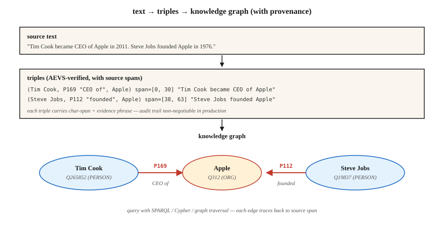

# Ekstraksi Relasi & Pembangunan Graf Pengetahuan

> NER menemukan entitasnya. Penautan entitas menguncinya. Ekstraksi relasi menemukan sisi (edge) di antaranya. Graf pengetahuan adalah gabungan simpul, sisi, dan provenannya.

**Jenis:** Bangun
**Bahasa:** Python, TypeScript
**Prasyarat:** Fase 5 · 06 (NER), Fase 5 · 25 (Entity Linking)
**Waktu:** ~60 menit

## Masalahnya

Seorang analis membaca: "Tim Cook menjadi CEO Apple pada 2011." Empat fakta:

- `(Tim Cook, role, CEO)`
- `(Tim Cook, employer, Apple)`
- `(Tim Cook, start_date, 2011)`
- `(Apple, type, Organization)`

Ekstraksi relasi (RE) mengubah teks bebas menjadi triple terstruktur `(subject, relation, object)`. Agregasi lintas korpus menghasilkan graf pengetahuan. Agregasi dan kueri menghasilkan landasan penalaran untuk RAG, analitik, atau audit kepatuhan.

Masalah 2026: LLM mengekstrak relasi dengan antusias. Terlalu antusias. Mereka menghalusinasi triple yang tidak didukung teks sumber. Tanpa provenansi, Anda tidak dapat membedakan triple nyata dari fiksi yang tampak masuk akal. Jawaban 2026 adalah pipeline jangkar-dan-verifikasi bergaya AEVS.

## Konsepnya



**Bentuk triple.** `(subject_entity, relation_type, object_entity)`. Relasi berasal dari ontologi tertutup (properti Wikidata, FIBO, UMLS) atau himpunan terbuka (gaya OpenIE, apa pun boleh).

**Tiga pendekatan ekstraksi.**

1. **Berbasis aturan / pola.** Pola Hearst: "X such as Y" → `(Y, isA, X)`. Ditambah regex buatan manual. Rapuh, presisi, dapat dijelaskan.
2. **Klasifikasi terselia.** Dengan dua penyebutan entitas dalam kalimat, prediksi relasinya dari himpunan tetap. Dilatih pada TACRED, ACE, KBP. Standar 2015–2022.
3. **LLM generatif.** Beri prompt model untuk menghasilkan triple. Bekerja langsung tanpa penyesuaian. Memerlukan provenansi, jika tidak akan menghalusinasi sampah yang tampak masuk akal.

**AEVS (Anchor-Extraction-Verification-Supplement, 2026).** Kerangka mitigasi halusinasi saat ini:

- **Jangkar (Anchor).** Identifikasi setiap span entitas dan span frasa relasi dengan posisi pasti.
- **Ekstraksi (Extraction).** Hasilkan triple yang terhubung ke span jangkar.
- **Verifikasi (Verification).** Cocokkan kembali setiap elemen triple dengan teks sumber; tolak apa pun yang tidak didukung.
- **Tambahan (Supplement).** Lintasan cakupan memastikan tidak ada span jangkar yang terlewat.

Halusinasi turun tajam. Memerlukan lebih banyak komputasi tetapi dapat diaudit.

**Trade-off terbuka versus tertutup.**

- **Ontologi tertutup.** Daftar properti tetap (misalnya 11.000+ properti Wikidata). Dapat diprediksi. Dapat dikueri. Sulit dibuat-buat.
- **Open IE.** Frasa verbal apa pun menjadi relasi. Recall tinggi. Presisi rendah. Ribet untuk dikueri.

KG produksi biasanya mencampur: Open IE untuk penemuan, lalu kanonisasi relasi ke ontologi tertutup sebelum digabungkan ke graf utama.

```figure
relation-triples
```

## Bangunlah

### Langkah 1: ekstraksi berbasis pola

```python
PATTERNS = [
    (r"(?P<s>[A-Z]\w+) (?:is|was) (?:a|an|the) (?P<o>[A-Z]?\w+)", "isA"),
    (r"(?P<s>[A-Z]\w+) (?:is|was) born in (?P<o>\w+)", "bornIn"),
    (r"(?P<s>[A-Z]\w+) works? (?:at|for) (?P<o>[A-Z]\w+)", "worksAt"),
    (r"(?P<s>[A-Z]\w+) founded (?P<o>[A-Z]\w+)", "founded"),
]
```

Lihat `code/main.py` untuk ekstraktor mainan lengkap. Pola Hearst masih dikirim dalam pipeline spesifik-domain karena dapat di-debug.

### Langkah 2: ekstraksi relasi seq2seq terselia

```python
from transformers import AutoTokenizer, AutoModelForSeq2SeqLM

tok = AutoTokenizer.from_pretrained("Babelscape/rebel-large")
model = AutoModelForSeq2SeqLM.from_pretrained("Babelscape/rebel-large")

text = "Tim Cook was born in Alabama. He later became CEO of Apple."
encoded = tok(text, return_tensors="pt", truncation=True)
output = model.generate(**encoded, max_length=200)
decoded = tok.batch_decode(output, skip_special_tokens=False)
```

REBEL adalah ekstraktor relasi seq2seq berbasis BART: ia menghasilkan triple alih-alih mengklasifikasikan pasangan entitas. Teks masuk, triple keluar, dengan nama relasi diambil dari properti Wikidata. String hasil dekode masih membawa penanda `<triplet>`, `<subj>`, dan `<obj>` dari REBEL, jadi pisahkan berdasarkan penanda tersebut (seperti parser pada kartu model) untuk mendapatkan catatan `(subject, relation, object)`. Model ini disetel halus pada data pengawasan jarak (distant supervision). Baseline bobot-terbuka standar.

### Langkah 3: ekstraksi berbasis prompt LLM dengan penjangkaran

```python
prompt = f"""Extract (subject, relation, object) triples from the text.
For each triple, include the exact character span in the source text.

Text: {text}

Output JSON:
[{{"subject": {{"text": "...", "span": [start, end]}},
   "relation": "...",
   "object": {{"text": "...", "span": [start, end]}}}}, ...]

Only include triples fully supported by the text. No inference beyond what is stated.
"""
```

Verifikasi setiap span yang dikembalikan terhadap sumber. Tolak apa pun yang `text[start:end] != triple_entity`. Ini adalah langkah "verifikasi" AEVS dalam bentuk minimalnya.

### Langkah 4: kanonisasi ke ontologi tertutup

```python
RELATION_MAP = {
    "is the CEO of": "P169",       # "direktur utama"
    "was born in":   "P19",         # "tempat lahir"
    "founded":        "P112",       # "didirikan oleh" (subjek/objek dibalik)
    "works at":       "P108",       # "pemberi kerja"
}


def canonicalize(relation):
    rel_low = relation.lower().strip()
    if rel_low in RELATION_MAP:
        return RELATION_MAP[rel_low]
    return None   # buang relasi terbuka yang tidak dipetakan atau arahkan ke tinjauan manual
```

Kanonisasi sering menyumbang 60-80% pekerjaan rekayasa. Anggarkan.

### Langkah 5: membangun graf kecil dan melakukan kueri

```python
triples = extract(text)
graph = {}
for s, r, o in triples:
    graph.setdefault(s, []).append((r, o))


def neighbors(node, relation=None):
    return [(r, o) for r, o in graph.get(node, []) if relation is None or r == relation]


print(neighbors("Tim Cook", relation="P108"))    # -> [(P108, Apple)]
```

Ini adalah atom dari setiap sistem RAG yang berjalan di atas KG. Skalakan dengan toko triple RDF (Blazegraph, Virtuoso), graf properti (Neo4j), atau toko graf yang dilengkapi vektor.

## Jebakan

- **Koreferensi sebelum RE.** "Ia mendirikan Apple" — RE perlu tahu siapa "ia" itu. Jalankan koref terlebih dahulu (pelajaran 24).
- **Kanonisasi entitas.** "Apple Inc" dan "Apple" harus menjadi simpul yang sama. Penautan entitas terlebih dahulu (pelajaran 25).
- **Triple halusinatif.** LLM menghasilkan triple yang tidak didukung teks. Terapkan verifikasi span.
- **Pergeseran kanonisasi relasi.** Relasi Open IE tidak konsisten ("was born in," "came from," "is a native of"). Rangkum menjadi id kanonik, jika tidak graf tidak dapat dikueri.
- **Kesalahan temporal.** "Tim Cook adalah CEO Apple" — benar sekarang, salah pada 2005. Banyak relasi terikat waktu. Gunakan qualifier (`P580` waktu mulai, `P582` waktu selesai di Wikidata).
- **Ketidaksesuaian domain.** REBEL dilatih pada Wikipedia. Teks hukum, medis, dan ilmiah sering memerlukan model RE yang disetel halus untuk domain.

## Gunakanlah

Tumpukan teknologi 2026:

| Situasi | Pilihan |
|----------|----------|
| Produksi cepat, domain umum | REBEL atau LlamaPred dengan kanonisasi Wikidata |
| Spesifik domain (biomed, hukum) | Fine-tuning domain gaya SciREX + ontologi khusus |
| Berbasis prompt LLM, keluaran diaudit | Pipeline AEVS: jangkar → ekstraksi → verifikasi → tambahan |
| IE berita volume tinggi | Hibrida berbasis pola + terselia |
| Membangun KG dari awal | Open IE + lintasan kanonisasi manual |
| KG temporal | Ekstraksi dengan qualifier (waktu mulai/selesai, titik waktu) |

Pola integrasi: NER → koref → penautan entitas → ekstraksi relasi → pemetaan ontologi → pemuatan graf. Setiap tahap adalah gerbang kualitas potensial.

## Kirimkan

Simpan sebagai `outputs/skill-re-designer.md`:

```markdown
---
name: re-designer
description: Rancang pipeline ekstraksi relasi dengan provenansi dan kanonisasi.
version: 1.0.0
phase: 5
lesson: 26
tags: [nlp, relation-extraction, knowledge-graph]
---

Dengan korpus (domain, bahasa, volume) dan penggunaan hilir (KG-RAG, analitik, kepatuhan), hasilkan:

1. Ekstraktor. Berbasis pola / terselia / LLM / hibrida AEVS. Alasan yang terkait target presisi versus recall.
2. Ontologi. Daftar properti tertutup (Wikidata / domain) atau Open IE dengan lintasan kanonisasi.
3. Provenansi. Setiap triple membawa span karakter sumber + id dokumen. Tidak bisa ditawar untuk audit.
4. Strategi penggabungan. Id entitas kanonik + id relasi + qualifier temporal; kebijakan deduplikasi.
5. Evaluasi. Presisi / recall pada 200 triple berlabel manual + laju halusinasi pada sampel hasil ekstraksi LLM.

Tolak pipeline RE berbasis LLM apa pun tanpa verifikasi span (provenansi sumber). Tolak keluaran Open IE yang masuk ke graf produksi tanpa kanonisasi. Tandai pipeline tanpa qualifier temporal pada relasi terikat waktu (pemberi kerja, pasangan, jabatan).
```

## Latihan

1. **Mudah.** Jalankan ekstraktor pola di `code/main.py` pada 5 kalimat artikel berita. Periksa presisi secara manual.
2. **Sedang.** Gunakan REBEL (atau LLM kecil) pada kalimat yang sama. Bandingkan triple. Ekstraktor mana yang presisinya lebih tinggi? Recall-nya lebih tinggi?
3. **Sulit.** Bangun pipeline AEVS: ekstraksi dengan LLM + verifikasi span terhadap sumber. Ukur laju halusinasi sebelum versus sesudah langkah verifikasi pada 50 kalimat bergaya Wikipedia.

## Istilah Kunci

| Istilah | Yang orang katakan | Arti sebenarnya |
|------|-----------------|-----------------------|
| Triple | Subjek-relasi-objek | Tupel `(s, r, o)` yang merupakan unit atomik KG. |
| Open IE | Ekstrak apa saja | Frasa relasi kosakata terbuka; recall tinggi, presisi rendah. |
| Ontologi tertutup | Skema tetap | Himpunan jenis relasi yang terbatas (Wikidata, UMLS, FIBO). |
| Kanonisasi | Normalkan semuanya | Petakan nama/relasi permukaan ke id kanonik. |
| AEVS | Ekstraksi berpijak | Pipeline Anchor-Extraction-Verification-Supplement (2026). |
| Provenansi | Tautan sumber kebenaran | Setiap triple membawa id dokumen + span karakter ke sumbernya. |
| Pengawasan jarak | Label murah | Selaraskan teks dengan KG yang ada untuk membuat data pelatihan. |

## Bacaan Lebih Lanjut

- [Mintz et al. (2009). Distant supervision for relation extraction without labeled data](https://www.aclweb.org/anthology/P09-1113.pdf) — makalah pengawasan jarak.
- [Huguet Cabot, Navigli (2021). REBEL: Relation Extraction By End-to-end Language generation](https://aclanthology.org/2021.findings-emnlp.204.pdf) — mesin kerja RE seq2seq.
- [Wadden et al. (2019). Entity, Relation, and Event Extraction with Contextualized Span Representations (DyGIE++)](https://arxiv.org/abs/1909.03546) — IE bersama (joint IE).
- [AEVS — Anchor-Extraction-Verification-Supplement framework](https://www.mdpi.com/2073-431X/15/3/178) — rancangan mitigasi halusinasi 2026.
- [Tutorial SPARQL Wikidata](https://www.wikidata.org/wiki/Wikidata:SPARQL_tutorial) — kueri graf kanonik.
