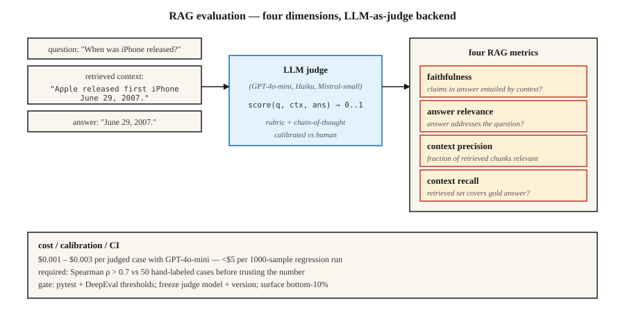

# Evaluasi LLM — RAGAS, DeepEval, G-Eval

> Exact Match dan F1 meleset dari kesetaraan semantik. Tinjauan manusia tidak bisa diskalakan. LLM-as-judge adalah jawaban untuk produksi — dengan kalibrasi yang cukup agar angkanya bisa dipercaya.

**Jenis:** Bangun
**Bahasa:** Python, TypeScript
**Prasyarat:** Fase 5 · 13 (Tanya Jawab), Fase 5 · 14 (Pengambilan Informasi)
**Waktu:** ~75 menit

## Masalahnya

Sistem RAG Anda menjawab: "June 29th, 2007."
Referensi emasnya adalah: "June 29, 2007."
Exact Match memberi skor 0. F1 memberi skor ~75%. Manusia akan memberi 100%.

Sekarang kalikan dengan 10.000 kasus uji. Kalikan lagi dengan setiap perubahan pada retriever, chunking, prompt, atau model. Anda butuh evaluator yang memahami makna, berjalan murah dalam skala besar, tidak berbohong soal regresi, dan menampilkan mode kegagalan yang tepat.

Tahun 2026 ada tiga kerangka kerja yang menguasai masalah ini.

- **RAGAS.** Retrieval-Augmented Generation ASsessment. Empat metrik RAG (faithfulness, answer-relevance, context-precision, context-recall) dengan backend NLI + LLM-judge. Berbasis riset, ringan.
- **DeepEval.** Pytest untuk LLM. Metrik G-Eval, task-completion, halusinasi, bias. Native CI/CD.
- **G-Eval.** Sebuah metode (dan metrik DeepEval): LLM-as-judge dengan chain-of-thought, kriteria kustom, skor 0-1.

Ketiganya bertumpu pada LLM-as-judge. Pelajaran ini membangun intuisi tentang metode tersebut dan lapisan kepercayaan di sekitarnya.

## Konsepnya



**LLM-as-judge.** Ganti metrik statis dengan LLM yang memberi skor keluaran berdasarkan rubrik. Diberikan `(query, context, answer)`, beri prompt pada judge LLM: "Beri skor 0-1 untuk faithfulness." Kembalikan skornya.

Mengapa ini berhasil: LLM mendekati penilaian manusia dengan biaya sepersekian kecil. GPT-4o-mini dengan ~$0.003 per kasus yang dinilai memungkinkan evaluasi regresi 1000 sampel dengan biaya di bawah $5.

Mengapa ini gagal secara diam-diam:

1. **Bias judge.** Judge lebih suka jawaban yang lebih panjang, jawaban dari keluarga modelnya sendiri, dan jawaban yang cocok dengan gaya prompt.
2. **Kegagalan parsing JSON.** JSON yang buruk → skor NaN → diam-diam dikeluarkan dari agregat. Pengguna RAGAS tahu rasa sakit ini. Pasang gerbang dengan try/except + mode kegagalan yang eksplisit.
3. **Pergeseran antarversi model.** Memutakhirkan judge mengubah semua metrik. Bekukan model judge + versinya.

**Empat metrik RAG.**

| Metrik | Pertanyaan | Backend |
|--------|------------|---------|
| Faithfulness | Apakah setiap klaim dalam jawaban berasal dari konteks yang diambil? | Entailment berbasis NLI |
| Answer relevance | Apakah jawaban menjawab pertanyaan? | Bangkitkan pertanyaan hipotetis dari jawaban; bandingkan dengan pertanyaan asli |
| Context precision | Dari potongan yang diambil, berapa bagian yang relevan? | LLM-judge |
| Context recall | Apakah pengambilan mengembalikan semua yang dibutuhkan? | LLM-judge terhadap jawaban emas |

**G-Eval.** Tentukan kriteria kustom: "Apakah jawaban mengutip sumber yang benar?" Kerangka kerja secara otomatis mengembangkannya menjadi langkah-langkah evaluasi chain-of-thought, lalu memberi skor 0-1. Bagus untuk dimensi kualitas spesifik domain yang tidak dicakup RAGAS.

**Kalibrasi.** Jangan pernah mempercayai skor judge mentah sebelum Anda memiliki korelasi dengan label manusia. Jalankan 100 contoh berlabel manual. Plot judge vs manusia. Hitung rho Spearman. Jika rho < 0.7, rubrik judge Anda perlu diperbaiki.

```figure
n5-judge-gauge
```

## Bangun

### Langkah 1: faithfulness dengan NLI (gaya RAGAS)

```python
from typing import Callable
from transformers import pipeline

nli = pipeline("text-classification",
               model="MoritzLaurer/DeBERTa-v3-large-mnli-fever-anli-ling-wanli",
               top_k=None)

# `llm` adalah callable apa pun: prompt str -> generated str.
# Contoh: llm = lambda p: client.messages.create(model="claude-haiku-4-5", ...).content[0].text
LLM = Callable[[str], str]


def atomic_claims(answer: str, llm: LLM) -> list[str]:
    prompt = f"""Break this answer into simple factual claims (one per line):
{answer}
"""
    return llm(prompt).splitlines()


def faithfulness(answer: str, context: str, llm: LLM) -> float:
    claims = atomic_claims(answer, llm)
    if not claims:
        return 0.0
    supported = 0
    for claim in claims:
        result = nli({"text": context, "text_pair": claim})[0]
        entail = next((s for s in result if s["label"] == "entailment"), None)
        if entail and entail["score"] > 0.5:
            supported += 1
    return supported / len(claims)
```

Uraikan jawaban menjadi klaim-klaim atomik. Periksa setiap klaim terhadap konteks yang diambil dengan NLI. Faithfulness = fraksi klaim yang didukung.

### Langkah 2: answer relevance

```python
import numpy as np
from sentence_transformers import SentenceTransformer

# encoder: model apa pun yang mengimplementasikan .encode(texts, normalize_embeddings=True) -> ndarray
# mis. encoder = SentenceTransformer("BAAI/bge-small-en-v1.5")

def answer_relevance(question: str, answer: str, encoder, llm: LLM, n: int = 3) -> float:
    prompt = f"Write {n} questions this answer could be the answer to:\n{answer}"
    generated = [line for line in llm(prompt).splitlines() if line.strip()][:n]
    if not generated:
        return 0.0
    q_emb = np.asarray(encoder.encode([question], normalize_embeddings=True)[0])
    g_embs = np.asarray(encoder.encode(generated, normalize_embeddings=True))
    sims = [float(q_emb @ g_emb) for g_emb in g_embs]
    return sum(sims) / len(sims)
```

Jika jawaban itu menyiratkan pertanyaan yang berbeda dari pertanyaan yang diajukan, relevansi turun.

### Langkah 3: metrik kustom G-Eval

```python
from deepeval.metrics import GEval
from deepeval.test_case import LLMTestCaseParams, LLMTestCase

metric = GEval(
    name="Correctness",
    criteria="The answer should be factually accurate and match the expected output.",
    evaluation_steps=[
        "Read the expected output.",
        "Read the actual output.",
        "List factual claims in the actual output.",
        "For each claim, mark supported or unsupported by the expected output.",
        "Return score = fraction supported.",
    ],
    evaluation_params=[LLMTestCaseParams.INPUT, LLMTestCaseParams.ACTUAL_OUTPUT, LLMTestCaseParams.EXPECTED_OUTPUT],
)

test = LLMTestCase(input="When was the first iPhone released?",
                   actual_output="June 29th, 2007.",
                   expected_output="June 29, 2007.")
metric.measure(test)
print(metric.score, metric.reason)
```

Langkah-langkah evaluasi adalah rubriknya. Langkah yang eksplisit lebih stabil daripada prompt "skor 0-1" yang implisit.

### Langkah 4: gerbang CI

```python
import deepeval
from deepeval.metrics import FaithfulnessMetric, ContextualRelevancyMetric


def test_rag_system():
    cases = load_regression_cases()
    faith = FaithfulnessMetric(threshold=0.85)
    rel = ContextualRelevancyMetric(threshold=0.7)
    for case in cases:
        faith.measure(case)
        assert faith.score >= 0.85, f"faithfulness regression on {case.id}"
        rel.measure(case)
        assert rel.score >= 0.7, f"relevancy regression on {case.id}"
```

Kirim sebagai file pytest. Jalankan pada setiap PR. Blokir merge saat terjadi regresi.

### Langkah 5: evaluasi mainan dari nol

Lihat `code/main.py`. Pendekatan hanya dengan pustaka standar untuk faithfulness (tumpang tindih klaim jawaban dengan konteks) dan relevance (tumpang tindih token jawaban dengan token pertanyaan). Ini bukan untuk produksi. Ini hanya menunjukkan bentuknya.

## Jebakan

- **Tanpa kalibrasi.** Judge dengan korelasi 0.3 terhadap label manusia hanyalah deretan noise. Wajibkan kalibrasi sebelum rilis.
- **Evaluasi diri.** Memakai LLM yang sama untuk menghasilkan dan menilai menaikkan skor 10-20%. Gunakan keluarga model yang berbeda untuk judge.
- **Bias posisi pada penilaian berpasangan.** Judge lebih suka opsi pertama yang ditampilkan. Selalu acak urutannya dan jalankan dua arah.
- **Agregat mentah menyembunyikan kegagalan.** Skor rata-rata 0.85 sering menyembunyikan 5% kegagalan katastropik. Selalu periksa kuantil bawah.
- **Pembusukan dataset emas.** Himpunan evaluasi tanpa versi yang bergeser dari waktu ke waktu merusak perbandingan longitudinal. Beri tag pada dataset pada setiap perubahan.
- **Biaya LLM.** Dalam skala besar, panggilan judge mendominasi biaya. Gunakan model termurah yang masih memenuhi ambang kalibrasi. GPT-4o-mini, Claude Haiku, Mistral-small.

## Gunakan

Stack tahun 2026:

| Kasus penggunaan | Kerangka kerja |
|---------|-----------|
| Pemantauan kualitas RAG | RAGAS (4 metrik) |
| Gerbang regresi CI/CD | DeepEval + pytest |
| Kriteria domain kustom | G-Eval di dalam DeepEval |
| Pemantauan lalu lintas langsung daring | RAGAS dengan mode tanpa referensi |
| Pemeriksaan sewaktu-waktu dengan manusia dalam loop | LangSmith atau Phoenix dengan UI anotasi |
| Red-teaming / evaluasi keamanan | Promptfoo + DeepEval |

Stack umum: RAGAS untuk pemantauan, DeepEval untuk CI, G-Eval untuk dimensi baru. Jalankan ketiganya; mereka berselisih dengan cara yang berguna.

## Kirim

Simpan sebagai `outputs/skill-eval-architect.md`:

```markdown
---
name: eval-architect
description: Rancang rencana evaluasi LLM dengan judge terkalibrasi dan gerbang CI.
version: 1.0.0
phase: 5
lesson: 27
tags: [nlp, evaluation, rag]
---

Diberikan sebuah kasus penggunaan (RAG / agen / tugas generatif), keluarkan:

1. Metrik. Faithfulness / relevance / context-precision / context-recall + metrik G-Eval kustom apa pun beserta kriterianya.
2. Model judge. Nama model + versi, alasan pertimbangan biaya vs akurasi.
3. Kalibrasi. Ukuran himpunan berlabel manual, target rho Spearman vs manusia > 0.7.
4. Versi dataset. Strategi tag, log perubahan, stratifikasi.
5. Gerbang CI. Ambang per metrik, logika jendela regresi, peringatan kuantil bawah.

Tolak bergantung pada judge yang belum diuji terhadap ≥50 contoh berlabel manusia. Tolak evaluasi diri (model yang sama menghasilkan + menilai). Tolak pelaporan hanya agregat tanpa menampilkan 10% terbawah. Tandai pipeline apa pun yang kedatangan pemutakhiran judgenya tanpa evaluasi baseline paralel.
```

## Latihan

1. **Mudah.** Gunakan RAGAS pada 10 contoh RAG yang mengandung halusinasi yang diketahui. Verifikasi metrik faithfulness menangkap masing-masing.
2. **Sedang.** Beri label manual 50 jawaban QA dengan skor 0-1 untuk kebenaran. Nilai dengan G-Eval. Ukur rho Spearman antara judge dan manusia.
3. **Sulit.** Bangun gerbang CI pytest dengan DeepEval. Secara sengaja buat regresi pada retriever. Verifikasi gerbang gagal. Tambahkan peringatan kuantil bawah lewat pengecekan ambang pada 10% terendah.

## Istilah Kunci

| Istilah | Yang orang katakan | Arti sebenarnya |
|------|-----------------|-----------------------|
| LLM-as-judge | Menilai dengan LLM | Beri prompt pada model judge untuk memberi skor keluaran 0-1 berdasarkan rubrik. |
| RAGAS | Pustaka metrik RAG | Kerangka evaluasi open-source dengan 4 metrik RAG tanpa referensi. |
| Faithfulness | Apakah jawabannya berpaut? | Fraksi klaim jawaban yang didukung oleh konteks yang diambil. |
| Context precision | Apakah potongan yang diambil relevan? | Fraksi potongan top-K yang benar-benar berpengaruh. |
| Context recall | Apakah pengambilan menemukan semuanya? | Fraksi klaim jawaban emas yang didukung oleh potongan yang diambil. |
| G-Eval | Judge LLM kustom | Rubrik + langkah evaluasi chain-of-thought + skor 0-1. |
| Calibration | Percaya, tapi verifikasi | Korelasi Spearman antara skor judge dan skor manusia. |

## Bacaan Lanjutan

- [Es et al. (2023). RAGAS: Automated Evaluation of Retrieval Augmented Generation](https://arxiv.org/abs/2309.15217) — makalah RAGAS.
- [Liu et al. (2023). G-Eval: NLG Evaluation using GPT-4 with Better Human Alignment](https://arxiv.org/abs/2303.16634) — makalah G-Eval.
- [Dokumentasi DeepEval](https://deepeval.com/docs/metrics-introduction) — stack produksi open-source.
- [Zheng et al. (2023). Judging LLM-as-a-Judge with MT-Bench and Chatbot Arena](https://arxiv.org/abs/2306.05685) — bias, kalibrasi, dan batasan.
- [MLflow GenAI Scorer](https://mlflow.org/blog/third-party-scorers) — kerangka penyatu yang mengintegrasikan RAGAS, DeepEval, dan Phoenix.
