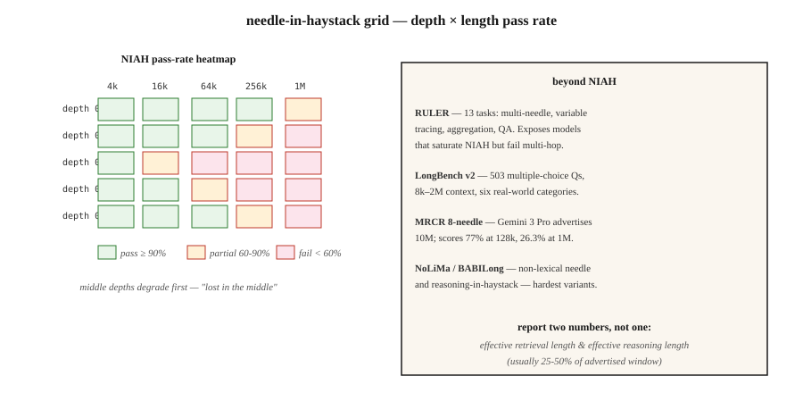

# Evaluasi Konteks Panjang — NIAH, RULER, LongBench, MRCR

> Gemini 3 Pro mengiklankan 10M token konteks. Pada 1M token, MRCR 8-jarum turun ke 26.3%. Iklan ≠ terpakai. Evaluasi konteks panjang memberi tahu Anda kapasitas sebenarnya dari model yang Anda pakai di produksi.

**Jenis:** Pelajari
**Bahasa:** Python, TypeScript
**Prasyarat:** Fase 5 · 13 (Tanya Jawab), Fase 5 · 23 (Strategi Chunking)
**Waktu:** ~60 menit

## Masalahnya

Anda punya kontrak 200 halaman. Model mengklaim konteks 1M token. Anda tempel kontraknya dan bertanya: "Apakah klausul pengakhiran kontrak itu?" Model menjawab — tetapi menjawab dari halaman sampul, karena klausul tersebut berada 120k token lebih dalam, melampaui titik yang benar-benar mendapat atensi dari model.

Ini adalah kesenjangan kapasitas konteks tahun 2026. Lembar spesifikasi mengatakan 1M atau 10M. Realitas mengatakan 60-70%-nya yang bisa dipakai, dan "bisa dipakai" bergantung pada tugasnya.

- **Pengambilan (satu jarum dalam tumpukan jerami):** hampir sempurna hingga batas maksimum yang diiklankan pada model frontier.
- **Multi-hop / agregasi:** menurun tajam setelah ~128k pada kebanyakan model.
- **Penalaran atas fakta yang tersebar:** tugas pertama yang gagal.

Evaluasi konteks panjang mengukur sumbu-sumbu ini. Pelajaran ini menyebutkan benchmark, apa yang sebenarnya diukur masing-masing, dan cara membangun uji jarum kustom untuk domain Anda.

## Konsepnya



**Needle-in-a-Haystack (NIAH, 2023).** Tempatkan sebuah fakta ("kata ajaibnya adalah nanas") pada kedalaman terkontrol dalam konteks panjang. Minta model mengambilnya. Sapu kedalaman × panjang. Benchmark konteks panjang yang original. Model frontier kini sudah jenuh pada tes ini; ini baseline yang diperlukan tetapi tidak memadai.

**RULER (Nvidia, 2024).** 13 jenis tugas dalam 4 kategori: pengambilan (satu kunci / banyak kunci / banyak nilai), pelacakan multi-hop (variable tracking), agregasi (frekuensi kata umum), QA. Panjang konteks dapat diatur (4k hingga 128k+). Mengungkap model yang jenuh di NIAH tetapi gagal pada multi-hop. Pada rilis 2024, hanya setengah dari 17 model yang mengklaim konteks 32k+ yang mempertahankan kualitas di 32k.

**LongBench v2 (2024).** 503 pertanyaan pilihan ganda, konteks 8k-2M kata, enam kategori tugas: QA satu dokumen, QA banyak dokumen, in-context learning panjang, dialog panjang, repositori kode, data terstruktur panjang. Benchmark produksi untuk perilaku konteks panjang dunia nyata.

**MRCR (Multi-Round Coreference Resolution).** Resolusi coreferensi multi-giliran dalam skala besar. Varian 8-jarum, 24-jarum, 100-jarum. Mengungkap berapa banyak fakta yang bisa dikelola model sebelum atensinya menurun.

**NoLiMa.** "Jarum non-leksikal." Jarum dan kueri tidak memiliki tumpang tindih literal; pengambilan membutuhkan satu langkah penalaran semantik. Lebih sulit dari NIAH.

**HELMET.** Menggabungkan banyak dokumen, lalu mengajukan pertanyaan dari salah satunya. Menguji atensi selektif.

**BABILong.** Menanamkan rantai penalaran bAbI di dalam tumpukan jerami yang tidak relevan. Menguji penalaran-dalam-jerami, bukan hanya pengambilan.

### Apa yang sebenarnya dilaporkan

- **Jendela konteks yang diiklankan.** Angka di lembar spesifikasi.
- **Panjang pengambilan efektif.** NIAH lulus pada ambang tertentu (mis. 90%).
- **Panjang penalaran efektif.** Multi-hop atau agregasi lulus pada ambang tersebut.
- **Kurva penurunan.** Akurasi vs panjang konteks, diplot per jenis tugas.

Dua angka untuk lembar spesifikasi Anda: efektif-pengambilan dan efektif-penalaran. Biasanya efektif-penalaran adalah 25-50% dari jendela yang diiklankan.

```figure
gx-niah-decay
```

## Bangun

### Langkah 1: NIAH kustom untuk domain Anda

Lihat `code/main.py`. Kerangkanya:

```python
def build_haystack(filler_text, needle, depth_ratio, total_tokens):
    if not (0.0 <= depth_ratio <= 1.0):
        raise ValueError(f"depth_ratio must be in [0, 1], got {depth_ratio}")
    if total_tokens <= 0:
        raise ValueError(f"total_tokens must be positive, got {total_tokens}")

    filler_tokens = tokenize(filler_text)
    needle_tokens = tokenize(needle)
    if not filler_tokens:
        raise ValueError("filler_text produced no tokens")

    # Ulangi filler sampai cukup panjang untuk mengisi badan tumpukan jerami.
    body_len = max(total_tokens - len(needle_tokens), 0)
    while len(filler_tokens) < body_len:
        filler_tokens = filler_tokens + filler_tokens
    filler_tokens = filler_tokens[:body_len]

    insert_at = min(int(body_len * depth_ratio), body_len)
    haystack = filler_tokens[:insert_at] + needle_tokens + filler_tokens[insert_at:]
    return " ".join(haystack)


def score_niah(model, haystack, question, expected):
    answer = model.complete(f"Context: {haystack}\nQ: {question}\nA:", max_tokens=50)
    return 1 if expected.lower() in answer.lower() else 0
```

Sapu `depth_ratio` ∈ {0, 0.25, 0.5, 0.75, 1.0} × `total_tokens` ∈ {1k, 4k, 16k, 64k}. Plot heatmapnya. Itulah kartu NIAH untuk model target Anda.

### Langkah 2: varian banyak jarum

```python
def build_multi_needle(filler, needles, total_tokens):
    depths = [0.1, 0.4, 0.7]
    chunks = [filler[:int(total_tokens * 0.1)]]
    for depth, needle in zip(depths, needles):
        chunks.append(needle)
        next_chunk = filler[int(total_tokens * depth): int(total_tokens * (depth + 0.3))]
        chunks.append(next_chunk)
    return " ".join(chunks)
```

Pertanyaan seperti "Apakah tiga kata ajaib itu?" mengharuskan pengambilan ketiganya. Keberhasilan satu jarum tidak memprediksi keberhasilan banyak jarum.

### Langkah 3: pelacakan variabel multi-hop (gaya RULER)

```python
haystack = """X1 = 42. ... (filler) ... X2 = X1 + 10. ... (filler) ... X3 = X2 * 2."""
question = "What is X3?"
```

Jawabannya memerlukan perantaian tiga penugasan. Model frontier pada 128k sering turun ke akurasi 50-70% di sini.

### Langkah 4: LongBench v2 pada stack Anda

```python
from datasets import load_dataset
longbench = load_dataset("THUDM/LongBench-v2")

def eval_model_on_longbench(model, subset="single-doc-qa"):
    tasks = [x for x in longbench["test"] if x["task"] == subset]
    correct = 0
    for x in tasks:
        answer = model.complete(x["context"] + "\n\nQ: " + x["question"], max_tokens=20)
        if normalize(answer) == normalize(x["answer"]):
            correct += 1
    return correct / len(tasks)
```

Laporkan akurasi per kategori. Skor agregat menyembunyikan perbedaan besar antartugas.

## Jebakan

- **Evaluasi NIAH saja.** Lulus NIAH pada 1M token tidak mengatakan apa pun tentang multi-hop. Selalu jalankan RULER atau uji multi-hop kustom.
- **Pengambilan sampel kedalaman seragam.** Banyak implementasi hanya menguji depth=0.5. Uji depth=0, 0.25, 0.5, 0.75, 1.0 — efek "tersesat di tengah" itu nyata.
- **Tumpang tindih leksikal dengan filler.** Jika jarum berbagi kata kunci dengan filler, pengambilan menjadi sepele. Gunakan jarum non-tumpang-tindih gaya NoLiMa.
- **Mengabaikan latensi.** Prompt 1M token butuh 30-120 detik untuk prefill. Ukur time-to-first-token bersama akurasi.
- **Angka yang dilaporkan sendiri oleh vendor.** OpenAI, Google, Anthropic semua mempublikasikan skor mereka sendiri. Selalu jalankan ulang secara independen pada kasus penggunaan Anda.

## Gunakan

Stack tahun 2026:

| Situasi | Benchmark |
|-----------|-----------|
| Pemeriksaan cepat | NIAH kustom 3 kedalaman × 3 panjang |
| Seleksi model untuk produksi | RULER (13 tugas) pada panjang target Anda |
| Kualitas QA dunia nyata | Subset single-doc-QA LongBench v2 |
| Penalaran multi-hop | BABILong atau pelacakan variabel kustom |
| Percakapan / dialog | MRCR 8-jarum pada panjang target Anda |
| Regresi pemutakhiran model | Harness NIAH + RULER internal yang tetap, dijalankan pada setiap model baru |

Aturan praktis untuk produksi: jangan pernah mempercayai jendela konteks sebelum Anda punya NIAH + 1 tugas penalaran pada panjang yang Anda rencanakan.

## Kirim

Simpan sebagai `outputs/skill-long-context-eval.md`:

```markdown
---
name: long-context-eval
description: Rancang baterai evaluasi konteks panjang untuk model dan kasus penggunaan tertentu.
version: 1.0.0
phase: 5
lesson: 28
tags: [nlp, long-context, evaluation]
---

Diberikan model target, panjang konteks target, dan kasus penggunaan, keluarkan:

1. Uji. Grid NIAH kedalaman × panjang; multi-hop RULER; tugas domain kustom.
2. Pengambilan sampel. Kedalaman 0, 0.25, 0.5, 0.75, 1.0 pada setiap panjang.
3. Metrik. Tingkat lulus pengambilan; tingkat lulus penalaran; time-to-first-token; biaya-per-kueri.
4. Batas. Panjang pengambilan efektif (lulus 90%) dan panjang penalaran efektif (lulus 70%). Laporkan keduanya.
5. Regresi. Harness tetap, jalankan ulang pada setiap pemutakhiran model, tampilkan selisihnya.

Tolak mempercayai jendela konteks hanya dari kartu model. Tolak evaluasi NIAH-saja untuk beban kerja multi-hop apa pun. Tolak skor konteks panjang yang dilaporkan sendiri oleh vendor sebagai bukti independen.
```

## Latihan

1. **Mudah.** Bangun NIAH dengan 3 kedalaman (0.25, 0.5, 0.75) × 3 panjang (1k, 4k, 16k). Jalankan pada model mana pun. Plot tingkat lulus sebagai heatmap 3×3.
2. **Sedang.** Tambahkan varian 3-jarum. Ukur pengambilan ketiganya pada setiap panjang. Bandingkan dengan tingkat lulus satu jarum pada panjang yang sama.
3. **Sulit.** Susun tugas pelacakan variabel (X1 → X2 → X3, dengan 3 hop) yang disematkan dalam 64k filler. Ukur akurasi pada 3 model frontier. Laporkan panjang penalaran efektif per model.

## Istilah Kunci

| Istilah | Yang orang katakan | Arti sebenarnya |
|------|-----------------|-----------------------|
| NIAH | Jarum dalam tumpukan jerami | Tanam sebuah fakta dalam filler, minta model mengambilnya. |
| RULER | NIAH dengan steroid | 13 jenis tugas lintas pengambilan / multi-hop / agregasi / QA. |
| Konteks efektif | Kapasitas yang sebenarnya | Panjang saat akurasi masih bertahan di atas ambang. |
| Tersesat di tengah | Bias kedalaman | Model kurang memberi atensi pada konten di tengah input panjang. |
| Banyak jarum | Banyak fakta sekaligus | Banyak penanaman; menguji kelincahan atensi, bukan sekadar pengambilan. |
| MRCR | Coref multi-putaran | Coreferensi 8, 24, atau 100 jarum; mengungkap kejenuhan atensi. |
| NoLiMa | Jarum non-leksikal | Jarum dan kueri tidak berbagi token literal; memerlukan penalaran. |

## Bacaan Lanjutan

- [Kamradt (2023). Needle in a Haystack analysis](https://github.com/gkamradt/LLMTest_NeedleInAHaystack) — repo NIAH original.
- [Hsieh et al. (2024). RULER: What's the Real Context Size of Your Long-Context LMs?](https://arxiv.org/abs/2404.06654) — benchmark multi-tugas.
- [Bai et al. (2024). LongBench v2](https://arxiv.org/abs/2412.15204) — evaluasi konteks panjang dunia nyata.
- [Modarressi et al. (2024). NoLiMa: Non-lexical needles](https://arxiv.org/abs/2404.06666) — jarum yang lebih sulit.
- [Kuratov et al. (2024). BABILong](https://arxiv.org/abs/2406.10149) — penalaran-dalam-jerami.
- [Liu et al. (2024). Lost in the Middle: How Language Models Use Long Contexts](https://arxiv.org/abs/2307.03172) — makalah bias kedalaman.
