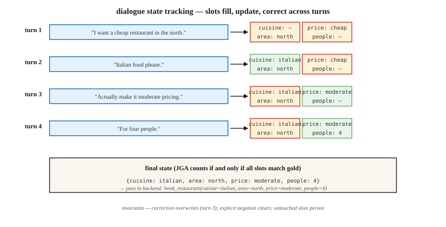

# Pelacakan Status Dialog

> "Saya mau restoran murah di utara... sebenarnya buat yang sedang... dan tambahkan masakan Italia." Tiga giliran, tiga pembaruan status. DST menjaga dict slot-nilai tetap sinkron agar pemesanan berjalan.

**Jenis:** Bangun
**Bahasa:** Python, TypeScript
**Prasyarat:** Fase 5 · 17 (Chatbot), Fase 5 · 20 (Keluaran Terstruktur)
**Waktu:** ~75 menit

## Masalahnya

Dalam sistem dialog berorientasi tugas, tujuan pengguna dikodekan sebagai sekumpulan pasangan slot-nilai: `{cuisine: italian, area: north, price: moderate}`. Setiap giliran pengguna dapat menambah, mengubah, atau menghapus sebuah slot. Sistem harus membaca seluruh percakapan dan mengeluarkan status saat ini dengan benar.

Satu slot yang salah dan sistem memesan restoran yang salah, menjadwalkan penerbangan yang salah, atau mendebet kartu yang salah. DST adalah engsel antara apa yang dikatakan pengguna dan apa yang dieksekusi backend.

Mengapa ini masih penting di 2026 meski ada LLM:

- Domain yang sensitif terhadap kepatuhan (perbankan, layanan kesehatan, pemesanan penerbangan) membutuhkan nilai slot yang deterministik, bukan generasi bentuk bebas.
- Agen pengguna alat masih memerlukan resolusi slot sebelum memanggil API.
- Koreksi multi-giliran lebih sulit dari yang terlihat: "sebenarnya tidak, buat hari Kamis."

Pipeline modern: konsep DST klasik + ekstraktor LLM + pagar pengaman keluaran terstruktur.

## Konsepnya



**Struktur tugas.** Sebuah skema mendefinisikan domain (restoran, hotel, taksi) dan slot-slotnya (cuisine, area, price, people). Setiap slot bisa kosong, terisi dengan nilai dari himpunan tertutup (price: {cheap, moderate, expensive}), atau nilai bentuk bebas (name: "The Copper Kettle").

**Dua formulasi DST.**

- **Klasifikasi.** Untuk setiap pasangan (slot, candidate_value), prediksi ya/tidak. Cocok untuk slot kosakata tertutup. Standar sebelum 2020.
- **Generasi.** Diberikan dialog, hasilkan nilai slot sebagai teks bebas. Cocok untuk slot kosakata terbuka. Default modern.

**Metrik.** Joint Goal Accuracy (JGA) — fraksi giliran di mana *setiap* slot benar. Semua-atau-tidak sama sekali. Papan peringkat MultiWOZ 2.4 puncaknya sekitar 83% pada 2026.

**Arsitektur.**

1. **Berbasis aturan (regex slot + kata kunci).** Baseline kuat untuk domain sempit. Mudah di-debug.
2. **TripPy / BERT-DST.** Generasi berbasis salinan dengan enkode BERT. Standar pra-LLM.
3. **LDST (LLaMA + LoRA).** LLM yang disetel dengan instruksi + prompting domain-slot. Mencapai kualitas setara ChatGPT pada MultiWOZ 2.4.
4. **Tanpa ontologi (2024–26).** Lewati skema; hasilkan nama dan nilai slot langsung. Menangani domain terbuka.
5. **Prompt + keluaran terstruktur (2024–26).** LLM dengan skema Pydantic + dekode terbatas. 5 baris kode, siap produksi.

### Mode kegagalan klasik

- **Coreferensi lintas giliran.** "Mari kita pilih opsi pertama." Perlu menyelesaikan opsi mana yang dimaksud.
- **Menimpa vs menambah.** Pengguna mengatakan "tambahkan masakan Italia." Apakah Anda mengganti cuisine atau menambahkannya?
- **Konfirmasi implisit.** "Oke bagus" — apakah itu menerima pemesanan yang ditawarkan?
- **Koreksi.** "Sebenarnya buat jam 7 malam." Harus memperbarui time tanpa menghapus slot lain.
- **Coreferensi ke ucapan sistem sebelumnya.** "Ya, yang itu." "Yang" yang mana?

```figure
n5-slot-tracker
```

## Bangun

### Langkah 1: ekstraktor slot berbasis aturan

Lihat `code/main.py`. Regex + kamus sinonim mencakup 70% ucapan kanonik dalam domain sempit:

```python
CUISINE_SYNONYMS = {
    "italian": ["italian", "pasta", "pizza", "italy"],
    "chinese": ["chinese", "chow mein", "noodles"],
}


def extract_cuisine(utterance):
    for canonical, synonyms in CUISINE_SYNONYMS.items():
        if any(syn in utterance.lower() for syn in synonyms):
            return canonical
    return None
```

Rapuh di luar kosakata kanonik. Cocok untuk konfirmasi slot deterministik.

### Langkah 2: loop pembaruan status

```python
def update_state(state, utterance):
    new_state = dict(state)
    for slot, extractor in SLOT_EXTRACTORS.items():
        value = extractor(utterance)
        if value is not None:
            new_state[slot] = value
    for slot in NEGATION_CLEARS:
        if is_negated(utterance, slot):
            new_state[slot] = None
    return new_state
```

Tiga invarian:

- Jangan pernah mereset slot yang tidak disentuh pengguna.
- Negasi eksplisit ("tidak usah soal cuisine") harus menghapus.
- Koreksi pengguna ("sebenarnya...") harus menimpa, bukan menambah.

### Langkah 3: DST berbasis LLM dengan keluaran terstruktur

```python
from pydantic import BaseModel
from typing import Literal, Optional
import instructor

class RestaurantState(BaseModel):
    cuisine: Optional[Literal["italian", "chinese", "indian", "thai", "any"]] = None
    area: Optional[Literal["north", "south", "east", "west", "center"]] = None
    price: Optional[Literal["cheap", "moderate", "expensive"]] = None
    people: Optional[int] = None
    day: Optional[str] = None


def llm_dst(history, llm):
    prompt = f"""You track the slot values of a restaurant booking across turns.
Dialogue so far:
{render(history)}

Update the state based on the latest user turn. Output only the JSON state."""
    return llm(prompt, response_model=RestaurantState)
```

Instructor + Pydantic menjamin objek status yang valid. Tanpa regex, tanpa ketidaksesuaian skema, tanpa slot halusinasi.

### Langkah 4: evaluasi JGA

```python
def joint_goal_accuracy(predicted_states, gold_states):
    correct = sum(1 for p, g in zip(predicted_states, gold_states) if p == g)
    return correct / len(predicted_states)
```

Kalibrasi: pada fraksi giliran mana sistem mendapatkan SEMUA slot dengan benar? Untuk MultiWOZ 2.4, sistem terbaik 2026: 80-83%. Sistem dalam domain Anda harus melebihi itu pada kosakata sempit Anda, kalau tidak baseline LLM mengalahkan Anda.

### Langkah 5: menangani koreksi

```python
CORRECTION_CUES = {"actually", "no wait", "on second thought", "change that to"}


def is_correction(utterance):
    return any(cue in utterance.lower() for cue in CORRECTION_CUES)
```

Pada koreksi yang terdeteksi, timpa slot yang terakhir diperbarui alih-alih menambahkannya. Sulit dilakukan dengan benar tanpa bantuan LLM. Pola modern: selalu biarkan LLM membangkitkan ulang seluruh status dari riwayat alih-alih memperbarui secara inkremental — ini secara alami menangani koreksi.

## Jebakan

- **Biaya regenerasi riwayat penuh.** Membiarkan LLM membangkitkan ulang status setiap giliran menghabiskan total token $O(n^2)$. Batasi riwayat atau ringkas giliran lama.
- **Pergeseran skema.** Menambah slot baru setelah fakta merusak data pelatihan lama. Beri versi pada skema Anda.
- **Sensitivitas huruf besar/kecil.** "Italian" vs "italian" vs "ITALIAN" — normalisasi di semua tempat.
- **Pewarisan implisit.** Jika pengguna sebelumnya menyebut "untuk 4 orang," permintaan baru untuk waktu berbeda tidak boleh menghapus people. Selalu sertakan riwayat lengkap.
- **Bentuk bebas vs himpunan tertutup.** Nama, waktu, dan alamat memerlukan slot bentuk bebas; cuisine dan area bersifat tertutup. Campur keduanya dalam skema.

## Gunakan

Stack tahun 2026:

| Situasi | Pendekatan |
|-----------|----------|
| Domain sempit (satu atau dua intent) | Berbasis aturan + regex |
| Domain luas, data berlabel tersedia | LDST (LLaMA + LoRA pada data gaya MultiWOZ) |
| Domain luas, tanpa label, siap produksi | LLM + Instructor + skema Pydantic |
| Lisan / suara | ASR + normalizer + LLM-DST |
| Alur pemesanan multi-domain | LLM terpandu skema dengan model Pydantic per domain |
| Sensitif terhadap kepatuhan | Aturan sebagai utama, LLM sebagai cadangan dengan alur konfirmasi |

## Kirim

Simpan sebagai `outputs/skill-dst-designer.md`:

```markdown
---
name: dst-designer
description: Rancang pelacak status dialog — skema, ekstraktor, kebijakan pembaruan, evaluasi.
version: 1.0.0
phase: 5
lesson: 29
tags: [nlp, dialogue, task-oriented]
---

Diberikan sebuah kasus penggunaan (domain, bahasa, keterbukaan kosakata, kebutuhan kepatuhan), keluarkan:

1. Skema. Daftar domain, slot per domain, kosakata terbuka vs tertutup per slot.
2. Ekstraktor. Berbasis aturan / seq2seq / LLM-dengan-Pydantic. Sertakan alasan.
3. Kebijakan pembaruan. Bangkitkan-ulang-seluruh-status / inkremental; penanganan koreksi; penanganan negasi.
4. Evaluasi. Joint Goal Accuracy pada himpunan dialog yang disisihkan, presisi/recall tingkat slot, kebingungan pada slot tersulit.
5. Alur konfirmasi. Kapan secara eksplisit meminta konfirmasi kepada pengguna (tindakan destruktif, ekstraksi keyakinan rendah).

Tolak DST hanya-LLM untuk slot sensitif kepatuhan tanpa pemeriksaan sekunder berbasis aturan. Tolak DST apa pun yang tidak bisa memutar balik sebuah slot saat pengguna mengoreksi. Tandai skema tanpa tag versi.
```

## Latihan

1. **Mudah.** Bangun pelacak status berbasis aturan di `code/main.py` untuk 3 slot (cuisine, area, price). Uji pada 10 dialog buatan manual. Ukur JGA.
2. **Sedang.** Dataset yang sama dengan Instructor + Pydantic + LLM kecil. Bandingkan JGA. Periksa giliran tersulit.
3. **Sulit.** Terapkan keduanya dan routing: aturan sebagai utama, LLM sebagai cadangan saat aturan menghasilkan <2 slot dengan keyakinan. Ukur JGA gabungan dan biaya inferensi per giliran.

## Istilah Kunci

| Istilah | Yang orang katakan | Arti sebenarnya |
|------|-----------------|-----------------------|
| DST | Pelacakan status dialog | Menjaga dict slot-nilai tetap berada di seluruh giliran dialog. |
| Slot | Unit niat pengguna | Parameter bernama yang dibutuhkan backend (cuisine, date). |
| Domain | Area tugas | Restoran, hotel, taksi — kumpulan slot. |
| JGA | Joint Goal Accuracy | Fraksi giliran di mana setiap slot benar. Semua-atau-tidak sama sekali. |
| MultiWOZ | Benchmark-nya | Dataset WOZ multi-domain; evaluasi DST standar. |
| DST tanpa ontologi | Tanpa skema | Hasilkan nama dan nilai slot langsung, tanpa daftar tetap. |
| Koreksi | "Sebenarnya..." | Giliran yang menimpa slot yang sebelumnya terisi. |

## Bacaan Lanjutan

- [Budzianowski et al. (2018). MultiWOZ — A Large-Scale Multi-Domain Wizard-of-Oz](https://arxiv.org/abs/1810.00278) — benchmark kanonik.
- [Feng et al. (2023). Towards LLM-driven Dialogue State Tracking (LDST)](https://arxiv.org/abs/2310.14970) — penyetelan instruksi LLaMA + LoRA untuk DST.
- [Heck et al. (2020). TripPy — A Triple Copy Strategy for Value Independent Neural Dialog State Tracking](https://arxiv.org/abs/2005.02877) — kuda kerja DST berbasis salinan.
- [King, Flanigan (2024). Unsupervised End-to-End Task-Oriented Dialogue with LLMs](https://arxiv.org/abs/2404.10753) — TOD tanpa pengawasan berbasis EM.
- [Papan peringkat MultiWOZ](https://github.com/budzianowski/multiwoz) — hasil DST kanonik.
