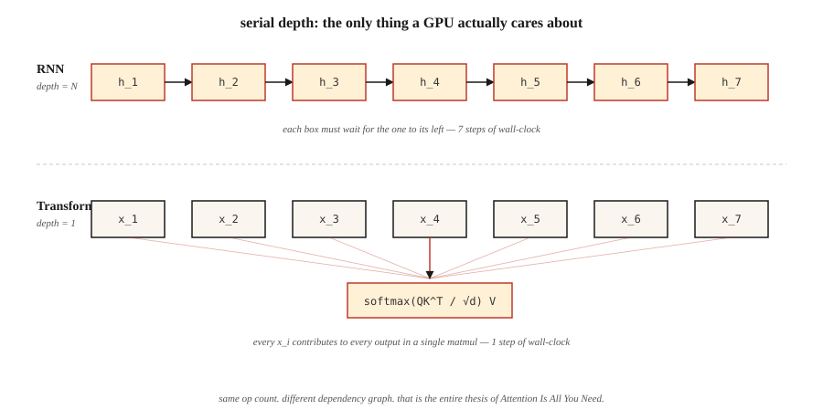

# Mengapa Transformer — Masalah dengan RNN

> RNN memproses token satu per satu. Transformer memproses semua token sekaligus. Satu taruhan arsitektur itu mengubah setiap kurva penskalaan dalam deep learning setelah 2017.

**Jenis:** Pelajari
**Bahasa:** Python
**Prasyarat:** Fase 3 (Inti Deep Learning), Fase 5 · 09 (Sequence-to-Sequence), Fase 5 · 10 (Mekanisme Atensi)
**Waktu:** ~45 menit

## Masalahnya

Sebelum 2017, setiap model sekuens mutakhir di planet ini — bahasa, terjemahan, ucapan — adalah jaringan saraf rekuren. LSTM dan GRU memenangkan benchmark terjemahan setara ImageNet selama setengah dekade. Mereka satu-satunya alat yang dimiliki siapa pun.

Mereka punya tiga kelemahan fatal. Komputasi sekuensial berarti Anda tidak bisa memparallelkan sepanjang sumbu waktu: token `t+1` membutuhkan hidden state dari token `t`. Sekuens 1.024 token berarti 1.024 langkah serial di GPU yang bisa melakukan 1.000.000 operasi floating-point per siklus. Waktu tembok pelatihan berskala linear dengan panjang sekuens pada perangkat keras yang dirancang untuk paralelisme.

Gradien yang menghilang berarti informasi 50 token sebelumnya sudah terkompresi melalui 50 nonlinearitas. Unit rekuren bergating (LSTM, GRU) melunakkan remasan itu tetapi tidak pernah menghilangkannya. Dependensi jarak jauh — "buku yang saya baca musim panas lalu di pesawat menuju Kyoto adalah…" — rutin gagal.

Hidden state berlebar tetap berarti encoder memeras seluruh sekuens sumber menjadi satu vektor sebelum decoder melihat apa pun. Tidak peduli sumbernya 5 token atau 500; bottleneck-nya sama bentuknya.

Makalah 2017 "Attention Is All You Need" mengusulkan sesuatu yang radikal: hilangkan rekurensi sepenuhnya. Biarkan setiap posisi memberi atensi ke posisi lain secara paralel. Latih dalam satu perkalian matriks besar alih-alih 1.024 perkalian sekuensial.

Hasilnya mendominasi setiap modalitas pada 2026. Bahasa (GPT-5, Claude 4, Llama 4), visi (ViT, DINOv2, SAM 3), audio (Whisper), biologi (AlphaFold 3), robotika (RT-2). Blok yang sama, masukan berbeda.

## Konsepnya



**Rekurensi sebagai bottleneck.** Sebuah RNN menghitung $h_t = f(h_{t-1}, x_t)$. Setiap langkah bergantung pada sebelumnya. Anda tidak bisa menghitung $h_5$ sebelum $h_4$. Pada GPU modern dengan 10.000+ inti paralel, ini membuang 99% silikon untuk sekuens panjang.

**Atensi sebagai siaran.** Self-attention menghitung `output_i = sum_j(a_ij * v_j)` untuk setiap pasangan $(i, j)$ secara bersamaan. Seluruh matriks atensi N×N terisi dalam satu matmul batch. Tidak ada langkah yang bergantung pada langkah lain. GPU menyukainya.

**Percepatan bukan konstanta.** Ini adalah perbedaan antara kedalaman serial $O(N)$ dan kedalaman serial $O(1)$. Dalam praktiknya, transformer melatih 5–10× lebih cepat per epoch pada perangkat keras yang sepadan di N=512, dan jaraknya melebar seiring panjang sekuens sampai Anda menabrak dinding memori $O(N^2)$ dari atensi (yang kemudian diperbaiki Flash Attention — lihat Pelajaran 12).

**Apa yang dibayar transformer.** Memori atensi berskala $O(N^2)$. Untuk konteks 2K, aman. Untuk konteks 128K, Anda butuh sliding window, ekstrapolasi RoPE, tiling Flash Attention, atau varian linear attention. Rekurensi $O(N)$ dalam waktu dan memori; transformer menukar waktu dengan memori lalu memenangkan kembali waktunya lewat paralelisme.

**Pergeseran bias induktif.** RNN mengasumsikan lokalitas dan kedekatan waktu. Transformer tidak mengasumsikan apa pun — setiap pasangan adalah kandidat atensi. Itulah sebabnya transformer butuh lebih banyak data untuk melatih dengan baik tetapi berskala lebih jauh setelah memilikinya. Chinchilla (2022) merumuskan ini: dengan token yang cukup, transformer selalu mengalahkan RNN dengan jumlah parameter yang sama.

```figure
rnn-vs-parallel
```

## Bangun

Tidak ada jaringan saraf di sini — kita menyimulasikan bottleneck inti secara numerik agar Anda merasakan jurangnya di laptop Anda.

### Langkah 1: ukur kedalaman serial

Lihat `code/main.py`. Kita membangun dua fungsi. Satu mengodekan sekuens sebagai rantai penjumlahan (serial, seperti RNN). Satu mengodekannya sebagai reduksi paralel (siaran, seperti atensi). Matematikanya sama, graf dependensinya berbeda.

```python
def rnn_style(xs):
    h = 0.0
    for x in xs:
        h = 0.9 * h + x   # tidak bisa diparallelkan: h bergantung pada h sebelumnya
    return h

def attention_style(xs):
    return sum(xs) / len(xs)  # setiap x independen
```

Kita mengukur waktu keduanya pada sekuens hingga 100.000 elemen. Versi RNN bersifat $O(N)$ dan satu pipeline CPU. Bahkan dalam Python murni, reduksi gaya atensi mengalahkannya pada panjang ≥ 1.000 karena `sum()` Python diimplementasikan dalam C dan beriterasi tanpa overhead interpreter per langkah.

### Langkah 2: hitung operasi teoritis

Kedua algoritma melakukan N penjumlahan. Bedanya adalah *kedalaman dependensi*: berapa operasi yang harus terjadi secara berurutan sebelum operasi berikutnya bisa dimulai. Kedalaman RNN = N. Kedalaman atensi = log(N) dengan reduksi pohon, atau 1 dengan parallel scan. Yang menentukan waktu GPU adalah kedalaman, bukan jumlah operasi.

### Langkah 3: penskalaan empiris pada sekuens panjang

Kita mencetak tabel waktu yang membuat jurang $O(N)$ terlihat. Pada laptop Mac 2026, sekuens di bawah 1.000 elemen terlalu cepat untuk diukur. Sekuens 100.000 menunjukkan pemindaian linear yang bersih. Skalakan itu ke transformer 16.384 token dengan LSTM ekuivalen 12 lapisan dan Anda mengerti mengapa waktu tembok pelatihan menjadi penghalang pada 2016.

## Gunakan

Kapan masih memilih RNN di 2026:

| Situasi | Pilihan |
|-----------|------|
| Inferensi streaming, satu token per waktu, memori konstan | RNN atau model ruang keadaan (Mamba, RWKV) |
| Sekuens sangat panjang (>1M token) saat memori atensi meledak | Linear attention, Mamba 2, Hyena |
| Perangkat edge tanpa akselerator matmul | RNN depthwise-separable masih menang di FLOPs/watt |
| Semua lainnya (pelatihan, inferensi batch, konteks hingga 128K) | Transformer |

Model ruang keadaan (SSM) seperti Mamba pada dasarnya adalah RNN dengan parameterisasi terstruktur yang memberi yang terbaik dari keduanya: memori pemindaian $O(N)$, pelatihan paralel melalui selective scan. Mereka memulihkan 90% kualitas transformer dengan penskalaan konteks panjang yang lebih baik. Di 2026 sebagian besar laboratorium frontier melatih model hybrid SSM+transformer (mis. Jamba, Samba) — rekurensi tidak mati, ia adalah sebuah komponen.

## Kirim

Lihat `outputs/skill-architecture-picker.md`. Skill ini memilih arsitektur untuk masalah sekuens baru dengan mempertimbangkan batasan panjang, throughput, dan anggaran pelatihan. Ia harus selalu menolak merekomendasikan RNN murni untuk pelatihan di atas 1B token tanpa menyatakan trade-off-nya.

## Latihan

1. **Mudah.** Ambil `rnn_style` dari `code/main.py` dan ganti hidden state skalar dengan vektor hidden state panjang 64. Ukur ulang. Berapa besar overhead serial bertambah seiring dimensi hidden state?
2. **Sedang.** Terapkan prefix-sum paralel (Hillis-Steele scan) dalam Python murni. Verifikasi bahwa hasil numeriknya sama dengan pemindaian serial pada panjang 1024. Hitung kedalamannya.
3. **Sulit.** Porting reduksi gaya atensi ke PyTorch di GPU. Ukur keduanya saat Anda menyapu panjang sekuens dari 64 hingga 65.536. Plot dan jelaskan bentuk kurvanya.

## Istilah Kunci

| Istilah | Yang orang katakan | Arti sebenarnya |
|------|-----------------|-----------------------|
| Rekurensi | "RNN itu sekuensial" | Komputasi di mana langkah `t` bergantung pada langkah `t-1`, sehingga memaksa eksekusi serial sepanjang sumbu waktu. |
| Kedalaman serial | "Seberapa dalam grafnya" | Rantai operasi saling bergantung terpanjang; membatasi waktu tembok bahkan pada perangkat keras tak terbatas. |
| Atensi | "Biarkan token saling melihat" | Jumlah terbobot $\sum_j a_{ij} v_j$ di mana $a_{ij}$ berasal dari skor kemiripan antara posisi $i$ dan $j$. |
| Jendela konteks | "Seberapa banyak yang dilihat model" | Jumlah posisi yang bisa menjadi masukan sebuah lapisan atensi; biaya memori kuadrat berskala di sini. |
| Bias induktif | "Asumsi yang tertanam dalam arsitektur" | Prior tentang bentuk data; CNN mengasumsikan invariansi translasi, RNN mengasumsikan kedekatan waktu. |
| Model ruang keadaan | "RNN dengan aljabar di belakangnya" | Rekurensi yang diparameterisasi untuk pelatihan paralel lewat matriks ruang keadaan terstruktur. |
| Bottleneck kuadrat | "Mengapa konteks begitu mahal" | Memori atensi = $O(N^2)$ terhadap panjang sekuens; Flash Attention menyembunyikan konstantanya, bukan penskalaannya. |

## Bacaan Lanjutan

- [Vaswani et al. (2017). Attention Is All You Need](https://arxiv.org/abs/1706.03762) — makalah yang mematikan rekurensi dalam NLP arus utama.
- [Bahdanau, Cho, Bengio (2014). Neural MT by Jointly Learning to Align and Translate](https://arxiv.org/abs/1409.0473) — tempat atensi lahir, ditempelkan pada RNN.
- [Hochreiter, Schmidhuber (1997). Long Short-Term Memory](https://www.bioinf.jku.at/publications/older/2604.pdf) — makalah LSTM original, untuk catatan.
- [Gu, Dao (2023). Mamba: Linear-Time Sequence Modeling with Selective State Spaces](https://arxiv.org/abs/2312.00752) — jawaban rekuren modern terhadap transformer.
