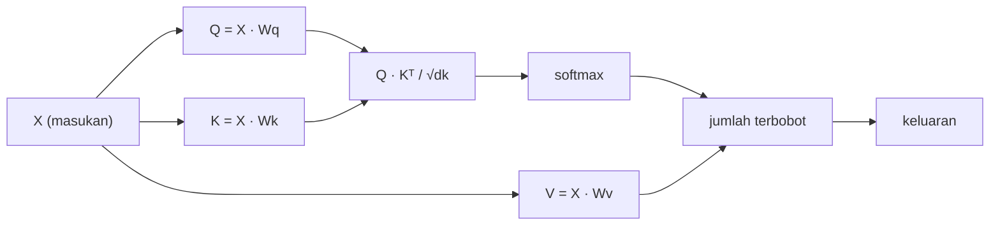

# Self-Attention dari Nol

> Atensi adalah tabel lookup di mana setiap kata bertanya "siapa yang penting bagiku?" — dan mempelajari jawabannya.

**Jenis:** Bangun
**Bahasa:** Python
**Prasyarat:** Fase 3 (Inti Deep Learning), Fase 5 Pelajaran 10 (Sequence-to-Sequence)
**Waktu:** ~90 menit

## Tujuan Pembelajaran

- Terapkan scaled dot-product self-attention dari nol hanya dengan NumPy, termasuk proyeksi query/key/value dan jumlah terbobot softmax
- Bangun lapisan multi-head attention yang membagi head, menghitung atensi paralel, dan menggabungkan hasil
- Lacak bagaimana matriks atensi menangkap relasi antartoken dan jelaskan mengapa penskalaan dengan $\sqrt{d_k}$ mencegah saturasi softmax
- Terapkan causal masking untuk mengubah atensi dua arah menjadi atensi autoregresif (gaya decoder)

## Masalahnya

RNN memproses sekuens satu token per waktu. Pada saat Anda mencapai token 50, informasi dari token 1 sudah melewati 50 langkah kompresi. Dependensi jarak jauh remas menjadi hidden state berukuran tetap — bottleneck yang tidak bisa diselesaikan sepenuhnya oleh gating LSTM berapa pun.

Makalah Bahdanau 2014 tentang attention menunjukkan perbaikannya: biarkan decoder melihat kembali setiap posisi encoder dan memutuskan mana yang penting untuk langkah saat ini. Namun itu masih ditempelkan pada RNN. Makalah 2017 "Attention Is All You Need" mengajukan pertanyaan yang lebih tajam: bagaimana jika atensi adalah *satu-satunya* mekanisme? Tanpa rekurensi. Tanpa konvolusi. Hanya atensi.

Self-attention membiarkan setiap posisi dalam sekuens memberi atensi ke posisi lain dalam satu langkah paralel. Itulah yang membuat transformer cepat, berskala, dan dominan.

## Konsepnya

### Analogi Lookup Basis Data

Anggap atensi sebagai lookup basis data lunak (*soft*):

```
Basis data tradisional:
  Kueri: "capital of France"  -->  exact match  -->  "Paris"

Atensi:
  Kueri: "capital of France"  -->  kemiripan dengan SEMUA kunci  -->  campuran terbobot dari SEMUA nilai
```

Setiap token membangkitkan tiga vektor:
- **Query (Q)**: "Apa yang saya cari?"
- **Key (K)**: "Apa yang saya miliki?"
- **Value (V)**: "Informasi apa yang saya berikan jika dipilih?"

Hasil dot product antara sebuah query dan semua kunci menghasilkan skor atensi. Skor tinggi berarti "kunci ini cocok dengan query saya." Skor itu memberi bobot pada nilai. Keluarannya adalah jumlah terbobot dari nilai.

### Komputasi Q, K, V

Setiap embedding token diproyeksikan melalui tiga matriks bobot yang dipelajari:

```
Embedding masukan (sekuens n token, masing-masing berdimensi d):

  X = [x1, x2, x3, ..., xn]       bentuk: (n, d)

Tiga matriks bobot:

  Wq  bentuk: (d, dk)
  Wk  bentuk: (d, dk)
  Wv  bentuk: (d, dv)

Proyeksi:

  Q = X @ Wq    bentuk: (n, dk)      query setiap token
  K = X @ Wk    bentuk: (n, dk)      kunci setiap token
  V = X @ Wv    bentuk: (n, dv)      nilai setiap token
```

Secara visual, untuk satu token:

```
             Wq
  x_i ------[*]------> q_i    "Apa yang saya cari?"
       |
       |     Wk
       +----[*]------> k_i    "Apa yang saya miliki?"
       |
       |     Wv
       +----[*]------> v_i    "Apa yang saya tawarkan?"
```

### Matriks Atensi

Setelah Anda punya Q, K, V untuk semua token, skor atensi membentuk sebuah matriks:

```
Scores = Q @ K^T    bentuk: (n, n)

              k1    k2    k3    k4    k5
        +-----+-----+-----+-----+-----+
   q1   | 2.1 | 0.3 | 0.1 | 0.8 | 0.2 |   <- seberapa besar q1 memberi atensi ke setiap kunci
        +-----+-----+-----+-----+-----+
   q2   | 0.4 | 1.9 | 0.7 | 0.1 | 0.3 |
        +-----+-----+-----+-----+-----+
   q3   | 0.2 | 0.6 | 2.3 | 0.5 | 0.1 |
        +-----+-----+-----+-----+-----+
   q4   | 0.9 | 0.1 | 0.4 | 1.7 | 0.6 |
        +-----+-----+-----+-----+-----+
   q5   | 0.1 | 0.3 | 0.2 | 0.5 | 2.0 |
        +-----+-----+-----+-----+-----+

Setiap baris: atensi satu token terhadap seluruh sekuens
```

Amati satu query menyapu kunci satu per satu: setiap baris memberi skor pada setiap token, softmax mengubah skor menjadi bobot, dan vektor konteks adalah campuran terbobot dari nilai.

```figure
attention-matrix
```

### Mengapa Diskalakan?

Hasil dot product bertambah seiring dimensi $d_k$. Jika $d_k = 64$, dot product bisa berada dalam rentang puluhan, mendorong softmax ke wilayah di mana gradien menghilang. Perbaikannya: bagi dengan $\sqrt{d_k}$.

```math
\text{Scaled scores} = \frac{Q K^T}{\sqrt{d_k}}
```

Ini menjaga nilai tetap dalam rentang di mana softmax menghasilkan gradien yang berguna.

### Softmax Mengubah Skor menjadi Bobot

Softmax mengubah skor mentah menjadi distribusi probabilitas pada setiap baris:

```
Skor mentah untuk q1:   [2.1, 0.3, 0.1, 0.8, 0.2]
                            |
                         softmax
                            |
Bobot atensi:   [0.52, 0.09, 0.07, 0.14, 0.08]   (berjumlah ~1.0)
```

Sekarang setiap token memiliki sekumpulan bobot yang menyatakan seberapa besar ia harus memberi atensi ke setiap token lain.

### Jumlah Terbobot dari Nilai

Keluaran akhir untuk setiap token adalah jumlah terbobot dari semua vektor nilai:

```
output_i = sum( attention_weight[i][j] * v_j  untuk semua j )

Untuk token 1:
  output_1 = 0.52 * v1 + 0.09 * v2 + 0.07 * v3 + 0.14 * v4 + 0.08 * v5
```

### Pipeline Lengkap



Rumus dalam satu baris:

```math
\text{Attention}(Q, K, V) = \mathop{\mathrm{softmax}}\left( \frac{Q K^T}{\sqrt{d_k}} \right) V
```

```figure
softmax-attention-scaling
```

## Bangun

```figure
iso-machine {"machine":"self-attention"}
```

### Langkah 1: Softmax dari nol

Softmax mengubah logit mentah menjadi probabilitas. Kurangi nilai maksimal untuk stabilitas numerik.

```python
import numpy as np

def softmax(x):
    shifted = x - np.max(x, axis=-1, keepdims=True)
    exp_x = np.exp(shifted)
    return exp_x / np.sum(exp_x, axis=-1, keepdims=True)

logits = np.array([2.0, 1.0, 0.1])
print(f"logits:  {logits}")
print(f"softmax: {softmax(logits)}")
print(f"sum:     {softmax(logits).sum():.4f}")
```

### Langkah 2: atensi dot product berskala

Fungsi inti. Menerima matriks Q, K, V dan mengembalikan keluaran atensi beserta matriks bobot.

```python
def scaled_dot_product_attention(Q, K, V):
    dk = Q.shape[-1]
    scores = Q @ K.T / np.sqrt(dk)
    weights = softmax(scores)
    output = weights @ V
    return output, weights
```

### Langkah 3: kelas self-attention dengan proyeksi yang dipelajari

Modul self-attention lengkap dengan matriks bobot Wq, Wk, Wv yang diinisialisasi dengan penskalaan seperti Xavier.

```python
class SelfAttention:
    def __init__(self, d_model, dk, dv, seed=42):
        rng = np.random.default_rng(seed)
        scale = np.sqrt(2.0 / (d_model + dk))
        self.Wq = rng.normal(0, scale, (d_model, dk))
        self.Wk = rng.normal(0, scale, (d_model, dk))
        scale_v = np.sqrt(2.0 / (d_model + dv))
        self.Wv = rng.normal(0, scale_v, (d_model, dv))
        self.dk = dk

    def forward(self, X):
        Q = X @ self.Wq
        K = X @ self.Wk
        V = X @ self.Wv
        output, weights = scaled_dot_product_attention(Q, K, V)
        return output, weights
```

### Langkah 4: jalankan pada sebuah kalimat

Buat embedding palsu untuk sebuah kalimat dan amati bobot atensinya.

```python
sentence = ["The", "cat", "sat", "on", "the", "mat"]
n_tokens = len(sentence)
d_model = 8
dk = 4
dv = 4

rng = np.random.default_rng(42)
X = rng.normal(0, 1, (n_tokens, d_model))

attn = SelfAttention(d_model, dk, dv, seed=42)
output, weights = attn.forward(X)

print("Attention weights (each row: where that token looks):\n")
print(f"{'':>6}", end="")
for token in sentence:
    print(f"{token:>6}", end="")
print()

for i, token in enumerate(sentence):
    print(f"{token:>6}", end="")
    for j in range(n_tokens):
        w = weights[i][j]
        print(f"{w:6.3f}", end="")
    print()
```

### Langkah 5: visualisasi atensi dengan heatmap ASCII

Petakan bobot atensi ke karakter untuk gambaran cepat.

```python
def ascii_heatmap(weights, tokens, chars=" ░▒▓█"):
    n = len(tokens)
    print(f"\n{'':>6}", end="")
    for t in tokens:
        print(f"{t:>6}", end="")
    print()

    for i in range(n):
        print(f"{tokens[i]:>6}", end="")
        for j in range(n):
            level = int(weights[i][j] * (len(chars) - 1) / weights.max())
            level = min(level, len(chars) - 1)
            print(f"{'  ' + chars[level] + '   '}", end="")
        print()

ascii_heatmap(weights, sentence)
```

## Gunakan

`nn.MultiheadAttention` dari PyTorch melakukan persis apa yang kita bangun, ditambah pembagian multi-head dan proyeksi keluaran:

```python
import torch
import torch.nn as nn

d_model = 8
n_heads = 2
seq_len = 6

mha = nn.MultiheadAttention(embed_dim=d_model, num_heads=n_heads, batch_first=True)

X_torch = torch.randn(1, seq_len, d_model)

output, attn_weights = mha(X_torch, X_torch, X_torch)

print(f"Input shape:            {X_torch.shape}")
print(f"Output shape:           {output.shape}")
print(f"Attention weight shape: {attn_weights.shape}")
print(f"\nAttn weights (averaged over heads):")
print(attn_weights[0].detach().numpy().round(3))
```

Bedanya: multi-head attention menjalankan beberapa fungsi atensi secara paralel, masing-masing dengan proyeksi Q, K, V berukuran $d_k = d_{\text{model}} / n_{\text{heads}}$, lalu menggabungkan hasilnya. Ini membiarkan model memberi atensi pada jenis relasi yang berbeda secara bersamaan.

## Kirim

Pelajaran ini menghasilkan:
- `outputs/prompt-attention-explainer.md` — sebuah prompt untuk menjelaskan atensi melalui analogi lookup basis data

## Latihan

1. Ubah `scaled_dot_product_attention` agar menerima matriks mask opsional yang menetapkan beberapa posisi menjadi negatif tak hingga sebelum softmax (beginilah cara kerja masking kausal/decoder)
2. Terapkan multi-head attention dari nol: bagi Q, K, V menjadi `n_heads` potongan, jalankan atensi pada masing-masing, gabungkan, lalu proyeksikan melalui matriks bobot akhir Wo
3. Ambil dua kalimat berbeda dengan panjang sama, masukkan ke instance SelfAttention yang sama, dan bandingkan pola atensinya. Apa yang berubah? Apa yang tetap sama?

## Istilah Kunci

| Istilah | Yang orang katakan | Arti sebenarnya |
|------|----------------|----------------------|
| Query (Q) | "Vektor pertanyaan" | Proyeksi masukan yang dipelajari dan mewakili informasi apa yang dicari token ini |
| Key (K) | "Vektor label" | Proyeksi yang dipelajari dan mewakili informasi apa yang dimiliki token ini, dicocokkan terhadap query |
| Value (V) | "Vektor isi" | Proyeksi yang membawa informasi aktual yang diagregasi berdasarkan skor atensi |
| Scaled dot-product attention | "Rumus atensi" | $\mathop{\mathrm{softmax}}(QK^T / \sqrt{d_k}) V$ — penskalaan mencegah saturasi softmax di dimensi tinggi |
| Self-attention | "Token melihat dirinya dan token lain" | Atensi yang Q, K, V-nya berasal dari sekuens yang sama, sehingga setiap posisi bisa memberi atensi ke posisi lain |
| Bobot atensi | "Seberapa besar fokusnya" | Distribusi probabilitas atas posisi, dihasilkan oleh softmax atas dot product berskala |
| Multi-head attention | "Atensi paralel" | Menjalankan beberapa fungsi atensi dengan proyeksi berbeda, lalu menggabungkan hasilnya untuk representasi yang lebih kaya |

## Bacaan Lanjutan

- [Attention Is All You Need (Vaswani et al., 2017)](https://arxiv.org/abs/1706.03762) — makalah transformer original
- [The Illustrated Transformer (Jay Alammar)](https://jalammar.github.io/illustrated-transformer/) — penelusuran visual terbaik untuk arsitektur lengkap
- [The Annotated Transformer (Harvard NLP)](https://nlp.seas.harvard.edu/annotated-transformer/) — implementasi PyTorch baris per baris dengan penjelasan
