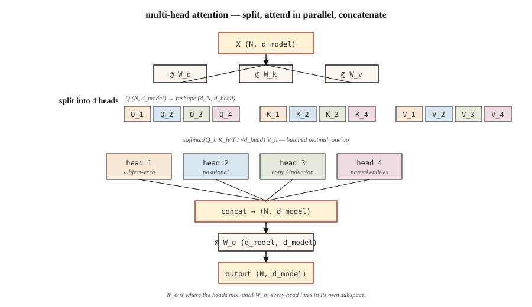

# Atensi Multi-Head

> Satu head atensi mempelajari satu relasi dalam satu waktu. Delapan head mempelajari delapan relasi. Head itu murah. Ambil lebih banyak.

**Jenis:** Build
**Bahasa:** Python
**Prasyarat:** Fase 7 · 02 (Self-Attention dari Awal)
**Waktu:** ~75 menit

## Masalahnya

Satu head self-attention menghitung satu matriks atensi. Matriks itu menangkap satu jenis relasi — biasanya relasi yang meminimalkan loss pada sinyal pelatihan apa pun. Jika data Anda memiliki kesesuaian subjek-kata kerja, coreferensi, wacana jarak jauh, dan pemotongan sintaktis yang semuanya tercampur aduk, satu head mengaburkan semuanya menjadi satu distribusi softmax dan kehilangan separuh sinyal.

Solusi dari makalah Vaswani 2017: jalankan beberapa fungsi atensi secara paralel, masing-masing dengan proyeksi Q, K, V sendiri, lalu gabungkan keluarannya. Setiap head beroperasi dalam subruang yang lebih kecil dengan dimensi $d_{\text{model}} / n_{\text{heads}}$. Total parameter tetap sama. Daya ekspresif naik.

Atensi multi-head adalah bawaan setiap transformer yang dirilis pada 2026. Perdebatan hanya soal *berapa banyak* head dan apakah kunci serta nilai berbagi proyeksi (Grouped-Query Attention, Multi-Query Attention, Multi-head Latent Attention).

## Konsepnya



**Pembelahan.** Ambil `X` berbentuk `(N, d_model)`. Proyeksikan ke Q, K, V masing-masing berbentuk `(N, d_model)`. Ubah bentuk menjadi `(N, n_heads, d_head)` dengan $d_{\text{head}} = d_{\text{model}} / n_{\text{heads}}$. Transpos menjadi `(n_heads, N, d_head)`.

**Hadiri secara paralel.** Jalankan atensi produk-titik berskala di dalam setiap head. Setiap head menghasilkan `(N, d_head)`. Head-head tersebut beroperasi pada subruang embedding yang berbeda dan tidak pernah saling berkomunikasi selama komputasi atensi itu sendiri.

**Gabungkan dan proyeksikan.** Tumpuk kembali head menjadi `(N, d_model)` lalu kalikan dengan matriks keluaran yang dipelajari `W_o` berbentuk `(d_model, d_model)`. Di `W_o`-lah head-head diberi kesempatan untuk bercampur.

**Mengapa ini bekerja.** Setiap head dapat mengkhususkan diri tanpa bersaing dengan yang lain untuk anggaran representasi. Studi probing dari 2019–2024 menunjukkan peran head yang berbeda: head posisi, head yang menghadiri token sebelumnya, head penyalin, head entitas bernama, dan head induksi (yang mendasari pembelajaran dalam konteks).

**Keturunan varian pada 2026:**

| Varian | Head Q | Head K/V | Digunakan oleh |
|--------|--------|----------|----------------|
| Multi-head (MHA) | N | N | GPT-2, BERT, T5 |
| Multi-query (MQA) | N | 1 | PaLM, Falcon |
| Grouped-query (GQA) | N | G (mis. N/8) | Llama 2 70B, Llama 3+, Qwen 2+, Mistral |
| Multi-head latent (MLA) | N | dikompres ke peringkat rendah | DeepSeek-V2, V3 |

GQA adalah bawaan modern karena memangkas memori KV-cache sebesar faktor $N/G$ sambil mempertahankan kualitas hampir penuh. MLA melangkah lebih jauh dengan mengompres K/V ke ruang laten, lalu memproyeksikannya kembali saat komputasi — biaya FLOPs bertambah, tetapi penghematan memori jauh lebih besar.

```figure
multihead-split
```

## Bangunlah

### Langkah 1: membelah head dari atensi satu head yang sudah kita punya

Ambil `SelfAttention` dari Pelajaran 02 dan bungkus dengan pasangan pembelahan/penggabungan. Lihat `code/main.py` untuk implementasi numpy; logikanya:

```python
def split_heads(X, n_heads):
    n, d = X.shape
    d_head = d // n_heads
    return X.reshape(n, n_heads, d_head).transpose(1, 0, 2)  # (heads, n, d_head)

def combine_heads(H):
    h, n, d_head = H.shape
    return H.transpose(1, 0, 2).reshape(n, h * d_head)
```

Satu reshape dan satu transpose. Tanpa loop. Ini persis yang dilakukan PyTorch di balik `nn.MultiheadAttention`.

### Langkah 2: menjalankan atensi produk-titik berskala per head

Setiap head mendapat irisan Q, K, V sendiri. Atensi menjadi matmul bertumpuk (batched):

```python
def mha_forward(X, W_q, W_k, W_v, W_o, n_heads):
    Q = X @ W_q
    K = X @ W_k
    V = X @ W_v
    Qh = split_heads(Q, n_heads)         # (heads, n, d_head)
    Kh = split_heads(K, n_heads)
    Vh = split_heads(V, n_heads)
    scores = Qh @ Kh.transpose(0, 2, 1) / np.sqrt(Qh.shape[-1])
    weights = softmax(scores, axis=-1)
    out = weights @ Vh                    # (heads, n, d_head)
    concat = combine_heads(out)
    return concat @ W_o, weights
```

Pada perangkat keras nyata, `Qh @ Kh.transpose(...)` adalah satu `bmm`. GPU melihat satu matmul bertumpuk berbentuk `(heads, N, d_head) × (heads, d_head, N) -> (heads, N, N)`. Menambah head itu gratis.

### Langkah 3: varian Grouped-Query Attention

Hanya proyeksi kunci dan nilai yang berubah. Q mendapat `n_heads` grup; K dan V mendapat `n_kv_heads < n_heads` grup lalu diulang agar cocok:

```python
def gqa_project(X, W, n_kv_heads, n_heads):
    kv = split_heads(X @ W, n_kv_heads)       # (kv_heads, n, d_head)
    repeat = n_heads // n_kv_heads
    return np.repeat(kv, repeat, axis=0)      # (n_heads, n, d_head)
```

Saat inferensi ini menghemat memori karena hanya `n_kv_heads` salinan yang hidup di KV cache, bukan `n_heads`. Llama 3 70B memakai 64 query head dengan 8 KV head — penyusutan cache sebesar 8×.

### Langkah 4: menyelidiki apa yang dipelajari setiap head

Jalankan MHA pada kalimat pendek dengan 4 head. Untuk setiap head, cetak matriks atensi `(N, N)`. Anda akan melihat head yang berbeda memilih struktur yang berbeda bahkan dengan inisialisasi acak — itu sebagian sinyal, sebagian lagi simetri rotasional pada subruang.

## Gunakanlah

Di PyTorch, versi satu baris:

```python
import torch.nn as nn

mha = nn.MultiheadAttention(embed_dim=512, num_heads=8, batch_first=True)
```

Mulai PyTorch 2.5+, GQA:

```python
from torch.nn.functional import scaled_dot_product_attention

# scaled_dot_product_attention otomatis menerapkan Flash Attention di CUDA.
# Untuk GQA, berikan Q berbentuk (B, n_heads, N, d_head) serta K,V berbentuk
# (B, n_kv_heads, N, d_head). PyTorch menangani pengulangannya.
out = scaled_dot_product_attention(q, k, v, is_causal=True, enable_gqa=True)
```

**Berapa banyak head?** Aturan praktis dari model produksi pada 2026:

| Ukuran model | d_model | n_heads | d_head |
|--------------|---------|---------|--------|
| Kecil (~125M) | 768 | 12 | 64 |
| Dasar (~350M) | 1024 | 16 | 64 |
| Besar (~1B) | 2048 | 16 | 128 |
| Frontier (~70B) | 8192 | 64 | 128 |

`d_head` hampir selalu berada di 64 atau 128. Ia adalah satuan seberapa jauh satu head dapat "melihat". Turun di bawah 32 dan head mulai berbenturan dengan faktor penskalaan $\sqrt{d_{\text{head}}}$; naik di atas 256 dan Anda kehilangan manfaat "banyak spesialis kecil".

## Kirimlah

Lihat `outputs/skill-mha-configurator.md`. Skill ini merekomendasikan jumlah head, jumlah kv-head, dan strategi proyeksi untuk sebuah transformer baru berdasarkan anggaran parameter, panjang urutan, dan target deployment.

## Latihan

1. **Mudah.** Ambil MHA dari `code/main.py` dan ubah `n_heads` dari 1 menjadi 16 dengan `d_model=64` tetap. Plot loss model satu lapisan kecil pada tugas penyalinan sintetis. Apakah lebih banyak head membantu, mendatar, atau justru merugikan?
2. **Sedang.** Implementasikan MQA (satu KV head yang dibagikan ke semua query head). Ukur seberapa banyak jumlah parameter turun dibanding MHA penuh. Hitung seberapa besar ukuran KV-cache menyusut saat inferensi untuk N=2048.
3. **Sulit.** Implementasikan versi kecil dari Multi-head Latent Attention: kompres K,V menjadi laten berperingkat-`r`, simpan laten itu di KV cache, lalu dekompresi saat atensi. Pada `r` berapa memori cache turun di bawah 1/8 dari MHA penuh sementara kualitas tetap dalam 1 bit dari ppl validasi?

## Istilah Kunci

| Istilah | Apa yang orang katakan | Apa yang sebenarnya dimaksud |
|---------|------------------------|------------------------------|
| Head | "Satu sirkuit atensi" | Satu proyeksi Q/K/V berdimensi $d_{\text{head}} = d_{\text{model}} / n_{\text{heads}}$ dengan matriks atensinya sendiri. |
| d_head | "Dimensi head" | Lebar tersembunyi per head; hampir selalu 64 atau 128 dalam produksi. |
| Split / combine | "Trik reshape" | `(N, d_model) ↔ (n_heads, N, d_head)` reshape+transpose di sekitar atensi. |
| W_o | "Proyeksi keluaran" | Matriks `(d_model, d_model)` yang diterapkan setelah menggabungkan head; tempat head bercampur. |
| MQA | "Satu KV head" | Multi-Query Attention: satu proyeksi K/V yang dibagikan. KV cache terkecil, dengan sedikit penurunan kualitas. |
| GQA | "Bawaan sejak Llama 2" | Grouped-Query Attention dengan `n_kv_heads < n_heads`; diulang agar cocok dengan Q. |
| MLA | "Trik DeepSeek" | Multi-head Latent Attention: K,V dikompres ke laten peringkat rendah, lalu didekompresi saat menghadiri. |
| Induction head | "Sirkuit di balik pembelajaran dalam konteks" | Sepasang head yang mendeteksi kemunculan sebelumnya dan menyalin apa yang mengikutinya. |

## Bacaan Lanjutan

- [Vaswani et al. (2017). Attention Is All You Need §3.2.2](https://arxiv.org/abs/1706.03762) — spesifikasi multi-head orisinal.
- [Shazeer (2019). Fast Transformer Decoding: One Write-Head is All You Need](https://arxiv.org/abs/1911.02150) — makalah MQA.
- [Ainslie et al. (2023). GQA: Training Generalized Multi-Query Transformer Models from Multi-Head Checkpoints](https://arxiv.org/abs/2305.13245) — cara mengonversi MHA menjadi GQA setelah pelatihan.
- [DeepSeek-AI (2024). DeepSeek-V2 Technical Report](https://arxiv.org/abs/2405.04434) — MLA dan mengapa ia mengalahkan MHA/GQA dalam hal memori cache.
- [Olsson et al. (2022). In-context Learning and Induction Heads](https://transformer-circuits.pub/2022/in-context-learning-and-induction-heads/index.html) — tinjauan mekanistik tentang apa yang sebenarnya dilakukan head.
