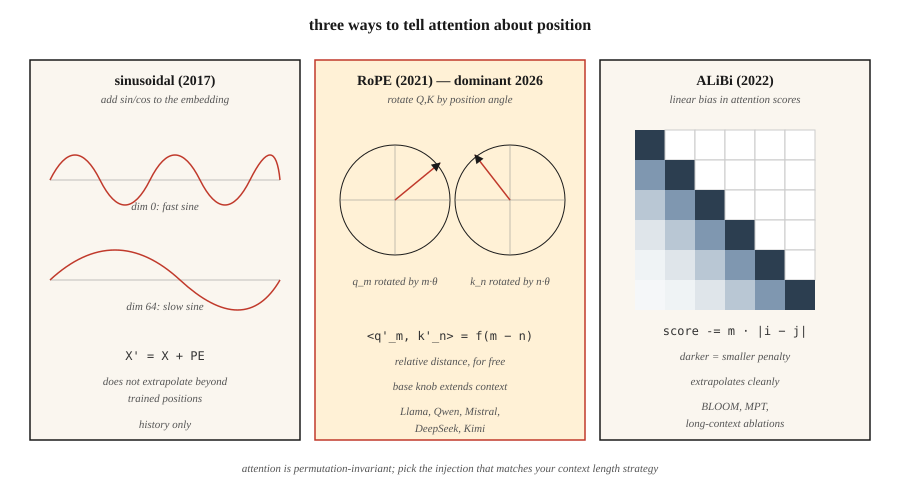

# Penyandian Posisi — Sinusoidal, RoPE, ALiBi

> Atensi bersifat invarian terhadap permutasi. "The cat sat on the mat" dan "mat the on sat cat the" menghasilkan keluaran yang sama tanpa sinyal posisi. Tiga algoritma memperbaikinya — masing-masing bertaruh dengan cara yang berbeda tentang apa arti "posisi".

**Jenis:** Build
**Bahasa:** Python
**Prasyarat:** Fase 7 · 02 (Self-Attention), Fase 7 · 03 (Atensi Multi-Head)
**Waktu:** ~45 menit

## Masalahnya

Atensi produk-titik berskala buta terhadap urutan. Matriks atensi `softmax(Q K^T / √d) V` dihitung dari kemiripan berpasangan. Acak baris-baris `X`, maka baris-baris keluaran ikut teracak dengan cara yang sama. Tidak ada satu pun di dalam atensi yang peduli pada posisi.

Itu bukan bug pada model kantong kata (bag-of-words). Untuk bahasa, kode, audio, video — apa pun yang maknanya dibawa oleh urutan — itu bersifat fatal.

Solusinya adalah menyuntikkan posisi ke dalam embedding dengan cara tertentu. Tiga era jawaban:

1. **Sinusoidal absolut** (Vaswani 2017). Tambahkan `sin/cos` posisi ke embedding. Sederhana, tanpa parameter yang dipelajari, ekstrapolasinya buruk di luar panjang latih.
2. **RoPE — Rotary Position Embeddings** (Su 2021). Putar vektor Q dan K dengan sudut yang sebanding dengan posisi. Mengodekan posisi *relatif* langsung di dalam produk titik. Dominan pada 2026.
3. **ALiBi — Attention with Linear Biases** (Press 2022). Lewati embedding sama sekali; tambahkan penalti linear per head pada skor atensi berdasarkan jarak. Ekstrapolasi panjang sangat baik.

Per 2026, hampir setiap model terbuka frontier memakai RoPE: Llama 2/3/4, Qwen 2/3, Mistral, Mixtral, DeepSeek-V3, Kimi. Segelintir model konteks panjang memakai ALiBi atau varian modernnya. Sinusoidal absolut bersifat historis.

## Konsepnya



### Sinusoidal absolut

Hitung lebih dulu matriks tetap `PE` berbentuk `(max_len, d_model)`:

```math
\begin{aligned}
PE_{(pos, 2i)} &= \sin\left(pos / 10000^{2i / d_{\text{model}}}\right) \\
PE_{(pos, 2i+1)} &= \cos\left(pos / 10000^{2i / d_{\text{model}}}\right)
\end{aligned}
```

Lalu `X' = X + PE[:N]` sebelum atensi. Setiap dimensi adalah sinusoid pada frekuensi yang berbeda. Model belajar membaca posisi dari pola fase. Gagal di luar `max_len`: tidak ada yang memberi tahu model apa yang terjadi di posisi 2048 ketika ia hanya melihat posisi 0–2047.

### RoPE

Putar vektor Q dan K (bukan embedding). Untuk sepasang dimensi $(2i, 2i+1)$:

```math
\begin{bmatrix} q'_{2i} \\ q'_{2i+1} \end{bmatrix} = \begin{bmatrix} \cos(pos \cdot \theta_i) & -\sin(pos \cdot \theta_i) \\ \sin(pos \cdot \theta_i) & \cos(pos \cdot \theta_i) \end{bmatrix} \begin{bmatrix} q_{2i} \\ q_{2i+1} \end{bmatrix}
\qquad \theta_i = \text{base}^{-2i / d_{\text{head}}}, \quad \text{base} = 10000 \text{ by default}
```

Terapkan rotasi yang sama pada kunci dengan posisi `pos_k`. Produk titik $q'_m \cdot k'_n$ menjadi fungsi dari $(m - n)$ saja. Artinya: **skor atensi hanya bergantung pada jarak relatif**, meskipun rotasinya dikunci pada posisi absolut. Trik yang indah.

Memperluas RoPE: `base` dapat diskalakan (NTK-aware, YaRN, LongRoPE) untuk melakukan ekstrapolasi ke konteks yang lebih panjang tanpa melatih ulang. Dengan cara ini Llama 3 memperluas konteks dari 8K menjadi 128K.

### ALiBi

Lewati trik embedding. Beri bias langsung pada skor atensi:

```math
\text{attn\_score}[i, j] = \frac{q_i \cdot k_j}{\sqrt{d}} - m_h \cdot |i - j|
```

Di mana $m_h$ adalah slope khusus per head (mis. $1 / 2^{8h/H}$). Token yang lebih dekat mendapat dorongan; token yang jauh mendapat penalti. Tanpa biaya saat pelatihan. Makalah ini menunjukkan ekstrapolasi panjang mengalahkan sinusoidal dan sejajar dengan RoPE pada panjang latih asalnya.

### Apa yang dipilih pada 2026

| Varian | Ekstrapolasi | Biaya pelatihan | Digunakan oleh |
|--------|--------------|-----------------|----------------|
| Sinusoidal absolut | buruk | gratis | transformer orisinal, BERT awal |
| Absolut yang dipelajari | tidak ada | sangat kecil | GPT-2, GPT-3 |
| RoPE | baik dengan penskalaan | gratis | Llama 2/3/4, Qwen 2/3, Mistral, DeepSeek-V3, Kimi |
| RoPE + YaRN | sangat baik | tahap fine-tuning | Qwen2-1M, Llama 3.1 128K |
| ALiBi | sangat baik | gratis | BLOOM, MPT, Baichuan |

RoPE menang karena ia masuk ke dalam atensi tanpa mengubah arsitektur, mengodekan posisi relatif, dan hiperparameter `base`-nya memberi tombol yang rapi untuk fine-tuning konteks panjang.

```figure
rope-explorer
```

## Bangunlah

### Langkah 1: penyandian sinusoidal

Lihat `code/main.py`. Komputasi empat baris:

```python
def sinusoidal(N, d):
    pe = [[0.0] * d for _ in range(N)]
    for pos in range(N):
        for i in range(d // 2):
            theta = pos / (10000 ** (2 * i / d))
            pe[pos][2 * i]     = math.sin(theta)
            pe[pos][2 * i + 1] = math.cos(theta)
    return pe
```

Tambahkan ini ke matriks embedding sebelum lapisan atensi pertama.

### Langkah 2: RoPE diterapkan pada Q, K

RoPE beroperasi secara langsung (in-place) pada Q dan K. Untuk setiap pasangan dimensi:

```python
def apply_rope(x, pos, base=10000):
    d = len(x)
    out = list(x)
    for i in range(d // 2):
        theta = pos / (base ** (2 * i / d))
        c, s = math.cos(theta), math.sin(theta)
        a, b = x[2 * i], x[2 * i + 1]
        out[2 * i]     = a * c - b * s
        out[2 * i + 1] = a * s + b * c
    return out
```

Yang krusial: terapkan fungsi yang sama pada Q di posisi $m$ dan K di posisi $n$. Produk titik keduanya memperoleh faktor $\cos((m-n) \cdot \theta_i)$ pada setiap pasangan koordinat. Atensi mempelajari posisi relatif secara gratis.

### Langkah 3: slope dan bias ALiBi

```python
def alibi_bias(n_heads, seq_len):
    # slope_h = 2 ** (-8 * h / n_heads) untuk h = 1..n_heads
    slopes = [2 ** (-8 * (h + 1) / n_heads) for h in range(n_heads)]
    bias = []
    for m in slopes:
        row = [[-m * abs(i - j) for j in range(seq_len)] for i in range(seq_len)]
        bias.append(row)
    return bias  # tambahkan ke skor atensi sebelum softmax
```

Tambahkan `bias[h]` ke matriks skor atensi `(seq_len, seq_len)` dari head `h`, lalu terapkan softmax.

### Langkah 4: verifikasi sifat jarak-relatif RoPE

Pilih dua vektor acak `a, b`. Putar dengan `(pos_a, pos_b)`. Lalu dengan `(pos_a + k, pos_b + k)`. Kedua produk titik harus sama dalam batas galat titik mengambang. Sifat itulah inti RoPE — ia invarian terhadap offset absolut, yang penting hanyalah jarak relatif.

## Gunakanlah

PyTorch 2.5+ menyediakan utilitas RoPE di `torch.nn.functional`. Sebagian besar kode produksi memakai `flash_attn` atau `xformers`, di mana RoPE diterapkan di dalam kernel atensi.

```python
from transformers import AutoModel
model = AutoModel.from_pretrained("meta-llama/Llama-3.2-3B")
# model.config.rope_scaling → {"type": "yarn", "factor": 32.0, "original_max_position_embeddings": 8192}
```

**Trik konteks panjang pada 2026:**

- **Interpolasi NTK-aware.** Skalakan ulang `base` menjadi `base * (scale_factor)^(d/(d-2))` saat memperluas dari 4K ke 16K+.
- **YaRN.** Interpolasi yang lebih cerdas dan mempertahankan entropi atensi pada konteks panjang. Llama 3.1 128K memakainya.
- **LongRoPE.** Metode Microsoft 2024 yang memakai pencarian evolusioner untuk memilih faktor skala per dimensi. Phi-3-Long memakainya.
- **Interpolasi posisi + fine-tuning.** Cukup perkecil posisi dengan faktor perluasan lalu lakukan fine-tuning selama 1–5B token. Efektivitasnya mengejutkan.

## Kirimlah

Lihat `outputs/skill-positional-encoding-picker.md`. Skill ini memilih strategi penyandian untuk model baru berdasarkan panjang konteks target, kebutuhan ekstrapolasi, dan anggaran pelatihan.

## Latihan

1. **Mudah.** Plot matriks `PE` sinusoidal sebagai peta panas untuk `max_len=512, d=128`. Konfirmasi pola "garis-garis melebar seiring indeks dimensi bertambah".
2. **Sedang.** Implementasikan penskalaan RoPE NTK-aware. Latih LM kecil pada urutan panjang 256, lalu uji pada panjang 1024 dengan dan tanpa penskalaan. Ukur perplexity.
3. **Sulit.** Implementasikan ALiBi dan RoPE dalam satu modul atensi. Latih transformer 4 lapisan pada tugas penyalinan dengan urutan panjang 512. Lakukan ekstrapolasi ke 2048 saat pengujian. Bandingkan penurunan kinerjanya.

## Istilah Kunci

| Istilah | Apa yang orang katakan | Apa yang sebenarnya dimaksud |
|---------|------------------------|------------------------------|
| Penyandian posisi | "Memberi tahu atensi tentang urutan" | Sinyal apa pun yang ditambahkan ke embedding atau atensi untuk mengodekan posisi. |
| Sinusoidal | "Yang orisinal" | `sin/cos` pada frekuensi geometris yang ditambahkan ke embedding; tidak melakukan ekstrapolasi. |
| RoPE | "Embedding rotasi" | Putar Q, K dengan sudut yang bergantung pada posisi; produk titik mengodekan jarak relatif. |
| ALiBi | "Trik bias linear" | Tambahkan $-m \cdot \lvert i-j \rvert$ ke skor atensi; tanpa embedding, ekstrapolasi sangat baik. |
| base | "Tombol RoPE" | Penskala frekuensi dalam RoPE; naikkan untuk memperpanjang konteks saat inferensi. |
| NTK-aware | "Trik penskalaan RoPE" | Skalakan ulang `base` agar dimensi frekuensi tinggi tidak terjepit saat konteks melebar. |
| YaRN | "Yang canggih" | Interpolasi+ekstrapolasi per dimensi yang mempertahankan entropi atensi. |
| Ekstrapolasi | "Bekerja di luar panjang latih" | Dapatkah skema posisi menghasilkan keluaran yang benar melebihi `max_len` yang dilihat saat pelatihan? |

## Bacaan Lanjutan

- [Vaswani et al. (2017). Attention Is All You Need §3.5](https://arxiv.org/abs/1706.03762) — sinusoidal orisinal.
- [Su et al. (2021). RoFormer: Enhanced Transformer with Rotary Position Embedding](https://arxiv.org/abs/2104.09864) — makalah RoPE.
- [Press, Smith, Lewis (2021). Train Short, Test Long: Attention with Linear Biases Enables Input Length Extrapolation](https://arxiv.org/abs/2108.12409) — ALiBi.
- [Peng et al. (2023). YaRN: Efficient Context Window Extension of Large Language Models](https://arxiv.org/abs/2309.00071) — penskalaan RoPE terbaik saat ini.
- [Chen et al. (2023). Extending Context Window of Large Language Models via Positional Interpolation](https://arxiv.org/abs/2306.15595) — makalah konteks panjang Llama 2 dari Meta.
- [Ding et al. (2024). LongRoPE: Extending LLM Context Window Beyond 2 Million Tokens](https://arxiv.org/abs/2402.13753) — metode Microsoft yang dipakai Phi-3-Long dan dikutip di bagian Gunakanlah.
- [HuggingFace Transformers — `modeling_rope_utils.py`](https://github.com/huggingface/transformers/blob/main/src/transformers/modeling_rope_utils.py) — implementasi siap produksi untuk setiap skema penskalaan RoPE (default, linear, dinamis, YaRN, LongRoPE, Llama-3).
