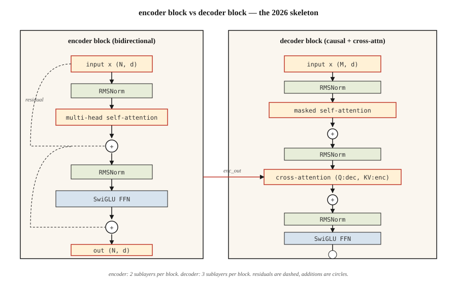

# Transformer Lengkap — Encoder + Decoder

> Atensi adalah bintangnya. Semua sisanya — residual, normalisasi, feed-forward, cross-attention — adalah perancah yang memungkinkan Anda menumpuknya secara dalam.

**Jenis:** Build
**Bahasa:** Python
**Prasyarat:** Fase 7 · 02 (Self-Attention), Fase 7 · 03 (Atensi Multi-Head), Fase 7 · 04 (Penyandian Posisi)
**Waktu:** ~75 menit

## Masalahnya

Satu lapisan atensi adalah ekstraktor fitur, bukan model. Satu matmul per lapisan tidak cukup kapasitas untuk bahasa. Anda memerlukan kedalaman — dan kedalaman rusak tanpa perpipaan yang tepat.

Makalah Vaswani 2017 merangkum enam keputusan desain yang mengubah satu lapisan atensi menjadi blok yang dapat ditumpuk. Setiap transformer setelahnya — encoder-only (BERT), decoder-only (GPT), encoder-decoder (T5) — mewarisi kerangka yang sama. Pada 2026 blok-blok itu telah disempurnakan (RMSNorm, SwiGLU, pre-norm, RoPE), tetapi kerangkanya identik.

Pelajaran ini adalah kerangkanya. Pelajaran berikutnya mengkhususkannya — 06 untuk encoder, 07 untuk decoder, 08 untuk encoder-decoder.

## Konsepnya



### Enam bagian

1. **Embedding + sinyal posisi.** Token → vektor. Posisi disuntikkan melalui RoPE (modern) atau sinusoidal (klasik).
2. **Self-attention.** Setiap posisi menghadiri semua posisi lainnya. Disamar pada decoder.
3. **Jaringan feed-forward (FFN).** MLP dua lapisan per posisi: `W_2 · activation(W_1 · x)`. Rasio ekspansi 4× secara bawaan.
4. **Koneksi residual.** `x + sublayer(x)`. Tanpa ini, gradien hilang setelah ~6 lapisan.
5. **Normalisasi lapisan.** `LayerNorm` atau `RMSNorm` (modern). Menstabilkan aliran residual.
6. **Cross-attention (khusus decoder).** Kueri berasal dari decoder, kunci dan nilai dari keluaran encoder.

Perhatikan sebuah vektor mengalir melalui satu blok: atensi mencampurnya lintas posisi, residual membawanya terus ke depan, FFN mengubahnya, dan normalisasi menjaga aliran tetap stabil.

```figure
transformer-block
```

### Blok encoder (dipakai BERT, encoder T5)

```
x → LN → MHA(self) → + → LN → FFN → + → out
                     ^              ^
                     |              |
                     └── residual ──┘
```

Encoder bersifat dua arah. Tanpa penyamaran. Semua posisi melihat semua posisi.

### Blok decoder (dipakai GPT, decoder T5)

```
x → LN → MHA(masked self) → + → LN → MHA(cross to encoder) → + → LN → FFN → + → out
```

Decoder memiliki tiga sublapisan per blok. Yang di tengah — cross-attention — adalah satu-satunya tempat informasi mengalir dari encoder ke decoder. Pada arsitektur decoder-only murni (GPT), cross-attention dihilangkan dan Anda hanya memiliki self-attention tersamar + FFN.

### Pre-norm vs post-norm

Makalah orisinal: `x + sublayer(LN(x))` vs `LN(x + sublayer(x))`. Post-norm kehilangan pamor sekitar 2019 — lebih sulit dilatih secara dalam tanpa warmup yang hati-hati. Pre-norm (`LN` *sebelum* sublapisan) adalah bawaan 2026: Llama, Qwen, GPT-3+, Mistral semuanya memakainya.

### Blok termodernisasi 2026

Vaswani 2017 merilis LayerNorm + ReLU. Stack modern mengganti keduanya. Bagaimana blok produksi sebenarnya terlihat:

| Komponen | 2017 | 2026 |
|----------|------|------|
| Normalisasi | LayerNorm | RMSNorm |
| Aktivasi FFN | ReLU | SwiGLU |
| Ekspansi FFN | 4× | 2,6× (SwiGLU memakai tiga matriks, total parameter sama) |
| Posisi | Sinusoidal absolut | RoPE |
| Atensi | MHA penuh | GQA (atau MLA) |
| Suku bias | Ya | Tidak |

RMSNorm menghilangkan pusat-rata-rata dari LayerNorm (satu pengurangan lebih sedikit), yang menghemat komputasi dan secara empiris setidaknya sama stabilnya. SwiGLU (`Swish(W1 x) ⊙ W3 x`) secara konsisten mengungguli FFN ReLU/GELU sekitar 0,5 poin ppl dalam makalah Llama, PaLM, dan Qwen.

### Jumlah parameter

Untuk satu blok dengan `d_model = d` dan ekspansi FFN `r`:

- MHA: `4 · d²` (proyeksi Q, K, V, O)
- FFN (SwiGLU): `3 · d · (r · d)` ≈ `3rd²`
- Normalisasi: dapat diabaikan

Pada `d = 4096, r = 2.6, layers = 32` (kurang lebih Llama 3 8B), total: `32 · (4·4096² + 3·2.6·4096²) ≈ 32 · (67M + 131M) ≈ 32 · 198M ≈ 6.3B` parameter di dalam blok, ditambah sekitar 1B untuk embedding dan head keluaran (128K vocab × 4096, tidak diikat). Itu mendekati angka 8B yang dipublikasikan. Model sebenarnya memakai GQA (proyeksi K dan V lebih kecil) serta FFN yang lebih lebar (`r = 3.5`), yang memindahkan parameter dari atensi ke FFN tetapi menjaga total tetap dekat 8B.

## Bangunlah

### Langkah 1: blok-blok penyusun

Dengan kelas `Matrix` kecil dari Pelajaran 03 (disalin ke file ini agar mandiri):

- `layer_norm(x, eps=1e-5)` — kurangi rata-rata, bagi dengan standar deviasi.
- `rms_norm(x, eps=1e-6)` — bagi dengan RMS. Tanpa pengurangan rata-rata.
- `gelu(x)` dan `silu(x) * W3 x` (SwiGLU).
- `ffn_swiglu(x, W1, W2, W3)`.
- `encoder_block(x, params)` dan `decoder_block(x, enc_out, params)`.

Lihat `code/main.py` untuk rangkaian lengkapnya.

### Langkah 2: rangkai encoder 2 lapisan dan decoder 2 lapisan

Tumpuk keduanya. Teruskan keluaran encoder ke setiap cross-attention decoder. Tambahkan LN terakhir sebelum proyeksi keluaran.

```python
def encode(tokens, params):
    x = embed(tokens, params.emb) + sinusoidal(len(tokens), params.d)
    for block in params.encoder_blocks:
        x = encoder_block(x, block)
    return x

def decode(target_tokens, encoder_out, params):
    x = embed(target_tokens, params.emb) + sinusoidal(len(target_tokens), params.d)
    for block in params.decoder_blocks:
        x = decoder_block(x, encoder_out, block)
    return x
```

### Langkah 3: jalankan forward pada contoh mainan

Masukkan sumber 6 token dan target 5 token. Verifikasi bentuk keluaran adalah `(5, vocab)`. Tanpa pelatihan — pelajaran ini tentang arsitektur, bukan loss.

### Langkah 4: ganti dengan RMSNorm + SwiGLU

Ganti LayerNorm dan FFN-ReLU dengan RMSNorm dan SwiGLU. Pastikan bentuk tetap cocok. Ini adalah modernisasi 2026 hanya dengan satu substitusi fungsi.

## Gunakanlah

Implementasi referensi PyTorch/TF: `nn.TransformerEncoderLayer`, `nn.TransformerDecoderLayer`. Namun sebagian besar kode produksi 2026 membuat blok sendiri karena:

- Flash Attention dipanggil di dalam atensi, bukan melalui `nn.MultiheadAttention`.
- GQA / MLA tidak ada di pustaka standar referensi.
- RoPE, RMSNorm, SwiGLU bukan bawaan PyTorch.

HF `transformers` memiliki blok referensi yang bersih dan sebaiknya Anda baca: `modeling_llama.py` adalah blok decoder-only kanonik 2026. Panjangnya ~500 baris dan layak ditelusuri sekali.

**Encoder vs decoder vs encoder-decoder — kapan memilih:**

| Kebutuhan | Pilihan | Contoh |
|-----------|---------|--------|
| Klasifikasi, embedding, QA pada teks | Encoder-only | BERT, DeBERTa, ModernBERT |
| Pembuatan teks, obrolan, kode, penalaran | Decoder-only | GPT, Llama, Claude, Qwen |
| Masukan terstruktur → keluaran terstruktur (terjemahan, peringkasan) | Encoder-decoder | T5, BART, Whisper |

Decoder-only menang di bidang bahasa karena penskalannya paling bersih dan menangani baik pemahaman maupun pembuatan. Encoder-decoder tetap terbaik ketika masukan memiliki identitas "urutan sumber" yang jelas (terjemahan, pengenalan ucapan, tugas terstruktur).

## Kirimlah

Lihat `outputs/skill-transformer-block-reviewer.md`. Skill ini meninjau implementasi blok transformer baru terhadap bawaan 2026 dan menandai bagian yang hilang (pre-norm, RoPE, RMSNorm, GQA, rasio ekspansi FFN).

## Latihan

1. **Mudah.** Hitung jumlah parameter pada encoder_block Anda di `d_model=512, n_heads=8, ffn_expansion=4, swiglu=True`. Validasi dengan mengimplementasikan blok itu dan memakai `sum(p.numel() for p in block.parameters())`.
2. **Sedang.** Beralih dari post-norm ke pre-norm. Inisialisasi keduanya dan ukur norma aktivasi setelah 12 lapisan bertumpuk pada masukan acak. Aktivasi post-norm seharusnya meledak; aktivasi pre-norm seharusnya tetap terbatas.
3. **Sulit.** Implementasikan encoder-decoder 4 lapisan pada tugas penyalinan mainan (salin `x` secara terbalik). Latih 100 langkah. Laporkan loss. Ganti dengan RMSNorm + SwiGLU + RoPE — apakah loss turun?

## Istilah Kunci

| Istilah | Apa yang orang katakan | Apa yang sebenarnya dimaksud |
|---------|------------------------|------------------------------|
| Blok | "Satu lapisan transformer" | Tumpukan norm + atensi + norm + FFN, dibungkus koneksi residual. |
| Residual | "Koneksi pintas" | Keluaran `x + f(x)`; memungkinkan aliran gradien melalui tumpukan dalam. |
| Pre-norm | "Normalkan sebelum, bukan sesudah" | Modern: `x + sublayer(LN(x))`. Melatih lebih dalam tanpa akrobasi warmup. |
| RMSNorm | "LayerNorm tanpa rata-rata" | Bagi dengan RMS; satu operasi lebih sedikit, stabilitas empiris sama. |
| SwiGLU | "FFN yang semua orang pakai" | `Swish(W1 x) ⊙ W3 x → W2`. Mengalahkan ReLU/GELU pada ppl LM. |
| Cross-attention | "Bagaimana decoder melihat encoder" | MHA dengan Q dari decoder, K/V dari keluaran encoder. |
| Ekspansi FFN | "Seberapa lebar MLP tengah" | Rasio ukuran tersembunyi terhadap d_model, biasanya 4 (LayerNorm) atau 2,6 (SwiGLU). |
| Tanpa bias | "Hilangkan suku +b" | Stack modern menghilangkan bias pada lapisan linear; perbaikan ppl kecil, model lebih kecil. |

## Bacaan Lanjutan

- [Vaswani et al. (2017). Attention Is All You Need](https://arxiv.org/abs/1706.03762) — spesifikasi blok orisinal.
- [Xiong et al. (2020). On Layer Normalization in the Transformer Architecture](https://arxiv.org/abs/2002.04745) — mengapa pre-norm mengalahkan post-norm pada tumpukan dalam.
- [Zhang, Sennrich (2019). Root Mean Square Layer Normalization](https://arxiv.org/abs/1910.07467) — RMSNorm.
- [Shazeer (2020). GLU Variants Improve Transformer](https://arxiv.org/abs/2002.05202) — makalah SwiGLU.
- [HuggingFace `modeling_llama.py`](https://github.com/huggingface/transformers/blob/main/src/transformers/models/llama/modeling_llama.py) — blok decoder-only kanonik 2026.
