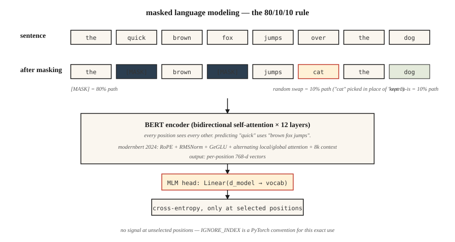

# BERT — Pemodelan Bahasa Tersamar

> GPT memprediksi kata berikutnya. BERT memprediksi kata yang hilang. Satu kalimat perbedaan — dan setengah dekade dari segala hal yang berbentuk embedding.

**Jenis:** Build
**Bahasa:** Python, Rust
**Prasyarat:** Fase 7 · 05 (Transformer Lengkap), Fase 5 · 02 (Representasi Teks)
**Waktu:** ~45 menit

## Masalahnya

Pada 2018 setiap tugas NLP — sentimen, NER, QA, entailment — melatih modelnya sendiri dari awal dengan data berlabelnya sendiri. Tidak ada checkpoint "memahami bahasa Inggris" yang sudah dilatih lebih dulu untuk Anda fine-tune. ELMo (2018) menunjukkan bahwa Anda dapat melakukan pra-pelatihan embedding kontekstual dengan LSTM dua arah; hal itu membantu, tetapi tidak menggeneralisasi dengan baik.

BERT (Devlin dkk. 2018) bertanya: bagaimana jika kita mengambil encoder transformer, melatihnya pada setiap kalimat di internet, dan memaksanya memprediksi kata yang hilang dari konteks di kedua sisinya? Lalu Anda melakukan fine-tuning satu head pada tugas hilir Anda. Efisiensi parameter menjadi sebuah wahyu.

Hasilnya: dalam 18 bulan BERT dan variannya (RoBERTa, ALBERT, ELECTRA) mendominasi setiap papan peringkat NLP yang ada. Pada 2020 setiap mesin pencari, pipeline moderasi konten, dan sistem pencarian semantik di dunia memiliki BERT di dalamnya.

Pada 2026 model encoder-only masih merupakan alat yang tepat untuk klasifikasi, pengambilan, dan ekstraksi terstruktur — ia berjalan 5–10× lebih cepat per token dibanding decoder dan embedding-nya adalah tulang punggung setiap stack pengambilan modern. ModernBERT (Des 2024) mendorong arsitektur ini ke konteks 8K dengan Flash Attention + RoPE + GeGLU.

## Konsepnya



### Sinyal pelatihan

Ambil sebuah kalimat: `the quick brown fox jumps over the lazy dog`.

Samarkan 15% token secara acak:

```
input:  the [MASK] brown fox jumps [MASK] the lazy dog
target: the  quick brown fox jumps  over  the lazy dog
```

Latih model untuk memprediksi token asli pada posisi yang disamarkan. Karena encoder bersifat dua arah, memprediksi `[MASK]` di posisi 1 dapat memakai `brown fox jumps` di posisi 2 ke atas. Itulah yang tidak bisa dilakukan GPT.

### Aturan penyamaran BERT

Dari 15% token yang dipilih untuk diprediksi:

- 80% diganti dengan `[MASK]`.
- 10% diganti dengan token acak.
- 10% dibiarkan apa adanya.

Mengapa tidak selalu `[MASK]`? Karena `[MASK]` tidak pernah muncul saat inferensi. Melatih model untuk mengharapkan `[MASK]` pada 100% posisi tersamar akan menciptakan pergeseran distribusi antara pra-pelatihan dan fine-tuning. 10% acak + 10% tak berubah menjaga model tetap jujur.

### Next Sentence Prediction (NSP) — dan mengapa ia dihapus

BERT orisinal juga dilatih dengan NSP: diberi dua kalimat A dan B, prediksi apakah B mengikuti A. RoBERTa (2019) melakukan ablasi terhadapnya dan menunjukkan NSP justru merugikan, bukan membantu. Encoder modern melewatkannya.

### Apa yang berubah pada 2026: ModernBERT

Makalah ModernBERT 2024 membangun ulang blok dengan primitive 2026:

| Komponen | BERT orisinal (2018) | ModernBERT (2024) |
|----------|----------------------|-------------------|
| Posisi | Absolut yang dipelajari | RoPE |
| Aktivasi | GELU | GeGLU |
| Normalisasi | LayerNorm | Pre-norm RMSNorm |
| Atensi | Penuh padat | Bergantian lokal (128) + global |
| Panjang konteks | 512 | 8192 |
| Tokenizer | WordPiece | BPE |

Dan tidak seperti stack 2018, ia mendukung Flash Attention secara bawaan. Inferensi 2–3× lebih cepat pada panjang urutan 8K dibanding DeBERTa-v3 dengan skor GLUE yang lebih baik.

### Kasus penggunaan yang masih memilih encoder pada 2026

| Tugas | Mengapa encoder mengalahkan decoder |
|-------|-------------------------------------|
| Pengambilan / embedding pencarian semantik | Konteks dua arah = kualitas embedding lebih baik per token |
| Klasifikasi (sentimen, niat, toksisitas) | Satu kali forward; tanpa beban pembuatan |
| NER / pelabelan token | Keluaran per posisi, dua arah secara alami |
| Entailment zero-shot (NLI) | Head klasifikasi di atas encoder |
| Peringkat ulang untuk RAG | Penilaian cross-encoder, 10× lebih cepat daripada peringkat ulang LLM |

```figure
transformer-residual
```

## Bangunlah

### Langkah 1: logika penyamaran

Lihat `code/main.py`. Fungsi `create_mlm_batch` menerima daftar ID token, ukuran kosakata, dan probabilitas penyamaran. Fungsi ini mengembalikan ID masukan (dengan penyamaran diterapkan) dan label (hanya pada posisi tersamar, -100 di tempat lain — konvensi indeks abai PyTorch).

```python
def create_mlm_batch(tokens, vocab_size, mask_prob=0.15, rng=None):
    input_ids = list(tokens)
    labels = [-100] * len(tokens)
    for i, t in enumerate(tokens):
        if rng.random() < mask_prob:
            labels[i] = t
            r = rng.random()
            if r < 0.8:
                input_ids[i] = MASK_ID
            elif r < 0.9:
                input_ids[i] = rng.randrange(vocab_size)
            # jika tidak: biarkan yang asli
    return input_ids, labels
```

### Langkah 2: jalankan prediksi MLM pada korpus kecil

Latih encoder 2 lapisan + head MLM pada kosakata 20 kata, 200 kalimat. Tanpa gradien — kita melakukan pemeriksaan kewarasan forward. Pelatihan penuh memerlukan PyTorch.

### Langkah 3: bandingkan jenis penyamaran

Tunjukkan bagaimana aturan tiga cabang menjaga model tetap dapat digunakan tanpa `[MASK]`. Lakukan prediksi pada kalimat tak tersamar dan pada kalimat tersamar. Keduanya seharusnya menghasilkan distribusi token yang masuk akal karena model melihat kedua pola itu saat pelatihan.

### Langkah 4: fine-tuning head

Ganti head MLM dengan head klasifikasi pada dataset sentimen mainan. Hanya head yang dilatih; encoder dibekukan. Ini pola yang diikuti setiap aplikasi BERT.

## Gunakanlah

```python
from transformers import AutoModel, AutoTokenizer

tok = AutoTokenizer.from_pretrained("answerdotai/ModernBERT-base")
model = AutoModel.from_pretrained("answerdotai/ModernBERT-base")

text = "Attention is all you need."
inputs = tok(text, return_tensors="pt")
out = model(**inputs).last_hidden_state   # (1, N, 768)
```

**Model embedding adalah BERT yang di-fine-tune.** Model `sentence-transformers` seperti `all-MiniLM-L6-v2` adalah BERT yang dilatih dengan contrastive loss. Encoder-nya sama. Yang berubah adalah loss-nya.

**Peringkat ulang cross-encoder juga merupakan BERT yang di-fine-tune.** Klasifikasi pasangan pada `[CLS] query [SEP] doc [SEP]`. Atensi dua arah antara kueri dan dokumen itulah yang memberi cross-encoder keunggulan kualitas atas biencoder.

**Kapan tidak memilih BERT pada 2026.** Apa pun yang generatif. Encoder tidak punya cara yang masuk akal untuk menghasilkan token secara autoregresif. Juga: apa pun di bawah 1B parameter yang mana decoder kecil dapat menyamai kualitasnya dengan fleksibilitas lebih besar (Phi-3-Mini, Qwen2-1.5B).

## Kirimlah

Lihat `outputs/skill-bert-finetuner.md`. Skill ini menentukan ruang lingkup fine-tuning BERT (pilihan backbone, spesifikasi head, data, evaluasi, penghentian) untuk tugas klasifikasi atau ekstraksi baru.

## Latihan

1. **Mudah.** Jalankan `code/main.py` dan cetak distribusi penyamaran pada 10.000 token. Konfirmasi ~15% dipilih, dan dari jumlah itu ~80% menjadi `[MASK]`.
2. **Sedang.** Implementasikan penyamaran kata utuh: jika sebuah kata ditokenisasi menjadi subkata, samarkan semua subkatanya sekaligus atau tidak sama sekali. Ukur apakah ini meningkatkan akurasi MLM pada korpus 500 kalimat.
3. **Sulit.** Latih BERT kecil (2 lapisan, d=64) pada 10.000 kalimat dari dataset publik. Lakukan fine-tuning token `[CLS]` untuk sentimen SST-2. Bandingkan dengan baseline decoder-only pada jumlah parameter yang sama — mana yang menang?

## Istilah Kunci

| Istilah | Apa yang orang katakan | Apa yang sebenarnya dimaksud |
|---------|------------------------|------------------------------|
| MLM | "Pemodelan bahasa tersamar" | Sinyal pelatihan: ganti 15% token secara acak dengan `[MASK]`, lalu prediksi yang asli. |
| Dua arah | "Melihat dua arah" | Atensi encoder tidak punya penyamaran kausal — setiap posisi melihat semua posisi lainnya. |
| `[CLS]` | "Token pengumpul" | Token khusus yang ditambahkan di awal setiap urutan; embedding akhirnya dipakai sebagai representasi tingkat kalimat. |
| `[SEP]` | "Pemisah segmen" | Memisahkan urutan berpasangan (mis. kueri/dokumen, kalimat A/B). |
| NSP | "Prediksi kalimat berikutnya" | Tugas pra-pelatihan kedua BERT; terbukti tidak berguna dalam RoBERTa, dihapus setelah 2019. |
| Fine-tuning | "Menyesuaikan dengan tugas" | Biarkan encoder sebagian besar dibekukan; latih head kecil di atasnya untuk tugas hilir. |
| Cross-encoder | "Peringkat ulang" | BERT yang menerima kueri dan dokumen sebagai masukan, lalu menghasilkan skor relevansi. |
| ModernBERT | "Penyegaran 2024" | Encoder dibangun ulang dengan RoPE, RMSNorm, GeGLU, atensi lokal/global bergantian, konteks 8K. |

## Bacaan Lanjutan

- [Devlin et al. (2018). BERT: Pre-training of Deep Bidirectional Transformers for Language Understanding](https://arxiv.org/abs/1810.04805) — makalah orisinal.
- [Liu et al. (2019). RoBERTa: A Robustly Optimized BERT Pretraining Approach](https://arxiv.org/abs/1907.11692) — cara melatih BERT dengan benar; menghilangkan NSP.
- [Clark et al. (2020). ELECTRA: Pre-training Text Encoders as Discriminators Rather Than Generators](https://arxiv.org/abs/2003.10555) — deteksi token yang diganti mengalahkan MLM pada komputasi yang sama.
- [Warner et al. (2024). Smarter, Better, Faster, Longer: A Modern Bidirectional Encoder](https://arxiv.org/abs/2412.13663) — makalah ModernBERT.
- [HuggingFace `modeling_bert.py`](https://github.com/huggingface/transformers/blob/main/src/transformers/models/bert/modeling_bert.py) — referensi encoder kanonik.
