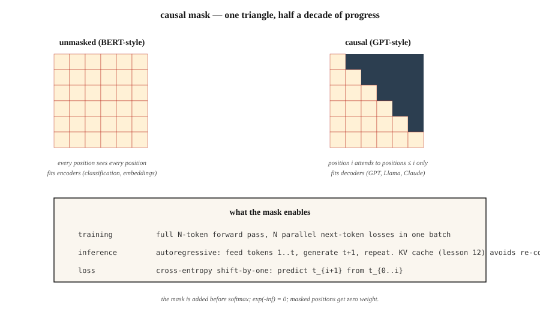

# GPT — Pemodelan Bahasa Kausal

> BERT melihat kedua sisi. GPT hanya melihat masa lalu. Penyamaran segitiga adalah satu baris kode paling berdampak dalam AI modern.

**Jenis:** Build
**Bahasa:** Python, Rust
**Prasyarat:** Fase 7 · 02 (Self-Attention), Fase 7 · 05 (Transformer Lengkap), Fase 7 · 06 (BERT)
**Waktu:** ~75 menit

## Masalahnya

Model bahasa menjawab satu pertanyaan: dengan `t-1` token pertama, apa distribusi probabilitas untuk token `t`? Latih dengan sinyal itu — prediksi token berikutnya — dan Anda mendapat model yang dapat menghasilkan teks apa pun satu token pada satu waktu.

Untuk melatihnya secara menyeluruh pada satu urutan penuh secara paralel, prediksi di setiap posisi harus hanya bergantung pada posisi-posisi sebelumnya. Jika tidak, model dengan mudah bercurang dengan melihat jawabannya.

Penyamaran kausal melakukan ini. Ia adalah satu matriks segitiga atas berisi nilai `-inf` yang ditambahkan ke skor atensi sebelum softmax. Setelah softmax, posisi-posisi itu menjadi 0. Setiap posisi hanya dapat menghadiri dirinya sendiri dan posisi sebelumnya. Dan karena Anda menerapkannya sekali pada seluruh urutan, Anda mendapat N prediksi token berikutnya secara paralel dalam satu kali forward.

GPT-1 (2018), GPT-2 (2019), GPT-3 (2020), GPT-4 (2023), GPT-5 (2025), Claude, Llama, Qwen, Mistral, DeepSeek, Kimi — semuanya adalah transformer kausal decoder-only dengan loop inti yang sama. Yang membedakan mereka adalah kualitas data, skala dan penyempurnaan arsitektur, serta pasca-pelatihan (SFT, RLHF, DPO, dan penerusnya).

## Konsepnya



### Penyamaran

Dengan urutan panjang $N$, bangun matriks $N \times N$:

```math
M_{ij} = \begin{cases} 0 & \text{if } j \le i \\ -\infty & \text{if } j > i \end{cases}
```

Tambahkan `M` ke skor atensi mentah sebelum softmax. $\exp(-\infty) = 0$, sehingga posisi tersamar menyumbang bobot nol. Setiap baris matriks atensi adalah distribusi probabilitas hanya atas posisi-posisi sebelumnya.

Biaya implementasi: satu panggilan `torch.tril()`. Waktu komputasi: nanodetik. Dampak pada bidang ini: segalanya.

### Dari mana segitiga itu berasal

Penyamaran biasanya disajikan sebagai tambalan yang dibautkan ke atensi. Jalankan penurunan ini dari arah sebaliknya dan ia berhenti menjadi misterius: atensi adalah penyempurnaan ketiga dari rata-rata prefiks, dan segitiga itu adalah batas loop dari rata-rata tersebut, yang ditulis sebagai matriks.

**Tahap 1 — rata-rata prefiks.** Ringkasan kausal paling sederhana dari sebuah urutan: posisi $i$ menjadi rata-rata posisi $0 \ldots i$. Sebagai loop, itu adalah `out[i] = X[:i+1].mean(0)`. Komputasi yang sama adalah satu perkalian matriks. Ambil matriks segitiga bawah berisi angka satu, bagi setiap baris dengan jumlah elemennya, lalu kalikan:

```python
import numpy as np

A = np.tril(np.ones((n, n)))
A = A / A.sum(axis=1, keepdims=True)
out = A @ X
```

Baris $i$ dari $A$ adalah $[1/(i+1), \ldots, 1/(i+1), 0, \ldots, 0]$. Nol-nol di atas diagonal itulah kausalitasnya. Tidak ada yang disamarkan tentang masa depan; masa depan tidak pernah masuk ke dalam penjumlahan.

**Tahap 2 — bobot yang dipelajari.** Rata-rata seragam memperlakukan setiap token masa lalu sebagai sama relevannya. Ganti angka satu itu dengan matriks skor yang dipelajari `S`. Sekarang baris tidak lagi otomatis berjumlah satu, jadi normalisasi setiap baris dengan softmax alih-alih membagi dengan jumlah elemen. Softmax tidak pernah menghasilkan nol persis, yang merusak kausalitas — kecuali skor masa depan dimasukkan sebagai `-inf`, karena `exp(-inf) = 0`:

```python
def softmax(x, axis):
    e = np.exp(x - np.max(x, axis=axis, keepdims=True))
    return e / e.sum(axis=axis, keepdims=True)

S = S + np.triu(np.full((n, n), -np.inf), k=1)
A = softmax(S, axis=1)
out = A @ X
```

Segitiga yang sama, matriks stokastik-barisan yang sama, satu matmul yang sama. Penyamaran `-inf` bukan mesin baru. Ia adalah entri nol dari tahap 1, yang diterjemahkan ke domain masukan softmax.

**Tahap 3 — bobot yang bergantung pada konten.** Pada tahap 2, `S` tetap setelah pelatihan: posisi 7 selalu memberi bobot yang sama pada posisi 3, apa pun yang dikatakan token. Biarkan skor bergantung pada token itu sendiri: `S = Q @ K.T / sqrt(d_k)`. Tidak ada yang lain berubah. Penyamaran, softmax, matmul — identik.

Tiga tahap, satu invarians: matriks stokastik-barisan segitiga bawah dikalikan urutan. Rata-rata seragam, bobot statis yang dipelajari, bobot yang bergantung pada konten. Penyamaran tidak pernah ditambahkan ke atensi. Ia bertahan dari rata-rata.

```figure
mask-derivation
```

### Pelatihan paralel, inferensi serial

Pelatihan: forward-kan seluruh urutan `(N, d_model)` sekali, hitung N loss entropi silang (satu per posisi), jumlahkan, lalu lakukan propagasi balik. Paralel sepanjang urutan. Inilah sebabnya pelatihan GPT dapat diskalakan — Anda memproses 1M token dalam satu batch dalam satu kali lintasan GPU.

Inferensi: Anda menghasilkan token demi token. Masukkan `[t1, t2, t3]`, dapatkan `t4`. Masukkan `[t1, t2, t3, t4]`, dapatkan `t5`. Masukkan `[t1, t2, t3, t4, t5]`, dapatkan `t6`. KV cache (Pelajaran 12) menyimpan keadaan tersembunyi dari `t1…tn` agar Anda tidak menghitung ulangnya setiap langkah. Namun kedalaman serial saat inferensi = panjang keluaran. Itulah pajak autoregresif dan alasan dekoding menjadi bottleneck latensi setiap LLM.

### Loss — pergeseran satu

Dengan token `[t1, t2, t3, t4]`:

- Masukan: `[t1, t2, t3]`
- Target: `[t2, t3, t4]`

Untuk setiap posisi `i`, hitung `-log P(target_i | inputs[:i+1])`. Jumlahkan. Inilah entropi silang untuk seluruh urutan.

Setiap LM transformer yang pernah Anda dengar dilatih dengan loss ini. Pra-pelatihan, fine-tuning, SFT — loss sama, data berbeda.

### Strategi dekoding

Setelah pelatihan, pilihan pengambilan sampel lebih penting daripada yang dibayangkan orang.

| Metode | Apa yang dilakukannya | Kapan dipakai |
|--------|-----------------------|---------------|
| Greedy | Argmax setiap langkah | Tugas deterministik, pelengkapan kode |
| Temperature | Bagi logits dengan T, lalu ambil sampel | Tugas kreatif, T lebih tinggi = lebih beragam |
| Top-k | Ambil sampel hanya dari token top-k | Memangkas ekor berprobabilitas rendah |
| Top-p (nucleus) | Ambil sampel dari himpunan terkecil dengan prob kumulatif ≥ p | Bawaan sejak 2020; menyesuaikan bentuk distribusi |
| Min-p | Simpan token dengan `p > min_p * max_p` | Sejak 2024; lebih baik menolak ekor panjang daripada top-p |
| Dekode spekulatif | Model draf mengusulkan N token, model besar memverifikasi | Penurunan latensi 2–3× pada kualitas yang sama |

Pada 2026, min-p + temperature 0.7 adalah bawaan yang masuk akal untuk model open-weights. Dekode spekulatif adalah syarat standar bagi stack inferensi produksi mana pun.

### Apa yang membuat "resep GPT" berhasil

1. **Decoder-only.** Tanpa beban encoder. Satu kali lintasan atensi + FFN per lapisan.
2. **Penskalaan.** 124M → 1.5B → 175B → triliunan. Hukum penskalaan Chinchilla (Pelajaran 13) memberi tahu Anda cara membelanjakan komputasi.
3. **Pembelajaran dalam konteks.** Muncul sekitar 6B–13B. Model dapat mengikuti contoh few-shot tanpa fine-tuning.
4. **RLHF.** Pasca-pelatihan pada preferensi manusia mengubah teks pra-pelatihan mentah menjadi asisten obrolan.
5. **Pre-norm + RoPE + SwiGLU.** Pelatihan stabil dalam skala besar.

Arsitektur inti tidak banyak berubah sejak GPT-2. Semua hal menarik terjadi pada data, skala, dan pasca-pelatihan.

```figure
causal-mask
```

## Bangunlah

### Langkah 1: penyamaran kausal

Lihat `code/main.py`. Satu baris:

```python
def causal_mask(n):
    return [[0.0 if j <= i else float("-inf") for j in range(n)] for i in range(n)]
```

Tambahkan ke skor atensi sebelum softmax. Itulah seluruh mekanismenya.

### Langkah 2: model sejenis GPT 2 lapisan

Tumpuk dua blok decoder (self-attention tersamar + FFN, tanpa cross-attention). Tambahkan embedding token, penyandian posisi, dan unembedding (diikat ke matriks embedding token — trik standar sejak GPT-2).

### Langkah 3: prediksi token berikutnya, menyeluruh

Pada kosakata mainan 20 token, hasilkan logits di setiap posisi. Hitung loss entropi silang terhadap target pergeseran-satu. Tanpa gradien — ini pemeriksaan kewarasan forward.

### Langkah 4: pengambilan sampel

Implementasikan greedy, temperature, top-k, top-p, min-p. Jalankan masing-masing pada prompt tetap dan bandingkan keluarannya. Fungsi pengambilan sampel hanya 10 baris.

## Gunakanlah

Idiom PyTorch 2026:

```python
from transformers import AutoModelForCausalLM, AutoTokenizer
model = AutoModelForCausalLM.from_pretrained("meta-llama/Llama-3.2-3B-Instruct")
tok = AutoTokenizer.from_pretrained("meta-llama/Llama-3.2-3B-Instruct")

prompt = "Attention is all you need because"
inputs = tok(prompt, return_tensors="pt")
out = model.generate(
    **inputs,
    max_new_tokens=64,
    temperature=0.7,
    top_p=0.9,
    do_sample=True,
)
print(tok.decode(out[0]))
```

Di balik layar, `generate()` menjalankan forward, mengambil logits posisi akhir, mengambil sampel token berikutnya, menambahkannya, lalu mengulang. Setiap stack inferensi LLM produksi (vLLM, TensorRT-LLM, llama.cpp, Ollama, MLX) menerapkan loop yang sama dengan optimasi berat — prefill bertumpuk, continuous batching, paginasi KV cache, dekode spekulatif.

**GPT vs BERT, masing-masing satu baris:** GPT memprediksi $P(x_t \mid x_{<t})$. BERT memprediksi $P(x_{\text{masked}} \mid x_{\text{unmasked}})$. Loss-lah yang menentukan apakah model dapat melakukan pembuatan.

## Kirimlah

Lihat `outputs/skill-sampling-tuner.md`. Skill ini memilih parameter pengambilan sampel untuk tugas pembuatan baru dan menandai kapan dekoding deterministik diperlukan.

## Latihan

1. **Mudah.** Jalankan `code/main.py` dan verifikasi matriks atensi kausal berbentuk segitiga bawah setelah softmax. Cek cepat: baris 3 seharusnya hanya memiliki bobot pada kolom 0–3.
2. **Sedang.** Implementasikan beam search dengan lebar 4. Bandingkan perplexity beam-4 vs greedy pada 10 prompt pendek. Apakah beam selalu menang? (Petunjuk: biasanya untuk terjemahan, bukan untuk obrolan terbuka.)
3. **Sulit.** Implementasikan dekode spekulatif: pakai model 2 lapisan kecil sebagai draf dan model 6 lapisan sebagai verifikator. Ukur percepatan waktu nyata pada 100 penyelesaian dengan panjang 64. Pastikan keluarannya sama dengan greedy dari verifikator.

## Istilah Kunci

| Istilah | Apa yang orang katakan | Apa yang sebenarnya dimaksud |
|---------|------------------------|------------------------------|
| Penyamaran kausal | "Segitiga itu" | Matriks segitiga atas `-inf` yang ditambahkan ke skor atensi agar posisi `i` hanya melihat posisi `≤ i`. |
| Prediksi token berikutnya | "Loss itu" | Entropi silang antara distribusi model dan token berikutnya yang sebenarnya di setiap posisi. |
| Autoregresif | "Hasilkan satu per satu" | Masukkan kembali keluaran sebagai masukan; paralelisme hanya saat pelatihan, bukan saat pembuatan. |
| Logits | "Skor sebelum softmax" | Keluaran mentah head LM sebelum softmax; pengambilan sampel dilakukan di atasnya. |
| Temperature | "Tombol kreativitas" | Bagi logits dengan $T$; $T \to 0$ = greedy, $T \to \infty$ = seragam. |
| Top-p | "Pengambilan sampel inti" | Pangkas distribusi menjadi himpunan terkecil yang berjumlah $\ge p$; ambil sampel dari sisanya. |
| Min-p | "Lebih baik daripada top-p" | Simpan token dengan `p ≥ min_p × max_p`; menyesuaikan batas dengan ketajaman distribusi. |
| Dekode spekulatif | "Draf + verifikasi" | Model murah mengusulkan N token; model besar memverifikasi secara paralel. |
| Teacher forcing | "Trik pelatihan" | Saat pelatihan, masukkan token sebelumnya yang sebenarnya, bukan prediksi model. Standar untuk setiap LM seq2seq. |

## Bacaan Lanjutan

- [Radford et al. (2018). Improving Language Understanding by Generative Pre-Training](https://cdn.openai.com/research-covers/language-unsupervised/language_understanding_paper.pdf) — GPT-1.
- [Radford et al. (2019). Language Models are Unsupervised Multitask Learners](https://cdn.openai.com/better-language-models/language_models_are_unsupervised_multitask_learners.pdf) — GPT-2.
- [Brown et al. (2020). Language Models are Few-Shot Learners](https://arxiv.org/abs/2005.14165) — GPT-3 dan pembelajaran dalam konteks.
- [Leviathan, Kalman, Matias (2023). Fast Inference from Transformers via Speculative Decoding](https://arxiv.org/abs/2211.17192) — makalah dekode spekulatif.
- [HuggingFace `modeling_llama.py`](https://github.com/huggingface/transformers/blob/main/src/transformers/models/llama/modeling_llama.py) — kode referensi LM kausal kanonik.
