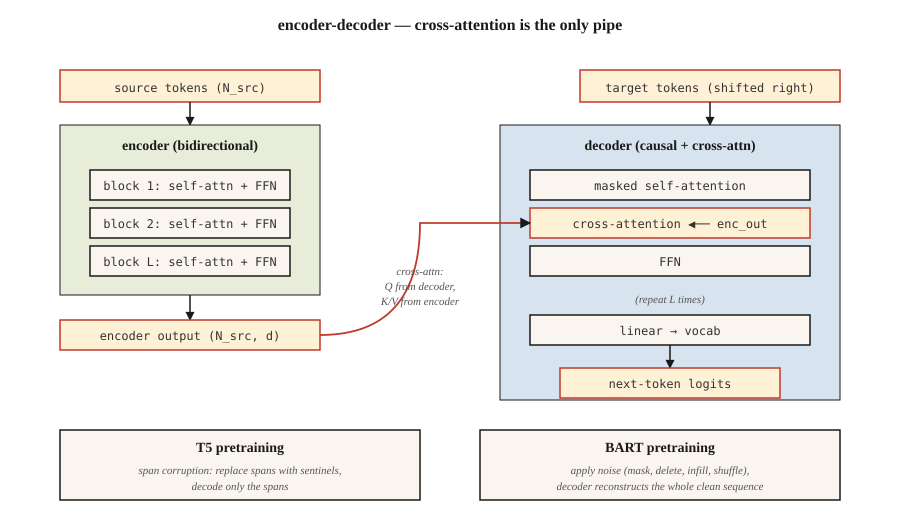

# T5, BART — Model Encoder-Decoder

> Encoder memahami. Decoder menghasilkan. Satukan kembali keduanya dan Anda mendapatkan model yang dibangun untuk tugas input → output: terjemahkan, ringkas, tulis ulang, transkrip.

**Jenis:** Belajar
**Bahasa:** Python, Rust
**Prasyarat:** Fase 7 · 05 (Transformer Lengkap), Fase 7 · 06 (BERT), Fase 7 · 07 (GPT)
**Waktu:** ~45 menit

## Masalah

GPT decoder-only dan BERT encoder-only masing-masing menyederhanakan arsitektur 2017 untuk tujuan yang berbeda. Namun banyak tugas secara alami bersifat input-output:

- Terjemahan: Inggris → Prancis.
- Ringkasan: artikel 5.000 token → ringkasan 200 token.
- Pengenalan ucapan: token audio → token teks.
- Ekstraksi terstruktur: prosa → JSON.

Untuk tugas-tugas ini, encoder-decoder adalah pilihan paling pas. Encoder menghasilkan representasi padat dari sumber. Decoder menghasilkan keluaran, dengan cross-attention ke representasi tersebut pada setiap langkah. Pelatihan berupa pergeseran-satu (shift-by-one) di sisi keluaran. Loss-nya sama seperti GPT, hanya saja dikondisikan pada keluaran encoder.

Dua makalah mendefinisikan resep modern ini:

1. **T5** (Raffel dkk. 2019). "Text-to-Text Transfer Transformer." Setiap tugas NLP dibingkai ulang sebagai teks masuk, teks keluar. Satu arsitektur, satu kosakata, satu loss. Dilatih awal dengan prediksi rentang tertutup (corrupt spans pada input, lalu dekode di output).
2. **BART** (Lewis dkk. 2019). "Bidirectional and Auto-Regressive Transformer." Autoencoder denoising: rusak input dengan berbagai cara (acak urutan, tutup, hapus, rotasi), lalu minta decoder merekonstruksi yang asli.

Pada 2026 format encoder-decoder tetap hidup di tempat-tempat di mana struktur input penting:

- Whisper (ucapan → teks).
- Tumpukan terjemahan Google.
- Beberapa model pelengkapan/perbaikan kode yang memiliki struktur konteks-dan-sunting yang berbeda.
- Flan-T5 dan variasinya untuk tugas penalaran terstruktur.

Decoder-only memenangkan sorotan, tetapi encoder-decoder tidak pernah pergi.

## Konsep



### Loop maju (forward)

```
token sumber ─▶ encoder ─▶ (N_src, d_model)  ──┐
                                                  │
token target ─▶ blok decoder                   │
                  ├─▶ masked self-attention       │
                  ├─▶ cross-attention ◀───────────┘
                  └─▶ FFN
                 ↓
               logits token berikutnya
```

Yang krusial, encoder berjalan sekali per input. Decoder berjalan secara autoregresif tetapi melakukan cross-attention ke keluaran encoder yang *sama* pada setiap langkah. Menembolok (caching) keluaran encoder adalah percepatan gratis untuk input panjang.

### Pra-pelatihan T5 — kerusakan rentang (span corruption)

Pilih rentang acak dari input (panjang rata-rata 3 token, 15% dari total). Ganti setiap rentang dengan penanda unik: `<extra_id_0>`, `<extra_id_1>`, dan seterusnya. Decoder hanya menghasilkan rentang yang rusak beserta awalan penandanya:

```
sumber: The quick <extra_id_0> fox jumps <extra_id_1> dog
target: <extra_id_0> brown <extra_id_1> over the lazy
```

Sinyal yang lebih murah daripada memprediksi seluruh urutan. Kompetitif dengan MLM (BERT) dan prefix-LM (UniLM) dalam ablasi makalah T5.

### Pra-pelatihan BART — denoising multi-deraan

BART mencoba lima fungsi penderaan (noising):

1. Penutupan token (token masking).
2. Penghapusan token (token deletion).
3. Pengisian teks (text infilling — tutup satu rentang, decoder menyisipkan panjang yang tepat).
4. Permutasi kalimat.
5. Rotasi dokumen.

Kombinasi pengisian teks + permutasi kalimat menghasilkan angka hilir (downstream) terbaik. Decoder selalu merekonstruksi yang asli. Keluaran BART adalah urutan penuh, bukan hanya rentang yang rusak — sehingga daya komputasi pra-pelatihannya lebih tinggi daripada T5.

### Inferensi

Generasi autoregresif yang sama seperti GPT. Greedy / beam / pengambilan sampel top-p berlaku. Beam search (lebar 4–5) adalah standar untuk terjemahan dan ringkasan karena distribusi keluaran lebih sempit daripada obrolan.

### Kapan memilih setiap varian pada 2026

| Tugas | Encoder-decoder? | Alasan |
|-------|------------------|--------|
| Terjemahan | Ya, biasanya | Urutan sumber jelas; distribusi keluaran tetap; beam search bekerja |
| Ucapan-ke-teks | Ya (Whisper) | Modality input berbeda dari output; encoder membentuk fitur audio |
| Obrolan / penalaran | Tidak, decoder-only | Tidak ada "input" persisten — percakapan itulah urutannya |
| Pelengkapan kode | Biasanya tidak | Decoder-only dengan konteks panjang menang; model kode seperti Qwen 2.5 Coder adalah decoder-only |
| Ringkasan | Keduanya bisa | BART, PEGASUS mengalahkan baseline decoder-only sebelumnya; LLM decoder-only modern sejajar |
| Ekstraksi terstruktur | Keduanya | T5 bersih karena "teks → teks" menyerap format keluaran apa pun |

Tren sejak ~2022: decoder-only mengambil alih tugas-tugas yang dulu dikuasai encoder-decoder karena (a) LLM decoder-only yang disetel instruksi melakukan generalisasi ke apa pun lewat prompting, (b) satu arsitektur lebih mudah diskalakan daripada dua, (c) RLHF mengasumsikan decoder. Encoder-decoder bertahan di tempat-tempat di mana modality input berbeda (ucapan, gambar) atau di mana kualitas beam search penting.

```figure
encoder-decoder
```

## Bangun

Lihat `code/main.py`. Kami mengimplementasikan kerusakan rentang gaya T5 untuk korpus mainan — bagian tunggal paling berguna dalam pelajaran ini karena muncul di setiap resep pra-pelatihan encoder-decoder sejak saat itu.

### Langkah 1: kerusakan rentang

```python
def corrupt_spans(tokens, mask_rate=0.15, mean_span=3.0, rng=None):
    """Pilih rentang yang totalnya ~mask_rate dari token. Kembalikan (input_rusak, target)."""
    n = len(tokens)
    n_mask = max(1, int(n * mask_rate))
    n_spans = max(1, int(round(n_mask / mean_span)))
    ...
```

Format target mengikuti konvensi T5: `<sent0> span0 <sent1> span1 ...`. Input yang rusak menyelingi token yang tidak berubah dengan token penanda di lokasi rentang.

### Langkah 2: verifikasi pergi-balik (round-trip)

Dengan input rusak dan target yang ada, rekonstruksi kalimat aslinya. Jika kerusakan Anda bersifat reversibel, forward pass terdefinisi dengan baik. Ini pemeriksaan kewarasan — pelatihan nyata tidak pernah melakukan ini, tetapi ujiannya murah dan menangkap bug off-by-one dalam pembukuan rentang Anda.

### Langkah 3: penderaan BART

Lima fungsi: `token_mask`, `token_delete`, `text_infill`, `sentence_permute`, `document_rotate`. Kombinasikan dua di antaranya dan tunjukkan hasilnya.

## Pakai

Referensi HuggingFace:

```python
from transformers import T5ForConditionalGeneration, T5Tokenizer
tok = T5Tokenizer.from_pretrained("google/flan-t5-base")
model = T5ForConditionalGeneration.from_pretrained("google/flan-t5-base")

inputs = tok("translate English to French: Attention is all you need.", return_tensors="pt")
out = model.generate(**inputs, max_new_tokens=32)
print(tok.decode(out[0], skip_special_tokens=True))
```

Trik T5: nama tugas dimasukkan ke dalam teks input. Model yang sama menangani puluhan tugas karena setiap tugas adalah teks masuk, teks keluar. Pada 2026 pola ini telah digeneralisasi oleh model decoder-only yang disetel instruksi, tetapi T5 yang mengkodekannya lebih dulu.

## Kirim

Lihat `outputs/skill-seq2seq-picker.md`. Skill ini memilih antara encoder-decoder dan decoder-only untuk tugas baru berdasarkan struktur input-output, latensi, dan target kualitas.

## Latihan

1. **Mudah.** Jalankan `code/main.py`, terapkan kerusakan rentang pada kalimat 30 token, verifikasi bahwa menggabungkan token sumber bukan-penanda dengan rentang target yang didekode mereproduksi kalimat asli.
2. **Sedang.** Implementasikan deraan `text_infill` BART: ganti rentang acak dengan satu token `<mask>`, dan decoder harus menyimpulkan panjang rentang yang benar beserta isinya. Tunjukkan satu contoh.
3. **Sulit.** Setel halus `flan-t5-small` pada korpus Inggris → pig-Latin kecil (200 pasangan). Ukur BLEU pada himpunan uji 50 pasangan yang disisihkan. Bandingkan dengan menyetel halus `Llama-3.2-1B` pada data yang sama dengan compute yang sama.

## Istilah Kunci

| Istilah | Yang sering dikatakan | Makna sebenarnya |
|---------|-----------------------|------------------|
| Encoder-decoder | "Transformer seq2seq" | Dua tumpukan: encoder bidireksional untuk input, decoder kausal dengan cross-attention untuk output. |
| Cross-attention | "Tempat sumber berbicara ke target" | Q decoder × K/V encoder. Satu-satunya tempat informasi encoder masuk ke decoder. |
| Kerusakan rentang | "Trik pra-pelatihan T5" | Ganti rentang acak dengan token penanda; decoder menghasilkan rentang tersebut. |
| Tujuan denoising | "Permainan BART" | Terapkan fungsi deraan pada input, latih decoder merekonstruksi urutan bersih. |
| Token penanda | "Placeholder `<extra_id_N>`" | Token khusus yang menandai rentang rusak di sumber dan menandainya kembali di target. |
| Flan | "T5 yang disetel instruksi" | T5 yang disetel halus pada >1.800 tugas; membuat encoder-decoder kompetitif dalam mengikuti instruksi. |
| Beam search | "Strategi dekode" | Simpan k urutan parsial teratas di setiap langkah; standar untuk terjemahan/ringkasan. |
| Teacher forcing | "Input saat pelatihan" | Saat pelatihan, berikan token keluaran sebelumnya yang benar ke decoder, bukan yang terampling. |

## Bacaan Lanjutan

- [Raffel dkk. (2019). Exploring the Limits of Transfer Learning with a Unified Text-to-Text Transformer](https://arxiv.org/abs/1910.10683) — T5.
- [Lewis dkk. (2019). BART: Denoising Sequence-to-Sequence Pre-training for Natural Language Generation, Translation, and Comprehension](https://arxiv.org/abs/1910.13461) — BART.
- [Chung dkk. (2022). Scaling Instruction-Finetuned Language Models](https://arxiv.org/abs/2210.11416) — Flan-T5.
- [Radford dkk. (2022). Robust Speech Recognition via Large-Scale Weak Supervision](https://arxiv.org/abs/2212.04356) — Whisper, encoder-decoder kanonik 2026.
- [`modeling_t5.py` HuggingFace](https://github.com/huggingface/transformers/blob/main/src/transformers/models/t5/modeling_t5.py) — implementasi referensi.
