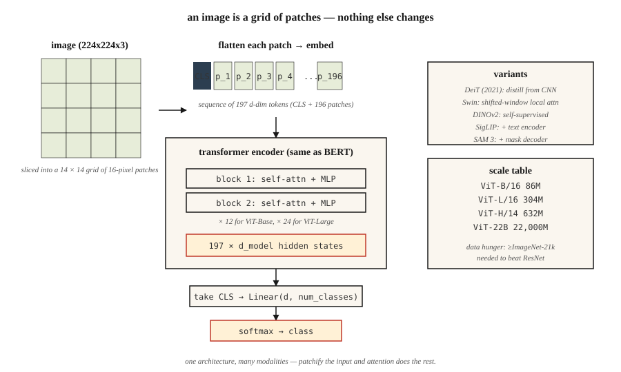

# Vision Transformer (ViT)

> Sebuah gambar adalah kisi patch. Sebuah kalimat adalah kisi token. Transformer yang sama memakan keduanya.

**Jenis:** Bangun
**Bahasa:** Python, Rust
**Prasyarat:** Fase 7 · 05 (Transformer Lengkap), Fase 4 · 03 (CNN), Fase 4 · 14 (Pengantar Vision Transformer)
**Waktu:** ~45 menit

## Masalah

Sebelum 2020, computer vision berarti konvolusi. Setiap SOTA di ImageNet, COCO, dan benchmark deteksi memakai backbone CNN. Transformer adalah untuk bahasa.

Dosovitskiy dkk. (2020) — "An Image is Worth 16x16 Words" — menunjukkan bahwa Anda bisa membuang konvolusi seluruhnya. Potong gambar menjadi patch berukuran tetap, proyeksikan setiap patch secara linear menjadi embedding, dan masukkan urutannya ke encoder transformer biasa. Pada skala yang cukup besar (pra-pelatihan ImageNet-21k atau lebih besar), ViT sejajar atau mengalahkan model berbasis ResNet.

ViT adalah awal dari pola yang lebih luas pada 2026: satu arsitektur, banyak modality. Whisper menokenisasi audio. ViT menokenisasi gambar. Token aksi untuk robotika. Token piksel untuk video. Transformer tidak peduli — beri ia urutan dan ia akan belajar.

Pada 2026, ViT dan keturunannya (DeiT, Swin, DINOv2, ViT-22B, SAM 3) menguasai sebagian besar visi. CNN masih menang di perangkat edge dan tugas yang kritis terhadap latensi. Semua hal lain memiliki ViT di suatu tempat dalam tumpukannya.

## Konsep



### Langkah 1 — memecah patch (patchify)

Belah gambar `H × W × C` menjadi urutan patch datar `N × (P·P·C)`. Setup khas: gambar `224 × 224`, patch `16 × 16` → 196 patch dengan 768 nilai setiapnya.

```
gambar (224, 224, 3) → kisi 14 × 14 dari patch 16x16x3 → 196 vektor panjang 768
```

Ukuran patch adalah tuasnya. Patch lebih kecil = lebih banyak token, resolusi lebih baik, biaya atensi kuadratik. Patch lebih besar = lebih kasar, lebih murah.

### Langkah 2 — embedding linear

Satu matriks yang dipelajari memproyeksikan setiap patch datar ke `d_model`. Setara dengan konvolusi berkernel `P` dan stride `P`. Di PyTorch ini secara harfiah `nn.Conv2d(C, d_model, kernel_size=P, stride=P)` — implementasi dua baris.

### Langkah 3 — awali dengan token `[CLS]`, tambahkan embedding posisi

- Awali dengan token `[CLS]` yang dapat dipelajari. Keadaan tersembunyi akhirnya adalah representasi gambar yang dipakai untuk klasifikasi.
- Tambahkan embedding posisi yang dapat dipelajari (ViT-original) atau sinusoidal 2D (varian kemudian).
- Pada 2024+ RoPE diperluas ke 2D untuk posisi, kadang tanpa embedding eksplisit.

### Langkah 4 — encoder transformer standar

Tumpuk L blok `LayerNorm → Self-Attention → + → LayerNorm → MLP → +`. Identik dengan BERT. Tidak ada lapisan khusus-visi. Inilah poin pedagogis utama makalah ini.

### Langkah 5 — head

Untuk klasifikasi: ambil keadaan tersembunyi `[CLS]` → linear → softmax. Untuk DINOv2 atau SAM, buang `[CLS]`, gunakan embedding patch secara langsung.

### Varian yang berpengaruh

| Model | Tahun | Perubahan |
|-------|-------|-----------|
| ViT | 2020 | Yang asli. Ukuran patch tetap, atensi global penuh. |
| DeiT | 2021 | Distilasi; dapat dilatih hanya dengan ImageNet-1k. |
| Swin | 2021 | Hierarkis dengan jendela bergeser (shifted windows). Biaya sub-kuadratik tetap. |
| DINOv2 | 2023 | Self-supervised (tanpa label). Fitur visi umum terbaik. |
| ViT-22B | 2023 | 22M parameter; hukum skala berlaku. |
| SigLIP | 2023 | ViT + pasangan bahasa, loss kontrastif sigmoid. |
| SAM 3 | 2025 | Segment anything; ViT-Large + decoder mask yang dapat diprompt. |

### Mengapa butuh waktu lama

ViT membutuhkan *banyak* data untuk sejajar dengan CNN karena ia tidak punya bias induktif CNN (invariansi translasi, lokalitas). Tanpa >100 juta gambar berlabel atau pra-pelatihan self-supervised yang kuat, CNN tetap menang pada compute yang sepadan. DeiT memperbaiki ini pada 2021 dengan trik distilasi; DINOv2 memperbaikinya secara permanen pada 2023 dengan self-supervisi.

```figure
n5-patch-stream
```

## Bangun

Lihat `code/main.py`. Patchify + embedding linear + pemeriksaan kewarasan murni pustaka standar. Tanpa pelatihan — ViT pada skala realistis apa pun memerlukan PyTorch dan berjam-jam waktu GPU.

### Langkah 1: gambar palsu

Gambar RGB 24 × 24 sebagai daftar baris tuple `(R, G, B)`. Kami pakai patch 6×6 → 16 patch, vektor embedding 108-d setiapnya.

### Langkah 2: patchify

```python
def patchify(image, P):
    H = len(image)
    W = len(image[0])
    patches = []
    for i in range(0, H, P):
        for j in range(0, W, P):
            patch = []
            for di in range(P):
                for dj in range(P):
                    patch.extend(image[i + di][j + dj])
            patches.append(patch)
    return patches
```

Urutan raster: row-major melintasi kisi. Setiap ViT memakai urutan ini.

### Langkah 3: embed linear

Kalikan setiap patch datar dengan matriks acak `(patch_flat_size, d_model)`. Verifikasi bentuk keluaran adalah `(N_patches + 1, d_model)` setelah mengawali dengan `[CLS]`.

### Langkah 4: hitung parameter untuk ViT realistis

Cetak jumlah parameter untuk ViT-Base: 12 lapisan, 12 head, d=768, patch=16. Bandingkan dengan ResNet-50 (~25M). ViT-Base berada di ~86M. ViT-Large ~307M. ViT-Huge ~632M.

## Pakai

```python
from transformers import ViTImageProcessor, ViTModel
import torch
from PIL import Image

processor = ViTImageProcessor.from_pretrained("google/vit-base-patch16-224-in21k")
model = ViTModel.from_pretrained("google/vit-base-patch16-224-in21k")

img = Image.open("cat.jpg")
inputs = processor(img, return_tensors="pt")
out = model(**inputs).last_hidden_state   # (1, 197, 768): [CLS] + 196 patch
cls_emb = out[:, 0]                       # representasi gambar
```

**Embedding DINOv2 adalah default 2026 untuk fitur gambar.** Bekukan backbone, latih head kecil. Bekerja untuk klasifikasi, pengambilan, deteksi, captioning. Checkpoint DINOv2 Meta mengalahkan CLIP pada setiap tugas visi non-teks.

**Memilih ukuran patch.** Model kecil memakai 16×16 (ViT-B/16). Prediksi padat (segmentasi) memakai 8×8 atau 14×14 (SAM, DINOv2). Model sangat besar memakai 14×14.

## Kirim

Lihat `outputs/skill-vit-configurator.md`. Skill ini memilih varian ViT dan ukuran patch untuk tugas visi baru berdasarkan ukuran dataset, resolusi, dan anggaran compute.

## Latihan

1. **Mudah.** Jalankan `code/main.py`. Verifikasi bahwa jumlah patch sama dengan `(H/P) * (W/P)` dan dimensi patch datar sama dengan `P*P*C`.
2. **Sedang.** Implementasikan embedding posisi sinusoidal 2D — dua kode sinusoidal independen untuk `row` dan `col` setiap patch, digabungkan (concatenate). Masukkan ke ViT PyTorch kecil dan bandingkan akurasi dengan embedding posisi yang dapat dipelajari pada CIFAR-10.
3. **Sulit.** Bangun ViT 3 lapisan (PyTorch), latih pada 1.000 gambar MNIST dengan patch 4×4. Ukur akurasi uji. Sekarang tambahkan pra-pelatihan DINOv2 pada 1.000 gambar yang sama (disimplifikasi: cukup latih encoder memprediksi embedding patch dari patch yang tertutup). Apakah akurasi membaik?

## Istilah Kunci

| Istilah | Yang sering dikatakan | Makna sebenarnya |
|---------|-----------------------|------------------|
| Patch | "Token vision-transformer" | Vektor datar nilai piksel untuk wilayah `P × P × C` pada gambar. |
| Patchify | "Potong + ratakan" | Potong gambar menjadi patch tak tumpang tindih, ratakan masing-masing menjadi vektor. |
| Token `[CLS]` | "Ringkasan gambar" | Token awal yang dapat dipelajari; embedding akhirnya adalah representasi gambar. |
| Bias induktif | "Yang diasumsikan model" | ViT punya lebih sedikit prior daripada CNN; butuh lebih banyak data untuk menutup jarak. |
| DINOv2 | "ViT self-supervised" | Dilatih tanpa label menggunakan augmentasi gambar + momentum teacher. Fitur gambar umum terbaik pada 2026. |
| SigLIP | "Penerus CLIP" | ViT + encoder teks yang dilatih dengan loss kontrastif sigmoid; lebih baik daripada CLIP pada compute yang sepadan. |
| Swin | "ViT berjendela" | ViT hierarkis dengan atensi lokal + jendela bergeser; sub-kuadratik. |
| Register token | "Trik 2023" | Beberapa token ekstra yang dapat dipelajari yang menyerap attention sink; memperbaiki fitur DINOv2. |

## Bacaan Lanjutan

- [Dosovitskiy dkk. (2020). An Image is Worth 16x16 Words: Transformers for Image Recognition at Scale](https://arxiv.org/abs/2010.11929) — makalah ViT.
- [Touvron dkk. (2021). Training data-efficient image transformers & distillation through attention](https://arxiv.org/abs/2012.12877) — DeiT.
- [Liu dkk. (2021). Swin Transformer: Hierarchical Vision Transformer using Shifted Windows](https://arxiv.org/abs/2103.14030) — Swin.
- [Oquab dkk. (2023). DINOv2: Learning Robust Visual Features without Supervision](https://arxiv.org/abs/2304.07193) — DINOv2.
- [Darcet dkk. (2023). Vision Transformers Need Registers](https://arxiv.org/abs/2309.16588) — perbaikan register-token untuk DINOv2.
