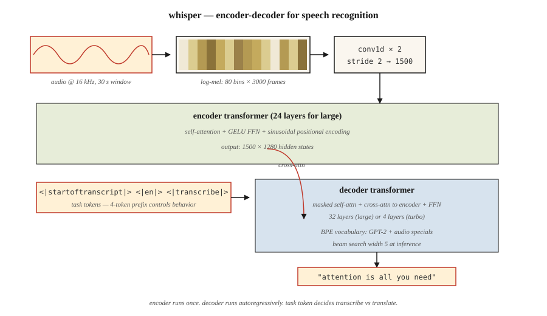

# Audio Transformer — Arsitektur Whisper

> Audio adalah gambar frekuensi terhadap waktu. Whisper adalah ViT yang memakan spektrogram mel dan menjawab kembali dengan suara kata.

**Jenis:** Belajar
**Bahasa:** Python, Rust
**Prasyarat:** Fase 7 · 05 (Transformer Lengkap), Fase 7 · 08 (Encoder-Decoder), Fase 7 · 09 (ViT)
**Waktu:** ~45 menit

## Masalah

Sebelum Whisper (OpenAI, Radford dkk. 2022), pengenalan ucapan otomatis (ASR) state-of-the-art berarti wav2vec 2.0 dan HuBERT — ekstraktor fitur self-supervised ditambah head yang disetel halus. Kualitas tinggi, pipeline data mahal, rapuh terhadap domain. Pengenalan ucapan multibahasa memerlukan model terpisah per rumpun bahasa.

Whisper memasang tiga taruhan:

1. **Latih pada semuanya.** 680.000 jam audio berlabel lemah yang diambil dari internet dalam 97 bahasa. Tanpa korpus akademis yang bersih. Tanpa label fonem.
2. **Satu model, banyak tugas.** Satu decoder dilatih bersamaan untuk transkripsi, terjemahan, deteksi aktivitas suara, identifikasi bahasa, dan penandaan waktu lewat token tugas.
3. **Transformer encoder-decoder standar.** Encoder memakan spektrogram log-mel. Decoder menghasilkan token teks secara autoregresif. Tanpa vocoder, tanpa CTC, tanpa HMM.

Hasilnya: Whisper large-v3 tangguh terhadap aksen, kebisingan, dan bahasa yang tidak punya data berlabel bersih sama sekali. Ia adalah front-end ucapan default untuk setiap asisten suara open-source dan sebagian besar asisten komersial pada 2026.

## Konsep



### Langkah 1 — resample + jendela

Audio pada 16 kHz. Potong/tambah padding menjadi 30 detik. Hitung spektrogram log-mel: 80 bin mel, stride 10 ms → ~3.000 frame × 80 fitur. Inilah "gambar input" yang dilihat Whisper.

### Langkah 2 — stem konvolusional

Dua lapisan Conv1D dengan kernel 3 dan stride 2 mengurangi 3.000 frame menjadi 1.500. Memotong panjang urutan tanpa menambah banyak parameter.

### Langkah 3 — encoder

Encoder transformer 24 lapisan (untuk large) di atas 1.500 langkah waktu. Encoding posisi sinusoidal, self-attention, FFN GELU. Menghasilkan 1.500 × 1.280 keadaan tersembunyi.

### Langkah 4 — decoder

Decoder transformer 24 lapisan. Ia menghasilkan token secara autoregresif dari kosakata BPE yang merupakan superset kosakata GPT-2 dengan beberapa token khusus audio tambahan.

### Langkah 5 — token tugas

Prompt decoder diawali token kontrol yang memberi tahu model apa yang harus dilakukan:

```
<|startoftranscript|>  <|en|>  <|transcribe|>  <|0.00|>
```

atau

```
<|startoftranscript|>  <|fr|>  <|translate|>   <|0.00|>
```

Model dilatih pada konvensi ini. Anda mengontrol tugas lewat awalan. Ini setara dengan instruction-tuning pada 2026, tetapi diterapkan pada ucapan.

### Langkah 6 — keluaran

Beam search (lebar 5) dengan ambang log-prob. Timestamp diprediksi setiap 0,02 detik audio ketika token `<|notimestamps|>` tidak ada.

### Ukuran Whisper

| Model | Parameter | Lapisan | d_model | Head | VRAM (fp16) |
|-------|-----------|---------|---------|------|-------------|
| Tiny | 39M | 4 | 384 | 6 | ~1 GB |
| Base | 74M | 6 | 512 | 8 | ~1 GB |
| Small | 244M | 12 | 768 | 12 | ~2 GB |
| Medium | 769M | 24 | 1024 | 16 | ~5 GB |
| Large | 1550M | 32 | 1280 | 20 | ~10 GB |
| Large-v3 | 1550M | 32 | 1280 | 20 | ~10 GB |
| Large-v3-turbo | 809M | 32 | 1280 | 20 | ~6 GB (decoder 4 lapisan) |

Large-v3-turbo (2024) memotong decoder dari 32 lapisan menjadi 4. Dekode 8× lebih cepat dengan regresi WER <1 poin. Kecepatan dekode inilah yang membuat Whisper-turbo menjadi default untuk agen suara real-time pada 2026.

### Yang tidak dilakukan Whisper

- Tanpa diarisasi (siapa yang berbicara). Pasangkan dengan pyannote untuk itu.
- Tanpa streaming real-time secara native — jendela 30 detik bersifat tetap. Wrapper modern (`faster-whisper`, `WhisperX`) menambahkan streaming lewat VAD + tumpang tindih.
- Tanpa konteks bentuk panjang lebih dari 30 s tanpa chunking eksternal. Bekerja baik dalam praktiknya karena ucapan manusia jarang membutuhkan konteks jarak jauh untuk transkripsi.

### Lanskap 2026

| Tugas | Model | Catatan |
|-------|-------|---------|
| ASR Inggris | Whisper-turbo, Moonshine | Moonshine 4× lebih cepat di edge |
| ASR multibahasa | Whisper-large-v3 | 97 bahasa |
| ASR streaming | faster-whisper + VAD | target latensi 150 ms dapat dicapai |
| TTS | Piper, XTTS-v2, Kokoro | Pola encoder-decoder, tetapi berbentuk seperti Whisper |
| Audio + bahasa | AudioLM, SeamlessM4T | Token teks + token audio dalam satu transformer |

```figure
n5-mel-decode
```

## Bangun

Lihat `code/main.py`. Kami tidak melatih Whisper — kami membangun pipeline spektrogram log-mel + formatter prompt token-tugas. Itulah bagian-bagian yang benar-benar Anda sentuh di produksi.

### Langkah 1: sintesiskan audio

Bangkitkan gelombang sinus 1 detik pada 440 Hz dengan laju sampel 16 kHz. 16.000 sampel.

### Langkah 2: spektrogram log-mel (disimplifikasi)

Spektrogram mel penuh memerlukan FFT. Kami melakukan versi pembingkaian + energi per frame yang disimplifikasi untuk menunjukkan pipeline tanpa memerlukan `librosa`:

```python
def frame_signal(x, frame_size=400, hop=160):
    frames = []
    for start in range(0, len(x) - frame_size + 1, hop):
        frames.append(x[start:start + frame_size])
    return frames
```

Frame = 25 ms, hop = 10 ms. Sesuai dengan windowing Whisper. Energi per frame menggantikan bin mel untuk kepentingan pedagogi.

### Langkah 3: padding ke 30 s

Whisper selalu memproses potongan 30 detik. Tambahkan padding (atau potong) spektrogram menjadi 3.000 frame.

### Langkah 4: bangun token prompt

```python
def whisper_prompt(lang="en", task="transcribe", timestamps=True):
    tokens = ["<|startoftranscript|>", f"<|{lang}|>", f"<|{task}|>"]
    if not timestamps:
        tokens.append("<|notimestamps|>")
    return tokens
```

Itulah seluruh permukaan kontrol tugas. Awalan 4 token.

## Pakai

```python
import whisper
model = whisper.load_model("large-v3-turbo")
result = model.transcribe("meeting.wav", language="en", task="transcribe")
print(result["text"])
print(result["segments"][0]["start"], result["segments"][0]["end"])
```

Lebih cepat, kompatibel dengan OpenAI:

```python
from faster_whisper import WhisperModel
model = WhisperModel("large-v3-turbo", compute_type="int8_float16")
segments, info = model.transcribe("meeting.wav", vad_filter=True)
for s in segments:
    print(f"{s.start:.2f} - {s.end:.2f}: {s.text}")
```

**Kapan memilih Whisper pada 2026:**

- ASR multibahasa dengan satu model.
- Transkripsi tangguh terhadap audio bising dan beragam.
- ASR riset / prototipe — titik awal tercepat.

**Kapan memilih yang lain:**

- Streaming latensi sangat rendah di edge — Moonshine mengalahkan Whisper pada kualitas yang sepadan.
- AI percakapan real-time yang membutuhkan <200 ms — ASR streaming khusus.
- Diarisasi pembicara — Whisper tidak melakukan ini; tambahkan pyannote.

## Kirim

Lihat `outputs/skill-asr-configurator.md`. Skill ini memilih model ASR, parameter dekode, dan pipeline praproses untuk aplikasi suara baru.

## Latihan

1. **Mudah.** Jalankan `code/main.py`. Konfirmasi bahwa jumlah frame untuk sinyal 1 detik pada 16 kHz dengan hop 10 ms adalah ~100 frame. Untuk 30 detik: ~3.000 frame.
2. **Sedang.** Bangun spektrogram log-mel penuh memakai `numpy.fft`. Verifikasi 80 bin mel cocok dengan `librosa.feature.melspectrogram(n_mels=80)` dalam batas galat numerik.
3. **Sulit.** Implementasikan inferensi streaming: potong audio menjadi jendela 10 s dengan tumpang tindih 2 s, jalankan Whisper pada setiap potongan, gabungkan transkrip. Ukur word-error rate dibandingkan single-pass pada contoh podcast 5 menit.

## Istilah Kunci

| Istilah | Yang sering dikatakan | Makna sebenarnya |
|---------|-----------------------|------------------|
| Spektrogram mel | "Gambar audio" | Representasi 2D: bin frekuensi di satu sumbu, frame waktu di sumbu lain; energi berskala log per sel. |
| Log-mel | "Yang dilihat Whisper" | Spektrogram mel yang dilewatkan log; mendekati persepsi kenyaringan manusia. |
| Frame | "Satu irisan waktu" | Jendela sampel 25 ms; tumpang tindih pada stride 10 ms. |
| Token tugas | "Awalan prompt untuk ucapan" | Token khusus seperti `<\|transcribe\|>` / `<\|translate\|>` dalam prompt decoder. |
| Deteksi aktivitas suara (VAD) | "Temukan ucapannya" | Gerbang yang membuang hening sebelum ASR; memangkas biaya secara drastis. |
| CTC | "Connectionist Temporal Classification" | Loss ASR klasik untuk pelatihan tanpa alignment; Whisper TIDAK memakainya. |
| Whisper-turbo | "Decoder kecil, encoder penuh" | Encoder large-v3 + decoder 4 lapisan; dekode 8× lebih cepat. |
| Faster-whisper | "Wrapper produksi" | Implementasi ulang CTranslate2; kuantisasi int8; 4× lebih cepat daripada referensi OpenAI. |

## Bacaan Lanjutan

- [Radford dkk. (2022). Robust Speech Recognition via Large-Scale Weak Supervision](https://arxiv.org/abs/2212.04356) — makalah Whisper.
- [Repo OpenAI Whisper](https://github.com/openai/whisper) — kode referensi + bobot model. Baca `whisper/model.py` untuk melihat stem Conv1D + encoder + decoder dari atas ke bawah dalam ~400 baris.
- [OpenAI Whisper — `whisper/decoding.py`](https://github.com/openai/whisper/blob/main/whisper/decoding.py) — logika beam search + token tugas yang dijelaskan di Langkah 5–6 ada di sini; 500 baris, mudah dibaca seluruhnya.
- [Baevski dkk. (2020). wav2vec 2.0: A Framework for Self-Supervised Learning of Speech Representations](https://arxiv.org/abs/2006.11477) — pendahulu; masih menjadi fitur SOTA dalam beberapa setting.
- [SYSTRAN/faster-whisper](https://github.com/SYSTRAN/faster-whisper) — wrapper produksi, 4× lebih cepat daripada referensi.
- [Jia dkk. (2024). Moonshine: Speech Recognition for Live Transcription and Voice Commands](https://arxiv.org/abs/2410.15608) — ASR ramah-edge 2024, berbentuk seperti Whisper tetapi lebih kecil.
- [Blog HuggingFace — "Fine-Tune Whisper For Multilingual ASR with 🤗 Transformers"](https://huggingface.co/blog/fine-tune-whisper) — resep setel-halus kanonik termasuk praproses spektrogram mel dan penanganan token-timestamp.
- [`modeling_whisper.py` HuggingFace](https://github.com/huggingface/transformers/blob/main/src/transformers/models/whisper/modeling_whisper.py) — implementasi lengkap (encoder, decoder, cross-attention, generasi) yang mencerminkan diagram arsitektur pelajaran ini.
