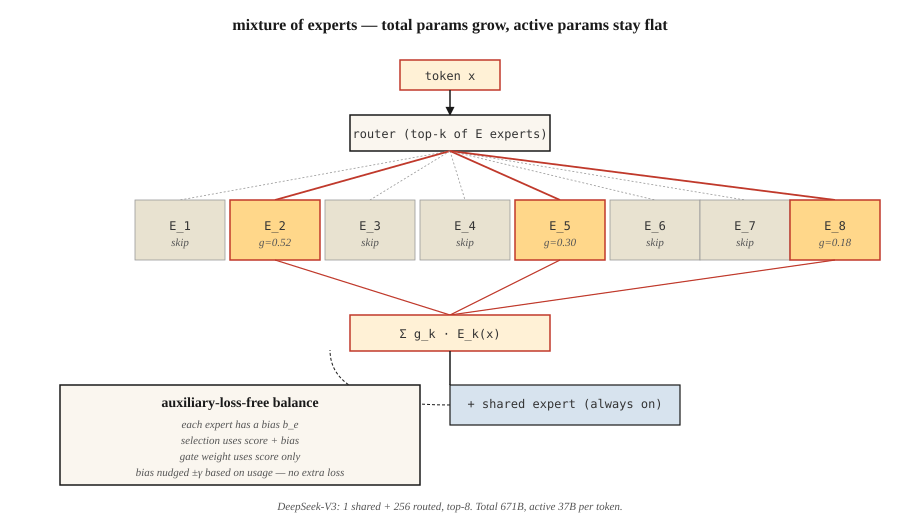

# Mixture of Experts (MoE)

> Transformer dense 70B mengaktifkan setiap parameter untuk setiap token. MoE 671B hanya mengaktifkan 37B per token dan mengalahkannya di setiap benchmark. Kejarangan (sparsity) adalah ide penskalaan terpenting dekade ini.

**Jenis:** Bangun
**Bahasa:** Python, Rust
**Prasyarat:** Fase 7 · 05 (Transformer Lengkap), Fase 7 · 07 (GPT)
**Waktu:** ~45 menit

## Masalah

FLOPs transformer dense saat inferensi sama dengan jumlah parameternya (dikalikan 2 untuk forward pass). Perbesar model dense dan setiap token membayar tagihan penuh. Pada 2024 frontier menabrak dinding komputasi: agar secara bermakna lebih pintar, Anda memerlukan FLOPs per token yang secara eksponensial lebih banyak.

Mixture of Experts memutus hubungan ini. Ganti setiap FFN dengan $E$ expert independen + router yang memilih $k$ expert per token. Total parameter = $E \times \text{ukuran FFN}$. Parameter aktif per token = $k \times \text{ukuran FFN}$. Konfigurasi khas 2026: $E=256$, $k=8$. Penyimpanan berskala dengan $E$, komputasi berskala dengan $k$.

Frontier 2026 hampir seluruhnya adalah MoE: DeepSeek-V3 (671B total / 37B aktif), Mixtral 8×22B, Qwen2.5-MoE, Llama 4, Kimi K2, gpt-oss. Di papan peringkat independen Artificial Analysis, 10 model open-source teratas semuanya adalah MoE.

## Konsep



### Pertukaran FFN

Blok transformer dense:

```
h = x + attn(norm(x))
h = h + FFN(norm(h))
```

Blok MoE:

```
h = x + attn(norm(x))
scores = router(norm(h))              # (N_tokens, E)
top_k = argmax_k(scores)              # pilih k dari E per token
h = h + sum_{e in top_k}(
        gate(scores[e]) * Expert_e(norm(h))
    )
```

Setiap expert adalah FFN independen (biasanya SwiGLU). Router adalah satu lapisan linear. Setiap token memilih sendiri `k` expert-nya dan mendapatkan campuran keluaran mereka yang digerbang (gated).

### Masalah keseimbangan beban

Jika router memasukkan 90% token melalui expert 3, expert lainnya kelaparan. Tiga perbaikan telah dicoba:

1. **Loss penyeimbang bantu** (auxiliary load-balancing loss — Switch Transformer, Mixtral). Tambahkan penalti yang sebanding dengan variansi dalam pemakaian expert. Berhasil, tetapi menambah hyperparameter dan sinyal gradien kedua.
2. **Kapasitas expert + pembuangan token** (Switch awal). Setiap expert memproses paling banyak $C \times N/E$ token; token yang meluap melewati lapisan ini. Merusak kualitas.
3. **Penyeimbangan tanpa loss bantu** (auxiliary-loss-free — DeepSeek-V3). Tambahkan bias yang dipelajari per expert yang menggeser pemilihan top-k router. Bias diperbarui di luar loss pelatihan. Tidak ada penalti pada objektif utama. Terobosan besar tahun 2024.

Pendekatan DeepSeek-V3: setelah setiap langkah pelatihan, untuk setiap expert, periksa apakah pemakaiannya di atas atau di bawah target. Geser bias sebesar `±γ`. Pemilihan memakai `scores + bias`. Probabilitas expert yang dipakai untuk gating adalah `scores` mentah yang tidak diubah. Ini memisahkan routing dari ekspresi.

### Expert bersama (shared experts)

DeepSeek-V2/V3 juga membagi expert menjadi *bersama* dan *ter-routing*. Setiap token melewati semua expert bersama. Expert ter-routing dipilih lewat top-k. Expert bersama menangkap pengetahuan umum; expert ter-routing mengkhususkan diri. V3 menjalankan 1 expert bersama plus top-8 dari 256 expert ter-routing.

### Expert butir halus (fine-grained)

MoE klasik (GShard, Switch): setiap expert selebar FFN penuh. `E` kecil (8–64), `k` kecil (1–2).

MoE butir halus modern (DeepSeek-V3, Qwen-MoE): setiap expert lebih sempit (1/8 ukuran FFN). $E$ besar (256+), `k` lebih besar (8+). Total parameter sama, tetapi kombinasi berskala jauh lebih cepat. $\binom{256}{8} \approx 400$ triliun kemungkinan "expert" per token. Kualitas naik, latensi tetap datar.

### Profil biaya

Per token, per lapisan:

| Konfigurasi | Parameter aktif / token | Total parameter |
|-------------|-------------------------|-----------------|
| Mixtral 8×22B | ~39B | 141B |
| Llama 3 70B (dense) | 70B | 70B |
| DeepSeek-V3 | 37B | 671B |
| Kimi K2 (MoE) | ~32B | 1T |

DeepSeek-V3 mengalahkan Llama 3 70B (dense) di hampir setiap benchmark sambil melakukan **lebih sedikit FLOPs aktif per token**. Lebih banyak parameter = lebih banyak pengetahuan. Lebih banyak FLOPs aktif = lebih banyak komputasi per token. MoE memisahkan keduanya.

### Jebakannya: memori

Semua expert tetap berada di GPU terlepas dari mana yang aktif. Model 671B memerlukan ~1,3 TB VRAM untuk bobot fp16. Deployment MoE frontier memerlukan paralelisme expert — bagi expert ke beberapa GPU, route token melintasi jaringan. Latensi didominasi oleh komunikasi all-to-all, bukan matmul.

```figure
expert-routing
```

## Bangun

Lihat `code/main.py`. Lapisan MoE ringkas dalam pustaka standar murni dengan:

- `n_experts=8` expert mirip SwiGLU (satu linear setiapnya, untuk ilustrasi)
- routing top-k=2
- bobot gating yang dinormalisasi softmax
- penyeimbangan tanpa loss bantu lewat bias per expert

`code/main.rs` adalah port Rust dengan fungsi dan demo yang sama. Ia hanya memakai pustaka standar. Bilangan acaknya berbeda dari Python, tetapi kesimpulan yang tercetak sama.

```bash
python3 code/main.py
rustc --edition 2021 -O code/main.rs -o /tmp/lesson && /tmp/lesson
```

### Langkah 1: router

```python
def route(hidden, W_router, top_k, bias):
    scores = [sum(h * w for h, w in zip(hidden, W_router[e])) for e in range(len(W_router))]
    biased = [s + b for s, b in zip(scores, bias)]
    top_idx = sorted(range(len(biased)), key=lambda i: -biased[i])[:top_k]
    # softmax atas skor ASLI dari expert yang terpilih
    chosen = [scores[i] for i in top_idx]
    m = max(chosen)
    exps = [math.exp(c - m) for c in chosen]
    s = sum(exps)
    gates = [e / s for e in exps]
    return top_idx, gates
```

Bias memengaruhi pemilihan, bukan bobot gate. Itulah trik DeepSeek-V3 — bias memperbaiki ketidakseimbangan beban tanpa mengarahkan prediksi model.

### Langkah 2: lewatkan 100 token melalui router

Lacak seberapa sering setiap expert aktif. Tanpa bias, pemakaiannya miring. Dengan loop pembaruan bias (`-γ` untuk expert yang terlalu sering dipakai, `+γ` untuk yang kurang), pemakaian konvergen ke distribusi seragam dalam beberapa iterasi.

### Langkah 3: perbandingan jumlah parameter

Cetak "padanan dense" dari konfigurasi MoE. Berbentuk seperti DeepSeek-V3: 256 ter-routing + 1 bersama, 8 aktif, d_model=7168. Jumlah parameter totalnya membuat mata terbelalak. Jumlah aktifnya seperujuh dari Llama 3 70B dense.

## Pakai

Memuat dengan HuggingFace:

```python
from transformers import AutoModelForCausalLM, AutoTokenizer
model = AutoModelForCausalLM.from_pretrained("mistralai/Mixtral-8x22B-v0.1")
```

Inferensi produksi 2026: vLLM mendukung routing MoE secara native. SGLang memiliki jalur paralelisme expert tercepat. Keduanya otomatis menangani pemilihan top-k dan paralelisme expert.

**Kapan memilih MoE:**
- Anda menginginkan kualitas frontier dengan biaya inferensi per token lebih rendah.
- Anda punya infrastruktur VRAM / paralelisme expert.
- Beban kerja Anda banyak token (obrolan, kode), bukan banyak konteks (dokumen panjang).

**Kapan TIDAK memilih MoE:**
- Deployment edge — Anda membayar penyimpanan penuh untuk FLOPs aktif apa pun.
- Serving single-user yang kritis terhadap latensi — routing expert menambah overhead.
- Model kecil (<7B) — keunggulan kualitas MoE baru muncul di atas ambang compute (~6B parameter aktif).

## Kirim

Lihat `outputs/skill-moe-configurator.md`. Skill ini memilih E, k, dan tata letak expert bersama untuk MoE baru dengan anggaran parameter, token pelatihan, dan target deployment.

## Latihan

1. **Mudah.** Jalankan `code/main.py`. Lihat bagaimana pembaruan bias tanpa loss bantu meratakan pemakaian expert selama 50 iterasi.
2. **Sedang.** Ganti router yang dipelajari dengan router berbasis hash (deterministik, tanpa pembelajaran). Bandingkan kualitas dan keseimbangan. Mengapa router yang dipelajari lebih baik?
3. **Sulit.** Implementasikan "routing yang cocok dengan rollout" gaya GRPO (trik DeepSeek-V3.2): catat expert mana yang aktif saat inferensi, paksa routing yang sama saat komputasi gradien. Ukur efeknya pada setup policy-gradient mainan.

## Istilah Kunci

| Istilah | Yang sering dikatakan | Makna sebenarnya |
|---------|-----------------------|------------------|
| Expert | "Satu FFN di antara banyak" | Jaringan feed-forward independen; parameter yang dikhususkan untuk irisan jarang dari komputasi FFN. |
| Router | "Gerbangnya" | Lapisan linear kecil yang memberi skor setiap token terhadap setiap expert; pemilihan top-k. |
| Routing top-k | "k expert aktif per token" | Komputasi FFN setiap token melewati tepat k expert, dibobot oleh gate. |
| Loss bantu | "Penalti keseimbangan beban" | Sifat loss ekstra yang menghukum pemakaian expert yang miring. |
| Tanpa loss bantu | "Trik DeepSeek-V3" | Keseimbangan lewat bias per expert hanya pada pemilihan router; tanpa gradien ekstra. |
| Expert bersama | "Selalu aktif" | Expert ekstra yang dilalui setiap token; menangkap pengetahuan umum. |
| Paralelisme expert | "Bagi per expert" | Distribusikan expert yang berbeda ke GPU yang berbeda; route token melintasi jaringan. |
| Kejarangan (sparsity) | "Parameter aktif < total parameter" | Rasio $k \times \text{ukuran expert} / (E \times \text{ukuran expert})$; 37/671 ≈ 5,5% untuk DeepSeek-V3. |

## Bacaan Lanjutan

- [Shazeer dkk. (2017). Outrageously Large Neural Networks: The Sparsely-Gated Mixture-of-Experts Layer](https://arxiv.org/abs/1701.06538) — idenya.
- [Fedus, Zoph, Shazeer (2022). Switch Transformer: Scaling to Trillion Parameter Models with Simple and Efficient Sparsity](https://arxiv.org/abs/2101.03961) — Switch, MoE klasik.
- [Jiang dkk. (2024). Mixtral of Experts](https://arxiv.org/abs/2401.04088) — Mixtral 8×7B.
- [DeepSeek-AI (2024). DeepSeek-V3 Technical Report](https://arxiv.org/abs/2412.19437) — MLA + MoE tanpa loss bantu + MTP.
- [Wang dkk. (2024). Auxiliary-Loss-Free Load Balancing Strategy for Mixture-of-Experts](https://arxiv.org/abs/2408.15664) — makalah penyeimbangan berbasis bias.
- [Dai dkk. (2024). DeepSeekMoE: Towards Ultimate Expert Specialization in Mixture-of-Experts Language Models](https://arxiv.org/abs/2401.06066) — pembagian butir halus + expert bersama yang dipakai router pelajaran ini.
- [Kim dkk. (2022). DeepSpeed-MoE: Advancing Mixture-of-Experts Inference and Training](https://arxiv.org/abs/2201.05596) — makalah asli expert bersama.
