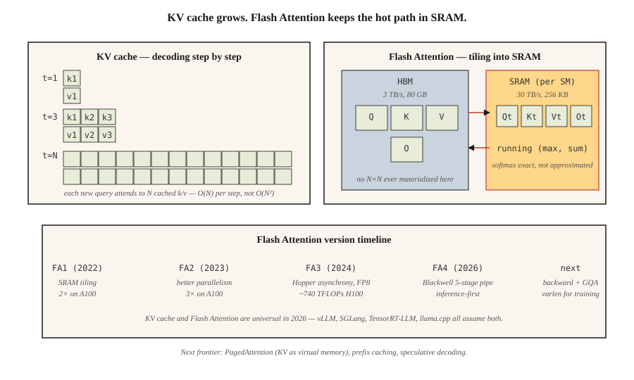

# KV Cache, Flash Attention & Optimasi Inferensi

> Pelatihan bersifat paralel dan terikat-FLOP. Inferensi bersifat serial dan terikat-memori. Bottleneck berbeda, trik berbeda.

**Jenis:** Bangun
**Bahasa:** Python, Rust
**Prasyarat:** Fase 7 · 02 (Self-Attention), Fase 7 · 05 (Transformer Lengkap), Fase 7 · 07 (GPT)
**Waktu:** ~75 menit

## Masalah

Decoder autoregresif naif melakukan kerja $O(N^2)$ untuk menghasilkan $N$ token: pada setiap langkah ia menghitung ulang atensi atas seluruh prefiks. Untuk respons 4K token itu adalah 16 juta operasi atensi, kebanyakan redo. Setiap keadaan tersembunyi dari token prefiks bersifat deterministik sekali dihitung — Anda hanya perlu menjalankan query token baru terhadap kunci dan nilai yang tembolok dari semua token sebelumnya.

Di atas itu, atensi sendiri memindahkan banyak data. Atensi standar mewujudkan matriks skor N×N, keluaran softmax N×d, keluaran akhir N×d — terlalu banyak baca dan tulis ke HBM. Untuk N≥2K, atensi menjadi terikat-memori sebelum menjadi terikat-FLOP. Kernel atensi klasik memanfaatkan GPU modern secara kurang optimal 4–10×.

Dua optimasi, keduanya dari Dao dkk., mendorong inferensi frontier dari "lambat" menjadi "cepat":

1. **KV cache.** Simpan vektor K dan V dari setiap token prefiks. Atensi token baru berikutnya adalah satu query terhadap kunci yang tembolok. Inferensi turun dari $O(N^2)$ menjadi $O(N)$ per langkah generasi.
2. **Flash Attention.** Bagi-bagi (tile) komputasi atensi sehingga matriks N×N penuh tidak pernah masuk ke HBM. Seluruh softmax + matmul terjadi di SRAM. Percepatan wall-clock 2–4× di A100; 5–10× di H100 dengan FP8.

Pada 2026 keduanya bersifat universal. Setiap tumpukan inferensi produksi (vLLM, TensorRT-LLM, SGLang, llama.cpp) mengasumsikannya. Setiap model frontier dikirim dengan Flash Attention aktif.

## Konsep



### Matematika KV cache

Per lapisan decoder, per token, melintasi semua KV head:

```
bytes_per_token_per_layer = 2 * n_kv_heads * d_head * dtype_size
                           ^
                           K dan V
```

Untuk model 7B dengan 32 lapisan, 32 head (semuanya dipakai untuk K dan V), d_head=128, fp16:

```
per token per lapisan = 2 * 32 * 128 * 2 = 16384 byte (16 KiB)
per token (32 lapisan) = 512 KiB
per 32K konteks = 16 GiB
```

Untuk Llama 3 70B (80 lapisan, d_head=128, GQA dengan 8 KV head):

```
per token per lapisan = 2 * 8 * 128 * 2 = 4096 byte (4 KiB)
per 32K konteks = 10 GiB
```

10 GiB itu pada 32K tumbuh menjadi 40 GiB pada 128K — seluruh kapasitas A100 40 GB hanya untuk KV cache pada batch size 1.

**GQA adalah kemenangan KV cache.** MHA dengan 64 KV head akan 8× lebih besar, sekitar 80 GiB pada 32K. MLA mengompres lebih jauh lagi.

Geser dimensi-dimensinya dan lihat ukuran cache bergerak. Dorong panjang urutan atau batch dan lihat seberapa cepat ia melampaui satu GPU:

```figure
kv-cache-sizer
```

### Flash Attention — trik pembagian-tile

Atensi standar:

```
S = Q @ K^T          (baca HBM, N×N, tulis HBM)
P = softmax(S)       (baca HBM, tulis HBM)
O = P @ V            (baca HBM, tulis HBM)
```

Tiga kali pergi-balik HBM. Di H100, bandwidth HBM adalah 3 TB/s; SRAM 30 TB/s. Setiap pergi-balik HBM adalah perlambatan faktor-10 dibanding menyimpan semuanya di on-chip.

Flash Attention:

```
untuk setiap blok Q (ukuran tile ~128 × 128):
    muat Q_tile ke SRAM
    untuk setiap blok K, V:
        muat K_tile, V_tile ke SRAM
        hitung S_tile = Q_tile @ K_tile^T     (SRAM)
        agregasi softmax berjalan              (SRAM)
        akumulasi ke O_tile                    (SRAM)
    tulis O_tile ke HBM
```

Satu pergi-balik HBM per tile. Jejak memori total turun dari $O(N^2)$ menjadi $O(N)$. Pass mundur menghitung ulang beberapa nilai dari pass maju alih-alih menyimpannya — kemenangan memori lagi.

**Trik numerik.** Softmax berjalan mempertahankan `(max, sum)` melintasi tile sehingga normalisasi akhir bersifat eksak. Bukan aproksimasi — Flash Attention menghasilkan keluaran bit-identik dengan atensi standar (modulo non-asosiativitas fp16).

**Evolusi versi:**

| Versi | Tahun | Perubahan utama | Percepatan pada hardware referensi |
|-------|-------|-----------------|-------------------------------------|
| Flash 1 | 2022 | Kernel SRAM ber-tile | 2× di A100 |
| Flash 2 | 2023 | Paralelisme lebih baik, urutan causal-first | 3× di A100 |
| Flash 3 | 2024 | Asinkroni Hopper, FP8 | 1,5–2× di H100 (~740 TFLOPs FP16) |
| Flash 4 | 2026 | Pipeline 5 tahap Blackwell, exp2 perangkat lunak | Inferensi-utama (awalnya forward only) |

Flash 4 saat peluncuran hanya forward pass. Pelatihan masih memakai Flash 3. Dukungan GQA dan varlen untuk Flash 4 masih tertunda (pertengahan 2026).

### Dekode spekulatif — kemenangan latensi lainnya

Model murah mengusulkan N token. Model besar memverifikasi semuanya secara paralel. Jika verifikasi menerima k token, Anda membayar 1 forward pass model besar untuk k generasi. Lazimnya k=3–5 pada kode dan prosa.

Default 2026:
- **EAGLE 2 / Medusa.** Draft head terintegrasi yang berbagi keadaan tersembunyi verifier. Percepatan 2–3× tanpa kehilangan kualitas.
- **Dekode spekulatif dengan model draft.** Percepatan 2–4× pada hardware konsumen.
- **Dekode lookahead.** Iterasi Jacobi; tidak perlu model draft. Niche tetapi gratis.

### Continuous batching

Inferensi batch klasik: tunggu urutan paling lambat selesai, lalu mulai batch baru. Membuang-buang GPU ketika respons pendek selesai lebih awal.

Continuous batching (pertama kali hadir di Orca, sekarang di vLLM, TensorRT-LLM, SGLang): tukar permintaan baru ke dalam batch segera setelah yang lama selesai. Keuntungan throughput 5–10× untuk beban obrolan khas.

### PagedAttention — KV cache sebagai memori virtual

Fitur unggulan vLLM. KV cache dialokasikan dalam blok 16 token; tabel halaman memetakan posisi logis ke blok fisik. Memungkinkan berbagi KV antar sampel paralel (beam search, parallel sampling), hot-swap prefiks untuk prompt caching, dan defragmentasi memori. Perbaikan throughput 4× dibanding alokasi kontigu naif.

```figure
flash-attention-memory
```

## Bangun

```figure
iso-machine {"machine":"kv-cache"}
```

Lihat `code/main.py`, atau port Rust-nya `code/main.rs`. Untuk menjalankan versi Rust: `rustc --edition 2021 -O code/main.rs -o /tmp/lesson && /tmp/lesson`. Kami mengimplementasikan:

1. Decoder inkremental naif $O(N^2)$.
2. Decoder dengan KV cache $O(N)$.
3. Softmax ber-tile yang menyimulasikan algoritma running-max Flash Attention.

### Langkah 1: KV cache

```python
class KVCache:
    def __init__(self, n_layers, n_heads, d_head):
        self.K = [[[] for _ in range(n_heads)] for _ in range(n_layers)]
        self.V = [[[] for _ in range(n_heads)] for _ in range(n_layers)]

    def append(self, layer, head, k, v):
        self.K[layer][head].append(k)
        self.V[layer][head].append(v)

    def read(self, layer, head):
        return self.K[layer][head], self.V[layer][head]
```

Sederhana: terus tambahkan vektor K, V per token ke dalam daftar per lapisan, per head.

### Langkah 2: softmax ber-tile

```python
def tiled_softmax_dot(q, K, V, tile=4):
    """Softmax(qK^T)V bergaya flash-attention dengan max/sum berjalan."""
    m = float("-inf")
    s = 0.0
    out = [0.0] * len(V[0])
    for start in range(0, len(K), tile):
        k_block = K[start:start + tile]
        v_block = V[start:start + tile]
        scores = [sum(qi * ki for qi, ki in zip(q, k)) for k in k_block]
        new_m = max(m, *scores)
        exp_old = math.exp(m - new_m) if m != float("-inf") else 0.0
        exp_new = [math.exp(sc - new_m) for sc in scores]
        s = s * exp_old + sum(exp_new)
        for j in range(len(out)):
            out[j] = out[j] * exp_old + sum(e * v[j] for e, v in zip(exp_new, v_block))
        m = new_m
    return [o / s for o in out]
```

Keluaran bit-identik dengan `softmax(qK) V` sekali jalan, tetapi pada setiap saat himpunan kerja yang ada adalah blok `tile × d_head`, bukan `N × d_head` penuh.

### Langkah 3: bandingkan dekode naif versus tembolok

Hitung operasi atensi. Kedua decoder melakukan perbandingan query-key yang sama: langkah `t` melakukan atensi atas `t` token, sehingga totalnya 1 + 2 + ... + N = N(N+1)/2. Kode memakai N = 10 dan mencetak 55 untuk masing-masing decoder. Untuk generasi 100 token, keduanya melakukan 5050 perbandingan. Cache menghemat proyeksi K dan V. Tanpa cache, setiap langkah menghitung K dan V lagi untuk prefiks penuh, sehingga generasi 100 token menghitung 5050 keadaan token. Dengan cache, K dan V setiap token dihitung sekali, sehingga generasi yang sama menghitung 100 keadaan token.

## Pakai

```python
# HuggingFace transformers mengaktifkan KV cache otomatis pada generate() decoder-only.
from transformers import AutoModelForCausalLM
model = AutoModelForCausalLM.from_pretrained(
    "meta-llama/Llama-3.2-3B",
    attn_implementation="flash_attention_2",  # pakai FA3 jika Hopper
    torch_dtype="bfloat16",
)
# generate() memakai KV cache secara otomatis
```

Produksi vLLM:

```bash
pip install vllm
vllm serve meta-llama/Llama-3.1-70B-Instruct \
    --tensor-parallel-size 4 \
    --max-model-len 32768 \
    --enable-prefix-caching \
    --kv-cache-dtype fp8
```

Prefix caching lintas permintaan adalah kemenangan besar 2026 — system prompt, contoh few-shot, atau dokumen konteks panjang yang sama menggunakan KV ulang antar panggilan. Untuk beban kerja agen dengan prompt alat yang berulang, prefix caching secara rutin memberi keuntungan throughput 5×.

## Kirim

Lihat `outputs/skill-inference-optimizer.md`. Skill ini memilih implementasi atensi, strategi KV cache, kuantisasi, dan dekode spekulatif untuk deployment inferensi baru.

## Latihan

1. **Mudah.** Jalankan `code/main.py`. Konfirmasi bahwa decoder naif dan tembolok menghasilkan keluaran yang sama; perhatikan selisih jumlah operasi.
2. **Sedang.** Implementasikan prefix caching: diberi prompt P dan beberapa penyelesaian, jalankan satu forward pass atas P untuk mengisi KV cache, lalu bercabang per penyelesaian. Ukur percepatan dibanding meng-encode ulang P untuk masing-masing.
3. **Sulit.** Implementasikan PagedAttention mainan: KV cache dalam blok tetap 16 token dengan free-list. Ketika sebuah urutan selesai, kembalikan bloknya ke kolam (pool). Simulasikan 1.000 penyelesaian obrolan dengan panjang beragam. Bandingkan fragmentasi memori dengan alokasi kontigu.

## Istilah Kunci

| Istilah | Yang sering dikatakan | Makna sebenarnya |
|---------|-----------------------|------------------|
| KV cache | "Trik yang membuat dekode cepat" | K dan V yang disimpan dari setiap token prefiks; query baru melakukan atensi ke sana alih-alih menghitung ulang. |
| HBM | "Memori utama GPU" | High Bandwidth Memory; 80 GB di H100, 192 GB di B200. Bandwidth ~3 TB/s. |
| SRAM | "Memori on-chip" | Memori cepat per-SM, ~256 KB per SM di H100. Bandwidth ~30 TB/s. |
| Flash Attention | "Kernel atensi ber-tile" | Menghitung atensi tanpa mewujudkan N×N di HBM. |
| Continuous batching | "Batching tanpa tunggu" | Tukar urutan yang selesai keluar, yang baru masuk, tanpa mengosongkan batch. |
| PagedAttention | "Unggulan vLLM" | KV cache dialokasikan dalam blok tetap dengan tabel halaman; menghilangkan fragmentasi. |
| Prefix caching | "Gunakan ulang prompt panjang" | Cache KV untuk prefiks bersama lintas permintaan; pemotongan biaya besar untuk agen. |
| Dekode spekulatif | "Draft + verifikasi" | Model draft murah mengusulkan token; model besar memverifikasi k dalam satu pass. |

## Bacaan Lanjutan

- [Dao dkk. (2022). FlashAttention: Fast and Memory-Efficient Exact Attention with IO-Awareness](https://arxiv.org/abs/2205.14135) — Flash 1.
- [Dao (2023). FlashAttention-2: Faster Attention with Better Parallelism and Work Partitioning](https://arxiv.org/abs/2307.08691) — Flash 2.
- [Shah dkk. (2024). FlashAttention-3: Fast and Accurate Attention with Asynchrony and Low-precision](https://arxiv.org/abs/2407.08608) — Flash 3.
- [Catatan rilis FlashAttention-4 (Dao-AILab, 2026)](https://github.com/Dao-AILab/flash-attention) — pipeline 5 tahap Blackwell dan trik exp2 perangkat lunak; baca README repo untuk catatan peluncuran forward-only yang disebut pelajaran ini.
- [Kwon dkk. (2023). Efficient Memory Management for Large Language Model Serving with PagedAttention](https://arxiv.org/abs/2309.06180) — makalah vLLM.
- [Leviathan dkk. (2023). Fast Inference from Transformers via Speculative Decoding](https://arxiv.org/abs/2211.17192) — dekode spekulatif.
- [Li dkk. (2024). EAGLE: Speculative Sampling Requires Rethinking Feature Uncertainty](https://arxiv.org/abs/2401.15077) — makalah EAGLE-1/2 untuk pendekatan draft terintegrasi yang dikutip pelajaran.
- [Cai dkk. (2024). Medusa: Simple LLM Inference Acceleration Framework with Multiple Decoding Heads](https://arxiv.org/abs/2401.10774) — pendekatan Medusa yang disebut bersama EAGLE.
- [Dokumentasi vLLM — PagedAttention](https://docs.vllm.ai/en/latest/design/kernel/paged_attention.html) — pendalaman kanonik tentang blok 16 token dan desain tabel halaman.
