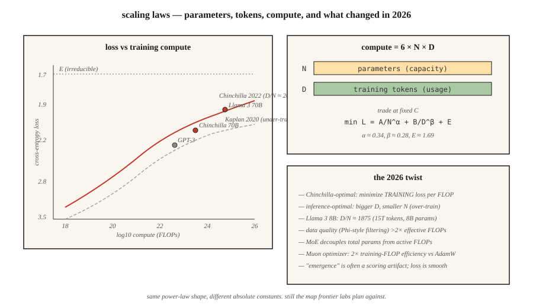

# Hukum Skala

> Makalah Kaplan 2020 berkata: model lebih besar, rugi lebih rendah. Makalah Hoffmann 2022 berkata: Anda kurang melatihnya. Komputasi masuk ke dua keranjang — parameter dan token — dan pembagiannya tidak jelas.

**Jenis:** Belajar
**Bahasa:** Python, Rust
**Prasyarat:** Fase 7 · 05 (Transformer Penuh), Fase 7 · 07 (GPT)
**Waktu:** ~45 menit

## Permasalahan

Saat Anda memiliki C FLOPs komputasi pelatihan dan menginginkan model terbaik, Anda menghadapi dua tuas:

1. **Berapa banyak parameter (N)?** Model lebih besar, kapasitas lebih tinggi.
2. **Berapa banyak token pelatihan (D)?** Lebih banyak data, pemanfaatan kapasitas lebih baik.

FLOPs berskala kira-kira `6 × N × D`. Anda bisa menaikkan N dan menurunkan D, atau D naik dan N turun. Mana yang lebih baik?

Sebelum 2022, jawabannya adalah "dorong N sekeras mungkin." GPT-3 (2020) berukuran 175B parameter dilatih pada ~300B token. Rasio sekitar 1,7 token per parameter. Hukum skala Kaplan mendukung ini.

Hoffmann dkk. (2022), yang melatih sebuah keluarga kecil model bernama Chinchilla, menemukan sesuatu yang berbeda: rasio optimal lebih dekat ke **20 token per parameter**. GPT-3 kurang terlatih 10×. Chinchilla (70B parameter, 1,4T token) mengalahkan GPT-3 (175B, 300B token) di setiap benchmark dengan biaya inferensi 2,5× lebih rendah.

2026 adalah dunia Chinchilla — dengan satu tikungan penting. Llama 3 8B dilatih pada 15 triliun token, rasio 1.875 token per parameter. Sembilan puluh empat kali lipat melampaui Chinchilla-optimal. Biaya inferensi lebih penting daripada biaya pelatihan bagi model yang akan dipakai secara masif, sehingga pelatihan berlebih (melampaui Chinchilla) untuk jejak deploy yang lebih kecil menjadi default 2026.

## Konsep



### Hukum Hoffmann

Dari makalah Chinchilla, rugi mengikuti:

```math
L(N, D) = \frac{A}{N^\alpha} + \frac{B}{D^\beta} + E
```

- $N$ = parameter (non-embedding).
- $D$ = token pelatihan.
- $\alpha \approx 0.34$, $\beta \approx 0.28$ (kurang lebih simetris).
- $E \approx 1.69$, batas rugi yang tak terelakkan.
- $A \approx 406$, $B \approx 411$.

Dua suku saling mengimbangi saat Anda menskalakan. Ambil turunan terhadap $N$ pada komputasi tetap ($C = 6ND$) dan selesaikan. Dengan $\alpha$ dan $\beta$ di atas, eksponen yang dihasilkan sekitar 0,45 untuk $N$ dan 0,55 untuk $D$, sehingga rasio optimal sebenarnya bergeser perlahan dengan anggaran; `code/main.py` menemukannya melalui pencarian grid. Dua pendekatan fitting pertama dalam makalah, yang mengukur optimum secara langsung, menempatkan kedua eksponen di sekitar 0,5. Itu memberi aturan empiris berupa rasio tetap. Tetapkan $D = 20N$ dalam $C = 6ND$ dan aturan praktisnya berbunyi:

```math
\begin{aligned}
N_{\text{opt}} &\approx 0.22 \times (C/6)^{0.5} \\
D_{\text{opt}} &\approx 4.5 \times (C/6)^{0.5} \\
D_{\text{opt}} / N_{\text{opt}} &\approx 20
\end{aligned}
```

Optimal-komputasi: 20 token per parameter.

### Mengapa tetap melakukan pelatihan berlebih

Chinchilla-optimal meminimalkan rugi pelatihan per FLOP pelatihan. Tetapi Anda membayar biaya pelatihan sekali; biaya inferensi selamanya.

Untuk chatbot yang melayani triliunan token per bulan, inferensi mendominasi total biaya. Pendekatan Llama: latih lebih kecil, lebih lama. 8B pada 15T token sangat dioptimalkan untuk inferensi:

- Muat di GPU konsumen.
- Latensi sebagian kecil dari Chinchilla-optimal 70B.
- Kualitas cukup dekat untuk sebagian besar tugas.

Makalah DeepMind 2024 ("Over-training is the new optimal") meformalisasi hal ini. Untuk beban kerja yang didominasi inferensi, rasio yang tepat lebih dekat ke 100–500 token per parameter tergantung volume penyajian.

### Kemunculan vs kehalusan

Klaim: kemampuan tertentu (aritmetika, penalaran beberapa langkah, mengikuti chain-of-thought) "muncul" secara tiba-tiba pada skala tertentu.

Schaeffer dkk. (2023) berargumen bahwa ini adalah artefak pengukuran: metrik kemunculan memakai penilaian yang diskontinuitas (exact match, akurasi pada ambang tertentu) yang menyembunyikan perbaikan mulus pada logit yang mendasarinya. Metrik kontinu (cross-entropy) menunjukkan kurva yang halus.

Pada 2026 konsensusnya: prediksi melalui rugi kontinu dapat diandalkan. Lompatan benchmark sering kali artefak penilai. Rencanakan anggaran berdasarkan metrik kontinu.

### Gambaran 2026

Hukum skala masih berlaku, tetapi:

| Faktor | Cara ia mengubahnya |
|--------|---------------------|
| Kualitas data | Kurasi token "baik" (gaya Phi) menggeser kurva >2× dalam komputasi efektif |
| MoE | Total parameter terlepas dari FLOP aktif; hukum skala per-FLOP-aktif |
| Pelatihan pasca | Sebagian kemampuan (mengikuti instruksi, kode) lebih banyak bergeser dengan SFT+RLHF daripada pra-pelatihan |
| Multimodalitas | Token gambar + teks berskala bersama; kurva terpisah per modalitas |
| Data sintetis | Model menghasilkan data pelatihan; komputasi efektif dapat berlipat ganda |

Pengoptimal Muon (Kimi Moonlight, 2024) menunjukkan perolehan komputasi-efektif ~2× dibanding AdamW pada data yang setara. Sebagian pelatihan 2026 memakai Muon secara default. Ini mengubah konstanta absolut dalam hukum skala, bukan bentuknya.

```figure
scaling-laws
```

## Bangunlah

Lihat `code/main.py`. Kami mengimplementasikan persamaan rugi Chinchilla dan menyelesaikan $(N, D)$ optimal-komputasi pada beberapa anggaran komputasi.

### Langkah 1: rugi Chinchilla

```python
def chinchilla_loss(N, D, A=406.4, B=410.7, alpha=0.34, beta=0.28, E=1.69):
    return A / N ** alpha + B / D ** beta + E
```

Plot $L$ sebagai kontur atas $(N, D)$ pada $C = 6ND$ tetap. Temukan minimumnya.

### Langkah 2: batas optimal-komputasi

Untuk anggaran komputasi dari `1e17` hingga `1e25` FLOPs, temukan $(N, D)$ yang meminimalkan rugi dengan syarat $6ND = C$. Verifikasi rasio $D/N \approx 20$.

### Langkah 3: biaya pelatihan berlebih

Hitung rugi tambahan yang Anda bayar untuk melatih model 10× lebih kecil (1/10 dari N optimal, 10× D optimal). Laporkan sebagai gantinya penghematan FLOP inferensi (proporsional dengan N).

### Langkah 4: bandingkan dengan model nyata

Masukkan pasangan `(N, D)` yang diketahui untuk GPT-3, Chinchilla, Llama 3 8B, DeepSeek-V3 (parameter aktif), dan bandingkan rugi prediksi vs yang dilaporkan.

## Gunakanlah

Anda kecil kemungkinan melatih model frontier sendiri. Tetapi hukum skala memberi tahu Anda:

1. **Apakah fine-tuning Anda memiliki cukup data.** Jika data spesifik tugas Anda di bawah 20 token per parameter model dasar, harapkan saturasi pada suatu batas rugi.
2. **Apakah memilih model dasar yang lebih besar.** Jika seluruh anggaran Anda habis untuk inferensi, pilih model yang lebih kecil dengan pelatihan lebih lama.
3. **Di mana pengembalian mulai menurun.** Melampaui 1000× Chinchilla-optimal, perubahan log-rugi menjadi derau.

**Trajektori riset pada 2026:**

- **Rezim terbatasi data.** Web memiliki jumlah token berkualitas tinggi yang terbatas (~5–10 triliun token Inggris setelah pemfilteran). Pra-pelatihan frontier mendekati batas ini. Data sintetis, multibahasa, multimodal, dan fine-tuning berskala RLHF adalah tuas berikutnya.
- **Trik pengganda komputasi.** Pengoptimal Muon, MoE, kurasi data yang lebih baik — masing-masing menggeser konstanta absolut, bukan asimtot.
- **Hukum skala untuk RL.** Pertanyaan terbuka. Bukti awal menunjukkan hukum pangkat pada sampel RL tetapi dengan eksponen yang sangat berbeda dari pra-pelatihan.

## Terapkanlah

Lihat `outputs/skill-training-budget-estimator.md`. Skill ini memilih `(N, D, hours, GPU)` untuk sebuah pelatihan baru diberikan anggaran komputasi, kendala deploy, dan rugi target.

## Latihan

1. **Mudah.** Jalankan `code/main.py`. Cetak $(N, D)$ optimal-Chinchilla untuk anggaran komputasi `1e20`, `1e22`, `1e24`. Bandingkan dengan tabel model nyata.
2. **Sedang.** Implementasikan kurva rugi-sebagai-fungsi-komputasi ala Hoffmann. Plot rugi vs `log10(C)` untuk batas optimal-komputasi. Identifikasi kapan hukum memprediksi kita membutuhkan $>10^{28}$ FLOPs untuk penurunan 0,1 berikutnya dalam cross-entropy.
3. **Sulit.** Cocokkan hukum skala Anda sendiri pada 5 model sangat kecil (100K hingga 10M parameter) yang dilatih pada dataset yang sama. Estimasi $\alpha$ dan $E$. Seberapa dekat eksponen Anda dengan yang dipublikasikan?

## Istilah Kunci

| Istilah | Apa yang orang katakan | Arti sebenarnya |
|---------|------------------------|-----------------|
| Parameter (N) | "Ukuran model" | Jumlah bobot non-embedding; menentukan kapasitas. |
| Token (D) | "Data pelatihan" | Jumlah token pelatihan yang dilihat; menentukan seberapa baik parameter digunakan. |
| Komputasi (C) | "FLOPs yang dibelanjakan" | Kira-kira `6 × N × D` untuk transformer standar. |
| Chinchilla-optimal | "D/N ≈ 20" | Rasio yang meminimalkan rugi per FLOP pra-pelatihan. |
| Pelatihan berlebih | "Melampaui Chinchilla" | Belanjakan FLOP pelatihan ekstra untuk menghemat FLOP inferensi; D/N >> 20. |
| Rugi tak terelakkan | "Lantai" | Suku $E$ dalam hukum skala; entropi data itu sendiri. |
| Kemampuan muncul | "Lompatan tiba-tiba pada skala" | Sering artefak penilai; rugi kontinu itu mulus. |
| Komputasi efektif | "Pengganda efisiensi pelatihan" | Data / pengoptimal / arsitektur yang lebih baik melipatgandakan jangkauan satu FLOP. |

## Bacaan Lanjutan

- [Kaplan dkk. (2020). Hukum Skala untuk Model Bahasa Saraf](https://arxiv.org/abs/2001.08361) — makalah hukum skala pertama; kurang terlatih.
- [Hoffmann dkk. (2022). Melatih Model Bahasa Besar yang Optimal-Komputasi](https://arxiv.org/abs/2203.15556) — Chinchilla.
- [Schaeffer dkk. (2023). Apakah Kemampuan Muncul Model Bahasa Besar itu Ilusi?](https://arxiv.org/abs/2304.15004) — kemunculan sebagai artefak pengukuran.
- [Sardana, Frankle (2024). Melampaui Chinchilla-Optimal: Memperhitungkan Inferensi dalam Hukum Skala Model Bahasa](https://arxiv.org/abs/2401.00448) — mengapa pelatihan berlebih Llama tepat untuk beban kerjanya.
- [Jordan dkk. (2024). Muon: sebuah pengoptimal untuk lapisan tersembunyi dalam jaringan saraf](https://kellerjordan.github.io/posts/muon/) — pengganda komputasi 2×.
