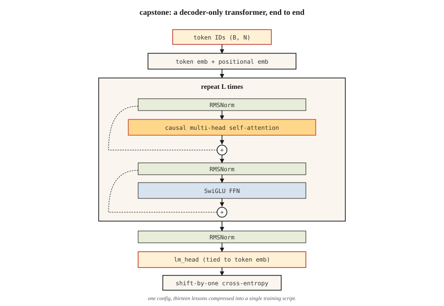

# Bangun Transformer dari Awal — Proyek Akhir

> Tiga belas pelajaran. Satu model. Tak ada jalan pintas.

**Jenis:** Bangun
**Bahasa:** Python
**Prasyarat:** Fase 7 · 01 sampai 13. Jangan lewati.
**Waktu:** ~120 menit

## Permasalahan

Anda telah membaca setiap makalah. Anda telah mengimplementasikan atensi, pembagian multi-head, penyandian posisi, blok encoder dan decoder, rugi BERT dan GPT, MoE, KV cache. Sekarang buat semuanya bekerja bersama dalam tugas nyata.

Proyek akhirnya: latih sebuah transformer decoder-only kecil secara menyeluruh pada tugas pemodelan bahasa tingkat karakter. Ia membaca Shakespeare. Ia menghasilkan Shakespeare baru. Ia cukup kecil untuk dilatih di laptop dalam waktu kurang dari 10 menit. Ia cukup benar sehingga mengganti dataset yang lebih besar dan pelatihan lebih lama memberi Anda LM sungguhan.

Ini adalah "nanoGPT" dari kursus ini. Ini bukan karya orisinal — tutorial nanoGPT Karpathy 2023 adalah implementasi referensi yang ditulis ulang oleh setiap mahasiswa setidaknya sekali. Kita mengambil bentuknya dan menyesuaikannya dengan apa yang telah kita bahas.

## Konsep



Arsitektur, dengan anotasi:

```
token input (B, N)
   │
   ▼
embedding token + embedding posisi  ◀── Pelajaran 04 (opsi RoPE)
   │
   ▼
┌──── blok × L ─────────────────────┐
│  RMSNorm                          │  ◀── Pelajaran 05
│  MultiHeadAttention (kausal)      │  ◀── Pelajaran 03 + 07 (mask kausal)
│  residual                         │
│  RMSNorm                          │
│  SwiGLU FFN                       │  ◀── Pelajaran 05
│  residual                         │
└────────────────────────────────── ┘
   │
   ▼
RMSNorm akhir
   │
   ▼
lm_head (terikat pada embedding token)
   │
   ▼
logits (B, N, V)
   │
   ▼
cross-entropy geser-satu            ◀── Pelajaran 07
```

### Yang kita hasilkan

- `GPTConfig` — satu tempat untuk mengonfigurasi semua hiperparameter.
- `MultiHeadAttention` — kausal, ber-batch, dengan jalur opsional gaya Flash (`scaled_dot_product_attention` milik PyTorch).
- `SwiGLUFFN` — FFN modern.
- `Block` — pre-norm, atensi + FFN yang dibungkus residual.
- `GPT` — embedding, tumpukan blok, LM head, generate().
- Loop pelatihan dengan AdamW, LR cosine, pemotongan gradien.
- Tokenizer tingkat karakter pada teks Shakespeare.

### Yang tidak kita hasilkan

- RoPE — diimplementasikan secara konseptual di Pelajaran 04. Di sini kita memakai embedding posisi yang dipelajari demi kesederhanaan. Latihan meminta Anda menggantinya dengan RoPE.
- KV cache saat generasi — setiap langkah generasi menghitung ulang atensi atas seluruh prefiks. Lebih lambat tetapi lebih sederhana. Latihan meminta Anda menambahkan KV cache.
- Flash Attention — PyTorch 2.0+ otomatis memilih implementasinya jika inputnya cocok; kita memakai `F.scaled_dot_product_attention`.
- MoE — satu FFN per blok. Anda melihat MoE di Pelajaran 11.

### Metrik target

Pada laptop Mac M2, GPT 4 lapisan, 4 head, d_model=128 yang dilatih selama 2.000 langkah pada `tinyshakespeare.txt`:

- Rugi pelatihan konvergen dari ~4,2 (acak) ke ~1,5 dalam sekitar 6 menit.
- Keluaran hasil sampel tampak berbentuk Shakespeare: kata-kata kuno, jeda baris, dan nama diri seperti "ROMEO:" muncul.
- Rugi validasi (10% akhir teks yang disisihkan) mengikuti rugi pelatihan dengan dekat; tidak ada overfitting pada ukuran/anggaran ini.

```figure
n5-block-stack
```

## Bangunlah

Pelajaran ini memakai PyTorch. Pasang `torch` (build CPU tidak masalah). Lihat `code/main.py`. Skrip ini menangani:

- Mengunduh `tinyshakespeare.txt` jika belum ada (atau membaca salinan lokal).
- Tokenizer karakter tingkat byte.
- Pemisahan train/val 90/10.
- Loop pelatihan dengan autocast bf16 pada perangkat keras yang mendukung.
- Pengambilan sampel setelah pelatihan selesai.

### Langkah 1: data

```python
text = open("tinyshakespeare.txt").read()
chars = sorted(set(text))
stoi = {c: i for i, c in enumerate(chars)}
itos = {i: c for c, i in stoi.items()}
encode = lambda s: [stoi[c] for c in s]
decode = lambda xs: "".join(itos[x] for x in xs)
```

65 karakter unik. Kosakata sangat kecil. Muat dalam vocab_size 4 byte. Tanpa BPE, tanpa drama tokenizer.

### Langkah 2: model

Lihat `code/main.py`. Bloknya standar dari Pelajaran 05 — pre-norm, RMSNorm, SwiGLU, MHA kausal. Jumlah parameter untuk 4/4/128: ~800K.

### Langkah 3: loop pelatihan

Ambil batch acak berupa jendela token panjang 256. Forward. Cross-entropy geser-satu. Backward. Langkah AdamW. Catat. Ulangi.

```python
for step in range(max_steps):
    x, y = get_batch("train")
    logits = model(x)
    loss = F.cross_entropy(logits.view(-1, vocab_size), y.view(-1))
    loss.backward()
    torch.nn.utils.clip_grad_norm_(model.parameters(), 1.0)
    opt.step()
    opt.zero_grad()
```

### Langkah 4: ambil sampel

Diberikan sebuah prompt, lakukan forward berulang kali, ambil sampel dari logit top-p, tambahkan, dan lanjutkan. Berhenti setelah 500 token.

### Langkah 5: baca keluaran

Setelah 2.000 langkah:

```
ROMEO:
Away and mild will not thy friend, that thou shalt wit:
The chief that well shame and hath been his friends,
...
```

Bukan Shakespeare. Tetapi berbentuk Shakespeare. Kemenangan jelas untuk ~800K parameter dan 6 menit di laptop.

## Gunakanlah

Proyek akhir ini adalah arsitektur referensi. Tiga pengembangan untuk membawanya menjadi sesuatu yang nyata:

1. **Ganti tokenizer.** Pakai BPE (mis. `tiktoken.get_encoding("cl100k_base")`). Ukuran kosakata melonjak dari 65 menjadi ~50.000. Kapasitas model perlu dinaikkan untuk mengimbangi.
2. **Latih pada korpus yang lebih besar.** Gunakan `OpenWebText` atau `fineweb-edu` (HuggingFace). 10B token pada satu A100 memakan ~24 jam untuk GPT 125M parameter.
3. **Tambahkan RoPE + KV cache + Flash Attention.** Latihan di bawah memandu Anda melalui masing-masing.

Ini berujung pada GPT 125M parameter yang menghasilkan bahasa Inggris yang fasih. Bukan model frontier. Tetapi jalur kode yang sama — hanya lebih besar — adalah apa yang dipakai Karpathy, EleutherAI, dan Allen Institute untuk melatih checkpoint riset pada 2026.

## Terapkanlah

Lihat `outputs/skill-transformer-review.md`. Skill ini meninjau implementasi transformer-dari-awal untuk kebenaran di seluruh 13 pelajaran sebelumnya.

## Latihan

1. **Mudah.** Jalankan `code/main.py`. Verifikasi rugi validasi langkah akhir model terlatih Anda berada di bawah 2,0. Ubah `max_steps` dari 2.000 menjadi 5.000 — apakah rugi val terus membaik?
2. **Sedang.** Ganti embedding posisi yang dipelajari dengan RoPE. Terapkan rotasi pada Q dan K di dalam `MultiHeadAttention`. Latih dan verifikasi rugi val setidaknya sama rendahnya.
3. **Sedang.** Implementasikan KV cache dalam loop pengambilan sampel. Hasilkan 500 token dengan dan tanpa cache. Waktu tembok (wall-clock) harus membaik 5–20× di laptop.
4. **Sulit.** Tambahkan head kedua pada model yang memprediksi token berikutnya-plus-satu (MTP — Multi-Token Prediction dari DeepSeek-V3). Latih secara bersamaan. Apakah membantu?
5. **Sulit.** Ganti FFN tunggal per blok dengan MoE 4 pakar. Router + routing top-2. Lihat bagaimana rugi val berubah pada parameter aktif yang setara.

## Istilah Kunci

| Istilah | Apa yang orang katakan | Arti sebenarnya |
|---------|------------------------|-----------------|
| nanoGPT | "Repo tutorial Karpathy" | Kode pelatihan transformer decoder-only minimal, ~300 LOC; referensi kanonik. |
| tinyshakespeare | "Korpus mainan standar" | ~1,1 MB teks; setiap tutorial LM tingkat karakter sejak 2015 memakainya. |
| Embedding terikat | "Bagikan matriks input/output" | Bobot LM head = transpose matriks embedding token; menghemat parameter, meningkatkan kualitas. |
| Autocast bf16 | "Trik presisi pelatihan" | Jalankan forward/backward dalam bf16, simpan state pengoptimal dalam fp32; standar sejak 2021. |
| Pemotongan gradien | "Menghentikan lonjakan" | Batasi norma gradien global di 1,0; mencegah pelatihan meledak. |
| Jadwal LR cosine | "Default 2020+" | LR naik linier (warmup) lalu turun berbentuk cosine ke 10% dari puncak. |
| MFU | "Model FLOP Utilization" | FLOP yang tercapai / puncak teoritis; 40% dense, 30% MoE kuat pada 2026. |
| Rugi val | "Rugi tersisih" | Cross-entropy pada data yang tidak pernah dilihat model; detektor overfitting. |

## Bacaan Lanjutan

- [Transformer Beranotasi (Harvard NLP)](https://nlp.seas.harvard.edu/annotated-transformer/) — implementasi beranotasi klasik.
