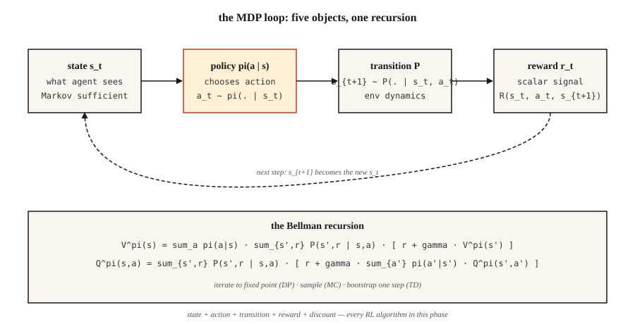

# MDP, Keadaan, Aksi & Hadiah

> Proses Keputusan Markov adalah lima hal: keadaan, aksi, transisi, hadiah, dan diskonto. Semua hal dalam RL — Q-learning, PPO, DPO, GRPO — mengoptimalkan bentuk ini. Pelajari sekali, lalu baca sisa pembelajaran penguatan secara gratis.

**Jenis:** Belajar
**Bahasa:** Python, TypeScript
**Prasyarat:** Fase 1 · 06 (Probabilitas & Distribusi), Fase 2 · 01 (Taksonomi ML)
**Waktu:** ~45 menit

## Masalah

Anda sedang menulis bot catur. Atau perencana inventaris. Atau agen perdagangan. Atau loop PPO yang melatih model penalaran. Empat domain berbeda, satu fakta yang mengejutkan: keempatnya runtuh menjadi objek matematis yang sama.

Pembelajaran terselia memberi Anda pasangan `(x, y)` dan meminta Anda menyesuaikan fungsi. Pembelajaran penguatan tidak memberi label — hanya aliran keadaan, aksi yang Anda ambil, dan hadiah skalar. Apakah langkah itu memenangkan pertandingan? Apakah keputusan pengisian ulang stok menghemat uang? Apakah perdagangan itu menguntungkan? Apakah token yang baru saja dihasilkan LLM menghasilkan hadiah lebih tinggi dari penilai?

Anda tidak dapat belajar dari aliran ini sebelum membentuknya secara formal. "Apa yang saya lihat," "apa yang saya lakukan," "apa yang terjadi berikutnya," "seberapa baik itu" — masing-masing harus menjadi objek yang dapat Anda alas. Formalisasi itu adalah Proses Keputusan Markov. Setiap algoritma RL di fase ini, termasuk loop RLHF dan GRPO di akhir, mengoptimalkan bentuk ini.

## Konsep



**Lima objek itu.**

- **Keadaan** $S$. Segala yang dibutuhkan agen untuk memutuskan. Di GridWorld, selnya. Di catur, papannya. Di LLM, jendela konteks plus memori apa pun.
- **Aksi** $A$. Pilihannya. Naik/turun/kiri/kanan. Memainkan sebuah langkah. Menghasilkan sebuah token.
- **Transisi** $P(s' \mid s, a)$. Diketahui keadaan $s$ dan aksi $a$, distribusi atas keadaan berikutnya. Deterministik di catur, stokastik di inventaris, hampir deterministik dalam dekode LLM.
- **Hadiah** $R(s, a, s')$. Sinyal skalar. Menang = +1, kalah = -1. Pendapatan dikurangi biaya. Suku rasio log-likelihood dalam GRPO.
- **Diskonto** $\gamma \in [0, 1)$. Seberapa besar hadiah masa depan dihitung dibandingkan masa kini. $\gamma = 0.99$ membeli horizon ~100 langkah; $\gamma = 0.9$ membeli ~10.

**Sifat Markov** $P(s_{t+1} \mid s_t, a_t) = P(s_{t+1} \mid s_0, a_0, \ldots, s_t, a_t)$. Masa depan hanya bergantung pada keadaan saat ini. Jika tidak, representasi keadaannya tidak lengkap — bukan kegagalan metode, melainkan kegagalan keadaan.

**Kebijakan dan imbal hasil.** Sebuah kebijakan $\pi(a \mid s)$ memetakan keadaan ke distribusi aksi. Imbal hasil $G_t = r_t + \gamma r_{t+1} + \gamma^2 r_{t+2} + \ldots$ adalah jumlah hadiah masa depan yang didiskonto. Nilai $V^\pi(s) = \mathbb{E}[G_t \mid s_t = s]$ adalah imbal hasil yang diharapkan mulai dari $s$ di bawah kebijakan $\pi$. Nilai-Q $Q^\pi(s, a) = \mathbb{E}[G_t \mid s_t = s, a_t = a]$ adalah imbal hasil yang diharapkan ketika mulai dengan aksi tertentu. Setiap algoritma RL mengestimasi salah satu dari keduanya, lalu memperbaiki $\pi$ sesuai hasilnya.

**Persamaan Bellman.** Persamaan titik tetap yang dipakai oleh segala hal di fase ini:

```math
\begin{aligned}
V^\pi(s) &= \sum_a \pi(a \mid s) \sum_{s', r} P(s', r \mid s, a) [r + \gamma V^\pi(s')] \\
Q^\pi(s, a) &= \sum_{s', r} P(s', r \mid s, a) [r + \gamma \sum_{a'} \pi(a' \mid s') Q^\pi(s', a')]
\end{aligned}
```

Persamaan ini memecah imbal hasil yang diharapkan menjadi "hadiah langkah ini" ditambah "nilai diskonto dari tempat Anda mendarat". Rekursif. Setiap algoritma di Fase 9 baik mengiterasi persamaan ini sampai konvergen (pemrograman dinamis), mengambil sampel darinya (Monte Carlo), atau melakukan bootstrap satu langkah (perbedaan temporal).

```figure
discount-horizon
```

## Bangun

### Langkah 1: MDP deterministik yang sangat kecil

GridWorld 4×4. Agen mulai di kiri atas, terminal di kanan bawah, hadiah -1 per langkah, aksi `{up, down, left, right}`. Lihat `code/main.py`.

```python
GRID = 4
TERMINAL = (3, 3)
ACTIONS = {"up": (-1, 0), "down": (1, 0), "left": (0, -1), "right": (0, 1)}

def step(state, action):
    if state == TERMINAL:
        return state, 0.0, True
    dr, dc = ACTIONS[action]
    r, c = state
    nr = min(max(r + dr, 0), GRID - 1)
    nc = min(max(c + dc, 0), GRID - 1)
    return (nr, nc), -1.0, (nr, nc) == TERMINAL
```

Lima baris. Itu seluruh lingkungannya. Transisi deterministik, penalti langkah konstan, keadaan terminal menyerap.

### Langkah 2: jalankan rollout kebijakan

Sebuah kebijakan adalah fungsi dari keadaan ke distribusi aksi. Paling sederhana: acak seragam.

```python
def uniform_policy(state):
    return {a: 0.25 for a in ACTIONS}

def rollout(policy, max_steps=200):
    s, total, steps = (0, 0), 0.0, 0
    for _ in range(max_steps):
        a = sample(policy(s))
        s, r, done = step(s, a)
        total += r
        steps += 1
        if done:
            break
    return total, steps
```

Jalankan kebijakan acak 1000 kali. Imbal hasil rata-rata sekitar -60 sampai -80 untuk papan 4×4 ini. Imbal hasil optimal adalah -6 (jalur lurus ke bawah-kanan). Menutup celah itu adalah seluruh isi Fase 9.

### Langkah 3: hitung `V^π` secara eksak melalui persamaan Bellman

Untuk MDP kecil, persamaan Bellman adalah sistem linear. Enumerasi keadaan, terapkan ekspektasi, iterasi sampai nilai berhenti berubah.

```python
def policy_evaluation(policy, gamma=0.99, tol=1e-6):
    V = {s: 0.0 for s in all_states()}
    while True:
        delta = 0.0
        for s in all_states():
            if s == TERMINAL:
                continue
            v = 0.0
            for a, pi_a in policy(s).items():
                s_next, r, _ = step(s, a)
                v += pi_a * (r + gamma * V[s_next])
            delta = max(delta, abs(v - V[s]))
            V[s] = v
        if delta < tol:
            return V
```

Ini adalah evaluasi kebijakan iteratif. Ini algoritma pertama dalam Sutton & Barto dan fondasi teoretis dari setiap metode RL yang mengikuti.

### Langkah 4: `γ` adalah hiperparameter yang punya makna fisik

Horizon efektif kurang lebih $1 / (1 - \gamma)$. $\gamma = 0.9$ → 10 langkah. $\gamma = 0.99$ → 100 langkah. $\gamma = 0.999$ → 1000 langkah.

Terlalu rendah dan agen bertindak pendek-pandang. Terlalu tinggi dan penugasan kredit menjadi bising, karena banyak langkah awal berbagi tanggung jawab atas hadiah di masa depan jauh. RLHF LLM biasanya memakai $\gamma = 1$ karena episode pendek dan terbatas. Tugas kontrol memakai `0.95–0.99`. Permainan strategi ber-horizon panjang memakai `0.999`.

## Jebakan

- **Keadaan non-Markov.** Jika Anda membutuhkan tiga pengamatan terakhir untuk memutuskan, "keadaan"-nya bukan hanya pengamatan saat ini. Perbaikannya: tumpuk frame (DQN pada Atari menumpuk 4) atau pakai keadaan rekuren (LSTM/GRU atas pengamatan).
- **Hadiah jarang.** Hadiah yang hanya diberikan saat menang membuat pembelajaran hampir mustahil di ruang keadaan besar. Bentuk hadiahnya (sinyal antara) atau lakukan bootstrap dengan imitasi (Fase 9 · 09).
- **Peretasan hadiah.** Mengoptimalkan hadiah proksi sering menghasilkan perilaku patologis. Agen balap perahu OpenAI berputar-putar mengumpulkan power-up selamanya alih-alih menyelesaikan balapan. Selalu definisikan hadiah dari hasil target, bukan dari proksinya.
- **Salah spesifikasi diskonto.** $\gamma = 1$ pada tugas ber-horizon tak hingga membuat setiap nilai menjadi tak hingga. Selalu batasi dengan horizon hingga atau $\gamma < 1$.
- **Skala hadiah.** Hadiah {+100, -100} versus {+1, -1} menghasilkan kebijakan optimal yang identik tetapi magnitudo gradien yang sangat berbeda. Normalisasi ke kisaran `[-1, 1]`-ish sebelum memasukkan ke PPO/DQN.

## Pakai

Tumpukan 2026 menyederhanakan setiap pipeline RL menjadi MDP sebelum menyentuh kode:

| Situasi | Keadaan | Aksi | Hadiah | γ |
|---------|---------|------|--------|---|
| Kontrol (lokomosi, manipulasi) | Sudut sendi + kecepatan | Torsi kontinu | Bentuk khusus tugas | 0.99 |
| Permainan (catur, Go, poker) | Papan + riwayat | Langkah legal | Menang=+1 / kalah=-1 | 1.0 (hinga) |
| Inventaris / penentuan harga | Stok + permintaan | Jumlah pesanan | Pendapatan - biaya | 0.95 |
| RLHF untuk LLM | Token konteks | Token berikutnya | Skor model hadiah di akhir | 1.0 (episode ~200 token) |
| GRPO untuk penalaran | Prompt + jawaban sebagian | Token berikutnya | Verifikator 0/1 di akhir | 1.0 |

Tulis lima tupel itu sebelum menulis loop pelatihan apa pun. Kebanyakan laporan bug "RL tidak bekerja" berakar pada formulasi MDP yang rusak di atas kertas.

## Kirim

Simpan sebagai `outputs/skill-mdp-modeler.md`:

```markdown
---
name: mdp-modeler
description: Diketahui deskripsi tugas, hasilkan spesifikasi Proses Keputusan Markov dan tandai risiko formulasi sebelum pelatihan.
version: 1.0.0
phase: 9
lesson: 1
tags: [rl, mdp, modeling]
---

Diketahui sebuah tugas (kontrol / permainan / rekomendasi / fine-tuning LLM), keluarkan:

1. Keadaan. Spesifikasi vektor fitur atau tensor yang eksak. Justifikasi sifat Markov.
2. Aksi. Himpunan diskrit atau rentang kontinu. Dimensinya.
3. Transisi. Deterministik, stokastik dengan model diketahui, atau hanya sampel.
4. Hadiah. Fungsi dan sumbernya. Jarang vs dibentuk. Terminal vs per langkah.
5. Diskonto. Nilainya dan justifikasi horizon.

Tolak mengirim MDP apa pun yang keadaannya non-Markov tanpa penyebutan eksplisit penumpukan frame atau keadaan rekuren. Tolak hadiah apa pun yang tidak didefinisikan dalam hasil target. Tandai setiap `γ ≥ 1.0` pada tugas ber-horizon tak hingga. Tandai rentang hadiah >100x hadiah langkah tipikal sebagai sumber ledakan gradien yang mungkin.
```

## Latihan

1. **Mudah.** Implementasikan GridWorld 4×4 dan rollout kebijakan acak di `code/main.py`. Jalankan 10.000 episode. Laporkan rerata dan simpangan baku imbal hasil. Bandingkan dengan imbal hasil optimal (-6).
2. **Sedang.** Jalankan `policy_evaluation` dengan $\gamma \in \lbrace 0.5, 0.9, 0.99 \rbrace$ untuk kebijakan acak seragam. Cetak `V` sebagai grid 4×4 untuk masing-masing. Jelaskan mengapa nilai keadaan dekat terminal tumbuh lebih cepat dengan $\gamma$ yang lebih besar.
3. **Sulit.** Buat GridWorld menjadi stokastik: setiap aksi tergelincir ke arah bersebelahan dengan probabilitas $p = 0.1$. Evaluasi ulang kebijakan seragam. Apakah `V[start]` menjadi lebih baik atau lebih buruk? Mengapa?

## Istilah Kunci

| Istilah | Yang orang katakan | Arti sebenarnya |
|---------|--------------------|-----------------|
| MDP | "Pengaturan pembelajaran penguatan" | Tupel $(S, A, P, R, \gamma)$ yang memenuhi sifat Markov. |
| Keadaan | "Apa yang dilihat agen" | Statistik yang cukup untuk dinamika masa depan di bawah kelas kebijakan yang dipilih. |
| Kebijakan | "Perilaku agen" | Distribusi bersyarat $\pi(a \mid s)$ atau pemetaan deterministik $s \to a$. |
| Imbal hasil | "Total hadiah" | Jumlah diskonto $\sum \gamma^t r_t$ dari langkah saat ini. |
| Nilai | "Seberapa baik suatu keadaan" | Imbal hasil yang diharapkan di bawah $\pi$ mulai dari $s$. |
| Nilai-Q | "Seberapa baik suatu aksi" | Imbal hasil yang diharapkan di bawah $\pi$ mulai dari $s$ dengan aksi pertama $a$. |
| Persamaan Bellman | "Rekursi pemrograman dinamis" | Dekomposisi titik tetap dari nilai / Q menjadi hadiah satu langkah ditambah nilai penerus yang didiskonto. |
| Diskonto $\gamma$ | "Masa depan vs masa kini" | Bobot geometris pada hadiah jauh di masa depan; horizon efektif $\approx 1/(1-\gamma)$. |

## Bacaan Lanjutan

- [Sutton & Barto (2018). Reinforcement Learning: An Introduction, ed. ke-2](http://incompleteideas.net/book/RLbook2020.pdf) — buku teksnya. Bab 3 membahas MDP dan persamaan Bellman; Bab 1 memotivasi hipotesis hadiah yang mendasari setiap pelajaran berikutnya.
- [Bellman (1957). Dynamic Programming](https://press.princeton.edu/books/paperback/9780691146683/dynamic-programming) — asal-usul persamaan Bellman.
- [OpenAI Spinning Up — Bagian 1: Konsep Kunci](https://spinningup.openai.com/en/latest/spinningup/rl_intro.html) — pengantar ringkas MDP dari sudut pandang deep-RL.
- [Puterman (2005). Markov Decision Processes](https://onlinelibrary.wiley.com/doi/book/10.1002/9780470316887) — referensi riset operasi tentang MDP dan metode solusi eksak.
- [Littman (1996). Algorithms for Sequential Decision Making (disertasi PhD)](https://cs.brown.edu/media/filer_public/d1/a6/d1a6f66a-289a-4b81-9596-417114843489/littman.pdf) — derivasi paling bersih tentang MDP sebagai spesialisasi pemrograman dinamis.
