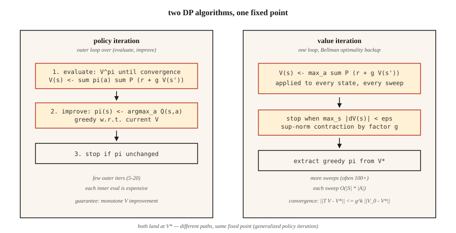

# Pemrograman Dinamis — Iterasi Kebijakan & Iterasi Nilai

> Pemrograman dinamis adalah RL dengan curang. Anda sudah mengetahui fungsi transisi dan hadiahnya; Anda tinggal mengiterasi persamaan Bellman sampai $V$ atau $\pi$ berhenti bergerak. Ini adalah benchmark yang berusaha didekati oleh setiap metode berbasis sampel.

**Jenis:** Bangun
**Bahasa:** Python, TypeScript
**Prasyarat:** Fase 9 · 01 (MDP)
**Waktu:** ~75 menit

## Masalah

Anda memiliki MDP dengan model yang diketahui: Anda dapat mengkueri $P(s' \mid s, a)$ dan $R(s, a, s')$ untuk pasangan keadaan-aksi apa pun. Seorang manajer inventaris mengetahui distribusi permintaan. Sebuah permainan papan memiliki transisi deterministik. Sebuah gridworld adalah empat baris Python. Anda punya *model*.

RL tanpa model (Q-learning, PPO, REINFORCE) diciptakan untuk kasus di mana Anda tidak memiliki model — Anda hanya dapat mengambil sampel dari lingkungan. Tetapi ketika Anda memang memilikinya, ada metode yang lebih cepat dan lebih baik: pemrograman dinamis. Bellman merancangnya pada 1957. Metode itu masih mendefinisikan kebenaran: ketika orang berkata "kebijakan optimal untuk MDP ini," yang mereka maksud adalah kebijakan yang dikembalikan DP.

Anda membutuhkannya di 2026 karena tiga alasan. Pertama, setiap lingkungan tabular dalam riset RL (GridWorld, FrozenLake, CliffWalking) diselesaikan dengan DP untuk menghasilkan kebijakan standar emas. Kedua, nilai eksak memungkinkan Anda *mendiagnosis* metode berbasis sampel: jika estimasi Q-learning untuk $V^{\ast}(s_0)$ berbeda 30% dari jawaban DP, Q-learning Anda memiliki bug. Ketiga, metode RL offline dan perencanaan modern (MCTS, pencarian AlphaZero, RL berbasis model di Fase 9 · 10) semuanya mengiterasi backup Bellman atas model yang dipelajari atau diberikan.

## Konsep



**Dua algoritma, keduanya iterasi titik tetap pada Bellman.**

**Iterasi kebijakan.** Bergantian dua langkah sampai kebijakan berhenti berubah.

1. *Evaluasi:* diberi kebijakan $\pi$, hitung $V^\pi$ dengan berulang kali menerapkan $V(s) \leftarrow \sum_a \pi(a \mid s) \sum_{s',r} P(s',r \mid s,a) [r + \gamma V(s')]$ sampai konvergen.
2. *Perbaikan:* diberi $V^\pi$, buat $\pi$ serakah terhadap $V^\pi$: $\pi(s) \leftarrow \arg\max_a \sum_{s',r} P(s',r \mid s,a) [r + \gamma V(s')]$.

Konvergensi terjamin karena (a) setiap langkah perbaikan baik membiarkan $\pi$ tetap sama maupun secara ketat menaikkan $V^\pi$ untuk suatu keadaan, (b) ruang kebijakan deterministik itu berhingga. Biasanya konvergen dalam ~5–20 iterasi luar bahkan untuk ruang keadaan besar.

**Iterasi nilai.** Menggabungkan evaluasi dan perbaikan menjadi satu sapuan. Terapkan persamaan *optimalitas* Bellman:

```math
V(s) \leftarrow \max_a \sum_{s',r} P(s',r \mid s,a) [r + \gamma V(s')]
```

Ulangi sampai $\max_s \lvert V_{\text{new}}(s) - V(s) \rvert < \epsilon$. Ekstrak kebijakan di akhir dengan mengambil aksi serakah. Secara ketat lebih cepat per iterasi — tidak ada loop evaluasi di dalamnya — tetapi biasanya membutuhkan lebih banyak iterasi untuk konvergen.

**Iterasi kebijakan umum (GPI).** Kerangka penyatunya. Fungsi nilai dan kebijakan terkunci dalam loop perbaikan dua arah; metode apa pun yang mendorong keduanya menuju konsistensi timbal balik (iterasi nilai asinkron, iterasi kebijakan termodifikasi, Q-learning, actor-critic, PPO) adalah sebuah instance dari GPI.

**Mengapa $\gamma < 1$ itu penting.** Operator Bellman adalah kontraksi-$\gamma$ dalam norma-sup: $\lVert T V - T V' \rVert_\infty \le \gamma \lVert V - V' \rVert_\infty$. Kontraksi menyiratkan titik tetap unik dan konvergensi geometris. Hilangkan $\gamma < 1$ dan Anda kehilangan jaminannya — Anda membutuhkan horizon hingga atau keadaan terminal menyerap.

```figure
value-iteration-gamma
```

## Bangun

### Langkah 1: bangun model MDP GridWorld

Gunakan GridWorld 4×4 yang sama dari Pelajaran 01. Kita tambahkan varian stokastik: dengan probabilitas `0.1` agen tergelincir ke arah tegak lurus yang acak.

```python
SLIP = 0.1

def transitions(state, action):
    if state == TERMINAL:
        return [(state, 0.0, 1.0)]
    outcomes = []
    for direction, prob in action_probs(action):
        outcomes.append((apply_move(state, direction), -1.0, prob))
    return outcomes
```

`transitions(s, a)` mengembalikan daftar `(s', r, p)`. Itu seluruh modelnya.

### Langkah 2: evaluasi kebijakan

Diberi kebijakan `π(s) = {action: prob}`, iterasi persamaan Bellman sampai $V$ berhenti bergerak:

```python
def policy_evaluation(policy, gamma=0.99, tol=1e-6):
    V = {s: 0.0 for s in states()}
    while True:
        delta = 0.0
        for s in states():
            v = sum(pi_a * sum(p * (r + gamma * V[s_prime])
                               for s_prime, r, p in transitions(s, a))
                    for a, pi_a in policy(s).items())
            delta = max(delta, abs(v - V[s]))
            V[s] = v
        if delta < tol:
            return V
```

### Langkah 3: perbaikan kebijakan

Ganti $\pi$ dengan kebijakan serakah terhadap $V$. Jika $\pi$ tidak berubah, kembalikan — kita berada di optimum.

```python
def policy_improvement(V, gamma=0.99):
    new_policy = {}
    for s in states():
        best_a = max(
            ACTIONS,
            key=lambda a: sum(p * (r + gamma * V[s_prime])
                              for s_prime, r, p in transitions(s, a)),
        )
        new_policy[s] = best_a
    return new_policy
```

### Langkah 4: satukan keduanya

```python
def policy_iteration(gamma=0.99):
    policy = {s: "up" for s in states()}   # awal sembarangan
    for _ in range(100):
        V = policy_evaluation(lambda s: {policy[s]: 1.0}, gamma)
        new_policy = policy_improvement(V, gamma)
        if new_policy == policy:
            return V, policy
        policy = new_policy
```

Konvergensi tipikal pada 4×4: 4–6 iterasi luar. Menghasilkan $V^{\ast}(0,0) \approx -6$ dan kebijakan yang secara ketat menurunkan jumlah langkah.

### Langkah 5: iterasi nilai (versi satu loop)

```python
def value_iteration(gamma=0.99, tol=1e-6):
    V = {s: 0.0 for s in states()}
    while True:
        delta = 0.0
        for s in states():
            v = max(sum(p * (r + gamma * V[s_prime])
                        for s_prime, r, p in transitions(s, a))
                    for a in ACTIONS)
            delta = max(delta, abs(v - V[s]))
            V[s] = v
        if delta < tol:
            break
    policy = policy_improvement(V, gamma)
    return V, policy
```

Titik tetap yang sama, lebih sedikit baris kode.

## Jebakan

- **Lupa menangani terminal.** Jika Anda menerapkan Bellman pada keadaan menyerap, ia tetap akan memilih "aksi terbaik" yang tidak mengubah apa pun. Lindungi dengan `if s == terminal: V[s] = 0`.
- **Norma-sup versus konvergensi L2.** Gunakan `max |V_new - V|`, bukan rerata. Jaminan teoretisnya berada pada norma-sup.
- **Pembaruan di tempat versus sinkron.** Memperbarui `V[s]` di tempat (Gauss-Seidel) konvergen lebih cepat daripada dict `V_new` terpisah (Jacobi). Kode produksi memakai pembaruan di tempat.
- **Ikatan kebijakan.** Jika dua aksi memiliki nilai-Q yang sama, `argmax` dapat memecah ikatan secara berbeda pada setiap iterasi, sehingga pemeriksaan "kebijakan stabil" berosilasi. Gunakan pemecah ikatan yang stabil (aksi pertama dalam urutan tetap).
- **Ledakan ruang keadaan.** DP adalah $O(\lvert S \rvert \cdot \lvert A \rvert)$ per sapuan. Berfungsi hingga ~10⁷ keadaan. Di atas itu, Anda membutuhkan aproksimasi fungsi (Fase 9 · 05 dan seterusnya).

## Pakai

Di 2026, DP adalah baseline kebenaran dan loop dalam dari perencana:

| Kasus penggunaan | Metode |
|------------------|--------|
| Menyelesaikan MDP tabular kecil secara eksak | Iterasi nilai (lebih sederhana) atau iterasi kebijakan (lebih sedikit langkah luar) |
| Memverifikasi implementasi Q-learning / PPO | Bandingkan dengan $V^{\ast}$ optimal-DP pada lingkungan mainan |
| RL berbasis model (Fase 9 · 10) | Backup Bellman atas model transisi yang dipelajari |
| Perencanaan dalam AlphaZero / MuZero | Monte Carlo Tree Search = backup Bellman asinkron |
| RL offline (CQL, IQL) | Iterasi-Q konservatif — DP dengan penalti pada aksi OOD |

Setiap kali seseorang berkata "fungsi nilai optimal," yang mereka maksud adalah "titik tetap DP." Saat Anda melihat $V^{\ast}$ atau $Q^{\ast}$ dalam makalah, bayangkan loop ini.

## Kirim

Simpan sebagai `outputs/skill-dp-solver.md`:

```markdown
---
name: dp-solver
description: Selesaikan MDP tabular kecil secara eksak melalui iterasi kebijakan atau iterasi nilai. Laporkan perilaku konvergensi.
version: 1.0.0
phase: 9
lesson: 2
tags: [rl, dynamic-programming, bellman]
---

Diketahui MDP dengan model yang diketahui, keluarkan:

1. Pilihan. Iterasi kebijakan versus iterasi nilai. Alasan yang dikaitkan dengan |S|, |A|, γ.
2. Inisialisasi. V_0, kebijakan awal. Sensitivitas konvergensi.
3. Penghentian. Toleransi norma-sup ε. Jumlah sapuan yang diharapkan.
4. Verifikasi. V*(s_0) dihitung secara eksak. Kebijakan serakah diekstrak.
5. Penggunaan. Bagaimana baseline ini akan dipakai untuk mendiagnosis/mengevaluasi metode berbasis sampel.

Tolak menjalankan DP pada ruang keadaan > 10⁷. Tolak mengklaim konvergensi tanpa pemeriksaan norma-sup. Tandai setiap γ ≥ 1 pada tugas ber-horizon tak hingga sebagai pelanggaran jaminan.
```

## Latihan

1. **Mudah.** Jalankan iterasi nilai pada GridWorld 4×4 dengan $\gamma \in \lbrace 0.9, 0.99 \rbrace$. Berapa sapuan sampai $\max \lvert \Delta V \rvert < 10^{-6}$? Cetak $V^{\ast}$ sebagai grid 4×4.
2. **Sedang.** Bandingkan iterasi kebijakan versus iterasi nilai pada GridWorld *stokastik* (probabilitas tergelincir `0.1`). Hitung: sapuan, waktu wall-clock, $V^{\ast}(0,0)$ akhir. Mana yang konvergen lebih cepat dalam iterasi? Dalam waktu wall-clock?
3. **Sulit.** Bangun iterasi kebijakan termodifikasi: pada langkah evaluasi, jalankan hanya $k$ sapuan alih-alih sampai konvergen. Plotkan error $V^{\ast}(0,0)$ terhadap $k$ untuk $k \in \lbrace 1, 2, 5, 10, 50 \rbrace$. Apa yang dikatakan kurva itu tentang trade-off evaluasi/perbaikan?

## Istilah Kunci

| Istilah | Yang orang katakan | Arti sebenarnya |
|---------|--------------------|-----------------|
| Iterasi kebijakan | "Algoritma DP" | Bergantian evaluasi ($V^\pi$) dan perbaikan ($\pi$ serakah terhadap $V^\pi$) sampai kebijakan berhenti berubah. |
| Iterasi nilai | "DP yang lebih cepat" | Backup optimalitas Bellman diterapkan dalam satu sapuan; konvergen ke $V^{\ast}$ secara geometris. |
| Operator Bellman | "Rekursinya" | $(T V)(s) = \max_a \sum P (r + \gamma V(s'))$; kontraksi-$\gamma$ dalam norma-sup. |
| Kontraksi | "Mengapa DP konvergen" | Operator $T$ apa pun dengan $\lVert T x - T y \rVert \le \gamma \lVert x - y \rVert$ memiliki titik tetap unik. |
| GPI | "Semuanya adalah DP" | Iterasi Kebijakan Umum: metode apa pun yang mendorong $V$ dan $\pi$ menuju konsistensi timbal balik. |
| Pembaruan sinkron | "Gaya Jacobi" | Pakai $V$ lama sepanjang satu sapuan; mudah dianalisis tetapi lebih lambat. |
| Pembaruan di tempat | "Gaya Gauss-Seidel" | Pakai $V$ selagi ia sedang diperbarui; konvergen lebih cepat dalam praktik. |

## Bacaan Lanjutan

- [Sutton & Barto (2018). Bab 4 — Dynamic Programming](http://incompleteideas.net/book/RLbook2020.pdf) — sajian kanonik iterasi kebijakan dan iterasi nilai.
- [Bertsekas (2019). Reinforcement Learning and Optimal Control](http://www.athenasc.com/rlbook_athena.html) — perlakuan rigor terhadap argumen pemetaan kontraksi.
- [Puterman (2005). Markov Decision Processes](https://onlinelibrary.wiley.com/doi/book/10.1002/9780470316887) — iterasi kebijakan termodifikasi dan analisis konvergensinya.
- [Howard (1960). Dynamic Programming and Markov Processes](https://mitpress.mit.edu/9780262582300/dynamic-programming-and-markov-processes/) — makalah asli iterasi kebijakan.
- [Bertsekas & Tsitsiklis (1996). Neuro-Dynamic Programming](http://www.athenasc.com/ndpbook.html) — jembatan dari DP ke DP aproksimat / deep RL yang dipakai oleh setiap pelajaran berikutnya.
