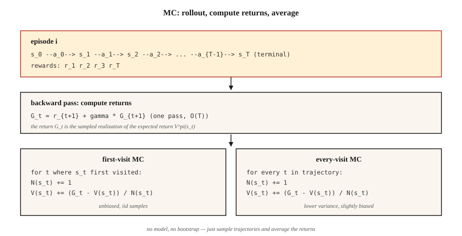

# Metode Monte Carlo — Belajar dari Episode Lengkap

> Pemrograman dinamis membutuhkan model. Monte Carlo tidak membutuhkan apa pun selain episode. Jalankan kebijakannya, amati imbal hasilnya, rata-ratakan. Ide paling sederhana dalam RL — dan ide yang membuka segala hal di hilirnya.

**Jenis:** Bangun
**Bahasa:** Python, TypeScript
**Prasyarat:** Fase 9 · 01 (MDP), Fase 9 · 02 (Pemrograman Dinamis)
**Waktu:** ~75 menit

## Masalah

Pemrograman dinamis itu elegan, tetapi ia mengasumsikan Anda dapat mengkueri $P(s' \mid s, a)$ untuk setiap keadaan dan aksi. Hampir tidak ada hal di dunia nyata yang bekerja seperti itu. Sebuah robot tidak dapat menghitung secara analitik distribusi atas piksel kamera setelah torsi sendi. Sebuah algoritma penentuan harga tidak dapat mengintegrasikan setiap kemungkinan reaksi pelanggan. Sebuah LLM tidak dapat enumerasi semua kelanjutan yang mungkin setelah sebuah token.

Anda membutuhkan metode yang hanya membutuhkan kemampuan untuk mengambil *sampel* dari lingkungan. Jalankan kebijakannya. Dapatkan trajektori `s_0, a_0, r_1, s_1, a_1, r_2, …, s_T`. Gunakan itu untuk mengestimasi nilai. Itulah Monte Carlo.

Pergeseran dari DP ke MC penting secara filosofis: kita beralih dari *model diketahui + backup eksak* ke *rollout bersampel + imbal hasil yang dirata-ratakan*. Varians melonjak, tetapi aplikabilitasnya meledak. Setiap algoritma RL setelah pelajaran ini — TD, Q-learning, REINFORCE, PPO, GRPO — pada dasarnya adalah estimator Monte Carlo, kadang dengan bootstrap ditumpuk di atasnya.

## Konsep



**Ide intinya, dalam satu baris:** $V^\pi(s) = \mathbb E_\pi[G_t \mid s_t = s] \approx (1/N) \sum_i G^{(i)}(s)$ di mana $G^{(i)}(s)$ adalah imbal hasil yang diamati setelah kunjungan ke $s$ di bawah kebijakan $\pi$.

**MC first-visit versus every-visit.** Diberi sebuah episode yang mengunjungi keadaan $s$ beberapa kali, MC first-visit hanya menghitung imbal hasil dari kunjungan pertama; MC every-visit menghitung semua kunjungan. MC first-visit tidak bias. MC every-visit dapat sedikit bias setelah sejumlah episode hingga, karena ia merata-ratakan jumlah imbal hasil yang acak per episode dan jumlah itu dapat berkorelasi dengan imbal hasilnya, tetapi keduanya konvergen ke $V^\pi(s)$ saat jumlah kunjungan menuju tak hingga. First-visit lebih sederhana dianalisis (sampel iid). Every-visit memakai lebih banyak data per episode dan biasanya konvergen lebih cepat dalam praktik.

**Rerata inkremental.** Alih-alih menyimpan semua imbal hasil, perbarui rata-rata berjalan:

```math
V_n(s) = V_{n-1}(s) + (1/n) [G_n - V_{n-1}(s)]
```

Susun ulang: $V_{\text{new}} = V_{\text{old}} + \alpha \cdot (\text{target} - V_{\text{old}})$ dengan $\alpha = 1/n$. Ganti $1/n$ dengan ukuran langkah konstan $\alpha \in (0, 1)$ dan Anda mendapat estimator MC non-stasioner yang melacak perubahan pada $\pi$. Pergeseran itulah lompatan utuh dari MC ke TD ke setiap algoritma RL modern.

**Eksplorasi sekarang menjadi masalah.** DP menyentuh setiap keadaan melalui enumerasi. MC hanya melihat keadaan yang dikunjungi kebijakan. Jika $\pi$ deterministik, seluruh wilayah ruang keadaan tidak pernah diambil sampelnya, dan estimasi nilainya tetap nol selamanya. Tiga perbaikan, menurut urutan historis:

1. **Titik awal eksploratif (exploring starts).** Mulai setiap episode dari pasangan (s, a) acak. Menjamin cakupan; tidak realistis dalam praktik (Anda tidak dapat "mengatur ulang" robot ke keadaan sembarangan).
2. **ε-greedy.** Bertindak serakah terhadap Q saat ini, tetapi dengan probabilitas $\epsilon$ pilih aksi acak. Semua pasangan keadaan-aksi akhirnya diambil sampelnya secara asimptotik.
3. **MC off-policy.** Kumpulkan data di bawah kebijakan perilaku $\mu$, pelajari kebijakan target $\pi$ melalui importance sampling. Varians tinggi, tetapi inilah jembatan menuju metode buffer replay seperti DQN.

**Kontrol Monte Carlo.** Evaluasi → perbaiki → evaluasi, seperti iterasi kebijakan, tetapi evaluasinya berbasis sampel:

1. Jalankan $\pi$, dapatkan sebuah episode.
2. Perbarui $Q(s, a)$ dari imbal hasil yang diamati.
3. Buat $\pi$ ε-greedy terhadap $Q$.
4. Ulangi.

Konvergen ke $Q^{\ast}$ dan $\pi^{\ast}$ dengan probabilitas 1 di bawah kondisi ringan (setiap pasangan dikunjungi tak terhingga seringnya, $\alpha$ memenuhi Robbins-Monro).

```figure
epsilon-greedy
```

## Bangun

### Langkah 1: rollout → daftar (s, a, r)

```python
def rollout(env, policy, max_steps=200):
    trajectory = []
    s = env.reset()
    for _ in range(max_steps):
        a = policy(s)
        s_next, r, done = env.step(s, a)
        trajectory.append((s, a, r))
        s = s_next
        if done:
            break
    return trajectory
```

Tanpa model, hanya `env.reset()` dan `env.step(s, a)`. Antarmuka yang sama seperti lingkungan gym, tetapi disederhanakan.

### Langkah 2: hitung imbal hasil (sapuan mundur)

```python
def returns_from(trajectory, gamma):
    returns = []
    G = 0.0
    for _, _, r in reversed(trajectory):
        G = r + gamma * G
        returns.append(G)
    return list(reversed(returns))
```

Satu lintasan, $O(T)$. Rekursi mundur $G_t = r_{t+1} + \gamma G_{t+1}$ menghindari penjumlahan ulang.

### Langkah 3: evaluasi kebijakan MC first-visit

```python
def mc_policy_evaluation(env, policy, episodes, gamma=0.99):
    V = defaultdict(float)
    counts = defaultdict(int)
    for _ in range(episodes):
        trajectory = rollout(env, policy)
        returns = returns_from(trajectory, gamma)
        seen = set()
        for t, ((s, _, _), G) in enumerate(zip(trajectory, returns)):
            if s in seen:
                continue
            seen.add(s)
            counts[s] += 1
            V[s] += (G - V[s]) / counts[s]
    return V
```

Tiga baris yang melakukan pekerjaan: tandai keadaan sebagai sudah terlihat pada kunjungan pertama, tambah penghitung, perbarui rerata berjalan.

### Langkah 4: kontrol MC ε-greedy (on-policy)

```python
def mc_control(env, episodes, gamma=0.99, epsilon=0.1):
    Q = defaultdict(lambda: {a: 0.0 for a in ACTIONS})
    counts = defaultdict(lambda: {a: 0 for a in ACTIONS})

    def policy(s):
        if random() < epsilon:
            return choice(ACTIONS)
        return max(Q[s], key=Q[s].get)

    for _ in range(episodes):
        trajectory = rollout(env, policy)
        returns = returns_from(trajectory, gamma)
        seen = set()
        for (s, a, _), G in zip(trajectory, returns):
            if (s, a) in seen:
                continue
            seen.add((s, a))
            counts[s][a] += 1
            Q[s][a] += (G - Q[s][a]) / counts[s][a]
    return Q, policy
```

### Langkah 5: bandingkan dengan standar emas DP

Estimasi MC Anda untuk $V^\pi$ harus sepakat dengan hasil DP dari Pelajaran 02 saat episode → ∞. Dalam praktik: 50.000 episode pada GridWorld 4×4 membuat Anda berada dalam `~0.1` dari jawaban DP.

## Jebakan

- **Episode tak hingga.** MC mensyaratkan episode *berakhir*. Jika kebijakan Anda dapat berputar selamanya, batasi `max_steps` dan perlakukan batas itu sebagai kegagalan implisit. GridWorld dengan kebijakan acak rutin mengalami timeout — itu normal, pastikan Anda menghitungnya dengan benar.
- **Varians.** MC memakai imbal hasil penuh. Pada episode panjang, varians sangat besar — satu hadiah yang tidak beruntung di akhir menggeser $V(s_0)$ dengan jumlah yang sama. Metode TD (Pelajaran 04) memotongnya dengan bootstrap.
- **Cakupan keadaan.** MC serakah pada Q yang masih baru dan memiliki ikatan hanya akan mencoba satu aksi. Anda *harus* eksplorasi (ε-greedy, exploring starts, UCB).
- **Kebijakan non-stasioner.** Jika $\pi$ berubah (seperti pada kontrol MC), imbal hasil lama berasal dari kebijakan yang berbeda. MC α-konstan menangani ini; MC rata-rata-sampel tidak.
- **Importance sampling off-policy.** Bobot $\pi(a \mid s)/\mu(a \mid s)$ saling mengalikan sepanjang trajektori. Varians meledak seiring horizon. Batasi dengan IS per-decision berbobot atau beralih ke TD.

## Pakai

Peran metode Monte Carlo di 2026:

| Kasus penggunaan | Mengapa MC |
|------------------|------------|
| Permainan ber-horizon pendek (blackjack, poker) | Episode berakhir secara alami; imbal hasil bersih. |
| Evaluasi offline dari kebijakan yang dicatat | Rata-ratakan imbal hasil diskonto atas trajektori yang tersimpan. |
| Monte Carlo Tree Search (AlphaZero) | Rollout MC dari daun pohon memandu seleksi. |
| Evaluasi RL LLM | Hitung hadiah rata-rata atas penyelesaian yang diambil sampelnya untuk kebijakan tertentu. |
| Estimasi baseline dalam PPO | Target keuntungan $A_t = G_t - V(s_t)$ memakai $G_t$ dari MC. |
| Mengajar RL | Algoritma paling sederhana yang benar-benar bekerja — buang bootstrap untuk melihat intinya. |

Algoritma deep-RL modern (PPO, SAC) berada di antara MC murni (imbal hasil penuh) dan TD murni (bootstrap satu langkah) melalui imbal hasil $n$-step atau GAE. Kedua ujung adalah instance dari estimator yang sama.

## Kirim

Simpan sebagai `outputs/skill-mc-evaluator.md`:

```markdown
---
name: mc-evaluator
description: Evaluasi kebijakan melalui rollout Monte Carlo dan hasilkan laporan konvergensi dengan perbandingan DP jika tersedia.
version: 1.0.0
phase: 9
lesson: 3
tags: [rl, monte-carlo, evaluation]
---

Diketahui lingkungan (episodik, dengan API reset+step) dan sebuah kebijakan, keluarkan:

1. Metode. MC first-visit versus every-visit. Alasannya.
2. Anggaran episode. Jumlah target, diagnostik varians, kesalahan standar yang diharapkan.
3. Rencana eksplorasi. Jadwal ε (jika perlu) atau exploring starts.
4. Perbandingan standar emas. V* optimal-DP jika tabular; jika tidak, batas dari baseline Q-learning / PPO.
5. Pemeriksaan penghentian. Batas max-step, timeout, penanganan trajektori yang tidak berhenti.

Tolak menjalankan MC pada tugas non-episodik tanpa batas horizon hingga. Tolak melaporkan estimasi V^π dari kurang dari 100 episode per keadaan untuk tugas tabular. Tandai kebijakan apa pun dengan aksi varians-nol sebagai risiko eksplorasi.
```

## Latihan

1. **Mudah.** Implementasikan evaluasi MC first-visit untuk kebijakan acak seragam pada GridWorld 4×4. Jalankan 10.000 episode. Plotkan $V(0,0)$ sebagai fungsi jumlah episode terhadap jawaban DP.
2. **Sedang.** Implementasikan kontrol MC ε-greedy dengan $\epsilon \in \lbrace 0.01, 0.1, 0.3 \rbrace$. Bandingkan imbal hasil rerata setelah 20.000 episode. Seperti apa bentuk kurvanya? Di mana letak trade-off bias-varians?
3. **Sulit.** Implementasikan MC *off-policy* dengan importance sampling: kumpulkan data di bawah kebijakan acak seragam $\mu$, estimasi $V^\pi$ untuk kebijakan optimal deterministik $\pi$. Bandingkan IS polos versus IS per-decision versus IS berbobot. Mana yang variansnya paling rendah?

## Istilah Kunci

| Istilah | Yang orang katakan | Arti sebenarnya |
|---------|--------------------|-----------------|
| Monte Carlo | "Pengambilan sampel acak" | Estimasi ekspektasi dengan merata-ratakan sampel iid dari distribusi. |
| Imbal hasil $G_t$ | "Hadiah masa depan" | Jumlah hadiah diskonto dari langkah $t$ hingga akhir episode: $\sum_{k\ge 0} \gamma^k r_{t+k+1}$. |
| MC first-visit | "Hitung setiap keadaan sekali" | Hanya kunjungan pertama dalam episode yang menyumbang pada estimasi nilai. |
| MC every-visit | "Pakai semua kunjungan" | Setiap kunjungan menyumbang; sedikit bias untuk sampel hingga, konsisten pada limit, dan lebih hemat sampel. |
| ε-greedy | "Derau eksplorasi" | Pilih aksi serakah dengan prob $1-\epsilon$; aksi acak dengan prob $\epsilon$. |
| Importance sampling | "Koreksi karena mengambil sampel dari distribusi yang salah" | Berbobot ulang imbal hasil dengan produk $\pi(a \mid s)/\mu(a \mid s)$ untuk mengestimasi $V^\pi$ dari data $\mu$. |
| On-policy | "Belajar dari data saya sendiri" | Kebijakan target = kebijakan perilaku. MC vanilla, PPO, SARSA. |
| Off-policy | "Belajar dari data orang lain" | Kebijakan target ≠ kebijakan perilaku. MC importance-sampled, Q-learning, DQN. |

## Bacaan Lanjutan

- [Sutton & Barto (2018). Bab 5 — Monte Carlo Methods](http://incompleteideas.net/book/RLbook2020.pdf) — sajian kanonik.
- [Singh & Sutton (1996). Reinforcement Learning with Replacing Eligibility Traces](https://link.springer.com/article/10.1007/BF00114726) — analisis first-visit versus every-visit.
- [Precup, Sutton, Singh (2000). Eligibility Traces for Off-Policy Policy Evaluation](http://incompleteideas.net/papers/PSS-00.pdf) — MC off-policy dan kontrol varians.
- [Mahmood et al. (2014). Weighted Importance Sampling for Off-Policy Learning](https://arxiv.org/abs/1404.6362) — estimator IS modern ber-varians rendah.
- [Tesauro (1995). TD-Gammon, A Self-Teaching Backgammon Program](https://dl.acm.org/doi/10.1145/203330.203343) — demonstrasi empiris berskala besar pertama bahwa self-play MC/TD konvergen ke permainan di atas level manusia; pendahulu konseptual dari setiap pelajaran di paruh kedua fase ini.
