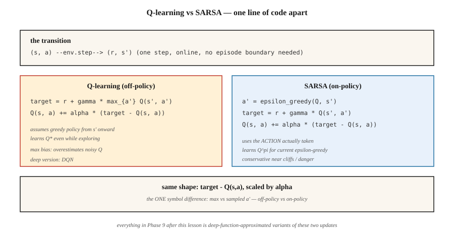

# Perbedaan Temporal — Q-Learning & SARSA

> Monte Carlo menunggu sampai episode berakhir. TD memperbarui setelah setiap langkah dengan melakukan bootstrap pada estimasi nilai berikutnya. Q-learning bersifat off-policy dan optimistis; SARSA bersifat on-policy dan konservatif. Keduanya hanya satu baris kode. Keduanya menjadi fondasi setiap metode deep-RL di fase ini.

**Jenis:** Bangun
**Bahasa:** Python, TypeScript
**Prasyarat:** Fase 9 · 01 (MDP), Fase 9 · 02 (Pemrograman Dinamis), Fase 9 · 03 (Monte Carlo)
**Waktu:** ~75 menit

## Masalah

Monte Carlo bekerja, tetapi ia memiliki dua tuntutan yang mahal. Ia membutuhkan episode yang berakhir, dan ia hanya memperbarui setelah imbal hasil akhir masuk. Jika episode Anda berlangsung 1.000 langkah, MC menunggu 1.000 langkah untuk memperbarui apa pun. Variansnya tinggi, biasnya rendah, dan lambat dalam praktik.

Pemrograman dinamis memiliki profil yang kebalikan — backup bootstrap dengan varians nol — tetapi membutuhkan model yang diketahui.

Pembelajaran perbedaan temporal (TD) mengambil jalan tengah. Dari satu transisi $(s, a, r, s')$, bentuk target satu langkah $r + \gamma V(s')$ dan dorong $V(s)$ ke arahnya. Tanpa model. Tanpa episode lengkap. Ada bias karena memakai $V$ aproksimat di ruas kanan, tetapi variansnya jauh lebih rendah daripada MC dan pembaruannya terjadi secara online sejak langkah pertama.

Inilah poros tempat berputarnya seluruh RL modern — DQN, A2C, PPO, SAC. Sisa Fase 9 adalah lapisan aproksimasi fungsi dan trik yang dibangun di atas pembaruan TD satu langkah yang akan Anda tulis di pelajaran ini.

## Konsep



**Pembaruan TD(0) untuk V:**

```math
V(s) \leftarrow V(s) + \alpha [r + \gamma V(s') - V(s)]
```

Besaran di dalam kurung adalah error TD $\delta = r + \gamma V(s') - V(s)$. Ia adalah analog online dari $G_t - V(s_t)$ dalam MC. Konvergensi mensyaratkan $\alpha$ memenuhi Robbins-Monro ($\sum \alpha = \infty$, $\sum \alpha^2 < \infty$) dan semua keadaan dikunjungi tak terhingga seringnya.

**Q-learning.** Metode TD off-policy untuk kontrol:

```math
Q(s, a) \leftarrow Q(s, a) + \alpha [r + \gamma \max_{a'} Q(s', a') - Q(s, a)]
```

`max` mengasumsikan kebijakan *serakah* akan diikuti dari $s'$ dan seterusnya, apa pun aksi yang benar-benar diambil agen. Keterpisangan itu membuat Q-learning mempelajari $Q^{\ast}$ sementara agen bereksplorasi melalui ε-greedy. Mnih et al. (2015) mengubahnya menjadi deep Q-learning pada Atari (Pelajaran 05).

**SARSA.** Metode TD on-policy:

```math
Q(s, a) \leftarrow Q(s, a) + \alpha [r + \gamma Q(s', a') - Q(s, a)]
```

Namanya adalah tupel $(s, a, r, s', a')$. SARSA memakai aksi $a'$ yang *benar-benar* diambil agen berikutnya, bukan `argmax` serakah. Konvergen ke $Q^\pi$ untuk kebijakan ε-greedy $\pi$ yang berjalan, yang pada limit $\epsilon \to 0$ menjadi $Q^{\ast}$.

**Perbedaan cliff-walking.** Pada tugas cliff-walking klasik (jatuh dari tebing = hadiah -100), Q-learning mempelajari jalur optimal di sepanjang tepi tebing tetapi sesekali menerima penalti saat eksplorasi. SARSA mempelajari jalur yang lebih aman selangkah menjauh dari tebing karena ia memperhitungkan derau eksplorasi ke dalam nilai-Q-nya. Dengan pelatihan, keduanya mencapai optimal saat $\epsilon \to 0$. Dalam praktik hal ini penting: ketika eksplorasi benar-benar berlangsung saat deployment, perilaku SARSA lebih konservatif.

**Expected SARSA.** Ganti $Q(s', a')$ dengan nilai ekspektasinya di bawah $\pi$:

```math
Q(s, a) \leftarrow Q(s, a) + \alpha [r + \gamma \sum_{a'} \pi(a' \mid s') Q(s', a') - Q(s, a)]
```

Varians lebih rendah daripada SARSA (tidak ada sampel $a'$), dengan target on-policy yang sama. Sering menjadi pilihan default dalam buku teks modern.

**n-step TD dan TD(λ).** Berada di antara TD(0) dan MC dengan menunggu $n$ langkah sebelum bootstrap. $n=1$ adalah TD, $n=\infty$ adalah MC. TD(λ) merata-ratakan semua $n$ dengan bobot geometris $(1-\lambda)\lambda^{n-1}$. Kebanyakan deep-RL memakai $n$ antara 3 dan 20.

```figure
qlearning-gridworld
```

## Bangun

### Langkah 1: SARSA pada kebijakan ε-greedy

```python
def sarsa(env, episodes, alpha=0.1, gamma=0.99, epsilon=0.1):
    Q = defaultdict(lambda: {a: 0.0 for a in ACTIONS})

    def choose(s):
        if random() < epsilon:
            return choice(ACTIONS)
        return max(Q[s], key=Q[s].get)

    for _ in range(episodes):
        s = env.reset()
        a = choose(s)
        while True:
            s_next, r, done = env.step(s, a)
            a_next = choose(s_next) if not done else None
            target = r + (gamma * Q[s_next][a_next] if not done else 0.0)
            Q[s][a] += alpha * (target - Q[s][a])
            if done:
                break
            s, a = s_next, a_next
    return Q
```

Delapan baris. Satu-satunya perbedaan dengan Q-learning adalah baris target.

### Langkah 2: Q-learning

```python
def q_learning(env, episodes, alpha=0.1, gamma=0.99, epsilon=0.1):
    Q = defaultdict(lambda: {a: 0.0 for a in ACTIONS})
    for _ in range(episodes):
        s = env.reset()
        while True:
            a = choose(s, Q, epsilon)
            s_next, r, done = env.step(s, a)
            target = r + (gamma * max(Q[s_next].values()) if not done else 0.0)
            Q[s][a] += alpha * (target - Q[s][a])
            if done:
                break
            s = s_next
    return Q
```

`max` memisahkan target dari perilaku. Simbol itulah yang membedakan on-policy dan off-policy.

### Langkah 3: kurva pembelajaran

Lacak imbal hasil rerata per 100 episode. Q-learning konvergen lebih cepat pada GridWorld deterministik sederhana; SARSA lebih konservatif pada cliff-walking. Pada GridWorld 4×4 di `code/main.py`, keduanya hampir optimal setelah ~2.000 episode dengan $\alpha=0.1, \epsilon=0.1$.

### Langkah 4: bandingkan dengan kebenaran DP

Jalankan iterasi nilai (Pelajaran 02) untuk mendapatkan $Q^{\ast}$. Periksa $\max_{s,a} \lvert Q_{\text{learned}}(s,a) - Q^{\ast}(s,a) \rvert$. Agen tabular TD yang sehat berada dalam `~0.5` pada GridWorld 4×4 setelah 10.000 episode.

## Jebakan

- **Nilai-Q awal itu penting.** Inisialisasi optimistik ($Q = 0$ untuk tugas dengan hadiah negatif) mendorong eksplorasi. Inisialisasi pesimistik dapat menjebak kebijakan serakah selamanya.
- **Jadwal α.** α konstan tidak masalah untuk masalah non-stasioner. Peluruhan $\alpha_n = 1/n$ memberikan konvergensi secara teori tetapi terlalu lambat dalam praktik — kunci $\alpha$ di `[0.05, 0.3]` dan pantau kurva pembelajaran.
- **Jadwal ε.** Mulai dari nilai tinggi ($\epsilon=1.0$), lalu peluruhan ke $\epsilon=0.05$. "GLIE" (greedy in the limit with infinite exploration) adalah kondisi konvergensi.
- **Bias-max dalam Q-learning.** Operator `max` bias ke atas ketika $Q$ bising. Hal ini menyebabkan overestimasi — Double Q-learning dari Hasselt (dipakai oleh DDQN di Pelajaran 05) memperbaikinya dengan dua tabel Q.
- **Episode yang tidak berhenti.** TD dapat belajar tanpa keadaan terminal, tetapi Anda harus membatasi langkah atau menangani bootstrap dengan benar pada batas tersebut. Standarnya: perlakukan batas sebagai non-terminal dan terus lakukan bootstrap.
- **Hashing keadaan.** Jika keadaan berupa tuple/tensor, gunakan kunci yang dapat di-hash (tuple, bukan list; tuple dari float yang dibulatkan, bukan yang mentah).

## Pakai

Lanskap TD di 2026:

| Tugas | Metode | Alasan |
|-------|--------|--------|
| Lingkungan tabular kecil | Q-learning | Memelajari kebijakan optimal secara langsung. |
| On-policy, kritis terhadap keselamatan | SARSA / Expected SARSA | Konservatif selama eksplorasi. |
| Keadaan berdimensi tinggi | DQN (Fase 9 · 05) | Fungsi-Q jaringan saraf dengan replay dan jaringan target. |
| Aksi kontinu | SAC / TD3 (Fase 9 · 07) | Pembaruan TD pada jaringan-Q; jaringan kebijakan menghasilkan aksi. |
| RL LLM (berbasis model hadiah) | PPO / GRPO (Fase 9 · 08, 12) | Actor-critic dengan keuntungan gaya TD melalui GAE. |
| RL offline | CQL / IQL (Fase 9 · 08) | Q-learning dengan regularisasi konservatif. |

Sembilan puluh persen dari "RL" yang Anda baca di makalah 2026 adalah elaborasi dari Q-learning atau SARSA. Pahami pembaruan tabular ini sampai ke jari-jari Anda sendiri sebelum membaca lebih dalam.

## Kirim

Simpan sebagai `outputs/skill-td-agent.md`:

```markdown
---
name: td-agent
description: Pilih antara Q-learning, SARSA, Expected SARSA untuk tugas RL tabular atau berfitur kecil.
version: 1.0.0
phase: 9
lesson: 4
tags: [rl, td-learning, q-learning, sarsa]
---

Diketahui lingkungan tabular atau berfitur kecil, keluarkan:

1. Algoritma. Q-learning / SARSA / Expected SARSA / varian n-step. Alasan satu kalimat yang dikaitkan dengan on-policy versus off-policy dan varians.
2. Hiperparameter. α, γ, ε, jadwal peluruhan.
3. Inisialisasi. Nilai Q_0 (optimistik versus nol) dan justifikasinya.
4. Diagnostik konvergensi. Kurva pembelajaran target, pemeriksaan `|Q - Q*|` jika DP memungkinkan.
5. Catatan deployment. Bagaimana eksplorasi akan berperilaku saat inferensi? Apakah konservatisme SARSA diperlukan?

Tolak menerapkan TD tabular pada ruang keadaan > 10⁶. Tolak mengirim agen Q-learning tanpa catatan bias-max. Tandai agen apa pun yang dilatih dengan ε tetap 1.0 sepanjang waktu (tanpa fase eksploitasi).
```

## Latihan

1. **Mudah.** Implementasikan Q-learning dan SARSA pada GridWorld 4×4. Plotkan kurva pembelajaran (imbal hasil rerata per 100 episode) selama 2.000 episode. Mana yang konvergen lebih cepat?
2. **Sedang.** Bangun lingkungan cliff-walking (4×12, baris terakhir adalah tebing dengan hadiah -100 dan pengaturan ulang ke awal). Bandingkan kebijakan akhir Q-learning dan SARSA. Ambil tangkapan layar jalur yang diambil masing-masing. Mana yang lebih dekat ke tebing?
3. **Sulit.** Implementasikan Double Q-learning. Pada GridWorld dengan hadiah bising (derau Gaussian $\sigma=5$ ditambahkan pada hadiah per langkah), tunjukkan bahwa Q-learning mengestimasi $V^{\ast}(0,0)$ secara berlebihan dengan jumlah yang signifikan sementara Double Q-learning tidak.

## Istilah Kunci

| Istilah | Yang orang katakan | Arti sebenarnya |
|---------|--------------------|-----------------|
| Error TD | "Sinyal pembaruan" | $\delta = r + \gamma V(s') - V(s)$, residual bootstrap. |
| TD(0) | "TD satu langkah" | Perbarui setelah setiap transisi dengan hanya memakai estimasi keadaan berikutnya. |
| Q-learning | "RL off-policy 101" | Pembaruan TD dengan `max` atas aksi keadaan berikutnya; memelajari $Q^{\ast}$ terlepas dari kebijakan perilaku. |
| SARSA | "Q-learning on-policy" | Pembaruan TD dengan aksi berikutnya yang aktual; memelajari $Q^\pi$ untuk π ε-greedy saat ini. |
| Expected SARSA | "SARSA ber-varians rendah" | Ganti $a'$ yang diambil sampelnya dengan ekspektasinya di bawah π. |
| GLIE | "Jadwal eksplorasi yang benar" | Greedy in the Limit with Infinite Exploration; diperlukan untuk konvergensi Q-learning. |
| Bootstrap | "Memakai estimasi saat ini dalam target" | Yang membedakan TD dari MC. Sumber bias, tetapi pengurangan varians yang besar. |
| Bias maksimalisasi | "Q-learning mengestimasi terlalu tinggi" | `max` atas estimasi bising bersifat bias ke atas; diperbaiki oleh Double Q-learning. |

## Bacaan Lanjutan

- [Watkins & Dayan (1992). Q-learning](https://link.springer.com/article/10.1007/BF00992698) — makalah asli dan bukti konvergensi.
- [Sutton & Barto (2018). Bab 6 — Temporal-Difference Learning](http://incompleteideas.net/book/RLbook2020.pdf) — TD(0), SARSA, Q-learning, Expected SARSA.
- [Hasselt (2010). Double Q-learning](https://papers.nips.cc/paper_files/paper/2010/hash/091d584fced301b442654dd8c23b3fc9-Abstract.html) — perbaikan untuk bias maksimalisasi.
- [Seijen, Hasselt, Whiteson, Wiering (2009). A Theoretical and Empirical Analysis of Expected SARSA](https://ieeexplore.ieee.org/document/4927542) — motivasi expected SARSA.
- [Rummery & Niranjan (1994). On-line Q-learning using connectionist systems](https://www.researchgate.net/publication/2500611_On-Line_Q-Learning_Using_Connectionist_Systems) — makalah yang menciptakan nama SARSA (dulu disebut "modified connectionist Q-learning").
- [Sutton & Barto (2018). Bab 7 — n-step Bootstrapping](http://incompleteideas.net/book/RLbook2020.pdf) — menggeneralisasi TD(0) menjadi TD(n), jalan dari Q-learning ke eligibility traces dan, kemudian, GAE dalam PPO.
