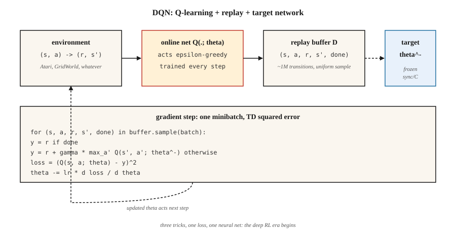

# Deep Q-Networks (DQN)

> 2013: Mnih melatih satu jaringan Q-learning pada piksel mentah dan mengalahkan setiap agen RL klasik pada tujuh permainan Atari. 2015: diperluas ke 49 permainan, dipublikasikan di Nature, memicu era deep-RL. DQN adalah Q-learning plus tiga trik yang membuat aproksimasi fungsi menjadi stabil.

**Jenis:** Bangun
**Bahasa:** Python, TypeScript
**Prasyarat:** Fase 3 · 03 (Propagasi Balik), Fase 9 · 04 (Q-learning, SARSA)
**Waktu:** ~75 menit

## Masalah

Q-learning tabular membutuhkan nilai-Q terpisah untuk setiap pasangan (keadaan, aksi). Sebuah papan catur memiliki ~10⁴³ keadaan. Satu frame Atari adalah 210×160×3 = 100.800 fitur. RL tabular mati pada ribuan keadaan, apalagi miliaran.

Perbaikannya jelas secara retrospektif: ganti tabel-Q dengan jaringan saraf, $Q(s, a; \theta)$. Tetapi "jelas secara retrospektif" membutuhkan berpuluh-puluh tahun. Aproksimasi fungsi naif dengan Q-learning menyimpang di bawah "triad mematikan" — aproksimasi fungsi + bootstrap + pembelajaran off-policy. Mnih et al. (2013, 2015) mengidentifikasi tiga trik rekayasa yang menstabilisasi pembelajaran:

1. **Replay pengalaman (experience replay)** mendekorelasi transisi.
2. **Jaringan target** membekukan target bootstrap.
3. **Pemotongan hadiah (reward clipping)** menormalkan magnitudo gradien.

DQN pada Atari adalah kali pertama sebuah arsitektur tunggal dengan satu set hiperparameter menyelesaikan puluhan masalah kontrol dari piksel mentah. Segala hal "deep-RL" yang dibangun sejak saat itu — DDQN, Rainbow, Dueling, Distributional, R2D2, Agent57 — ditumpuk di atas basis tiga trik ini.

## Konsep



**Tujuannya.** DQN meminimalkan loss TD satu langkah pada fungsi-Q saraf:

```math
L(\theta) = \mathbb{E}_{(s,a,r,s') \sim D}[ (r + \gamma \max_{a'} Q(s', a'; \theta^-) - Q(s, a; \theta))^2 ]
```

$\theta$ = jaringan online, diperbarui setiap langkah oleh gradient descent. $\theta^-$ = jaringan target, disalin secara periodik dari $\theta$ (setiap ~10.000 langkah). $D$ = buffer replay dari transisi masa lalu.

**Ketiga trik, menurut urutan kepentingannya:**

**Replay pengalaman.** Buffer melingkar berisi `~10⁶` transisi. Setiap langkah pelatihan mengambil minibatch secara acak seragam. Ini memutus korelasi temporal (frame berurutan hampir identik), memungkinkan jaringan belajar berulang kali dari transisi langka yang menguntungkan, dan mendekorelasi pembaruan gradien yang berurutan. Tanpa itu, TD on-policy dengan jaringan saraf menyimpang pada Atari.

**Jaringan target.** Memakai jaringan yang sama $Q(\cdot; \theta)$ di kedua ruas persamaan Bellman membuat target bergerak pada setiap pembaruan — "mengejar ekor sendiri." Perbaikannya: simpan jaringan kedua $Q(\cdot; \theta^-)$ dengan bobot beku. Setiap $C$ langkah, salin $\theta \to \theta^-$. Ini menstabilisasi target regresi selama ribuan langkah gradien sekaligus. Pembaruan lunak $\theta^- \leftarrow \tau \theta + (1-\tau) \theta^-$ (dipakai dalam DDPG, SAC) adalah varian yang lebih halus.

**Pemotongan hadiah.** Magnitudo hadiah Atari berkisar dari 1 sampai 1000+. Memotong menjadi $\lbrace-1, 0, +1 \rbrace$ mencegah satu permainan mendominasi gradien. Salah ketika magnitudo hadiah memang penting; tidak masalah untuk Atari yang hanya peduli tanda.

**Double DQN.** Hasselt (2016) memperbaiki bias maksimalisasi: pakai jaringan online untuk *memilih* aksi, jaringan target untuk *mengevaluasinya*.

```math
\text{target} = r + \gamma Q(s', \arg\max_{a'} Q(s', a'; \theta); \theta^-)
```

Pengganti drop-in, secara konsisten lebih baik. Pakai sebagai default.

**Penyempurnaan lain (Rainbow, 2017):** prioritized replay (ambil sampel transisi dengan error-TD tinggi lebih sering), arsitektur dueling (head $V(s)$ dan advantage terpisah), noisy networks (eksplorasi yang dipelajari), imbal hasil n-step, Q distribusional (C51/QR-DQN), bootstrap multi-langkah. Masing-masing menambah beberapa persen; keuntungannya kurang lebih bersifat aditif.

```figure
f3-dqn-stability
```

## Bangun

Kode di sini hanya memakai stdlib dan tanpa numpy — kita menggunakan MLP satu lapisan tersembunyi buatan sendiri pada GridWorld kontinu kecil, sehingga setiap langkah pelatihan berjalan dalam mikrodetik. Algoritmanya identik dengan DQN Atari pada skala penuh.

### Langkah 1: buffer replay

```python
class ReplayBuffer:
    def __init__(self, capacity):
        self.buf = []
        self.capacity = capacity
    def push(self, s, a, r, s_next, done):
        if len(self.buf) == self.capacity:
            self.buf.pop(0)
        self.buf.append((s, a, r, s_next, done))
    def sample(self, batch, rng):
        return rng.sample(self.buf, batch)
```

Kapasitas ~10⁶ untuk Atari, seperti pada DQN asli (ia mengumpulkan 50.000 transisi sebelum pembelajaran dimulai); 5.000 sudah cukup untuk lingkungan mainan kita.

### Langkah 2: jaringan-Q kecil (MLP manual)

```python
class QNet:
    def __init__(self, n_in, n_hidden, n_actions, rng):
        self.W1 = [[rng.gauss(0, 0.3) for _ in range(n_in)] for _ in range(n_hidden)]
        self.b1 = [0.0] * n_hidden
        self.W2 = [[rng.gauss(0, 0.3) for _ in range(n_hidden)] for _ in range(n_actions)]
        self.b2 = [0.0] * n_actions
    def forward(self, x):
        h = [max(0.0, sum(w * xi for w, xi in zip(row, x)) + b) for row, b in zip(self.W1, self.b1)]
        q = [sum(w * hi for w, hi in zip(row, h)) + b for row, b in zip(self.W2, self.b2)]
        return q, h
```

Forward pass: linear → ReLU → linear. Itu seluruh jaringannya.

### Langkah 3: pembaruan DQN

```python
def train_step(online, target, batch, gamma, lr):
    grads = zeros_like(online)
    for s, a, r, s_next, done in batch:
        q, h = online.forward(s)
        if done:
            y = r
        else:
            q_next, _ = target.forward(s_next)
            y = r + gamma * max(q_next)
        td_error = q[a] - y
        accumulate_grads(grads, online, s, h, a, td_error)
    apply_sgd(online, grads, lr / len(batch))
```

Bentuknya adalah Q-learning dari Pelajaran 04 dengan dua perbedaan: (a) kita melakukan propagasi balik melalui $Q(\cdot; \theta)$ yang diferensial alih-alih meng-indeks tabel, (b) target memakai $Q(\cdot; \theta^-)$.

### Langkah 4: loop luar

Untuk setiap episode, bertindak ε-greedy pada $Q(\cdot; \theta)$, masukkan transisi ke dalam buffer, ambil minibatch, lakukan satu langkah gradien, dan sesekali sinkronkan $\theta^- \leftarrow \theta$. Polanya:

```python
for episode in range(N):
    s = env.reset()
    while not done:
        a = epsilon_greedy(online, s, epsilon)
        s_next, r, done = env.step(s, a)
        buffer.push(s, a, r, s_next, done)
        if len(buffer) >= batch:
            train_step(online, target, buffer.sample(batch), gamma, lr)
        if steps % sync_every == 0:
            target = copy(online)
        s = s_next
```

Pada GridWorld mini kita dengan keadaan one-hot 16 dimensi, agen memelajari kebijakan hampir optimal dalam ~500 episode. Pada Atari, skalakan ini menjadi 200 juta frame dan tambahkan ekstraktor fitur CNN.

## Jebakan

- **Triad mematikan.** Aproksimasi fungsi + off-policy + bootstrap dapat menyimpang. DQN memitigasinya dengan jaringan target + replay; jangan hapus salah satunya.
- **Eksplorasi.** ε harus melurun, biasanya dari 1,0 ke 0,01 sekitar 10% pertama dari pelatihan. Tanpa eksplorasi awal yang cukup, jaringan-Q konvergen ke lembah lokal.
- **Overestimasi.** `max` atas Q yang bising bersifat bias ke atas. Selalu pakai Double DQN dalam produksi.
- **Skala hadiah.** Potong atau normalisasi hadiah; magnitudo gradien sebanding dengan magnitudo hadiah.
- **Start dingin buffer replay.** Jangan melatih sampai buffer memiliki beberapa ribu transisi. Gradien awal atas ~20 sampel mengalami overfitting.
- **Frekuensi sinkronisasi target.** Terlalu sering ≈ tidak ada jaringan target; terlalu jarang ≈ target basi. DQN Atari memakai 10.000 langkah lingkungan. Aturan praktisnya: sinkronkan setiap ~1/100 dari horizon pelatihan.
- **Praproses pengamatan.** DQN Atari menumpuk 4 frame agar keadaan menjadi Markov. Lingkungan apa pun yang memiliki informasi kecepatan membutuhkan penumpukan frame atau keadaan rekuren.

## Pakai

Di 2026, DQN jarang menjadi state-of-the-art tetapi tetap menjadi algoritma off-policy referensi:

| Tugas | Metode pilihan | Mengapa bukan DQN? |
|-------|----------------|--------------------|
| Mirip Atari dengan aksi diskrit | Rainbow DQN atau Muesli | Kerangka sama, lebih banyak trik. |
| Kontrol kontinu | SAC / TD3 (Fase 9 · 07) | DQN tidak memiliki jaringan kebijakan. |
| On-policy / throughput tinggi | PPO (Fase 9 · 08) | Tanpa buffer replay; lebih mudah diskalakan. |
| RL offline | CQL / IQL / Decision Transformer | Target-Q konservatif, tanpa ledakan bootstrap. |
| Ruang aksi diskrit besar (recommender) | DQN dengan action embedding, atau IMPALA | Boleh saja; dekorasi yang menentukan. |
| RL LLM | PPO / GRPO | Level sekuens, bukan level langkah; loss berbeda. |

Pelajaran ini tetap berlaku. Replay dan jaringan target muncul dalam SAC, TD3, DDPG, SAC-X, buffer self-play AlphaZero, dan setiap metode RL offline. Pemotongan hadiah hidup terus sebagai normalisasi keuntungan dalam PPO. Arsitekturnya adalah cetak birunya.

## Kirim

Simpan sebagai `outputs/skill-dqn-trainer.md`:

```markdown
---
name: dqn-trainer
description: Hasilkan konfigurasi pelatihan DQN (buffer, sinkronisasi target, jadwal ε, pemotongan hadiah) untuk tugas RL beraksi diskrit.
version: 1.0.0
phase: 9
lesson: 5
tags: [rl, dqn, deep-rl]
---

Diketahui lingkungan beraksi diskrit (bentuk pengamatan, jumlah aksi, horizon, skala hadiah), keluarkan:

1. Jaringan. Arsitektur (MLP / CNN / Transformer), dimensi fitur, kedalaman.
2. Buffer replay. Kapasitas, ukuran minibatch, ukuran pemanasan (warmup).
3. Jaringan target. Strategi sinkronisasi (hard setiap C langkah atau lunak τ).
4. Eksplorasi. ε awal / akhir / panjang jadwal.
5. Loss. Huber versus MSE, nilai pemotongan gradien, aturan pemotongan hadiah.
6. Double DQN. Aktif secara default kecuali ada alasan eksplisit untuk menonaktifkan.

Tolak mengirim DQN tanpa jaringan target, tanpa buffer replay, atau dengan ε yang tetap berada di 1. Tolak tugas beraksi kontinu (arahkan ke SAC / TD3). Tandai rentang hadiah > 10× rerata per langkah sebagai yang memerlukan pemotongan atau normalisasi skala.
```

## Latihan

1. **Mudah.** Jalankan `code/main.py`. Plotkan kurva imbal hasil per episode. Berapa episode sampai rerata berjalan melebihi -10?
2. **Sedang.** Nonaktifkan jaringan target (pakai jaringan online untuk kedua ruas target Bellman). Ukur ketidakstabilan pelatihan — apakah imbal hasil berosilasi atau menyimpang?
3. **Sulit.** Tambahkan Double DQN: pakai jaringan online untuk memilih `argmax a'`, jaringan target untuk mengevaluasinya. Bandingkan bias `Q(s_0, best_a)` terhadap $V^{\ast}(s_0)$ yang sejati setelah 1.000 episode dengan dan tanpa Double DQN pada GridWorld berhadiah bising.

## Istilah Kunci

| Istilah | Yang orang katakan | Arti sebenarnya |
|---------|--------------------|-----------------|
| DQN | "Deep Q-learning" | Q-learning dengan fungsi-Q saraf, buffer replay, dan jaringan target. |
| Replay pengalaman | "Transisi yang diacak" | Buffer melingkar yang diambil sampelnya secara seragam pada setiap langkah gradien; mendekorelasi data. |
| Jaringan target | "Bootstrap yang dibekukan" | Salinan Q secara periodik yang dipakai dalam target Bellman; menstabilisasi pelatihan. |
| Triad mematikan | "Mengapa RL menyimpang" | Aproksimasi fungsi + bootstrap + off-policy = tanpa jaminan konvergensi. |
| Double DQN | "Perbaikan bias maksimalisasi" | Jaringan online memilih aksi, jaringan target mengevaluasinya. |
| Dueling DQN | "Head V dan A" | Dekomposisi Q = V + A - mean(A); keluaran sama, aliran gradien lebih baik. |
| Rainbow | "Semua triknya" | DDQN + PER + dueling + n-step + noisy + distributional dalam satu. |
| PER | "Prioritized Replay" | Ambil sampel transisi sebanding dengan magnitudo error-TD. |

## Bacaan Lanjutan

- [Mnih et al. (2013). Playing Atari with Deep Reinforcement Learning](https://arxiv.org/abs/1312.5602) — makalah workshop NeurIPS 2013 yang memulai deep RL.
- [Mnih et al. (2015). Human-level control through deep reinforcement learning](https://www.nature.com/articles/nature14236) — makalah Nature, DQN 49 permainan.
- [Hasselt, Guez, Silver (2016). Deep Reinforcement Learning with Double Q-learning](https://arxiv.org/abs/1509.06461) — DDQN.
- [Wang et al. (2016). Dueling Network Architectures](https://arxiv.org/abs/1511.06581) — dueling DQN.
- [Hessel et al. (2018). Rainbow: Combining Improvements in Deep RL](https://arxiv.org/abs/1710.02298) — makalah tumpukan trik.
- [Sutton & Barto (2018). Bab 9 — On-policy Prediction with Approximation](http://incompleteideas.net/book/RLbook2020.pdf) — sajian buku teks tentang "triad mematikan" (aproksimasi fungsi + bootstrap + off-policy) yang berusaha dijinakkan oleh jaringan target dan buffer replay DQN.
- [CleanRL DQN implementation](https://docs.cleanrl.dev/rl-algorithms/dqn/) — implementasi DQN satu berkas sebagai referensi yang dipakai dalam studi ablasi; baik dibaca berdampingan dengan versi dari awal pada pelajaran ini.
