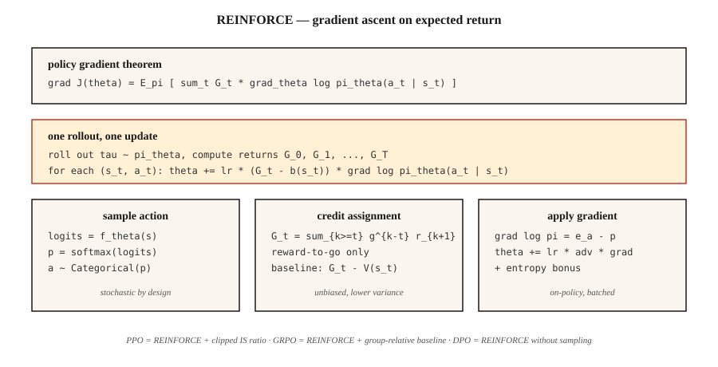

# Policy Gradient — REINFORCE dari Awal

> Berhentilah mengestimasi nilai. Parametrizasi kebijakan secara langsung, hitung gradien dari ekspektasi return, lalu ambil langkah menanjak. Williams (1992) menuliskannya dalam satu teorema. Inilah sebabnya PPO, GRPO, dan setiap loop RL LLM ada.

**Jenis:** Membangun
**Bahasa:** Python, TypeScript
**Prasyarat:** Fase 3 · 03 (Propagasi Balik), Fase 9 · 03 (Monte Carlo), Fase 9 · 04 (TD Learning)
**Waktu:** ~75 menit

## Masalah

Q-learning dan DQN memparametrizasi fungsi *nilai*. Anda memilih aksi lewat `argmax Q`. Itu baik-baik saja untuk aksi diskret dan keadaan diskret. Pendekatan ini pecah ketika aksinya kontinu (apa `argmax` atas torsi berdimensi 10 itu?) atau ketika Anda menginginkan kebijakan stokastik (`argmax` deterministik secara konstruksi).

Policy gradient justru memparametrizasi *kebijakan*. $\pi_\theta(a \mid s)$ adalah jaring saraf yang menghasilkan distribusi atas aksi. Ambil sampel darinya untuk bertindak. Hitung gradien ekspektasi return terhadap $\theta$. Ambil langkah menanjak. Tanpa `argmax`. Tanpa rekursi Bellman. Hanya gradient ascent pada $J(\theta) = \mathbb E_{\pi_\theta}[G]$.

Teorema REINFORCE (Williams 1992) memberi tahu Anda bahwa gradien ini dapat dihitung: $\nabla J(\theta) = \mathbb E_\pi[ G \cdot \nabla_\theta \log \pi_\theta(a \mid s) ]$. Jalankan satu episode. Hitung return-nya. Kalikan dengan $\nabla \log \pi_\theta(a \mid s)$ di setiap langkah. Rata-ratakan. Gradient ascent. Selesai.

Setiap algoritma LLM-RL pada 2026 — PPO, DPO, GRPO — adalah penyempurnaan dari REINFORCE. Memahaminya sampai ke ujung jari adalah prasyarat untuk sisa fase ini, serta untuk Fase 10 · 07 (implementasi RLHF) dan Fase 10 · 08 (DPO).

## Konsep



**Teorema policy gradient.** Untuk sebarang kebijakan $\pi_\theta$ yang diparametrizasi oleh $\theta$:

```math
\nabla J(\theta) = \mathbb{E}_{\tau \sim \pi_\theta}[ \sum_{t=0}^{T} G_t \cdot \nabla_\theta \log \pi_\theta(a_t \mid s_t) ]
```

dengan $G_t = \sum_{k=t}^{T} \gamma^{k-t} r_{k+1}$ adalah return terdiskonto dari langkah $t$. Ekspektasi diambil atas lintasan lengkap $\tau$ yang disampel dari $\pi_\theta$.

**Buktinya pendek.** Diferensiasi $J(\theta) = \sum_\tau P(\tau; \theta) G(\tau)$ di bawah ekspektasi. Gunakan $\nabla P(\tau; \theta) = P(\tau; \theta) \nabla \log P(\tau; \theta)$ (trik turunan-log). Faktorkan $\log P(\tau; \theta) = \sum \log \pi_\theta(a_t \mid s_t) + \text{environment terms that do not depend on } \theta$. Suku-suku lingkungan lenyap. Dua baris aljabar saja menghasilkan teorema tersebut.

**Trik peredaman varians.** REINFORCE vanilla memiliki varians yang mematikan — return bersifat berderau, $\nabla \log \pi$ juga berderau, hasil kalinya sangat berderau. Dua perbaikan standar:

1. **Pengurangan baseline.** Ganti $G_t$ dengan $G_t - b(s_t)$ untuk sebarang baseline $b(s_t)$ yang tidak bergantung pada $a_t$. Tak bias karena $\mathbb{E}[b(s_t) \cdot \nabla \log \pi(a_t \mid s_t)] = 0$. Pilihan umum: $b(s_t) = \hat{V}(s_t)$ yang dipelajari oleh sebuah critic → actor-critic (Pelajaran 07).
2. **Reward-to-go.** Ganti $\sum_t G_t \cdot \nabla \log \pi_\theta(a_t \mid s_t)$ dengan $\sum_t G_t^{\text{from } t} \cdot \nabla \log \pi_\theta(a_t \mid s_t)$. Hanya return masa depan yang penting bagi suatu aksi — reward masa lalu menyumbang derau ber-rata-rata-nol.

Gabungkan keduanya, Anda mendapat:

```math
\nabla J \approx (1/N) \sum_{i=1}^{N} \sum_{t=0}^{T_i} [ G_t^{(i)} - \hat{V}(s_t^{(i)}) ] \cdot \nabla_\theta \log \pi_\theta(a_t^{(i)} \mid s_t^{(i)})
```

yaitu REINFORCE dengan baseline — leluhur langsung dari A2C (Pelajaran 07) dan PPO (Pelajaran 08).

**Parametrizasi kebijakan softmax.** Untuk aksi diskret, pilihan standar:

```math
\pi_\theta(a \mid s) = \exp(f_\theta(s, a)) / \sum_{a'} \exp(f_\theta(s, a'))
```

dengan $f_\theta$ adalah sebarang jaring saraf yang menghasilkan skor per aksi. Gradiennya memiliki bentuk yang bersih:

```math
\nabla_\theta \log \pi_\theta(a \mid s) = \nabla_\theta f_\theta(s, a) - \sum_{a'} \pi_\theta(a' \mid s) \nabla_\theta f_\theta(s, a')
```

yaitu, skor aksi yang diambil dikurangi nilai ekspektasinya di bawah kebijakan.

**Kebijakan Gaussian untuk aksi kontinu.** $\pi_\theta(a \mid s) = N(\mu_\theta(s), \sigma_\theta(s))$. $\nabla \log N(a; \mu, \sigma)$ memiliki bentuk tertutup. Itu saja yang dibutuhkan SAC di Fase 9 · 07.

```figure
policy-gradient-landscape
```

## Membangunnya

### Langkah 1: jaringan kebijakan softmax

```python
def policy_logits(theta, state_features):
    return [dot(theta[a], state_features) for a in range(N_ACTIONS)]

def softmax(logits):
    m = max(logits)
    exps = [exp(l - m) for l in logits]
    Z = sum(exps)
    return [e / Z for e in exps]
```

Gunakan kebijakan linear (satu vektor bobot per aksi) untuk lingkungan tabular. Untuk Atari, ganti dengan CNN dan pertahankan head softmax.

### Langkah 2: pengambilan sampel dan log-probabilitas

```python
def sample_action(probs, rng):
    x = rng.random()
    cum = 0
    for a, p in enumerate(probs):
        cum += p
        if x <= cum:
            return a
    return len(probs) - 1

def log_prob(probs, a):
    return log(probs[a] + 1e-12)
```

### Langkah 3: rollout dengan log-prob yang tercatat

```python
def rollout(theta, env, rng, gamma):
    trajectory = []
    s = env.reset()
    while not done:
        logits = policy_logits(theta, s)
        probs = softmax(logits)
        a = sample_action(probs, rng)
        s_next, r, done = env.step(s, a)
        trajectory.append((s, a, r, probs))
        s = s_next
    return trajectory
```

### Langkah 4: pembaruan REINFORCE

```python
def reinforce_step(theta, trajectory, gamma, lr, baseline=0.0):
    returns = compute_returns(trajectory, gamma)
    for (s, a, _, probs), G in zip(trajectory, returns):
        advantage = G - baseline
        grad_log_pi_a = [-p for p in probs]
        grad_log_pi_a[a] += 1.0
        for i in range(N_ACTIONS):
            for j in range(len(s)):
                theta[i][j] += lr * advantage * grad_log_pi_a[i] * s[j]
```

Gradien $\nabla \log \pi(a \mid s) = e_a - \pi(\cdot \mid s)$ (onehot dari $a$ dikurangi probabilitas) adalah jantung dari policy gradient softmax. Bakarlah ini ke dalam memori otot Anda.

### Langkah 5: baseline

Rata-rata bergerak dari $G$ atas episode-episode terakhir sudah cukup untuk meredam varians agar GridWorld 4×4 bisa berjalan; konvergensinya memakan ~500 episode. Tingkatkan baseline menjadi $\hat{V}(s)$ yang dipelajari dan Anda mendapat actor-critic.

## Jebakan

- **Gradien meledak.** Return bisa sangat besar. Selalu normalisasi $G$ menjadi `~N(0, 1)` di seluruh batch sebelum mengalikannya dengan $\nabla \log \pi$.
- **Kolaps entropi.** Kebijakan terlalu cepat konvergen ke satu aksi yang nyaris deterministik, berhenti mengeksplorasi, dan mandek. Perbaikan: tambahkan bonus entropi $\beta \cdot H(\pi(\cdot \mid s))$ pada objektif.
- **Varians tinggi.** REINFORCE vanilla butuh ribuan episode. Baseline critic (Pelajaran 07) atau trust region dari TRPO/PPO (Pelajaran 08) adalah perbaikan standarnya.
- **Inefisiensi sampel.** On-policy berarti Anda membuang setiap transisi setelah satu pembaruan. Koreksi off-policy lewat importance sampling mengembalikan data, dengan biaya varians (rasio PPO adalah bobot IS yang dipotong/clip).
- **Gradien non-stasioner.** Gradien yang sama dari 100 episode lalu memakai $\pi$ lama. Karena itulah metode on-policy memperbarui tiap beberapa rollout.
- **Atribusi kredit.** Tanpa reward-to-go, reward masa lalu menyumbang derau. Selalu pakai reward-to-go.

## Menggunakannya

Pada 2026, REINFORCE jarang dijalankan langsung, tetapi rumus gradiennya ada di mana-mana:

| Kasus penggunaan | Metode turunan |
|------------------|----------------|
| Kontrol kontinu | PPO / SAC dengan kebijakan Gaussian |
| RLHF LLM | PPO dengan penalti KL, berjalan pada kebijakan level token |
| Penalaran LLM (DeepSeek) | GRPO — REINFORCE dengan baseline relatif-grup, tanpa critic |
| Multi-agen | REINFORCE dengan critic terpusat (MADDPG, COMA) |
| Robotika aksi diskret | A2C, A3C, PPO |
| Setting hanya-preferensi | DPO — REINFORCE ditulis ulang sebagai loss likelihood preferensi, tanpa sampling |

Ketika Anda membaca `loss = -advantage * log_prob` dalam skrip pelatihan tahun 2026, itu adalah REINFORCE dengan baseline. Seluruh makalah (DPO, GRPO, RLOO) adalah trik peredaman varians di atas satu baris ini.

## Merilisnya

Simpan sebagai `outputs/skill-policy-gradient-trainer.md`:

```markdown
---
name: policy-gradient-trainer
description: Hasilkan konfigurasi pelatihan REINFORCE / actor-critic / PPO untuk suatu tugas dan diagnosis masalah varians.
version: 1.0.0
phase: 9
lesson: 6
tags: [rl, policy-gradient, reinforce]
---

Diberikan sebuah lingkungan (aksi diskret / kontinu, horizon, statistik reward), keluarkan:

1. Head kebijakan. Softmax (diskret) atau Gaussian (kontinu) beserta jumlah parameter.
2. Baseline. Tak ada (vanilla), rata-rata bergerak, `V̂(s)` yang dipelajari, atau critic A2C.
3. Kontrol varians. Reward-to-go aktif secara default, normalisasi return, nilai clip gradien.
4. Bonus entropi. Koefisien β dan jadwal peluruhan.
5. Ukuran batch. Episode per pembaruan; kontrak kesegaran data on-policy.

Tolak REINFORCE-tanpa-baseline pada horizon > 500 langkah. Tolak kontrol aksi-kontinu dengan head softmax. Tandai setiap proses dengan `β = 0` dan entropi kebijakan teramati < 0,1 sebagai entropy-collapsed.
```

## Latihan

1. **Mudah.** Implementasikan REINFORCE pada GridWorld 4×4 dengan kebijakan softmax linear. Latih selama 1.000 episode tanpa baseline. Plot kurva pembelajaran; ukur varians (standar deviasi return).
2. **Sedang.** Tambahkan baseline rata-rata bergerak. Latih ulang. Bandingkan efisiensi sampel dan varians dengan hasil vanilla. Berapa besar baseline mengurangi langkah menuju konvergensi?
3. **Sulit.** Tambahkan bonus entropi $\beta \cdot H(\pi)$. Sapu $\beta \in \lbrace 0, 0.01, 0.1, 1.0 \rbrace$. Plot return akhir dan entropi kebijakan. Di mana titik manis untuk tugas ini?

## Istilah Kunci

| Istilah | Apa yang orang katakan | Apa yang sebenarnya dimaksud |
|---------|------------------------|------------------------------|
| Policy gradient | "Latih kebijakan secara langsung" | $\nabla J(\theta) = \mathbb{E}[G \cdot \nabla \log \pi_\theta(a \mid s)]$; diturunkan dari trik turunan-log. |
| REINFORCE | "Algoritma PG original" | Williams (1992); return Monte Carlo dikalikan gradien log-kebijakan. |
| Trik turunan-log | "Estimator fungsi skor" | $\nabla P(\tau;\theta) = P(\tau;\theta) \cdot \nabla \log P(\tau;\theta)$; membuat gradien ekspektasi dapat dihitung. |
| Baseline | "Peredaman varians" | Sembarang $b(s)$ yang dikurangkan dari $G$; tak bias karena $\mathbb{E}[b \cdot \nabla \log \pi] = 0$. |
| Reward-to-go | "Hanya return masa depan yang dihitung" | $G_t^{\text{from } t}$, bukan $G_0$ penuh; benar dan varians lebih rendah. |
| Bonus entropi | "Dorong eksplorasi" | Suku $+\beta \cdot H(\pi(\cdot \mid s))$ mencegah kebijakan kolaps. |
| On-policy | "Latih dari apa yang baru saja Anda lihat" | Ekspektasi gradien terhadap kebijakan saat ini — data lama tidak bisa dipakai langsung. |
| Advantage | "Seberapa lebih baik dari rata-rata" | $A(s, a) = G(s, a) - V(s)$; besaran bertanda yang dikalikan REINFORCE-dengan-baseline. |

## Bacaan Lanjutan

- [Williams (1992). Simple Statistical Gradient-Following Algorithms for Connectionist Reinforcement Learning](https://link.springer.com/article/10.1007/BF00992696) — makalah REINFORCE original.
- [Sutton et al. (2000). Policy Gradient Methods for Reinforcement Learning with Function Approximation](https://papers.nips.cc/paper_files/paper/1999/hash/464d828b85b0bed98e80ade0a5c43b0f-Abstract.html) — teorema policy gradient modern dengan aproksimasi fungsi.
- [Sutton & Barto (2018). Ch. 13 — Policy Gradient Methods](http://incompleteideas.net/book/RLbook2020.pdf) — sajian buku teks.
- [OpenAI Spinning Up — VPG / REINFORCE](https://spinningup.openai.com/en/latest/algorithms/vpg.html) — paparan pedagogis yang jelas dengan kode PyTorch.
- [Peters & Schaal (2008). Reinforcement Learning of Motor Skills with Policy Gradients](https://homes.cs.washington.edu/~todorov/courses/amath579/reading/PolicyGradient.pdf) — peredaman varians dan pandangan gradien alami yang menghubungkan REINFORCE ke keluarga trust-region (TRPO, PPO).
