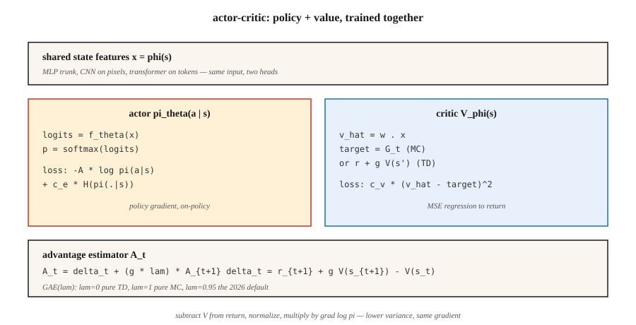

# Actor-Critic — A2C dan A3C

> REINFORCE berderau. Tambahkan critic yang mempelajari $\hat{V}(s)$, kurangkan dari return, dan Anda mendapat advantage yang ekspektasinya sama tetapi variansnya jauh lebih kecil. Itulah actor-critic. A2C menjalankannya secara sinkron; A3C menjalankannya lintas thread. Keduanya adalah model mental untuk setiap metode deep-RL modern.

**Jenis:** Membangun
**Bahasa:** Python, TypeScript
**Prasyarat:** Fase 9 · 04 (TD Learning), Fase 9 · 06 (REINFORCE)
**Waktu:** ~75 menit

## Masalah

REINFORCE vanilla berfungsi, tetapi variansnya mengerikan. Return Monte Carlo $G_t$ bisa berayun hingga faktor 10 antarepisode. Mengalikan derau itu dengan $\nabla \log \pi$ dan merata-ratkannya menghasilkan estimator gradien yang butuh ribuan episode untuk menggerakkan kebijakan sejauh yang bisa Anda capai dengan jauh lebih sedikit pembaruan DQN.

Varians itu berasal dari penggunaan return mentah. Jika Anda mengurangi baseline $b(s_t)$ — sembarang fungsi keadaan, termasuk nilai yang dipelajari — ekspektasinya tidak berubah dan variansnya turun. Baseline terbaik yang dapat dihitung adalah $\hat{V}(s_t)$. Kini besaran yang mengalikan $\nabla \log \pi$ adalah *advantage*:

```math
A(s, a) = G - \hat{V}(s)
```

Suatu aksi dikatakan baik bila menghasilkan return di atas rata-rata; buruk bila di bawahnya. REINFORCE dengan critic yang dipelajari adalah *actor-critic*. Critic memberi actor seorang guru dengan varians rendah. Inilah semua metode deep-policy setelah 2015 (A2C, A3C, PPO, SAC, IMPALA).

## Konsep



**Dua jaringan, satu fungsi rugi bersama:**

- **Actor** $\pi_\theta(a \mid s)$: kebijakan. Diambil sampelnya untuk bertindak. Dilatih dengan policy gradient.
- **Critic** $V_\phi(s)$: mengestimasi ekspektasi return dari suatu keadaan. Dilatih untuk meminimalkan $(V_\phi(s) - \text{target})^2$.

**Advantage.** Dua bentuk standar:

- *MC advantage:* $A_t = G_t - V_\phi(s_t)$. Tak bias, varians lebih tinggi.
- *TD advantage:* $A_t = r_{t+1} + \gamma V_\phi(s_{t+1}) - V_\phi(s_t)$. Bias (memakai $V_\phi$), varians jauh lebih rendah. Disebut pula *residu TD* $\delta_t$.

**Advance n-langkah.** Interpolasi di antara keduanya:

```math
A_t^{(n)} = r_{t+1} + \gamma r_{t+2} + \ldots + \gamma^{n-1} r_{t+n} + \gamma^n V_\phi(s_{t+n}) - V_\phi(s_t)
```

$n = 1$ adalah TD murni. $n = \infty$ adalah MC. Kebanyakan implementasi memakai $n = 5$ untuk Atari, $n = 2048$ untuk PPO pada MuJoCo.

**Generalized Advantage Estimation (GAE).** Schulman dkk. (2016) mengusulkan rata-rata terbobot secara eksponensial atas semua advantage n-langkah:

```math
A_t^{\text{GAE}} = \sum_{l=0}^{\infty} (\gamma \lambda)^l \delta_{t+l}
```

dengan $\lambda \in [0, 1]$. $\lambda = 0$ adalah TD (varians rendah, bias tinggi). $\lambda = 1$ adalah MC (varians tinggi, tak bias). $\lambda = 0.95$ adalah default 2026 — setel sampai tombol bias/varians berada di posisi yang Anda inginkan.

**A2C: actor-critic advantage sinkron.** Kumpulkan $T$ langkah dari $N$ lingkungan paralel. Hitung advantage untuk setiap langkah. Perbarui actor dan critic pada batch gabungan. Ulangi. Saudara A3C yang lebih sederhana dan lebih mudah diskalakan.

**A3C: actor-critic advantage asinkron.** Mnih dkk. (2016). Bangkitkan $N$ thread pekerja, masing-masing menjalankan satu lingkungan. Setiap pekerja menghitung gradien secara lokal pada rollout-nya sendiri, lalu menerapkannya secara asinkron ke server parameter bersama. Tak perlu replay buffer — para pekerja mendekorelasi dengan menjalankan lintasan yang berbeda. A3C membuktikan Anda bisa melatih pada CPU dalam skala besar. Pada 2026, A2C berbasis GPU (lingkungan paralel ber-batch) mendominasi karena GPU menyukai batch besar.

**Fungsi rugi gabungan.**

```math
L(\theta, \phi) = -\mathbb{E}[ A_t \cdot \log \pi_\theta(a_t \mid s_t) ] + c_v \cdot \mathbb{E}[(V_\phi(s_t) - G_t)^2] - c_e \cdot \mathbb{E}[H(\pi_\theta(\cdot \mid s_t))]
```

Tiga suku: fungsi rugi policy gradient, regresi nilai, bonus entropi. `c_v ~ 0.5`, `c_e ~ 0.01` adalah titik awal kanonik.

```figure
actor-critic
```

## Membangunnya

### Langkah 1: sebuah critic

Critic linear $V_\phi(s) = w \cdot \text{features}(s)$ yang diperbarui dengan MSE:

```python
def critic_update(w, x, target, lr):
    v_hat = dot(w, x)
    err = target - v_hat
    for j in range(len(w)):
        w[j] += lr * err * x[j]
    return v_hat
```

Pada lingkungan tabular, critic konvergen dalam beberapa ratus episode. Pada Atari, ganti critic linear dengan trunk CNN bersama + head nilai.

### Langkah 2: advantage n-langkah

Diberikan rollout sepanjang $T$ dan $V(s_T)$ akhir hasil bootstrap:

```python
def compute_advantages(rewards, values, gamma=0.99, lam=0.95, last_value=0.0):
    advantages = [0.0] * len(rewards)
    gae = 0.0
    for t in reversed(range(len(rewards))):
        next_v = values[t + 1] if t + 1 < len(values) else last_value
        delta = rewards[t] + gamma * next_v - values[t]
        gae = delta + gamma * lam * gae
        advantages[t] = gae
    returns = [a + v for a, v in zip(advantages, values)]
    return advantages, returns
```

`returns` adalah target critic. `advantages` adalah besaran yang mengalikan $\nabla \log \pi$.

### Langkah 3: pembaruan gabungan

```python
for step_i, (x, a, _r, probs) in enumerate(traj):
    adv = advantages[step_i]
    target_v = returns[step_i]

    # critic
    critic_update(w, x, target_v, lr_v)

    # actor
    for i in range(N_ACTIONS):
        grad_logpi = (1.0 if i == a else 0.0) - probs[i]
        for j in range(N_FEAT):
            theta[i][j] += lr_a * adv * grad_logpi * x[j]
```

On-policy, satu rollout per pembaruan, laju pembelajaran terpisah untuk actor dan critic.

### Langkah 4: paralelisasi (A3C vs A2C)

- **A3C:** bangkitkan $N$ thread. Masing-masing menjalankan lingkungan dan forward pass-nya sendiri. Secara berkala dorong pembaruan gradien ke master bersama. Tanpa kunci pada master — *race condition* tidak apa-apa, itu hanya menambah derau.
- **A2C:** jalankan $N$ instance lingkungan dalam satu proses, tumpuk observasi menjadi batch `[N, obs_dim]`, forward pass ber-batch, backward pass ber-batch. Utilisasi GPU lebih tinggi, deterministik, lebih mudah dinalar. Default pada 2026.

Kode mainan kita bersifat single-thread demi kejelasan; menulis ulang menjadi A2C ber-batch hanya butuh tiga baris numpy.

## Jebakan

- **Bias critic sebelum gradien actor.** Jika critic masih acak, baseline-nya tidak informatif dan Anda melatih dengan derau murni. Panasi critic selama beberapa ratus langkah sebelum menyalakan policy gradient, atau pakai laju pembelajaran actor yang lambat.
- **Normalisasi advantage.** Normalisasi advantage menjadi rata-rata-nol/simpangan-baku-satu per batch. Menstabilkan pelatihan secara besar-besaran dengan biaya nyaris nol.
- **Trunk bersama.** Pakai ekstraktor fitur bersama untuk actor dan critic pada input gambar. Head terpisah. Fitur bersama ikut terbawa gratis pada kedua fungsi rugi.
- **Kontrak on-policy.** A2C memakai ulang data tepat untuk satu pembaruan. Lebih dari itu, gradien Anda menjadi bias (koreksi importance sampling adalah yang ditambahkan PPO).
- **Kolaps entropi.** Tanpa $c_e > 0$, kebijakan menjadi nyaris deterministik dalam beberapa ratus pembaruan dan berhenti mengeksplorasi.
- **Skala reward.** Besaran advantage bergantung pada skala reward. Normalisasi reward (misalnya, pembagian dengan simpangan baku bergerak) agar besar gradien konsisten antartugas.

## Menggunakannya

A2C/A3C jarang menjadi pilihan akhir pada 2026, tetapi keduanya adalah arsitektur yang disempurnakan oleh semua metode setelahnya:

| Metode | Hubungan dengan A2C |
|--------|---------------------|
| PPO | A2C + rasio importance ter-clip untuk pembaruan multi-epoch |
| IMPALA | A3C + koreksi off-policy V-trace |
| SAC (Fase 9 · 07) | A2C off-policy dengan critic soft-value (pelajaran berikutnya) |
| GRPO (Fase 9 · 12) | A2C tanpa critic — advantage relatif-grup |
| DPO | A2C yang direduksi menjadi fungsi rugi peringkat preferensi, tanpa sampling |
| AlphaStar / OpenAI Five | A2C dengan league training + pra-pelatihan imitasi |

Jika Anda melihat "advantage" dalam makalah tahun 2026, pikirkan actor-critic.

## Merilisnya

Simpan sebagai `outputs/skill-actor-critic-trainer.md`:

```markdown
---
name: actor-critic-trainer
description: Hasilkan konfigurasi A2C / A3C / GAE untuk suatu lingkungan, dengan estimasi advantage dan bobot fungsi rugi yang ditentukan.
version: 1.0.0
phase: 9
lesson: 7
tags: [rl, actor-critic, gae]
---

Diberikan sebuah lingkungan dan anggaran komputasi, keluarkan:

1. Paralelisme. A2C (GPU ber-batch) vs A3C (CPU asinkron) serta jumlah pekerja.
2. Panjang rollout T. Langkah per lingkungan per pembaruan.
3. Estimator advantage. n-langkah atau GAE(λ); sebutkan λ.
4. Bobot fungsi rugi. `c_v` (nilai), `c_e` (entropi), clip gradien.
5. Laju pembelajaran. Actor dan critic (terpisah jika dipakai).

Tolak A2C satu-pekerja pada lingkungan dengan horizon > 1000 (terlalu on-policy, terlalu lambat). Tolak rilis tanpa normalisasi advantage. Tandai setiap proses dengan `c_e = 0` dan entropi teramati < 0,1 sebagai entropy-collapsed.
```

## Latihan

1. **Mudah.** Latih actor-critic dengan MC advantage $(G_t - V(s_t))$ pada GridWorld 4×4. Bandingkan efisiensi sampel dengan REINFORCE-dengan-baseline-rata-rata-berg-erak dari Pelajaran 06.
2. **Sedang.** Beralih ke advantage residu-TD $(r + \gamma V(s') - V(s))$. Ukur varians batch advantage. Berapa besar penurunannya?
3. **Sulit.** Implementasikan GAE(λ). Sapu $\lambda \in \lbrace 0, 0.5, 0.9, 0.95, 1.0 \rbrace$. Plot return akhir vs efisiensi sampel. Di mana titik manis bias/varians untuk tugas ini?

## Istilah Kunci

| Istilah | Apa yang orang katakan | Apa yang sebenarnya dimaksud |
|---------|------------------------|------------------------------|
| Actor | "Jaring kebijakan" | $\pi_\theta(a \mid s)$, diperbarui oleh policy gradient. |
| Critic | "Jaring nilai" | $V_\phi(s)$, diperbarui oleh regresi MSE terhadap return / target TD. |
| Advantage | "Seberapa lebih baik dari rata-rata" | $A(s, a) = Q(s, a) - V(s)$ atau estimatornya. Pengali $\nabla \log \pi$. |
| Residu TD | "δ" | $\delta_t = r + \gamma V(s') - V(s)$; estimasi advantage satu langkah. |
| GAE | "Tombol interpolasi" | Jumlah terbobot secara eksponensial dari advantage n-langkah, diparametrizasi oleh $\lambda$. |
| A2C | "Actor-critic sinkron" | Ber-batch lintas lingkungan; satu langkah gradien per rollout. |
| A3C | "Actor-critic asinkron" | Thread pekerja mendorong gradien ke server parameter bersama. Makalah original; kurang umum pada 2026. |
| Bootstrap | "Pakai V di horizon" | Potong rollout, tambahkan $\gamma^n V(s_{t+n})$ untuk menutup jumlah. |

## Bacaan Lanjutan

- [Mnih et al. (2016). Asynchronous Methods for Deep Reinforcement Learning](https://arxiv.org/abs/1602.01783) — A3C, makalah actor-critic asinkron yang original.
- [Schulman et al. (2016). High-Dimensional Continuous Control Using Generalized Advantage Estimation](https://arxiv.org/abs/1506.02438) — GAE.
- [Sutton & Barto (2018). Ch. 13 — Actor-Critic Methods](http://incompleteideas.net/book/RLbook2020.pdf) — landasan; pasangkan dengan Ch. 9 tentang aproksimasi fungsi ketika critic berupa jaring saraf.
- [Espeholt et al. (2018). IMPALA](https://arxiv.org/abs/1802.01561) — actor-critic terdistribusi yang scalable dengan koreksi off-policy V-trace.
- [OpenAI Baselines / Stable-Baselines3](https://stable-baselines3.readthedocs.io/) — implementasi A2C/PPO produksi yang layak dibaca.
- [Konda & Tsitsiklis (2000). Actor-Critic Algorithms](https://papers.nips.cc/paper/1786-actor-critic-algorithms) — hasil konvergensi dasar untuk dekomposisi actor-critic dua skala waktu.
