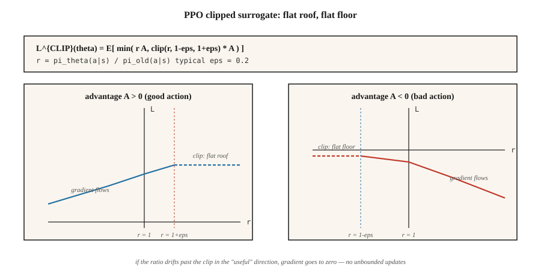

# Proximal Policy Optimization (PPO)

> A2C membuang setiap rollout setelah satu pembaruan. PPO membungkus policy gradient dengan rasio importance ter-clip sehingga Anda bisa menjalankan 10+ epoch pada data yang sama tanpa kebijakan meledak. Schulman dkk. (2017). Hingga kini tetap menjadi algoritma policy-gradient default pada 2026.

**Jenis:** Membangun
**Bahasa:** Python, TypeScript
**Prasyarat:** Fase 9 · 06 (REINFORCE), Fase 9 · 07 (Actor-Critic)
**Waktu:** ~75 menit

## Masalah

A2C (Pelajaran 07) bersifat on-policy: gradien $\mathbb E_{\pi_\theta}[A \cdot \nabla \log \pi_\theta]$ membutuhkan data yang disampel dari $\pi_\theta$ *saat ini*. Lakukan satu pembaruan, dan $\pi_\theta$ berubah; data yang Anda pakai kini menjadi off-policy. Pakai ulang dan gradien Anda menjadi bias.

Rollout itu mahal. Pada Atari, satu rollout dari 8 lingkungan × 128 langkah = 1024 transisi dan belasan detik waktu lingkungan. Membuangnya setelah satu langkah gradien adalah pemborosan.

Trust Region Policy Optimization (TRPO, Schulman 2015) adalah perbaikan pertama: batasi setiap pembaruan agar divergensi KL antara kebijakan lama dan baru tetap di bawah $\delta$. Secara teoretis bersih, tetapi membutuhkan penyelesaian conjugate-gradient per pembaruan. Tak ada yang menjalankan TRPO pada 2026.

PPO (Schulman dkk. 2017) mengganti batasan trust region yang kaku dengan objektif ter-clip yang sederhana. Satu baris kode tambahan. Sepuluh epoch per rollout. Tanpa conjugate gradient. Jaminan teoretis yang cukup baik. Sembilan tahun kemudian, algoritma ini masih menjadi algoritma policy-gradient default untuk segalanya, dari MuJoCo hingga RLHF.

## Konsep



**Rasio importance.**

```math
r_t(\theta) = \frac{\pi_\theta(a_t \mid s_t)}{\pi_{\theta_{\text{old}}}(a_t \mid s_t)}
```

Ini adalah rasio likelihood kebijakan baru terhadap kebijakan yang mengumpulkan data. $r_t = 1$ berarti tidak ada perubahan. $r_t = 2$ berarti kebijakan baru dua kali lebih mungkin mengambil $a_t$ dibanding kebijakan lama.

**Surrogate ter-clip.**

```math
L^{\text{CLIP}}(\theta) = \mathbb{E}_t \left[ \min\left( r_t(\theta) A_t, \mathop{\mathrm{clip}}(r_t(\theta), 1-\epsilon, 1+\epsilon) A_t \right) \right]
```

Dua suku:

- Jika advantage $A_t > 0$ dan rasio mencoba tumbuh melewati $1 + \epsilon$, clip meratakan gradien — jangan dorong aksi baik lebih jauh dari $+\epsilon$ di atas probabilitas lama.
- Jika advantage $A_t < 0$ dan rasio mencoba turun di bawah $1 - \epsilon$ (artinya kita membuat aksi buruk jauh lebih kecil kemungkinannya daripada kebijakan lama), clip meratakan gradien: jangan dorong aksi buruk lebih jauh dari $-\epsilon$ di bawah probabilitas lama.

`min` menangani arah sebaliknya: jika rasio telah bergerak ke arah yang *menguntungkan*, Anda tetap mendapat gradien (tidak ada pemotongan pada sisi yang akan merugikan Anda).

Biasanya $\epsilon = 0.2$. Plot objektif sebagai fungsi $r_t$: fungsi linear-bisegi dengan atap datar pada "sisi baik" dan lantai datar pada "sisi buruk."

**Fungsi rugi PPO lengkap.**

```math
L(\theta, \phi) = L^{\text{CLIP}}(\theta) - c_v \cdot (V_\phi(s_t) - V_t^{\text{target}})^2 + c_e \cdot H(\pi_\theta(\cdot \mid s_t))
```

Struktur actor-critic yang sama dengan A2C. Tiga koefisien, biasanya $c_v = 0.5$, $c_e = 0.01$, $\epsilon = 0.2$.

**Loop pelatihan.**

1. Kumpulkan $N \times T$ transisi dari $N$ lingkungan paralel, masing-masing $T$ langkah.
2. Hitung advantage (GAE), bekukan sebagai konstanta.
3. Bekukan $\pi_{\theta_{\text{old}}}$ sebagai snapshot dari $\pi_\theta$ saat ini.
4. Selama $K$ epoch, untuk setiap minibatch `(s, a, A, V_target, log π_old(a|s))`:
   - Hitung $r_t(\theta) = \exp(\log \pi_\theta(a \mid s) - \log \pi_{\text{old}}(a \mid s))$.
   - Terapkan $L^{\text{CLIP}}$ + rugi nilai + entropi.
   - Langkah gradien.
5. Buang rollout. Kembali ke langkah 1.

$K = 10$ dan minibatch berukuran 64 adalah sekumpulan hiperparameter standar. PPO tangguh: angka pastinya jarang penting dalam rentang ±50%.

**Varian penalti KL.** Makalah original mengusulkan alternatif dengan penalti KL adaptif: $L = L^{\text{PG}} - \beta \cdot \mathrm{KL}(\pi_\theta \Vert \pi_{\text{old}})$ dengan $\beta$ disesuaikan berdasarkan KL yang teramati. Versi clipping menjadi dominan; varian KL bertahan di RLHF (di mana KL terhadap kebijakan referensi adalah batasan tersendiri yang memang selalu Anda inginkan).

```figure
ppo-clip
```

## Membangunnya

### Langkah 1: merekam `log π_old(a | s)` saat rollout

```python
for step in range(T):
    probs = softmax(logits(theta, state_features(s)))
    a = sample(probs, rng)
    s_next, r, done = env.step(s, a)
    buffer.append({
        "s": s, "a": a, "r": r, "done": done,
        "v_old": value(w, state_features(s)),
        "log_pi_old": log(probs[a] + 1e-12),
    })
    s = s_next
```

Snapshot diambil sekali, saat rollout. Nilainya tidak berubah selama epoch pembaruan.

### Langkah 2: menghitung advantage GAE (Pelajaran 07)

Sama seperti A2C. Normalisasi di seluruh batch.

### Langkah 3: pembaruan surrogate ter-clip

```python
for _ in range(K_EPOCHS):
    for mb in minibatches(buffer, size=64):
        for rec in mb:
            x = state_features(rec["s"])
            probs = softmax(logits(theta, x))
            logp = log(probs[rec["a"]] + 1e-12)
            ratio = exp(logp - rec["log_pi_old"])
            adv = rec["advantage"]
            surrogate = min(
                ratio * adv,
                clamp(ratio, 1 - EPS, 1 + EPS) * adv,
            )
            # backprop -surrogate, tambahkan rugi nilai, kurangi entropi
            grad_logpi = onehot(rec["a"]) - probs
            if (adv > 0 and ratio >= 1 + EPS) or (adv < 0 and ratio <= 1 - EPS):
                pg_grad = 0.0  # ter-clip
            else:
                pg_grad = ratio * adv
            for i in range(N_ACTIONS):
                for j in range(N_FEAT):
                    theta[i][j] += LR * pg_grad * grad_logpi[i] * x[j]
```

Pola "ter-clip → gradien nol" adalah jantung PPO. Jika kebijakan baru sudah terlalu jauh menyimpang ke arah yang menguntungkan, pembaruan berhenti.

### Langkah 4: nilai dan entropi

Tambahkan MSE standar pada target critic dan bonus entropi pada actor, sama seperti A2C.

### Langkah 5: diagnostik

Tiga hal yang harus diawasi setiap pembaruan:

- **KL rata-rata** $\mathbb{E}[\log \pi_{\text{old}} - \log \pi_\theta]$. Seharusnya tetap dalam `[0, 0.02]`. Jika melampaui `0.1`, kurangi `K_EPOCHS` atau `LR`.
- **Fraksi clip** — fraksi sampel yang rasionya berada di luar $[1-\epsilon, 1+\epsilon]$. Seharusnya `~0.1-0.3`. Jika `~0`, clip tidak pernah aktif → naikkan `LR` atau `K_EPOCHS`. Jika `~0.5+`, Anda melakukan over-fitting pada rollout → turunkan keduanya.
- **Varians yang dijelaskan** $1 - \text{Var}(V_{\text{target}} - V_{\text{pred}}) / \text{Var}(V_{\text{target}})$. Metrik kualitas critic. Seharusnya naik menuju 1 seiring critic belajar.

## Jebakan

- **Koefisien clip salah setel.** $\epsilon = 0.2$ adalah standar de facto. Mengubahnya menjadi `0.1` membuat pembaruan terlalu penakut; `0.3+` mengundang ketidakstabilan.
- **Terlalu banyak epoch.** $K > 20$ secara rutin mendestabilisasi karena kebijakan menyimpang jauh dari $\pi_{\text{old}}$. Batasi epoch, terutama untuk jaringan besar.
- **Tanpa normalisasi reward.** Skala reward yang besar memakan rentang clip. Normalisasi reward (simpangan baku bergerak) sebelum menghitung advantage.
- **Lupa normalisasi advantage.** Normalisasi rata-rata-nol/simpangan-baku-satu per batch adalah standar. Melewatkannya merusak PPO pada kebanyakan benchmark.
- **Laju pembelajaran tidak diturunkan.** PPO mendapat manfaat dari peluruhan LR linear hingga nol. LR konstan sering lebih buruk.
- **Kesalahan matematis rasio importance.** Selalu pakai `exp(log_new - log_old)` demi stabilitas numerik, bukan `new / old`.
- **Tanda gradien salah.** Memaksimalkan surrogate = *meminimalkan* $-L^{\text{CLIP}}$. Tanda yang terbalik adalah bug PPO yang paling umum.

## Menggunakannya

PPO adalah algoritma RL default tahun 2026 di sejumlah domain yang jumlahnya mengejutkan:

| Kasus penggunaan | Varian PPO |
|------------------|------------|
| Kontrol MuJoCo / robotika | PPO dengan kebijakan Gaussian, GAE(0.95) |
| Atari / game diskret | PPO dengan kebijakan kategorikal, rollout 128 langkah bergulir |
| RLHF untuk LLM | PPO dengan penalti KL terhadap model referensi, reward dari RM di akhir respons |
| Agen game skala besar | IMPALA + PPO (AlphaStar, OpenAI Five) |
| LLM penalaran | GRPO (Pelajaran 12) — varian PPO tanpa critic |
| Data hanya-preferensi | DPO — reduksi bentuk tertutup dari PPO+KL, tanpa sampling online |

Bentuk *fungsi rugi* PPO — surrogate ter-clip + nilai + entropi — adalah kerangka bagi DPO, GRPO, dan hampir setiap pipeline RLHF.

## Merilisnya

Simpan sebagai `outputs/skill-ppo-trainer.md`:

```markdown
---
name: ppo-trainer
description: Hasilkan konfigurasi pelatihan PPO dan rencana diagnostik untuk suatu lingkungan.
version: 1.0.0
phase: 9
lesson: 8
tags: [rl, ppo, policy-gradient]
---

Diberikan sebuah lingkungan dan anggaran pelatihan, keluarkan:

1. Ukuran rollout. `N` lingkungan × `T` langkah.
2. Jadwal pembaruan. `K` epoch, ukuran minibatch, jadwal LR.
3. Parameter surrogate. `ε` (clip), `c_v`, `c_e`, normalisasi advantage aktif.
4. Advantage. GAE(`λ`) dengan `γ` dan `λ` yang dinyatakan eksplisit.
5. Rencana diagnostik. Ambang KL, fraksi clip, dan varians yang dijelaskan beserta alarm.

Tolak `K > 30` atau `ε > 0.3` (trust region tidak aman). Tolak proses PPO tanpa normalisasi advantage atau pemantauan KL/clip. Tandai fraksi clip yang terus-menerus di atas 0.4 sebagai drift.
```

## Latihan

1. **Mudah.** Jalankan PPO pada GridWorld 4×4 dengan $\epsilon=0.2, K=4$. Bandingkan efisiensi sampel dengan A2C (satu epoch per rollout) pada jumlah langkah lingkungan yang sama.
2. **Sedang.** Sapu $K \in \lbrace 1, 4, 10, 30 \rbrace$. Plot return vs langkah lingkungan dan lacak KL rata-rata per pembaruan. Pada $K$ berapa KL meledak untuk tugas ini?
3. **Sulit.** Ganti surrogate ter-clip dengan penalti KL adaptif ($\beta$ digandakan jika $\mathrm{KL} > 2 \cdot \text{target}$, dibagi dua jika $\mathrm{KL} < \text{target}/2$). Bandingkan return akhir, stabilitas, dan bebas-clip.

## Istilah Kunci

| Istilah | Apa yang orang katakan | Apa yang sebenarnya dimaksud |
|---------|------------------------|------------------------------|
| Rasio importance | "r_t(θ)" | $\pi_\theta(a \mid s) / \pi_{\text{old}}(a \mid s)$; penyimpangan dari kebijakan yang mengumpulkan data. |
| Surrogate ter-clip | "Trik utama PPO" | $\min(r \cdot A, \mathop{\mathrm{clip}}(r, 1-\epsilon, 1+\epsilon) \cdot A)$; gradien datar setelah clip pada sisi yang menguntungkan. |
| Trust region | "Maksud TRPO / PPO" | Batasi KL setiap pembaruan untuk menjamin perbaikan monoton. |
| Penalti KL | "Trust region lunak" | Varian PPO alternatif: $L - \beta \cdot \mathrm{KL}(\pi_\theta \Vert \pi_{\text{old}})$. $\beta$ adaptif. |
| Fraksi clip | "Seberapa sering clip aktif" | Diagnostik — seharusnya 0.1-0.3; di luar itu berarti salah setel. |
| Pelatihan multi-epoch | "Penggunaan ulang data" | K epoch per rollout; biaya varians ditukar dengan efisiensi sampel. |
| On-policy-ish | "Sebagian besar on-policy" | PPO secara nominal on-policy, tetapi K>1 epoch memakai data yang sedikit off-policy secara aman. |
| PPO-KL | "PPO yang lain" | Varian penalti KL; dipakai di RLHF di mana KL terhadap referensi sudah merupakan batasan. |

## Bacaan Lanjutan

- [Schulman et al. (2017). Proximal Policy Optimization Algorithms](https://arxiv.org/abs/1707.06347) — makalahnya.
- [Schulman et al. (2015). Trust Region Policy Optimization](https://arxiv.org/abs/1502.05477) — TRPO, pendahulu PPO.
- [Andrychowicz et al. (2021). What Matters In On-Policy RL? A Large-Scale Empirical Study](https://arxiv.org/abs/2006.05990) — ablasi terhadap setiap hiperparameter PPO.
- [Ouyang et al. (2022). Training language models to follow instructions with human feedback](https://arxiv.org/abs/2203.02155) — InstructGPT; resep PPO-in-RLHF.
- [OpenAI Spinning Up — PPO](https://spinningup.openai.com/en/latest/algorithms/ppo.html) — paparan modern yang bersih dengan PyTorch.
- [CleanRL PPO implementation](https://github.com/vwxyzjn/cleanrl) — implementasi PPO satu berkas yang dijadikan acuan banyak makalah.
- [Hugging Face TRL — PPOTrainer](https://huggingface.co/docs/trl/main/en/ppo_trainer) — resep produksi PPO untuk model bahasa; bacalah bersama Pelajaran 09 (RLHF).
- [Engstrom et al. (2020). Implementation Matters in Deep Policy Gradients](https://arxiv.org/abs/2005.12729) — makalah "37 optimisasi level kode"; trik PPO mana yang benar-benar menopang dan mana yang sekadar legenda.
