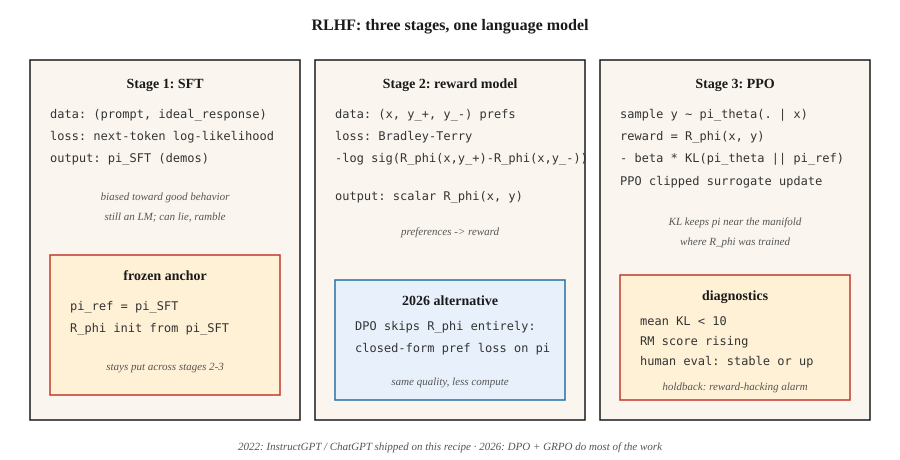

# Pemodelan Reward & RLHF

> Manusia tidak bisa menulis fungsi reward untuk "respons asisten yang baik," tetapi mereka bisa membandingkan dua respons dan memilih yang lebih baik. Cocokkan reward model pada perbandingan itu, lalu lakukan RL pada model bahasa terhadapnya. Christiano 2017. InstructGPT 2022. Resep yang mengubah GPT-3 menjadi ChatGPT. Pada 2026, resep ini sebagian besar digantikan oleh DPO — tetapi model mentalnya tetap bertahan.

**Jenis:** Membangun
**Bahasa:** Python, TypeScript
**Prasyarat:** Fase 5 · 05 (Sentimen), Fase 9 · 08 (PPO)
**Waktu:** ~45 menit

## Masalah

Anda melatih model bahasa dengan objektif prediksi-token-berikutnya. Model itu menulis bahasa Inggris yang gramatikal. Ia juga berbohong, bertele-tele, dan menolak untuk menolak. Anda tidak bisa memperbaiki ini dengan lebih banyak pra-pelatihan — teks web adalah masalahnya, bukan obatnya.

Anda menginginkan *reward skalar* yang menyatakan "respons A lebih baik daripada respons B untuk instruksi X." Menulis fungsi reward itu dengan tangan tidak mungkin. "Kebermanfaatan" bukanlah ekspresi bentuk-tertutup atas token. Tetapi manusia bisa membandingkan dua keluaran dan menandai preferensi. Itu murah untuk dikumpulkan dalam skala besar.

RLHF (Christiano dkk. 2017; Ouyang dkk. 2022) mengubah preferensi menjadi reward model, lalu mengoptimalkan LM lewat PPO terhadap reward itu. Dalam tiga langkah: SFT → RM → PPO. Inilah resep yang meluncurkan ChatGPT, Claude, Gemini, dan setiap LLM teralignment lainnya pada 2023–2025.

Pada 2026, langkah PPO sebagian besar digantikan oleh DPO (Fase 10 · 08) karena lebih murah dan hampir sama baiknya untuk penyetelan halus alignment. Namun bagian *reward model* tetap mendasari setiap sampler Best-of-N, setiap pipeline RL-from-verifiable-rewards, dan setiap model penalaran yang memakai process reward model. Pahami RLHF dan Anda memahami seluruh tumpukan alignment.

## Konsep



**Tahap 1: Supervised Fine-Tuning (SFT).** Mulai dari model dasar yang telah dilatih sebelumnya. Lakukan fine-tuning pada demonstrasi yang ditulis manusia tentang perilaku target (respons yang mengikuti instruksi, balasan yang bermanfaat, dll.). Hasilnya: model $\pi_{\text{SFT}}$ yang *terbiasa ke arah perilaku baik* tetapi masih memiliki ruang aksi tak terhingga.

**Tahap 2: pelatihan Reward Model.**

- Kumpulkan pasangan respons $(y_+, y_-)$ untuk prompt $x$, diberi label oleh manusia sebagai "y_+ lebih disukai daripada y_-."
- Latih reward model $R_\phi(x, y)$ agar memberikan skor lebih tinggi kepada $y_+$.
- Fungsi rugi: **logistik berpasangan Bradley-Terry**:

  $L(\phi) = -\mathbb{E}[ \log \sigma(R_\phi(x, y_+) - R_\phi(x, y_-)) ]$

  $\sigma$ adalah sigmoid. Selisih reward menyiratkan log-odds preferensi. BT telah menjadi standar sejak 1952 (Bradley-Terry) dan merupakan pilihan dominan dalam RLHF modern.

- $R_\phi$ biasanya diinisialisasi dari model SFT dengan head skalar di atasnya. Backbone transformer yang sama; satu lapisan linear menghasilkan reward.

**Tahap 3: PPO terhadap RM dengan penalti KL.**

- Inisialisasi kebijakan yang dapat dilatih $\pi_\theta$ dari $\pi_{\text{SFT}}$. Simpan *referensi* yang dibekukan $\pi_{\text{ref}} = \pi_{\text{SFT}}$.
- Reward di akhir suatu respons $y$:

  $r_{\text{total}}(x, y) = R_\phi(x, y) - \beta \cdot \mathrm{KL}(\pi_\theta(\cdot \mid x) \Vert \pi_{\text{ref}}(\cdot \mid x))$

  Penalti KL mencegah $\pi_\theta$ menyimpang sewenang-wenang dari $\pi_{\text{SFT}}$ — ini adalah *regularizer*, bukan trust region yang kaku. $\beta$ biasanya 0.01-0.05.
- Jalankan PPO (Pelajaran 08) dengan reward ini. Advantage dihitung pada lintasan level token, tetapi RM hanya menilai respons lengkap.

**Mengapa KL?** Tanpa itu, PPO dengan senang hati akan menemukan strategi reward-hacking — RM hanya dilatih pada kelengkapan yang berada dalam distribusi. Respons di luar distribusi bisa saja mendapat skor lebih tinggi daripada respons mana pun yang ditulis manusia. KL menjaga $\pi_\theta$ tetap dekat dengan manifold tempat RM dilatih. Ini adalah satu-satunya tombol paling penting dalam RLHF.

**Status 2026:**

- **DPO** (Rafailov 2023): aljabar bentuk-tertutup mereduksi Tahap 2+3 menjadi satu fungsi rugi tersupervisi atas data preferensi. Tanpa RM, tanpa PPO. Kualitas yang sama pada benchmark alignment dengan sebagian kecil komputasi. Dibahas di Fase 10 · 08.
- **GRPO** (DeepSeek 2024–2025): PPO dengan baseline relatif-grup alih-alih critic, reward dari *verifier* (kode berjalan / jawaban matematika cocok) alih-alih RM yang dilatih manusia. Dominan untuk model penalaran. Dibahas di Fase 9 · 12.
- **Process reward models (PRM):** menilai solusi parsial (setiap langkah penalaran), dipakai baik dalam RLHF maupun varian GRPO untuk penalaran.
- **Constitutional AI / RLAIF:** memakai LLM yang teralignment untuk menghasilkan preferensi alih-alih manusia. Menskalakan anggaran preferensi.

```figure
reward-model
```

## Membangunnya

Pelajaran ini memakai "prompt" dan "respons" sintetis berukuran kecil yang direpresentasikan sebagai string. RM adalah penilai linear atas representasi bag-of-tokens. Tanpa LLM sungguhan — yang penting adalah *bentuk* pipeline, bukan skalanya. Lihat `code/main.py`.

### Langkah 1: data preferensi sintetis

```python
PROMPTS = ["help me", "answer me", "explain this"]
GOOD_WORDS = {"clear", "specific", "kind", "thorough"}
BAD_WORDS = {"vague", "rude", "wrong", "short"}

def make_pair(rng):
    x = rng.choice(PROMPTS)
    y_good = rng.choice(list(GOOD_WORDS)) + " " + rng.choice(list(GOOD_WORDS))
    y_bad = rng.choice(list(BAD_WORDS)) + " " + rng.choice(list(BAD_WORDS))
    return (x, y_good, y_bad)
```

Pada RLHF sungguhan ini digantikan oleh pemberi label manusia. Bentuknya — `(prompt, preferred_response, rejected_response)` — identik.

### Langkah 2: reward model Bradley-Terry

Skor linear: `R(x, y) = w · bag(y)`. Latih untuk meminimalkan pairwise log-loss BT:

```python
def rm_train_step(w, x, y_pos, y_neg, lr):
    r_pos = dot(w, bag(y_pos))
    r_neg = dot(w, bag(y_neg))
    p = sigmoid(r_pos - r_neg)
    for tok, cnt in bag(y_pos).items():
        w[tok] += lr * (1 - p) * cnt
    for tok, cnt in bag(y_neg).items():
        w[tok] -= lr * (1 - p) * cnt
```

Setelah beberapa ratus pembaruan, `w` memberikan bobot positif pada token kata baik dan negatif pada kata buruk.

### Langkah 3: kebijakan mirip-PPO di atas RM

Kebijakan mainan kita menghasilkan satu token dari kosakata. Kita menilai token itu di bawah RM, menghitung $\log \pi_\theta(\text{token} \mid \text{prompt})$, menambahkan penalti KL terhadap referensi, dan menerapkan surrogate PPO ter-clip.

```python
def rlhf_step(theta, ref, w, prompt, rng, eps=0.2, beta=0.1, lr=0.05):
    logits_theta = policy_logits(theta, prompt)
    probs = softmax(logits_theta)
    token = sample(probs, rng)
    logits_ref = policy_logits(ref, prompt)
    probs_ref = softmax(logits_ref)
    reward = dot(w, bag([token])) - beta * kl(probs, probs_ref)
    # pembaruan bergaya ppo pada theta, memperlakukan reward sebagai return
    ...
```

### Langkah 4: memantau KL

Lacak $\mathrm{KL}(\pi_\theta \Vert \pi_{\text{ref}})$ rata-rata setiap pembaruan. Jika nilainya merayap melewati `~5-10` (KL per respons dalam nats, dijumlahkan atas token, satuan yang dicatat TRL), kebijakan telah menyimpang jauh dari $\pi_{\text{SFT}}$: baik $\beta$ terlalu rendah (naikkan untuk menarik kebijakan kembali) maupun reward hacking mulai terjadi. Ini adalah diagnostik utama dalam RLHF sungguhan.

### Langkah 5: resep produksi dengan TRL

Setelah Anda memahami pipeline mainan itu, berikut loop yang sama seperti yang ditulis pengguna pustaka sungguhan. [TRL](https://huggingface.co/docs/trl) dari Hugging Face adalah implementasi referensi — `RewardTrainer` untuk Tahap 2 dan `PPOTrainer` (dengan KL terhadap referensi bawaan) untuk Tahap 3.

```python
# Tahap 2: reward model dari preferensi berpasangan
from trl import RewardTrainer, RewardConfig
from transformers import AutoModelForSequenceClassification, AutoTokenizer

tok = AutoTokenizer.from_pretrained("meta-llama/Llama-3.1-8B-Instruct")
rm = AutoModelForSequenceClassification.from_pretrained(
    "meta-llama/Llama-3.1-8B-Instruct", num_labels=1
)

# baris dataset: {"prompt", "chosen", "rejected"} — format Bradley-Terry
trainer = RewardTrainer(
    model=rm,
    tokenizer=tok,
    train_dataset=preference_data,
    args=RewardConfig(output_dir="./rm", num_train_epochs=1, learning_rate=1e-5),
)
trainer.train()
```

```python
# Tahap 3: PPO terhadap RM dengan penalti KL terhadap referensi SFT
from trl import PPOTrainer, PPOConfig, AutoModelForCausalLMWithValueHead

policy = AutoModelForCausalLMWithValueHead.from_pretrained("./sft-checkpoint")
ref    = AutoModelForCausalLMWithValueHead.from_pretrained("./sft-checkpoint")  # dibekukan

ppo = PPOTrainer(
    config=PPOConfig(learning_rate=1.41e-5, batch_size=64, init_kl_coef=0.05,
                     target_kl=6.0, adap_kl_ctrl=True),
    model=policy, ref_model=ref, tokenizer=tok,
)

for batch in dataloader:
    responses = ppo.generate(batch["query_ids"], max_new_tokens=128)
    rewards   = rm(torch.cat([batch["query_ids"], responses], dim=-1)).logits[:, 0]
    stats     = ppo.step(batch["query_ids"], responses, rewards)
    # stats mencakup: mean_kl, clip_frac, value_loss — tiga diagnostik PPO
```

Tiga hal yang dilakukan pustaka untuk Anda. `adap_kl_ctrl=True` menerapkan jadwal β adaptif: jika KL teramati melebihi `target_kl`, β digandakan; jika di bawah setengahnya, β dibagi dua. Model referensi dibekukan sesuai konvensi — Anda tidak boleh secara tidak sengaja berbagi parameter dengan `policy`. Dan head nilai hidup pada backbone yang sama dengan kebijakan (`AutoModelForCausalLMWithValueHead` menempelkan head MLP skalar), itulah sebabnya TRL melaporkan `policy/kl` dan `value/loss` secara terpisah.

## Jebakan

- **Over-optimisasi / reward hacking.** RM tidak sempurna; $\pi_\theta$ menemukan kelengkapan adversarial yang skornya tinggi tetapi buruk. Gejala: reward terus naik tanpa henti sementara skor evaluasi manusia mandek atau turun. Perbaikan: hentikan lebih awal, naikkan $\beta$, perluas data pelatihan RM.
- **Length hacking.** RM yang dilatih pada respons yang bermanfaat sering secara implisit memberi reward pada panjang. Kebijakan belajar menambal respons. Penanganan: reward yang dinormalisasi berdasarkan panjang, atau RLAIF dengan RM yang sadar panjang.
- **RM terlalu kecil.** RM harus berukuran minimal sebesar kebijakan. RM kecil tidak bisa menilai keluaran kebijakan dengan setia.
- **Penyetelan KL.** β terlalu rendah → drift dan reward hacking. β terlalu tinggi → kebijakan hampir tidak berubah. Trik standar adalah β *adaptif* yang menargetkan KL tetap per langkah.
- **Derau data preferensi.** ~30% label manusia bersifat berderau atau ambigu. Kalibrasi dengan melatih RM pada data yang difilter berdasarkan kesepakatan, atau pakai temperatur pada BT.
- **Masalah off-policy.** Data PPO menjadi sedikit off-policy setelah epoch pertama. Pantau fraksi clip seperti di Pelajaran 08.

## Menggunakannya

RLHF pada 2026 bersifat berlapis:

| Lapisan | Target | Metode |
|---------|--------|--------|
| Mengikuti instruksi, kebermanfaatan, ketidakberbahayaan | Alignment | DPO (Fase 10 · 08) lebih disukai daripada RLHF-PPO. |
| Ketepatan penalaran (matematika, kode) | Kemampuan | GRPO dengan reward verifier (Fase 9 · 12). |
| Tugas multi-langkah horizon panjang | Agenik | PPO / GRPO dengan process reward model atas langkah-langkah. |
| Keamanan / perilaku penolakan | Keamanan | RLHF-PPO dengan RM keamanan terpisah, atau Constitutional AI. |
| Best-of-N saat inferensi | Alignment cepat | Pakai RM saat dekode; tidak perlu pelatihan kebijakan. |
| Distilasi reward | Komputasi inferensi | Latih "reward head" kecil di atas LM yang dibekukan. |

RLHF adalah metode *yang* dominan pada 2022–2024. Pada 2026, pipeline alignment produksi mengutamakan DPO, dan memakai PPO hanya untuk langkah-langkah yang intensif-RM atau kritis-keamanan.

## Merilisnya

Simpan sebagai `outputs/skill-rlhf-architect.md`:

```markdown
---
name: rlhf-architect
description: Rancang pipeline alignment RLHF / DPO / GRPO untuk model bahasa, termasuk strategi RM, KL, dan data.
version: 1.0.0
phase: 9
lesson: 9
tags: [rl, rlhf, alignment, llm]
---

Diberikan LM dasar, perilaku target (alignment / penalaran / penolakan / agen), serta anggaran preferensi atau verifier, keluarkan:

1. Tahap. SFT? RM? DPO? GRPO? Sertakan justifikasi.
2. Sumber preferensi atau verifier. Manusia, umpan balik AI, berbasis aturan, lulus unit-test, atau distilasi reward.
3. Strategi KL. β tetap, β adaptif, atau DPO (KL implisit).
4. Diagnostik. KL rata-rata, stabilitas reward, penjaga over-optimisasi (evaluasi manusia tersisihkan).
5. Gerbang keamanan. Himpunan red-team, tingkat penolakan, RM keamanan terpisah dari RM kebermanfaatan.

Tolak rilis RLHF-PPO tanpa pemantau KL. Tolak pemakaian RM yang lebih kecil daripada kebijakan target. Tolak reward berbasis panjang saja. Tandai pipeline mana pun yang tidak menyisihkan himpunan evaluasi-butawamanusia sebagai tidak memiliki perlindungan over-optimisasi.
```

## Latihan

1. **Mudah.** Latih reward model Bradley-Terry di `code/main.py` pada 500 pasangan preferensi sintetis. Ukur akurasi berpasangan pada 100 pasangan yang disisihkan. Seharusnya melebihi 90%.
2. **Sedang.** Jalankan loop PPO-RLHF mainan dengan $\beta \in \lbrace 0.0, 0.1, 1.0 \rbrace$. Untuk masing-masing, plot skor RM vs KL-terhadap-referensi seiring pembaruan. Proses mana yang melakukan reward-hack?
3. **Sulit.** Implementasikan DPO (fungsi rugi likelihood preferensi bentuk-tertutup) pada data preferensi yang sama dan bandingkan dengan pipeline RLHF-PPO dari segi komputasi yang dipakai dan skor RM akhir yang dicapai.

## Istilah Kunci

| Istilah | Apa yang orang katakan | Apa yang sebenarnya dimaksud |
|---------|------------------------|------------------------------|
| RLHF | "RL alignment" | Pipeline tiga tahap SFT + RM + PPO (Christiano 2017, Ouyang 2022). |
| Reward Model (RM) | "Jaring penilai" | Fungsi skalar yang dipelajari, dicocokkan pada preferensi berpasangan via Bradley-Terry. |
| Bradley-Terry | "Fungsi rugi logistik berpasangan" | $P(y_+ \succ y_-) = \sigma(R(y_+) - R(y_-))$; objektif RM standar. |
| Penalti KL | "Tetap dekat referensi" | $\beta \cdot \mathrm{KL}(\pi_\theta \Vert \pi_{\text{ref}})$ dalam reward; regularizer anti-reward-hacking. |
| Reward hacking | "Hukum Goodhart" | Kebijakan memanfaatkan kelemahan RM; gejala: reward naik, evaluasi manusia datar. |
| RLAIF | "Preferensi berlabel AI" | RLHF yang labelnya berasal dari LM lain, bukan manusia. |
| PRM | "Process Reward Model" | Menilai langkah penalaran parsial; dipakai dalam pipeline penalaran. |
| Constitutional AI | "Metode Anthropic" | Preferensi yang dihasilkan AI dengan bimbingan aturan eksplisit. |

## Bacaan Lanjutan

- [Christiano et al. (2017). Deep Reinforcement Learning from Human Preferences](https://arxiv.org/abs/1706.03741) — makalah yang memulai RLHF.
- [Ouyang et al. (2022). InstructGPT — Training language models to follow instructions with human feedback](https://arxiv.org/abs/2203.02155) — resep di balik ChatGPT.
- [Stiennon et al. (2020). Learning to summarize with human feedback](https://arxiv.org/abs/2009.01325) — RLHF awal untuk peringkasan.
- [Rafailov et al. (2023). Direct Preference Optimization](https://arxiv.org/abs/2305.18290) — DPO; default pasca-RLHF pada 2026.
- [Bai et al. (2022). Constitutional AI: Harmlessness from AI Feedback](https://arxiv.org/abs/2212.08073) — RLAIF dan loop self-critique.
- [Anthropic RLHF paper (Bai et al. 2022). Training a Helpful and Harmless Assistant](https://arxiv.org/abs/2204.05862) — makalah HH.
- [Hugging Face TRL library](https://huggingface.co/docs/trl) — `RewardTrainer` dan `PPOTrainer` produksi. Bacalah sumber trainer untuk detail adaptive-KL dan value-head.
- [Hugging Face — Illustrating Reinforcement Learning from Human Feedback](https://huggingface.co/blog/rlhf) oleh Lambert, Castricato, von Werra, Havrilla — penelusuran kanonik pipeline tiga tahap disertai diagram.
- [von Werra et al. (2020). TRL: Transformer Reinforcement Learning](https://github.com/huggingface/trl) — pustakanya; `examples/` berisi skrip RLHF ujung-ke-ujung untuk Llama, Mistral, dan Qwen.
- [Sutton & Barto (2018). Ch. 17.4 — Designing Reward Signals](http://incompleteideas.net/book/RLbook2020.pdf) — pandangan hipotesis reward; prasyarat esensial untuk memikirkan reward hacking.
