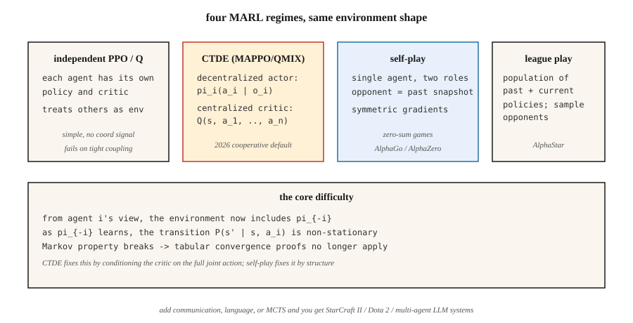

# RL Multi-Agen

> RL single-agen mengasumsikan lingkungan bersifat stasioner. Tempatkan dua agen pembelajar di dunia yang sama dan asumsi itu pun runtuh: setiap agen adalah bagian dari lingkungan agen lainnya, dan keduanya terus berubah. RL multi-agen adalah sekumpulan trik agar pembelajaran tetap konvergen ketika asumsi Markov tidak lagi berlaku.

**Jenis:** Bangun
**Bahasa:** Python, TypeScript
**Prasyarat:** Fase 9 · 04 (Q-learning), Fase 9 · 06 (REINFORCE), Fase 9 · 07 (Aktor-Kritik)
**Waktu:** ~45 menit

## Masalah

Sebuah robot yang belajar menavigasi ruangan adalah masalah RL single-agen. Sebuah tim sepak bola bukan. AlphaStar yang melawan lawan StarCraft bukan. Sebuah pasar yang berisi agen-agen penawaran bukan. Dua mobil yang bernegosiasi di persimpangan empat arah bukan. Masalah dunia nyata banyak-lawan-banyak juga bukan.

Dalam setiap setting multi-agen, dari sudut pandang salah satu agen, agen-agen lain *adalah* bagian dari lingkungan. Saat mereka belajar dan mengubah perilaku, lingkungan menjadi tidak stasioner. Sifat Markov — "keadaan berikutnya hanya bergantung pada keadaan saat ini dan aksi saya" — dilanggar karena keadaan berikutnya juga bergantung pada apa yang *dipilih oleh agen lain*, dan kebijakan mereka adalah target yang bergerak.

Ini merusak bukti konvergensi tabular (jaminan Q-learning mengasumsikan lingkungan stasioner). Ini juga merusak deep RL naif: agen-agen saling mengejar dalam loop, tidak pernah konvergen ke kebijakan yang stabil. Anda memerlukan teknik khusus multi-agen: pelatihan terpusat / eksekusi terdesentralisasi, baseline kontrafaktual, league play, self-play.

Aplikasi 2026: kawanan robot, perutean lalu lintas, armada kendaraan otonom, simulator pasar, sistem LLM multi-agen (Fase 16), dan permainan apa pun dengan lebih dari satu pemain cerdas.

## Konsep



**Formalisme: Permainan Markov.** Generalisasi MDP: keadaan $S$, aksi gabungan $a = (a_1, \ldots, a_n)$, transisi $P(s' \mid s, a)$, dan hadiah per agen $R_i(s, a, s')$. Setiap agen $i$ memaksimalkan imbal hasilnya sendiri di bawah kebijakannya sendiri $\pi_i$. Jika hadiahnya identik, ini **kooperatif penuh**. Jika zero-sum, ini **adversarial**. Jika campuran, ini **general-sum**.

**Tantangan inti:**

- **Ketidakstasioneran.** $P(s' \mid s, a_i)$ dari sudut pandang agen $i$ bergantung pada $\pi_{-i}$, yang terus berubah.
- **Penetapan kredit (credit assignment).** Dengan hadiah bersama, agen mana yang menyebabkannya?
- **Koordinasi eksplorasi.** Agen harus mengeksplorasi strategi yang saling melengkapi, bukan mengeksplorasi keadaan yang sama secara berulang.
- **Skalabilitas.** Ruang aksi gabungan tumbuh secara eksponensial terhadap $n$.
- **Observabilitas parsial.** Setiap agen hanya melihat observasinya sendiri; keadaan global tersembunyi.

**Empat rezim dominan:**

**1. Independent Q-learning / independent PPO (IQL, IPPO).** Setiap agen mempelajari Q atau kebijakannya sendiri, memperlakukan agen lain sebagai bagian dari lingkungan. Sederhana, kadang berhasil (terutama dengan replay pengalaman yang bertindak sebagai trik peredam pemodelan-agen). Konvergensi teoritis: tidak ada. Dalam praktik: cukup untuk tugas yang terkopulasi longgar, buruk untuk yang terkopulasi erat.

**2. Pelatihan terpusat, eksekusi terdesentralisasi (CTDE).** Paradigma modern yang paling umum. Setiap agen memiliki *kebijakan* $\pi_i$ sendiri yang bersyarat pada observasi lokal $o_i$ — eksekusi terdesentralisasi standar saat di-deploy. Selama *pelatihan*, kritik terpusat $Q(s, a_1, \ldots, a_n)$ bersyarat pada keadaan global penuh dan aksi gabungan. Contoh:
- **MADDPG** (Lowe et al. 2017): DDPG dengan satu kritik terpusat per agen.
- **COMA** (Foerster et al. 2017): baseline kontrafaktual — bertanya "apa hadiah saya seandainya saya mengambil aksi $a'$?" — untuk mengisolasi kontribusi saya.
- **MAPPO** / **IPPO** dengan kritik bersama (Yu et al. 2022): PPO dengan fungsi nilai terpusat. Dominan pada 2026 untuk MARL kooperatif.
- **QMIX** (Rashid et al. 2018): dekomposisi nilai — $Q_{\text{tot}}(s, a) = f(Q_1(s, a_1), \ldots, Q_n(s, a_n))$ dengan pencampuran monoton.

**3. Self-play.** Dua salinan agen yang sama saling bermain. Kebijakan lawan *adalah* kebijakan saya dari snapshot masa lalu. AlphaGo / AlphaZero / MuZero. OpenAI Five. Paling cocok untuk permainan zero-sum; sinyal pelatihannya simetris.

**4. League play.** Perpanjangan self-play untuk lingkungan general-sum / adversarial: simpan populasi kebijakan masa lalu dan terkini, ambil sampel lawan dari league, lalu latih melawan mereka. Tambahkan exploiter (spesialis mengalahkan yang terbaik saat ini) dan main exploiter (spesialis mengalahkan para exploiter). AlphaStar (StarCraft II). Diperlukan ketika permainan memungkinkan siklus strategi "batu–kertas–gunting".

**Komunikasi.** Izinkan agen saling mengirim pesan hasil pembelajaran $m_i$. Ini bekerja pada setting kooperatif. Foerster et al. (2016) menunjukkan bahwa komunikasi antar-agen yang terdiferensialkan dapat dilatih ujung-ke-ujung. Sistem multi-agen berbasis LLM masa kini (Fase 16) pada dasarnya berkomunikasi dalam bahasa alami.

```figure
f3-marl-orbit
```

## Bangun

Pelajaran ini memakai GridWorld 6×6 dengan dua agen kooperatif. Keduanya mulai di sudut yang berlawanan dan harus mencapai tujuan bersama. Hadiah bersama: `-1` per langkah selama salah satu agen masih bergerak, `+10` ketika keduanya tiba. Lihat `code/main.py`.

### Langkah 1: lingkungan multi-agen

```python
class CoopGridWorld:
    def __init__(self):
        self.size = 6
        self.goal = (5, 5)

    def reset(self):
        return ((0, 0), (5, 0))  # dua agen

    def step(self, state, actions):
        a1, a2 = state
        new1 = move(a1, actions[0])
        new2 = move(a2, actions[1])
        done = (new1 == self.goal) and (new2 == self.goal)
        reward = 10.0 if done else -1.0
        return (new1, new2), reward, done
```

Ruang aksi *gabungan* adalah `|A|² = 16`. Keadaan global adalah dua posisi.

### Langkah 2: independent Q-learning

Setiap agen menjalankan tabel-Q sendiri yang dikunci pada keadaan gabungan. Pada setiap langkah: kedua agen memilih aksi ε-greedy, mengumpulkan transisi gabungan, lalu masing-masing memperbarui Q-nya dengan hadiah bersama.

```python
def independent_q(env, episodes, alpha, gamma, epsilon):
    Q1, Q2 = defaultdict(default_q), defaultdict(default_q)
    for _ in range(episodes):
        s = env.reset()
        done = False
        while not done:
            a1 = epsilon_greedy(Q1, s, epsilon)
            a2 = epsilon_greedy(Q2, s, epsilon)
            s_next, r, done = env.step(s, (a1, a2))
            if done:
                Q1[s][a1] += alpha * (r - Q1[s][a1])
                Q2[s][a2] += alpha * (r - Q2[s][a2])
                break
            target1 = r + gamma * max(Q1[s_next].values())
            target2 = r + gamma * max(Q2[s_next].values())
            Q1[s][a1] += alpha * (target1 - Q1[s][a1])
            Q2[s][a2] += alpha * (target2 - Q2[s][a2])
            s = s_next
```

Bekerja pada tugas ini karena hadiahnya rapat dan selaras. Gagal pada tugas yang terkopulasi erat (misalnya ketika satu agen harus *menunggu* agen lain).

### Langkah 3: Q terpusat dengan pembaruan nilai terdekomposisi

Gunakan satu Q atas aksi gabungan $Q(s, a_1, a_2)$. Perbarui dari hadiah bersama. Desentralisasi saat eksekusi dengan marginalisasi: $\pi_i(s) = \arg\max_{a_i} \max_{a_{-i}} Q(s, a_1, a_2)$. Ini menukar ruang aksi gabungan yang eksponensial dengan pandangan global yang *benar*.

### Langkah 4: self-play sederhana (adversarial 2 agen)

Agen yang sama, dua peran. Latih agen A melawan agen B; setelah $K$ episode, salin bobot A ke B. Pelatihan simetris, kemajuan konsisten. Resep AlphaZero dalam skala mini.

## Jebakan

- **Replay tidak stasioner.** Replay pengalaman dengan agen independen lebih buruk daripada single-agen karena transisi lama dihasilkan oleh lawan yang sudah usang. Perbaiki: beri label ulang atau beri bobot berdasarkan kedekatan waktu (recency).
- **Ambiguitas penetapan kredit.** Hadiah bersama setelah episode yang panjang; tidak ada cara jelas untuk menyatakan agen mana yang berkontribusi. Perbaiki: baseline kontrafaktual (COMA), atau reward shaping per agen.
- **Drift / saling mengejar kebijakan.** Respons terbaik tiap agen berubah seiring pembaruan agen lain. Perbaiki: kritik terpusat, laju pembelajaran yang lambat, atau bekukan satu agen pada satu waktu.
- **Reward hacking lewat koordinasi.** Agen menemukan eksploitasi terkoordinasi yang tidak diprediksi oleh desainer. Agen lelang konvergen ke penawaran nol. Perbaiki: desain hadiah yang cermat, batasan perilaku.
- **Redundansi eksplorasi.** Kedua agen mengeksplorasi pasangan keadaan-aksi yang sama. Perbaiki: bonus entropi per agen, atau pensyaratan peran (role-conditioning).
- **Siklus league.** Self-play murni bisa terjebak dalam siklus dominasi. Perbaiki: league play dengan lawan yang beragam.
- **Ledakan sampel.** `n` agen × ruang keadaan × aksi gabungan. Aproksimasi dengan aproksimasi fungsi; ruang aksi terfaktorisasi (satu head kebijakan per agen).

## Pakai

Peta aplikasi MARL 2026:

| Domain | Metode | Catatan |
|--------|--------|-------|
| Navigasi / manipulasi kooperatif | MAPPO / QMIX | CTDE; kritik bersama + aktor terdesentralisasi. |
| Permainan dua pemain (catur, Go, poker) | Self-play dengan MCTS (AlphaZero) | Zero-sum; pelatihan simetris. |
| Multipemain kompleks (Dota, StarCraft) | League play + pretraining imitasi | OpenAI Five, AlphaStar. |
| Armada kendaraan otonom | CTDE MAPPO / PPO dengan atensi | Observasi parsial; ukuran tim variabel. |
| Pasar lelang | Keseimbangan teori permainan + RL | Mean-field RL saat `n` → ∞. |
| Sistem multi-agen LLM (Fase 16) | Komunikasi bahasa alami + pensyaratan peran | Loop RL pada lapisan perencanaan agen. |

Pada 2026, area pertumbuhan terbesar MARL adalah yang berbasis LLM: kawanan agen model bahasa yang bernegosiasi, berdebat, dan membangun perangkat lunak. RL muncul sebagai optimasi preferensi pada keluaran *tingkat trajektori*, bukan tingkat token (Fase 16 · 03).

## Kirim

Simpan sebagai `outputs/skill-marl-architect.md`:

```markdown
---
name: marl-architect
description: Pilih rezim RL multi-agen yang tepat (IPPO, CTDE, self-play, league) untuk suatu tugas.
version: 1.0.0
phase: 9
lesson: 10
tags: [rl, multi-agent, marl, self-play]
---

Diketahui tugas dengan `n` agen, keluarkan:

1. Klasifikasi rezim. Kooperatif / adversarial / general-sum. Berikan justifikasi.
2. Algoritme. IPPO / MAPPO / QMIX / self-play / league. Alasan yang terkait dengan keeratan kopling dan struktur hadiah.
3. Akses informasi. Pelatihan terpusat (informasi global apa yang masuk ke kritik)? Eksekusi terdesentralisasi?
4. Penetapan kredit. Baseline kontrafaktual, dekomposisi nilai, atau reward shaping.
5. Rencana eksplorasi. Entropi per agen, pelatihan berbasis populasi, atau league.

Tolak independent Q-learning pada tugas kooperatif yang terkopulasi erat. Tolak merekomendasikan self-play untuk general-sum yang berisiko siklus. Tandai setiap pipeline MARL tanpa evaluasi lawan tetap (angka self-play yang diseleksi secara bias adalah hal yang umum).
```

## Latihan

1. **Mudah.** Latih independent Q-learning pada GridWorld kooperatif 2 agen. Berapa episode hingga imbal hasil rerata > 0? Plot kurva pembelajaran gabungannya.
2. **Sedang.** Tambahkan tugas "koordinasi": tujuan tercapai hanya jika kedua agen menginjaknya pada giliran yang sama. Apakah independent Q tetap konvergen? Apa yang rusak?
3. **Sulit.** Implementasikan kritik terpusat untuk pelatihan gaya MAPPO dan bandingkan kecepatan konvergensinya dengan independent PPO pada tugas koordinasi.

## Istilah Kunci

| Istilah | Yang orang katakan | Yang sebenarnya dimaksud |
|---------|-------------------|--------------------------|
| Permainan Markov | "MDP multi-agen" | $(S, A_1, \ldots, A_n, P, R_1, \ldots, R_n)$; setiap agen memiliki hadiahnya sendiri. |
| CTDE | "Pelatihan terpusat, eksekusi terdesentralisasi" | Kritik gabungan saat pelatihan; kebijakan tiap agen hanya memakai observasi lokal. |
| IPPO | "PPO independen" | Setiap agen menjalankan PPO secara terpisah. Baseline sederhana; sering diremehkan. |
| MAPPO | "PPO multi-agen" | PPO dengan fungsi nilai terpusat yang bersyarat pada keadaan global. |
| QMIX | "Dekomposisi nilai monoton" | $Q_{\text{tot}} = f_{\text{monotone}}(Q_1, \ldots, Q_n)$ memungkinkan argmax terdesentralisasi. |
| COMA | "Multi-agen kontrafaktual" | Keuntungan = Q saya dikurangi Q ekspektasian yang dimarginalkan atas aksi saya. |
| Self-play | "Agen versus diri masa lalu" | Satu agen, dua peran; standar untuk permainan zero-sum. |
| League play | "Pelatihan populasi" | Simpan kebijakan masa lalu, ambil sampel lawan dari kolam; menangani siklus strategi. |

## Bacaan Lanjutan

- [Lowe et al. (2017). Multi-Agent Actor-Critic for Mixed Cooperative-Competitive Environments (MADDPG)](https://arxiv.org/abs/1706.02275) — CTDE dengan kritik terpusat.
- [Foerster et al. (2017). Counterfactual Multi-Agent Policy Gradients (COMA)](https://arxiv.org/abs/1705.08926) — baseline kontrafaktual untuk penetapan kredit.
- [Rashid et al. (2018). QMIX: Monotonic Value Function Factorisation](https://arxiv.org/abs/1803.11485) — dekomposisi nilai dengan monotonisitas.
- [Yu et al. (2022). The Surprising Effectiveness of PPO in Cooperative Multi-Agent Games (MAPPO)](https://arxiv.org/abs/2103.01955) — PPO sangat kuat untuk MARL.
- [Vinyals et al. (2019). Grandmaster level in StarCraft II using multi-agent reinforcement learning (AlphaStar)](https://www.nature.com/articles/s41586-019-1724-z) — league play dalam skala besar.
- [Silver et al. (2017). Mastering the game of Go without human knowledge (AlphaGo Zero)](https://www.nature.com/articles/nature24270) — self-play murni dalam permainan zero-sum.
- [Sutton & Barto (2018). Ch. 15 — Neuroscience & Ch. 17 — Frontiers](http://incompleteideas.net/book/RLbook2020.pdf) — memuat pembahasan singkat buku teks tentang setting multi-agen dan masalah ketidakstasioneran yang dirancang untuk diatasi oleh CTDE.
- [Zhang, Yang & Başar (2021). Multi-Agent Reinforcement Learning: A Selective Overview](https://arxiv.org/abs/1911.10635) — survei yang mencakup MARL kooperatif, kompetitif, dan campuran beserta hasil konvergensinya.
