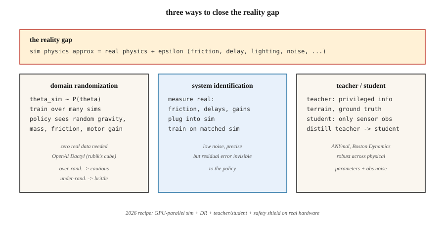

# Transfer Sim-to-Real

> Sebuah kebijakan yang dilatih di simulator lalu gagal pada perangkat keras adalah kebijakan yang menghafal simulator itu. Randomisasi domain, adaptasi domain, dan identifikasi sistem adalah tiga alat untuk membuat pengontrol hasil pembelajaran menyeberangi jurang realitas.

**Jenis:** Belajar
**Bahasa:** Python, TypeScript
**Prasyarat:** Fase 9 · 08 (PPO), Fase 2 · 10 (Bias/Varians)
**Waktu:** ~45 menit

## Masalahnya

Melatih robot sungguhan itu lambat, berbahaya, dan mahal. Sebuah biped membutuhkan jutaan episode pelatihan untuk belajar berjalan; biped sungguhan yang jatuh sekali saja sudah merusak perangkat keras. Simulasi memberi Anda reset tanpa batas, keterulangan yang deterministik, lingkungan paralel, dan tidak ada kerusakan fisik.

Tapi simulator itu salah. Bantalan (bearing) memiliki gesekan lebih besar daripada model MuJoCo. Kamera memiliki distorsi lensa yang tidak disertakan simulator. Motor memiliki keterlambatan, backlash, dan saturasi yang dilewatkan oleh 99% model sim. Angin, debu, dan pencahayaan yang berubah menyabotase kebijakan yang dilatih pada render yang steril. **Jurang realitas** — perbedaan sistematis antara distribusi sim dan distribusi dunia nyata — adalah masalah utama RL yang diterapkan pada robotika.

Anda membutuhkan kebijakan yang *tahan terhadap pergeseran distribusi sim-to-real*. Tiga pendekatan historis: randomisasi simulator (randomisasi domain), adaptasi kebijakan dengan sedikit data dunia nyata (adaptasi domain / fine-tuning), atau mengidentifikasi parameter sistem nyata lalu mencocokkannya (identifikasi sistem). Pada 2026, resep dominan menggabungkan ketiganya dengan simulasi paralel masif (Isaac Sim, Isaac Lab, Mujoco MJX di GPU).

## Konsepnya



**Randomisasi Domain (DR).** Tobin et al. 2017, Peng et al. 2018. Selama pelatihan, randomisasi setiap parameter sim yang mungkin berbeda pada robot sungguhan: massa, koefisien gesekan, gain PD motor, noise sensor, posisi kamera, pencahayaan, tekstur, model kontak. Kebijakan mempelajari distribusi bersyarat atas "sim mana yang sedang digunakan hari ini" dan melakukan generalisasi pada seluruh rentangnya. Jika robot sungguhan berada di dalam amplop pelatihan, kebijakan itu bekerja.

- **Kelebihan:** tidak memerlukan data dunia nyata. Satu resep, banyak robot.
- **Kekurangan:** pelatihan yang terlalu terandomisasi menghasilkan kebijakan "universal" tetapi terlalu berhati-hati. Terlalu banyak noise ≈ terlalu banyak regularisasi.

**Identifikasi Sistem (SI).** Cocokkan parameter simulator dengan data dunia nyata sebelum pelatihan. Jika Anda dapat mengukur gesekan sendi lengan pada robot sungguhan, masukkan nilai itu ke dalam sim. Lalu latih kebijakan yang mengharapkan nilai-nilai tersebut. Memerlukan akses ke sistem nyata, tetapi langsung mengecilkan jurang realitas.

- **Kelebihan:** target pelatihan yang presisi dan ber-noise rendah.
- **Kekurangan:** error model residual tidak terlihat oleh kebijakan; efek kecil yang tidak teridentifikasi (mis. zona mati motor) tetap bisa menggagalkan penerapan.

**Adaptasi Domain.** Latih di sim, lalu fine-tuning dengan sedikit data dunia nyata. Dua varian:

- **Real2Sim2Real:** pelajari simulator residual $f(s, a, z) - f_{\text{sim}}(s, a)$ menggunakan rollout dunia nyata, lalu latih di sim yang sudah dikoreksi. Menutup jurang tanpa banyak data dunia nyata.
- **Adaptasi observasi:** latih kebijakan yang memetakan observasi nyata → observasi mirip sim melalui ekstraktor fitur hasil pembelajaran (mis. GAN piksel-ke-piksel). Pengontrol tetap berada di sim.

**Pembelajaran istimewa / guru–murid.** Miki et al. 2022 (quadruped ANYmal). Latih seorang *guru* di simulasi yang memiliki akses ke informasi istimewa (gesekan ground truth, ketinggian medan, drift IMU). Distilasi seorang *murid* yang hanya melihat observasi sensor sungguhan. Murid belajar menyimpulkan fitur istimewa dari riwayat, sehingga tangguh terhadap parameter fisik.

**Simulasi paralel masif.** 2024–2026. Isaac Lab, Mujoco MJX, Brax semuanya menjalankan ribuan robot paralel dalam satu GPU. PPO dengan 4.096 humanoid paralel mengumpulkan pengalaman bertahun-tahun dalam hitungan jam. "Jurang realitas" menyusut seiring distribusi pelatihan melebar; DR menjadi hampir gratis ketika masing-masing dari 4.096 lingkungan itu memiliki parameter terandomisasi yang berbeda.

**Resep dunia nyata 2026 (contoh berjalan quadruped):**

1. Sim paralel masif dengan gravitasi, gesekan, gain motor, dan beban yang terandomisasi domain.
2. Kebijakan guru dilatih dengan informasi istimewa (peta medan, kecepatan tubuh ground truth).
3. Kebijakan murid didistilasi dari guru hanya dengan propiosepsi (encoder sendi kaki).
4. Adaptasi observasi opsional melalui autoencoder pada IMU sungguhan.
5. Terapkan. Zero-shot pada 10+ lingkungan. Jika gagal, lakukan fine-tuning dunia nyata selama beberapa menit dengan PPO yang dibatasi keselamatan.

```figure
f3-reality-gap
```

## Bangunlah

Kode pelajaran ini adalah demonstrasi kecil randomisasi domain pada GridWorld dengan transisi yang *ber-noise*. Kita melatih kebijakan yang mengalami probabilitas slip terandomisasi di "sim" dan mengevaluasinya pada "real" dengan tingkat slip yang tidak pernah dilihatnya selama pelatihan. Bentuknya dipetakan langsung ke transfer MuJoCo-ke-perangkat-keras.

### Langkah 1: sim berparameter

```python
def step(state, action, slip):
    if rng.random() < slip:
        action = random_perpendicular(action)
    ...
```

`slip` adalah parameter yang diekspos simulator. Pada robotika sungguhan, itu bisa berupa gesekan, massa, gain motor — apa pun yang bergeser antara sim dan real.

### Langkah 2: latih dengan DR

Pada awal setiap episode, ambil sampel `slip ~ Uniform[0.0, 0.4]`. Latih PPO / Q-learning / apa pun. Lakukan ini selama banyak episode.

### Langkah 3: evaluasi zero-shot pada slip "real"

Evaluasi pada `slip ∈ {0.0, 0.1, 0.2, 0.3, 0.5, 0.7}`. Empat pertama berada di dalam dukungan pelatihan; `0.5` dan `0.7` berada di luarnya. Kebijakan yang dilatih dengan DR seharusnya tetap near-optimal di dalam dukungan dan menurun secara anggun di luarnya. Kebijakan yang dilatih dengan slip tetap akan rapuh di luar slip pelatihannya.

### Langkah 4: bandingkan dengan pelatihan sempit

Latih kebijakan kedua hanya dengan `slip = 0.0`. Evaluasi pada sapuan `slip` yang sama. Anda akan melihat penurunan katastropik begitu slip real > 0.

## Jebakan

- **Terlalu banyak randomisasi.** Latih pada `slip ∈ [0, 0.9]` dan kebijakan Anda menjadi sangat menghindari risiko sehingga tidak pernah mencoba jalur optimal. Cocokkan distribusi dunia nyata yang *diharapkan*, bukan "apa pun bisa terjadi."
- **Terlalu sedikit randomisasi.** Latih pada irisan tipis dan kebijakan tidak bisa melakukan generalisasi sama sekali. Gunakan kurikulum adaptif (Automatic Domain Randomization) yang melebarkan distribusi seiring kebijakan membaik.
- **Ruang parameter yang salah diidentifikasi.** Merandomisasi hal yang salah (hue kamera padahal jurangnya adalah keterlambatan motor) dan DR tidak membantu. Profilkan robot sungguhan terlebih dahulu.
- **Kebocoran informasi istimewa.** Guru yang menggunakan keadaan global untuk tindakan, bukan hanya observasi, dapat menghasilkan murid yang tidak bisa mengejar. Pastikan kebijakan guru dapat direalisasikan oleh murid dengan riwayat observasi.
- **Kegagalan transfer sim-to-sim.** Jika kebijakan Anda tidak tangguh terhadap varian sim yang lebih sulit, ia juga tidak akan tangguh terhadap dunia nyata. Selalu uji pada varian sim yang disisihkan sebelum menerapkan.
- **Tanpa amplop keselamatan dunia nyata.** Kebijakan yang bekerja di sim dan "bekerja di real" tanpa pelindung keselamatan tingkat rendah tetap bisa merusak perangkat keras. Tambahkan batas laju, batas torsi, dan batas sendi pada pengontrol yang tidak dipelajari.

## Gunakanlah

Tumpukan sim-to-real 2026:

| Domain | Tumpukan |
|--------|----------|
| Locomotion berkaki (ANYmal, Spot, humanoid) | Isaac Lab + DR + guru / murid istimewa |
| Manipulasi (tangan dexterous, pick-and-place) | Isaac Lab + DR + DR-GAN untuk visi |
| Mengemudi otonom | CARLA / NVIDIA DRIVE Sim + DR + fine-tuning real |
| Balap drone | RotorS / Flightmare + DR + adaptasi daring |
| Manipulasi jari/dalam tangan | OpenAI Dactyl (DR dalam skala yang belum pernah ada) |
| Lengan industri | MuJoCo-Warp + SI + sedikit fine-tuning real |

Untuk kontrol pada semua skala, alurnya konsisten: cocokkan sim sebaik mungkin, randomisasi apa yang tidak bisa Anda cocokkan, latih kebijakan yang sangat besar, distilasi, terapkan dengan pelindung keselamatan.

## Kirimkanlah

Simpan sebagai `outputs/skill-sim2real-planner.md`:

```markdown
---
name: sim2real-planner
description: Rencanakan pipeline transfer sim-to-real untuk robot + tugas tertentu, mencakup DR, SI, dan keselamatan.
version: 1.0.0
phase: 9
lesson: 11
tags: [rl, sim2real, robotics, domain-randomization]
---

Dengan platform robot, sebuah tugas, dan akses ke waktu perangkat keras sungguhan, keluarkan:

1. Inventarisasi jurang realitas. Sumber yang dicurigai diurutkan berdasarkan dampak yang diharapkan (kontak, sensing, keterlambatan aktuasi, visi).
2. Parameter DR. Daftar pasti, rentang, distribusi. Justifikasi setiap rentang terhadap pengukuran dunia nyata.
3. Langkah SI. Parameter mana yang diukur; metode pengukuran.
4. Pembagian guru/murid. Informasi istimewa apa yang dipakai guru; observasi apa yang dipakai murid.
5. Amplop keselamatan. Batas tingkat rendah, pemberhentian darurat, pengontrol cadangan.

Tolak penerapan tanpa (a) uji varian sim zero-shot, (b) pelindung keselamatan, (c) rencana rollback. Tandai rentang DR apa pun yang lebih lebar dari 3× variabilitas real terukur sebagai kemungkinan besar terlalu terandomisasi.
```

## Latihan

1. **Mudah.** Latih agen Q-learning pada GridWorld slip tetap (slip=0.0). Evaluasi pada $\text{slip} \in \lbrace 0.0, 0.1, 0.3, 0.5 \rbrace$. Plot return versus slip.
2. **Sedang.** Latih agen Q-learning DR dengan sampel `slip ~ Uniform[0, 0.3]`. Evaluasi sapuan yang sama. Seberapa besar keuntungan DR pada slip=0.5 (di luar distribusi)?
3. **Sulit.** Terapkan kurikulum: mulai dengan slip=0.0, lebarkan rentang DR setiap kali kebijakan mencapai 90% dari optimal. Ukur total langkah lingkungan untuk mencapai slip=0.3 zero-shot dibandingkan baseline DR tetap.

## Istilah Kunci

| Istilah | Kata orang | Arti sebenarnya |
|---------|-----------|-----------------|
| Jurang realitas | "Perbedaan sim-to-real" | Pergeseran distribusi antara fisik/sensing pelatihan dan penerapan. |
| Randomisasi domain (DR) | "Latih di simulator acak" | Randomisasi parameter sim selama pelatihan agar kebijakan melakukan generalisasi. |
| Identifikasi sistem (SI) | "Ukur real dan cocokkan sim" | Estimasi parameter fisik dunia nyata; atur sim agar cocok. |
| Adaptasi domain | "Fine-tuning pada data real" | Fine-tuning dunia nyata dalam skala kecil setelah pelatihan di sim; dapat menyesuaikan observasi atau dinamika. |
| Informasi istimewa | "Ground truth untuk guru" | Informasi yang hanya ada di sim; murid harus menyimpulkannya dari riwayat observasi. |
| Guru/murid | "Distil istimewa → teramati" | Guru dilatih dengan jalan pintas; murid belajar meniru tanpanya. |
| ADR | "Automatic Domain Randomization" | Kurikulum yang melebarkan rentang DR seiring kebijakan membaik. |
| Real2Sim | "Tutup jurang dengan data real" | Pelajari residual agar sim meniru rollout dunia nyata. |

## Bacaan Lanjutan

- [Tobin et al. (2017). Domain Randomization for Transferring Deep Neural Networks from Simulation to the Real World](https://arxiv.org/abs/1703.06907) — makalah DR awal (visi untuk robotika).
- [Peng et al. (2018). Sim-to-Real Transfer of Robotic Control with Dynamics Randomization](https://arxiv.org/abs/1710.06537) — DR untuk dinamika, locomotion quadruped.
- [OpenAI et al. (2019). Solving Rubik's Cube with a Robot Hand](https://arxiv.org/abs/1910.07113) — Dactyl, ADR dalam skala besar.
- [Miki et al. (2022). Learning robust perceptive locomotion for quadrupedal robots in the wild](https://www.science.org/doi/10.1126/scirobotics.abk2822) — guru–murid untuk ANYmal.
- [Makoviychuk et al. (2021). Isaac Gym: High Performance GPU Based Physics Simulation for Robot Learning](https://arxiv.org/abs/2108.10470) — simulator paralel masif yang mendorong penerapan 2025–2026.
- [Akkaya et al. (2019). Automatic Domain Randomization](https://arxiv.org/abs/1910.07113) — metode kurikulum ADR.
- [Sutton & Barto (2018). Ch. 8 — Planning and Learning with Tabular Methods](http://incompleteideas.net/book/RLbook2020.pdf) — kerangka Dyna (memakai model untuk perencanaan + rollout) yang mendasari pipeline sim-to-real modern.
- [Zhao, Queralta & Westerlund (2020). Sim-to-Real Transfer in Deep Reinforcement Learning for Robotics: a Survey](https://arxiv.org/abs/2009.13303) — taksonomi metode sim-to-real dengan hasil benchmark.
