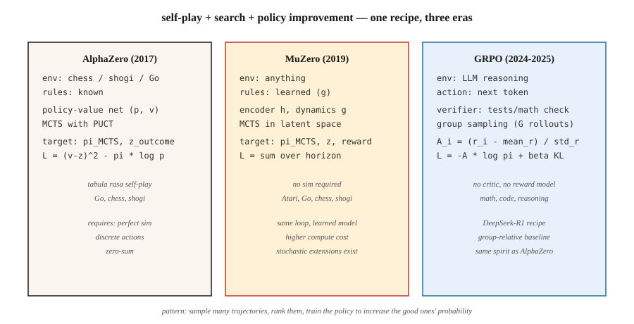

# RL untuk Game — AlphaZero, MuZero, dan Era Penalaran LLM

> 1992: TD-Gammon mengalahkan juara manusia dalam backgammon dengan TD murni. 2016: AlphaGo mengalahkan Lee Sedol. 2017: AlphaZero mendominasi catur, shogi, dan Go dari nol. 2025: DeepSeek-R1 membuktikan resep yang sama, dengan GRPO menggantikan PPO, bekerja pada penalaran. Game adalah benchmark yang mendorong setiap terobosan dalam fase ini.

**Jenis:** Bangun
**Bahasa:** Python, TypeScript
**Prasyarat:** Fase 9 · 05 (DQN), Fase 9 · 08 (PPO), Fase 9 · 09 (RLHF), Fase 9 · 10 (MARL)
**Waktu:** ~120 menit

## Masalahnya

Game memiliki semua yang diinginkan RL. Hadiah yang bersih (menang/kalah). Episode tanpa batas (reset self-play). Simulasi sempurna (game *adalah* simulatornya). Ruang aksi diskrit atau kontinu kecil. Struktur multi-agen yang memaksa ketahanan adversarial.

Dan game adalah sarana diujinya setiap terobosan besar RL. TD-Gammon (backgammon, 1992). Atari-DQN (2013). AlphaGo (2016). AlphaZero (2017). OpenAI Five (Dota 2, 2019). AlphaStar (StarCraft II, 2019). MuZero (model hasil pembelajaran, 2019). AlphaTensor (perkalian matriks, 2022). AlphaDev (algoritme pengurutan, 2023). DeepSeek-R1 (penalaran matematika, 2025) — demonstrasi terbaru bahwa teknik game-RL bekerja pada teks.

Capstone ini meninjau tiga arsitektur tonggak — AlphaZero, MuZero, dan GRPO — melalui satu lensa penyatu: **self-play + pencarian + perbaikan kebijakan**. Masing-masing menggeneralisasi pendahulunya; GRPO khususnya adalah resep AlphaZero yang diterapkan pada penalaran LLM, dengan token sebagai aksi dan verifikasi matematis sebagai sinyal kemenangan.

## Konsepnya



**Loop yang menyatukan.**

```
while True:
    trajectory = self_play(current_policy, search)     # mainkan game melawan diri sendiri
    policy_target = search.improved_policy(trajectory) # pencarian menyempurnakan kebijakan mentah
    policy_net.update(policy_target, value_target)     # pembelajaran terawasi pada keluaran pencarian
```

**AlphaZero (2017).** Silver et al. Diberikan sebuah game (catur, shogi, Go) dengan aturan yang diketahui:

- Jaringan kebijakan-nilai: satu menara $f_\theta(s) \to (p, v)$. $p$ adalah prior atas langkah-langkah legal. $v$ adalah hasil game yang diharapkan.
- Monte Carlo Tree Search (MCTS): pada setiap langkah, kembangkan pohon kelanjutan yang mungkin. Gunakan $(p, v)$ sebagai prior + bootstrap. Pilih simpul dengan UCB (PUCT): $a^{\ast} = \arg\max_a Q(s, a) + c \cdot p(a \mid s) \cdot \sqrt{N(s)} / (1 + N(s, a))$.
- Self-play: mainkan game agen melawan agen. Pada langkah $t$, distribusi kunjungan MCTS $\pi_t$ menjadi target pelatihan kebijakan.
- Fungsi rugi: $L = (v - z)^2 - \pi \cdot \log p + c \cdot \lVert \theta \rVert^2$. $z$ adalah hasil game (+1 / 0 / -1).

Nol pengetahuan manusia. Nol heuristik buatan tangan. Satu resep yang menguasai catur, shogi, dan Go setelah masing-masing puluhan juta game self-play.

**MuZero (2019).** Schrittwieser et al. Menghapus persyaratan bahwa aturan harus diketahui.

- Alih-alih lingkungan tetap, pelajari *model dinamika latent* $(h, g, f)$:
  - $h(s)$: mengodekan observasi menjadi keadaan latent.
  - $g(s_{\text{latent}}, a)$: memprediksi keadaan latent berikutnya + hadiah.
  - $f(s_{\text{latent}})$: memprediksi prior kebijakan + nilai.
- MCTS berjalan di *ruang latent hasil pembelajaran*. Pencarian yang sama, loop pelatihan yang sama.
- Bekerja pada Go, catur, shogi *dan* Atari — satu algoritme, tanpa pengetahuan aturan.

**Stochastic MuZero (2022).** Menambahkan dinamika stokastik dan simpul peluang; diperluas ke game kelas backgammon.

**Muesli, Gumbel MuZero (2022–2024).** Perbaikan pada efisiensi sampel dan pencarian deterministik.

**GRPO (2024–2025).** Resep DeepSeek-R1. Loop berbentuk AlphaZero yang sama, diterapkan pada penalaran model bahasa:

- "Game": menjawab soal matematika / pemrograman / penalaran. "Menang" = verifier (kasus uji lulus, jawaban numerik cocok) mengembalikan 1.
- Kebijakan: LLM. Aksi: token. Keadaan: prompt + respons sejauh ini.
- Tanpa kritik (model $V_\phi$ bergaya PPO). Sebaliknya, untuk setiap prompt, ambil sampel $G$ kelengkapan dari kebijakan. Hitung hadiah untuk masing-masing. Gunakan **keunggulan relatif kelompok** $A_i = (r_i - \text{mean}_r) / \text{std}_r$ sebagai sinyal untuk pembaruan bergaya REINFORCE.
- Penalti KL terhadap kebijakan referensi untuk mencegah pergeseran (seperti RLHF).
- Fungsi rugi lengkap:

  $L_{\text{GRPO}}(\theta) = -\mathbb E_{q, \lbrace o_i \rbrace} \left[ \frac{1}{G} \sum_i A_i \cdot \log \pi_\theta(o_i \mid q) \right] + \beta \cdot \mathrm{KL}(\pi_\theta \Vert \pi_{\text{ref}})$

Tanpa model hadiah hasil pembelajaran, tanpa kritik, tanpa MCTS. Verifier berbasis aturan menyediakan hadiah, baseline relatif kelompok menggantikan kritik, dan langkah pencarian dihilangkan. Menyamai atau melampaui kualitas PPO-RLHF pada benchmark penalaran dengan sebagian kecil komputasi.

**Resep R1 lengkap.** DeepSeek-R1 (DeepSeek 2025) adalah dua model dalam satu makalah:

- **R1-Zero.** Mulai dari model dasar DeepSeek-V3. Tanpa SFT. Terapkan GRPO langsung dengan dua komponen hadiah: *hadiah akurasi* (berbasis aturan — apakah jawaban akhir terurai menjadi angka yang benar / apakah kode lulus unit test) dan *hadiah format* (apakah kelengkapan membungkus chain-of-thought-nya dalam tag `<think>…</think>`). Selama ribuan langkah, panjang respons rata-rata tumbuh dari ~100 menjadi ~10.000 token dan skor benchmark matematika naik mendekati level o1-preview. Model belajar bernalar dari nol. Kelemahannya: rantai pikirannya sering sulit dibaca, mencampur bahasa, dan tidak punya kilau gaya.
- **R1.** Memperbaiki masalah keterbacaan R1-Zero dengan pipeline empat tahap:
  1. **SFT awal dingin (cold-start).** Kumpulkan beberapa ribu demonstrasi CoT panjang dengan format bersih. Lakukan supervised fine-tuning pada model dasar dengan data itu. Ini memberi titik awal yang dapat dibaca.
  2. **GRPO berorientasi penalaran.** Terapkan GRPO dengan hadiah akurasi+format ditambah hadiah *konsistensi bahasa* untuk mencegah pergantian bahasa (code-switching).
  3. **Sampling penolakan + SFT putaran 2.** Ambil sampel ~600K trajektori penalaran dari checkpoint RL, simpan hanya yang jawaban akhirnya benar dan CoT-nya terbaca, lalu gabungkan dengan ~200K contoh SFT non-penalaran (menulis, QA, self-cognition). Fine-tuning lagi model dasarnya.
  4. **GRPO spektrum penuh.** Satu putaran RL lagi yang mencakup penalaran (hadiah berbasis aturan) dan penyelarasan umum (hadiah berbasis preferensi kemanfaatan/ketidakberbahayaan).

Hasilnya menyamai o1 pada AIME dan MATH-500 dengan bobot terbuka, dan cukup kecil untuk didistilasi. Makalah yang sama juga merilis enam model padat hasil distilasi (Qwen-1.5B hingga Llama-70B) dengan SFT pada jejak penalaran R1 — tanpa RL pada murid. Distilasi dari guru RL yang kuat secara konsisten mengalahkan RL dari nol pada skala murid.

**Mengapa GRPO, bukan PPO, untuk penalaran.** Tiga alasan dalam makalah DeepSeekMath (Feb 2024): (1) tidak ada jaringan nilai yang perlu dilatih, sehingga memori berkurang setengah; (2) baseline kelompok secara alami menangani hadiah jarang di akhir trajektori yang dihasilkan tugas penalaran; (3) normalisasi per-prompt membuat keunggulan dapat dibandingkan lintas soal dengan kesulitan yang sangat berbeda — sesuatu yang tidak bisa dilakukan kritik tunggal PPO.

**Tanpa pencarian versus berbasis pencarian.** Game telah bercabang:

- *Game informasi-sempurna dengan horizon panjang* (Go, catur): tetap berbasis pencarian. AlphaZero / MuZero mendominasi.
- *Penalaran LLM*: belum ada MCTS di produksi; GRPO pada rollout penuh, best-of-N untuk komputasi inferensi. Model hadiah proses (process reward model / PRM) mengisyaratkan pencarian tingkat langkah akan ditambahkan kembali.

```figure
f3-selfplay-ladder
```

## Bangunlah

Kode di `code/main.py` mengimplementasikan **GRPO dalam skala mini**: bandit dengan beberapa kelompok sampel. Algoritmenya sama seperti pada LLM; hanya kebijakan dan lingkungannya yang lebih sederhana. Ini mengajarkan *fungsi rugi* dan *keunggulan relatif kelompok*, yaitu inovasi 2024 dari DeepSeekMath.

### Langkah 1: lingkungan verifier kecil

```python
QUESTIONS = [
    {"prompt": "q1", "correct": 3},
    {"prompt": "q2", "correct": 1},
]

def verify(prompt_idx, answer_token):
    return 1.0 if answer_token == QUESTIONS[prompt_idx]["correct"] else 0.0
```

Pada GRPO sungguhan, verifier menjalankan unit test atau memeriksa kesetaraan matematis.

### Langkah 2: kebijakan: softmax atas K token jawaban per prompt

```python
def policy_probs(theta, p_idx):
    return softmax(theta[p_idx])
```

Setara dengan keluaran lapisan terakhir LLM yang dikondisikan pada sebuah prompt.

### Langkah 3: sampling kelompok dan keunggulan relatif kelompok

```python
def grpo_step(theta, p_idx, G=8, beta=0.01, lr=0.1, rng=None):
    probs = policy_probs(theta, p_idx)
    samples = [sample(probs, rng) for _ in range(G)]
    rewards = [verify(p_idx, s) for s in samples]
    mean_r = sum(rewards) / G
    std_r = stddev(rewards) + 1e-8
    advs = [(r - mean_r) / std_r for r in rewards]

    for a, A in zip(samples, advs):
        grad = onehot(a) - probs
        for i in range(len(probs)):
            theta[p_idx][i] += lr * A * grad[i]
    # Penalti KL: tarik theta menuju referensi
    for i in range(len(probs)):
        theta[p_idx][i] -= beta * (theta[p_idx][i] - reference[p_idx][i])
```

Keunggulan relatif kelompok adalah trik DeepSeek 2024. Kritik tidak diperlukan. "Baseline"-nya adalah rata-rata kelompok, dan normalisasi memakai simpangan baku kelompok.

### Langkah 4: bandingkan dengan baseline REINFORCE (tanpa nilai)

Pengaturan yang sama, komputasi yang sama, REINFORCE polos. GRPO konvergen lebih cepat dan lebih stabil.

### Langkah 5: amati entropi dan KL

Diagnostik yang sama seperti RLHF: KL rata-rata terhadap referensi, entropi kebijakan, hadiah dari waktu ke waktu. Begitu semuanya stabil, pelatihan selesai.

## Jebakan

- **Reward hacking lewat permainan verifier.** GRPO mewarisi risiko RLHF: jika verifier salah atau bisa dieksploitasi, LLM akan menemukan celahnya. Verifier yang tangguh (beberapa kasus uji, bukti formal) sangat penting.
- **Ukuran kelompok terlalu kecil.** Varians baseline rata-rata kelompok berbanding $1/G$ (galat bakuannya $1/\sqrt{G}$). Di bawah $G = 4$, sinyal keunggulan ber-noise; pilihan standar adalah $G = 8$ sampai 64.
- **Bias panjang.** Kelengkapan LLM dengan panjang berbeda memiliki log-probabilitas berbeda. Normalisasi dengan jumlah token, atau pakai log-prob tingkat sekuens, atau potong sampai panjang maksimum.
- **Siklus self-play murni.** Pelatihan bergaya AlphaZero bisa terjebak dalam loop dominasi pada game jumlah-umum (general-sum). Dimitigasi dengan kumpulan lawan yang beragam (league play, Pelajaran 10).
- **Ketidakcocokan pencarian–kebijakan.** AlphaZero melatih kebijakan untuk meniru keluaran pencarian. Jika jaringan kebijakan terlalu kecil untuk merepresentasikan distribusi pencarian, pelatihan mandek.
- **Batas komputasi minimum.** MuZero / AlphaZero membutuhkan komputasi masif. Satu ablasi saja sering ratusan jam-GPU. Ada demo mini (mis. AlphaZero pada Connect Four) untuk belajar.
- **Cakupan verifier.** Unit test yang lulus untuk solusi buggy justru memperkuat bug itu. Rancang verifier yang menangkap kasus tepi.

## Gunakanlah

Lanskap game-RL 2026, per domain:

| Domain | Metode dominan |
|--------|----------------|
| Game papan dua pemain jumlah-nol (Go, catur, shogi) | AlphaZero / MuZero / KataGo |
| Game kartu informasi-tak-sempurna (poker) | CFR + pembelajaran mendalam (DeepStack, Libratus, Pluribus) |
| Atari / game piksel | Muesli / MuZero / IMPALA-PPO |
| Strategi multipemain skala besar (Dota, StarCraft) | PPO + self-play + liga (OpenAI Five, AlphaStar) |
| Penalaran matematika/kode LLM | GRPO (DeepSeek-R1, Qwen-RL, replikasi open) |
| Penyelarasan LLM | DPO / RLHF-PPO (bukan GRPO; verifier berupa preferensi, bukan sesuatu yang dapat diverifikasi) |
| Robotika | PPO + DR (bukan game-RL, tetapi memakai alat gradient kebijakan yang sama) |
| Masalah kombinatorial | Varian AlphaZero (AlphaTensor, AlphaDev) |

*Resep* itu — self-play, perbaikan yang dibantu pencarian, distilasi kebijakan — merentang teks, piksel, dan kontrol fisik. GRPO adalah contoh termuda; akan ada lagi.

## Kirimkanlah

Simpan sebagai `outputs/skill-game-rl-designer.md`:

```markdown
---
name: game-rl-designer
description: Rancang pipeline pelatihan game-RL atau reasoning-RL (AlphaZero / MuZero / GRPO) untuk suatu domain tertentu.
version: 1.0.0
phase: 9
lesson: 12
tags: [rl, alphazero, muzero, grpo, self-play]
---

Dengan target tertentu (game informasi-sempurna / informasi-tak-sempurna / Atari / penalaran LLM / kombinatorial), keluarkan:

1. Kecocokan lingkungan. Apakah aturannya diketahui? Markov? Stokastik? Multi-agen? Ini menentukan AlphaZero versus MuZero versus GRPO.
2. Strategi pencarian. MCTS (PUCT dengan prior hasil pembelajaran), sampel-Gumbel, best-of-N, atau tidak ada.
3. Rencana self-play. Self-play simetris / liga / data offline / hasil verifier.
4. Sinyal target. Hasil game / hadiah verifier / preferensi / model hasil pembelajaran. Sertakan rencana ketahanan.
5. Diagnostik. Tingkat kemenangan terhadap baseline, kurva ELO, tingkat kelulusan verifier, KL terhadap referensi.

Tolak AlphaZero pada game informasi-tak-sempurna (alihkan ke CFR). Tolak GRPO tanpa verifier yang tepercaya. Tolak pipeline game-RL apa pun tanpa kumpulan lawan baseline yang tetap (jika tidak, ELO self-play tidak terkalibrasi).
```

## Latihan

1. **Mudah.** Terapkan bandit GRPO di `code/main.py`. Latih pada 2 prompt × 4 token jawaban masing-masing. Konvergen dalam < 1.000 pembaruan dengan $G=8$.
2. **Sedang.** Pasang PPO (clipped) dan REINFORCE vanilla. Bandingkan efisiensi sampel dan varians hadiah dengan GRPO pada bandit yang sama.
3. **Sulit.** Perluas menjadi "rantai penalaran" panjang-2: agen mengeluarkan dua token dan verifier memberi hadiah pada pasangannya. Ukur bagaimana GRPO menangani penugasan kredit lintas sekuens dua langkah. (Petunjuk: hitung keunggulan kelompok per *sekuens penuh*, lalu sebarkan ke kedua posisi token.)

## Istilah Kunci

| Istilah | Kata orang | Arti sebenarnya |
|---------|-----------|-----------------|
| MCTS | "Pencarian pohon dengan jaringan hasil pembelajaran" | Monte Carlo Tree Search; seleksi UCB1/PUCT dengan prior $(p, v)$ hasil pembelajaran. |
| AlphaZero | "Self-play + MCTS" | Jaringan kebijakan-nilai yang dilatih agar cocok dengan kunjungan MCTS dan hasil game. |
| MuZero | "AlphaZero dengan model hasil pembelajaran" | Loop yang sama, tetapi di ruang latent lewat dinamika hasil pembelajaran. |
| GRPO | "PPO tanpa kritik" | Group Relative Policy Optimization; REINFORCE dengan baseline rata-rata kelompok + KL. |
| PUCT | "UCB-nya AlphaZero" | $Q + c \cdot p \cdot \sqrt{N} / (1 + N_a)$ — menyeimbangkan estimasi nilai dan prior. |
| Self-play | "Agen melawan diri masa lalu" | Standar untuk game jumlah-nol; sinyal pelatihan simetris. |
| League play | "Self-play berbasis populasi" | Lawan yang diambil dari masa lalu + masa kini + agen pengeksploitasi. |
| Hadiah verifier | "RL yang dapat diverifikasi" | Hadiah berasal dari pemeriksa deterministik (uji lulus, jawaban cocok). |
| Hadiah proses | "PRM" | Menilai setiap langkah penalaran, bukan hanya jawaban akhir. |

## Bacaan Lanjutan

- [Silver et al. (2017). Mastering the game of Go without human knowledge (AlphaGo Zero)](https://www.nature.com/articles/nature24270).
- [Silver et al. (2018). A general reinforcement learning algorithm that masters chess, shogi, and Go through self-play (AlphaZero)](https://www.science.org/doi/10.1126/science.aar6404).
- [Schrittwieser et al. (2020). Mastering Atari, Go, chess and shogi by planning with a learned model (MuZero)](https://www.nature.com/articles/s41586-020-03051-4).
- [Vinyals et al. (2019). Grandmaster level in StarCraft II (AlphaStar)](https://www.nature.com/articles/s41586-019-1724-z).
- [DeepSeek-AI (2024). DeepSeekMath: Pushing the Limits of Mathematical Reasoning in Open Language Models (GRPO)](https://arxiv.org/abs/2402.03300) — makalah yang memperkenalkan GRPO dan baseline relatif kelompok.
- [DeepSeek-AI (2025). DeepSeek-R1: Incentivizing Reasoning Capability in LLMs via Reinforcement Learning](https://arxiv.org/abs/2501.12948) — resep R1 empat tahap lengkap plus ablasi R1-Zero.
- [Brown et al. (2019). Superhuman AI for multiplayer poker (Pluribus)](https://www.science.org/doi/10.1126/science.aay2400) — CFR + pembelajaran mendalam dalam skala besar.
- [Tesauro (1995). Temporal Difference Learning and TD-Gammon](https://dl.acm.org/doi/10.1145/203330.203343) — makalah yang memulai semuanya.
- [Hugging Face TRL — GRPOTrainer](https://huggingface.co/docs/trl/main/en/grpo_trainer) — referensi produksi untuk menerapkan GRPO dengan fungsi hadiah kustom.
- [Qwen Team (2024). Qwen2.5-Math — GRPO replication](https://github.com/QwenLM/Qwen2.5-Math) — replikasi open atas resep R1 dalam beberapa skala.
- [Sutton & Barto (2018). Ch. 17 — Frontiers of Reinforcement Learning](http://incompleteideas.net/book/RLbook2020.pdf) — kerangka buku teks untuk self-play, pencarian, dan "hadiah rancangan" yang diwujudkan R1 pada skala LLM.
