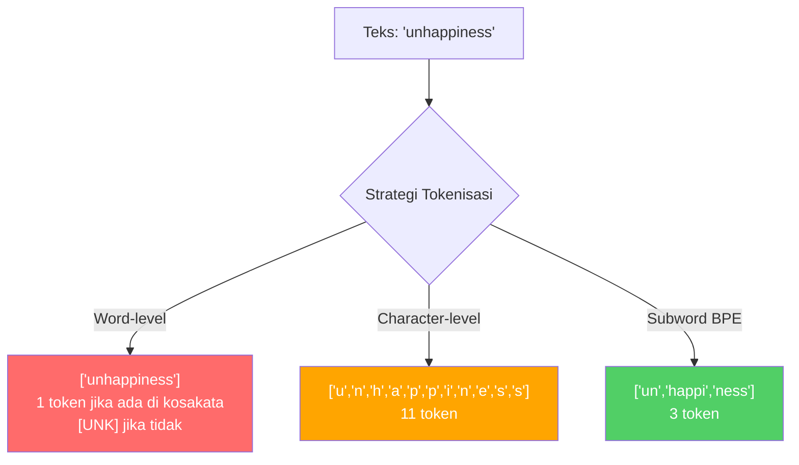
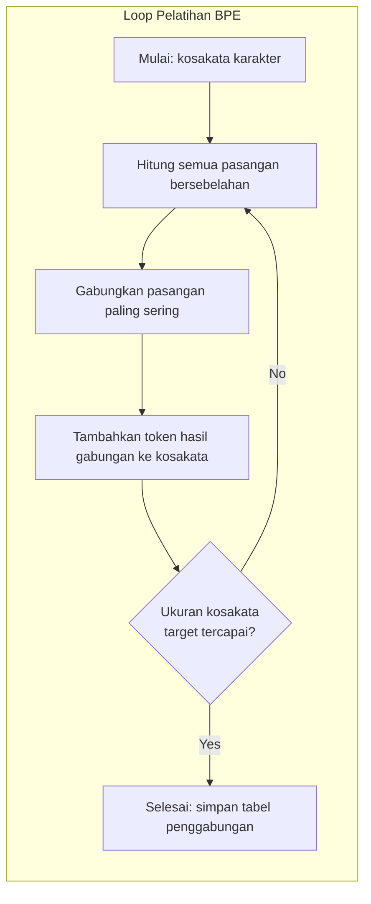
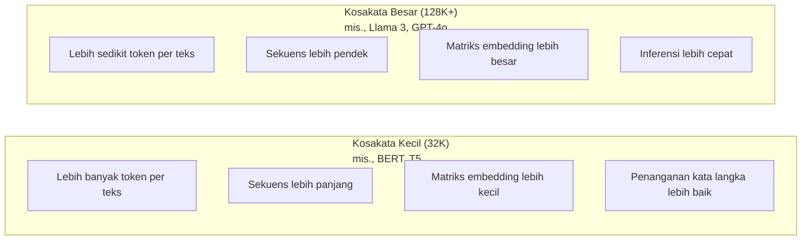

# Tokenizer: BPE, WordPiece, SentencePiece

> LLM Anda tidak membaca bahasa Inggris. Ia membaca bilangan bulat. Tokenizer menentukan apakah bilangan bulat itu membawa makna atau membuangnya.

**Jenis:** Bangun
**Bahasa:** Python
**Prasyarat:** Fase 05 (Dasar-Dasar NLP)
**Waktu:** ~90 menit

## Tujuan Pembelajaran

- Implementasikan algoritme tokenisasi BPE, WordPiece, dan Unigram dari nol serta bandingkan strategi penggabungannya
- Jelaskan bagaimana ukuran kosakata memengaruhi efisiensi model: terlalu kecil menghasilkan sekuens panjang, terlalu besar membuang parameter embedding
- Analisis artefak tokenisasi lintas bahasa dan kode, serta identifikasi di mana tokenizer tertentu gagal
- Gunakan pustaka tiktoken dan sentencepiece untuk menokenisasi teks dan memeriksa ID token yang dihasilkan

## Masalahnya

LLM Anda tidak membaca bahasa Inggris. Ia tidak membaca bahasa apa pun. Ia membaca angka.

Jurang antara "Hello, world!" dan [15496, 11, 995, 0] adalah tokenizer. Setiap kata, setiap spasi, setiap tanda baca harus diubah menjadi bilangan bulat sebelum model dapat memprosesnya. Konversi ini tidak netral. Ia menanamkan asumsi ke dalam model yang tidak bisa dibatalkan kemudian.

Salah langkah di sini dan model Anda membuang-buang kapasitas untuk mengodekan kata-kata umum dengan beberapa token. "unfortunately" menjadi empat token, bukan satu. Jendela konteks 128K Anda baru saja menyusut 75% untuk teks yang penuh kata bersuku kata banyak. Lakukan dengan benar dan jendela konteks yang sama menampung dua kali lipat makna. Perbedaan antara "model ini menangani kode dengan baik" dan "model ini tersendat pada Python" sering kali bermuara pada cara tokenizer dilatih.

Setiap panggilan API yang Anda buat ke GPT-4 atau Claude dihargai per token. Setiap token yang dihasilkan model Anda memakan komputasi. Semakin sedikit token yang dibutuhkan untuk merepresentasikan keluaran, semakin cepat inferensi ujung-ke-ujung. Tokenisasi bukan praproses. Ia adalah arsitektur.

## Konsepnya

### Tiga Pendekatan yang Gagal (dan Satu yang Menang)

Ada tiga cara yang jelas untuk mengubah teks menjadi angka. Dua di antaranya tidak bekerja pada skala besar.

**Tokenisasi tingkat kata** memecah pada spasi dan tanda baca. "The cat sat" menjadi ["The", "cat", "sat"]. Sederhana. Tetapi bagaimana dengan "tokenization"? Atau "GPT-4o"? Atau kata majemuk bahasa Jerman seperti "Geschwindigkeitsbegrenzung"? Tokenisasi tingkat kata memerlukan kosakata masif untuk mencakup setiap kata di setiap bahasa. Lewatkan satu kata dan Anda mendapat token `[UNK]` yang ditakuti -- cara model berkata "saya tidak tahu apa ini." Bahasa Inggris saja punya lebih dari sejuta bentuk kata. Tambahkan kode, URL, notasi ilmiah, dan 100 bahasa lain, dan Anda membutuhkan kosakata tak hingga.

**Tokenisasi tingkat karakter** bergerak ke arah sebaliknya. "hello" menjadi ["h", "e", "l", "l", "o"]. Kosakatanya sangat kecil (beberapa ratus karakter). Tidak pernah ada token tak dikenal. Tetapi sekuens menjadi sangat panjang. Kalimat yang seharusnya 10 token tingkat kata menjadi 50 token tingkat karakter. Model harus mempelajari bahwa "t", "h", "e" bersama-sama berarti "the" -- membakar kapasitas atensi pada sesuatu yang dipelajari manusia pada usia tiga tahun.

**Tokenisasi subkata** menemukan titik manisnya. Kata umum tetap utuh: "the" adalah satu token. Kata langka terurai menjadi potongan bermakna: "unhappiness" menjadi ["un", "happi", "ness"]. Kosakata tetap terkelola (30K sampai 128K token). Sekuens tetap pendek. Token tak dikenal pada dasarnya hilang karena kata apa pun bisa dibangun dari potongan-potongan subkata.

Setiap LLM modern memakai tokenisasi subkata. GPT-2, GPT-4, BERT, Llama 3, Claude -- semuanya. Pertanyaannya adalah algoritme mana.



### BPE: Byte Pair Encoding

BPE adalah algoritme kompresi serakah yang dialihfungsikan untuk tokenisasi. Gagasannya sederhana hingga muat di sebuah kartu indeks.

Mulai dengan karakter-karakter individual. Hitung setiap pasangan yang bersebelahan di korpus pelatihan. Gabungkan pasangan paling sering menjadi token baru. Ulangi hingga mencapai ukuran kosakata target.

```figure
tokenizer-bpe
```

Berikut BPE yang berjalan pada korpus kecil dengan kata "lower", "lowest", dan "newest":

```
Korpus (dengan frekuensi kata):
  "lower"  x5
  "lowest" x2
  "newest" x6

Langkah 0 -- Mulai dengan karakter:
  l o w e r       (x5)
  l o w e s t     (x2)
  n e w e s t     (x6)

Langkah 1 -- Hitung pasangan bersebelahan:
  (e,s): 8    (s,t): 8    (l,o): 7    (o,w): 7
  (w,e): 13   (e,r): 5    (n,e): 6    ...

Langkah 2 -- Gabungkan pasangan paling sering (w,e) -> "we":
  l o we r        (x5)
  l o we s t      (x2)
  n e we s t      (x6)

Langkah 3 -- Hitung ulang dan gabungkan (e,s) -> "es":
  l o we r        (x5)
  l o we s t      (x2)    <- 'es' hanya terbentuk dari 'e'+'s', bukan 'we'+'s'
  n e we s t      (x6)    <- tunggu, 'e' sebelum 'we' dan 's' sesudah 'we'

Sebenarnya mari lacak dengan tepat:
  Setelah penggabungan "we", pasangan yang tersisa:
  (l,o): 7   (o,we): 7   (we,r): 5   (we,s): 8
  (s,t): 8   (n,e): 6    (e,we): 6

Langkah 3 -- Gabungkan (we,s) -> "wes" atau (s,t) -> "st" (imbang di 8, pilih yang pertama):
  Gabungkan (we,s) -> "wes":
  l o we r        (x5)
  l o wes t       (x2)
  n e wes t       (x6)

Langkah 4 -- Gabungkan (wes,t) -> "west":
  l o we r        (x5)
  l o west        (x2)
  n e west        (x6)

...lanjutkan sampai ukuran kosakata target tercapai.
```

Tabel penggabungan adalah tokenizer-nya. Untuk mengodekan teks baru, terapkan penggabungan dalam urutan saat dipelajari. Korpus pelatihan menentukan penggabungan mana yang ada, dan pilihan itu secara permanen membentuk apa yang dilihat model.



### BPE Tingkat Byte (GPT-2, GPT-3, GPT-4)

BPE standar beroperasi pada karakter Unicode. BPE tingkat byte beroperasi pada byte mentah (0–255). Ini memberi Anda kosakata dasar tepat 256 entri, menangani bahasa atau penyandian apa pun, dan tidak pernah menghasilkan token tak dikenal.

GPT-2 memperkenalkan pendekatan ini. Kosakata dasar mencakup setiap byte yang mungkin. Penggabungan BPE dibangun di atasnya. Pustaka tiktoken milik OpenAI mengimplementasikan BPE tingkat byte dengan ukuran kosakata berikut:

- GPT-2: 50.257 token
- GPT-3.5/GPT-4: ~100.256 token (penyandian cl100k_base)
- GPT-4o: 200.019 token (penyandian o200k_base)

### WordPiece (BERT)

WordPiece tampak mirip BPE, tetapi memilih penggabungan dengan cara berbeda. Alih-alih frekuensi mentah, ia memaksimalkan likelihood data pelatihan:

```
Kriteria penggabungan BPE:      count(A, B)
Kriteria penggabungan WordPiece: count(AB) / (count(A) * count(B))
```

BPE bertanya: "Pasangan mana yang paling sering muncul?" WordPiece bertanya: "Pasangan mana yang muncul bersama lebih sering daripada yang diharapkan secara kebetulan?" Perbedaan halus ini menghasilkan kosakata yang berbeda. WordPiece lebih menyukai penggabungan yang kemunculan bersamanya mengejutkan, bukan sekadar sering.

WordPiece juga memakai awalan "##" untuk subkata lanjutan:

```
"unhappiness" -> ["un", "##happi", "##ness"]
"embedding"   -> ["em", "##bed", "##ding"]
```

Awalan "##" memberi tahu bahwa potongan ini melanjutkan token sebelumnya. BERT memakai WordPiece dengan kosakata 30.522 token. Setiap varian BERT -- DistilBERT, tokenizer RoBERTa sebenarnya BPE, tetapi BERT sendiri memakai WordPiece.

### SentencePiece (Llama, T5)

SentencePiece memperlakukan masukan sebagai aliran karakter Unicode mentah, termasuk spasi. Tidak ada langkah pratokenisasi. Tidak ada aturan spesifik bahasa tentang batas kata. Ini menjadikannya benar-benar agnostik terhadap bahasa -- ia bekerja pada bahasa Tionghoa, Jepang, Thai, dan bahasa lain yang spasinya tidak memisahkan kata.

SentencePiece mendukung dua algoritme:
- **Mode BPE**: logika penggabungan yang sama seperti BPE standar, diterapkan pada urutan karakter mentah
- **Mode Unigram**: mulai dengan kosakata besar lalu secara iteratif menghapus token yang paling sedikit memengaruhi likelihood keseluruhan. Kebalikan dari BPE -- memangkas, bukan menggabungkan.

Llama 2 memakai SentencePiece BPE dengan kosakata 32.000 token. T5 memakai SentencePiece Unigram dengan 32.000 token. Catatan: Llama 3 beralih ke tokenizer BPE tingkat byte berbasis tiktoken dengan 128.256 token.

### Trade-off Ukuran Kosakata

Ini adalah keputusan rekayasa nyata dengan konsekuensi yang dapat diukur.



Angka konkret. Untuk kosakata 128K dengan embedding berdimensi 4.096, matriks embedding saja sudah 128.000 x 4.096 = 524 juta parameter. Untuk kosakata 32K, 131 juta parameter. Itu selisih 400 juta parameter hanya dari pilihan tokenizer.

Tetapi kosakata yang lebih besar mengompresi teks lebih agresif. Paragraf bahasa Inggris yang sama yang memakan 100 token dengan kosakata 32K mungkin hanya memakan 70 token dengan kosakata 128K. Itu berarti 30% lebih sedikit forward pass selama generasi. Untuk model yang melayani jutaan permintaan, itu adalah pengurangan langsung biaya komputasi.

Trennya jelas: ukuran kosakata terus bertumbuh. GPT-2 memakai 50.257. GPT-4 memakai ~100K. Llama 3 memakai 128K. GPT-4o memakai 200K.

| Model | Ukuran Kosakata | Jenis Tokenizer | Rata-rata Token per Kata Bahasa Inggris |
|-------|-----------|----------------|---------------------------|
| BERT | 30,522 | WordPiece | ~1.4 |
| GPT-2 | 50,257 | BPE tingkat byte | ~1.3 |
| Llama 2 | 32,000 | SentencePiece BPE | ~1.4 |
| GPT-4 | ~100,256 | BPE tingkat byte | ~1.2 |
| Llama 3 | 128,256 | BPE tingkat byte (tiktoken) | ~1.1 |
| GPT-4o | 200,019 | BPE tingkat byte | ~1.0 |

### Pajak Multibahasa

Tokenizer yang terutama dilatih pada bahasa Inggris kejam terhadap bahasa lain. Teks Korea pada tokenizer GPT-2 rata-rata 2–3 token per kata. Bahasa Tionghoa bisa lebih buruk. Ini berarti pengguna Korea secara efektif memiliki jendela konteks setengah dari pengguna Inggris -- membayar harga yang sama untuk kepadatan informasi yang lebih rendah.

Ini sebabnya Llama 3 melipatgandakan kosakatanya empat kali dari 32K ke 128K. Lebih banyak token yang dikhususkan untuk aksara non-Inggris berarti kompresi yang lebih adil lintas bahasa.

```figure
tokenizer-tradeoff
```

## Bangunlah

### Langkah 1: Tokenizer Tingkat Karakter

Mulai dari dasar. Tokenizer tingkat karakter memetakan setiap karakter ke titik kode Unicode-nya. Tidak perlu pelatihan. Tidak ada token tak dikenal. Hanya pemetaan langsung.

```python
class CharTokenizer:
    def encode(self, text):
        return [ord(c) for c in text]

    def decode(self, tokens):
        return "".join(chr(t) for t in tokens)
```

"hello" menjadi [104, 101, 108, 108, 111]. Setiap karakter adalah tokennya sendiri. Ini baseline yang kita perbaiki.

### Langkah 2: Tokenizer BPE dari Nol

Implementasi sungguhan. Kita melatih pada byte mentah (seperti GPT-2), menghitung pasangan, menggabungkan yang paling sering, dan mencatat setiap penggabungan secara berurutan. Tabel penggabungan adalah tokenizer-nya.

```python
from collections import Counter

class BPETokenizer:
    def __init__(self):
        self.merges = {}
        self.vocab = {}

    def _get_pairs(self, tokens):
        pairs = Counter()
        for i in range(len(tokens) - 1):
            pairs[(tokens[i], tokens[i + 1])] += 1
        return pairs

    def _merge_pair(self, tokens, pair, new_token):
        merged = []
        i = 0
        while i < len(tokens):
            if i < len(tokens) - 1 and tokens[i] == pair[0] and tokens[i + 1] == pair[1]:
                merged.append(new_token)
                i += 2
            else:
                merged.append(tokens[i])
                i += 1
        return merged

    def train(self, text, num_merges):
        tokens = list(text.encode("utf-8"))
        self.vocab = {i: bytes([i]) for i in range(256)}

        for i in range(num_merges):
            pairs = self._get_pairs(tokens)
            if not pairs:
                break
            best_pair = max(pairs, key=pairs.get)
            new_token = 256 + i
            tokens = self._merge_pair(tokens, best_pair, new_token)
            self.merges[best_pair] = new_token
            self.vocab[new_token] = self.vocab[best_pair[0]] + self.vocab[best_pair[1]]

        return self

    def encode(self, text):
        tokens = list(text.encode("utf-8"))
        for pair, new_token in self.merges.items():
            tokens = self._merge_pair(tokens, pair, new_token)
        return tokens

    def decode(self, tokens):
        byte_sequence = b"".join(self.vocab[t] for t in tokens)
        return byte_sequence.decode("utf-8", errors="replace")
```

Loop pelatihan adalah inti BPE: hitung pasangan, gabungkan pemenangnya, ulangi. Setiap penggabungan mengurangi jumlah token total. Setelah `num_merges` putaran, kosakata tumbuh dari 256 (byte dasar) menjadi 256 + num_merges.

Enkode menerapkan penggabungan tepat dalam urutan saat dipelajari. Ini penting. Jika penggabungan 1 menciptakan "th" dan penggabungan 5 menciptakan "the", enkode harus menerapkan penggabungan 1 terlebih dahulu agar "the" dapat terbentuk dari "th" + "e" pada penggabungan 5.

Dekode adalah kebalikannya: cari setiap ID token di kosakata, gabungkan byte-nya, dekode ke UTF-8.

### Langkah 3: Putaran Enkode dan Dekode

```python
corpus = (
    "The cat sat on the mat. The cat ate the rat. "
    "The dog sat on the log. The dog ate the frog. "
    "Natural language processing is the study of how computers "
    "understand and generate human language. "
    "Tokenization is the first step in any NLP pipeline."
)

tokenizer = BPETokenizer()
tokenizer.train(corpus, num_merges=40)

test_sentences = [
    "The cat sat on the mat.",
    "Natural language processing",
    "tokenization pipeline",
    "unhappiness",
]

for sentence in test_sentences:
    encoded = tokenizer.encode(sentence)
    decoded = tokenizer.decode(encoded)
    raw_bytes = len(sentence.encode("utf-8"))
    ratio = len(encoded) / raw_bytes
    print(f"'{sentence}'")
    print(f"  Tokens: {len(encoded)} (from {raw_bytes} bytes) -- ratio: {ratio:.2f}")
    print(f"  Roundtrip: {'PASS' if decoded == sentence else 'FAIL'}")
```

Rasio kompresi memberi tahu seberapa efektif tokenizer itu. Rasio 0,50 berarti tokenizer mengompresi teks menjadi separuh jumlah token dari byte mentah. Semakin rendah semakin baik. Pada korpus pelatihan, rasionya akan bagus. Pada teks di luar distribusi seperti "unhappiness" (yang tidak muncul di korpus), rasionya lebih buruk -- tokenizer kembali ke enkode tingkat karakter untuk pola yang belum pernah dilihat.

### Langkah 4: Bandingkan dengan tiktoken

```python
import tiktoken

enc = tiktoken.get_encoding("cl100k_base")

texts = [
    "The cat sat on the mat.",
    "unhappiness",
    "Hello, world!",
    "def fibonacci(n): return n if n < 2 else fibonacci(n-1) + fibonacci(n-2)",
    "Geschwindigkeitsbegrenzung",
]

for text in texts:
    our_tokens = tokenizer.encode(text)
    tiktoken_tokens = enc.encode(text)
    tiktoken_pieces = [enc.decode([t]) for t in tiktoken_tokens]
    print(f"'{text}'")
    print(f"  Our BPE:   {len(our_tokens)} tokens")
    print(f"  tiktoken:  {len(tiktoken_tokens)} tokens -> {tiktoken_pieces}")
```

tiktoken memakai algoritme yang persis sama, tetapi dilatih pada ratusan gigabyte teks dengan 100.000 penggabungan. Algoritmenya identik. Perbedaannya adalah data pelatihan dan jumlah penggabungan. Tokenizer Anda yang dilatih pada satu paragraf dengan 40 penggabungan tidak bisa menyaingi 100K penggabungan tiktoken pada korpus masif. Tetapi mekanismenya sama.

### Langkah 5: Analisis Kosakata

```python
def analyze_vocabulary(tokenizer, test_texts):
    total_tokens = 0
    total_chars = 0
    token_usage = Counter()

    for text in test_texts:
        encoded = tokenizer.encode(text)
        total_tokens += len(encoded)
        total_chars += len(text)
        for t in encoded:
            token_usage[t] += 1

    print(f"Vocabulary size: {len(tokenizer.vocab)}")
    print(f"Total tokens across all texts: {total_tokens}")
    print(f"Total characters: {total_chars}")
    print(f"Avg tokens per character: {total_tokens / total_chars:.2f}")

    print(f"\nMost used tokens:")
    for token_id, count in token_usage.most_common(10):
        token_bytes = tokenizer.vocab[token_id]
        display = token_bytes.decode("utf-8", errors="replace")
        print(f"  Token {token_id:4d}: '{display}' (used {count} times)")

    unused = [t for t in tokenizer.vocab if t not in token_usage]
    print(f"\nUnused tokens: {len(unused)} out of {len(tokenizer.vocab)}")
```

Ini mengungkap distribusi Zipf pada kosakata Anda. Beberapa token mendominasi (spasi, "the", "e"). Sebagian besar token jarang dipakai. Tokenizer produksi dioptimalkan untuk distribusi ini -- pola umum mendapat ID token pendek, pola langka mendapat representasi lebih panjang.

## Gunakanlah

BPE buatan Anda dari nol bekerja. Sekarang lihat seperti apa alat produksi.

### tiktoken (OpenAI)

```python
import tiktoken

enc = tiktoken.get_encoding("cl100k_base")

text = "Tokenizers convert text to integers"
tokens = enc.encode(text)
print(f"Tokens: {tokens}")
print(f"Pieces: {[enc.decode([t]) for t in tokens]}")
print(f"Roundtrip: {enc.decode(tokens)}")
```

tiktoken ditulis dalam Rust dengan pengikatan Python. Ia mengenkode jutaan token per detik. Algoritme BPE yang sama, implementasi kelas industri.

### tokenizers Hugging Face

```python
from tokenizers import Tokenizer
from tokenizers.models import BPE
from tokenizers.trainers import BpeTrainer
from tokenizers.pre_tokenizers import ByteLevel

tokenizer = Tokenizer(BPE())
tokenizer.pre_tokenizer = ByteLevel()

trainer = BpeTrainer(vocab_size=1000, special_tokens=["<pad>", "<eos>", "<unk>"])
tokenizer.train(["corpus.txt"], trainer)

output = tokenizer.encode("The cat sat on the mat.")
print(f"Tokens: {output.tokens}")
print(f"IDs: {output.ids}")
```

Pustaka tokenizers Hugging Face juga memakai Rust di balik layar. Ia melatih BPE pada korpus berskala gigabyte dalam hitungan detik. Inilah yang Anda pakai saat melatih model sendiri.

### Memuat Tokenizer Llama

```python
from transformers import AutoTokenizer

tokenizer = AutoTokenizer.from_pretrained("meta-llama/Llama-3.1-8B")

text = "Tokenizers are the unsung heroes of LLMs"
tokens = tokenizer.encode(text)
print(f"Token IDs: {tokens}")
print(f"Tokens: {tokenizer.convert_ids_to_tokens(tokens)}")
print(f"Vocab size: {tokenizer.vocab_size}")

multilingual = ["Hello world", "Hola mundo", "Bonjour le monde"]
for text in multilingual:
    ids = tokenizer.encode(text)
    print(f"'{text}' -> {len(ids)} tokens")
```

Kosakata 128K Llama 3 mengompresi teks non-Inggris jauh lebih baik daripada kosakata 50K GPT-2. Anda bisa membuktikannya sendiri -- enkode kalimat yang sama dalam beberapa bahasa lalu hitung tokennya.

## Kirimkanlah

Pelajaran ini menghasilkan `outputs/prompt-tokenizer-analyzer.md` -- prompt yang dapat dipakai ulang untuk menganalisis efisiensi tokenisasi bagi kombinasi teks dan model apa pun. Beri ia sampel teks dan ia akan memberi tahu tokenizer model mana yang menanganinya paling baik.

## Latihan

1. Ubah tokenizer BPE agar mencetak kosakata pada setiap langkah penggabungan. Amati bagaimana "t" + "h" menjadi "th", lalu "th" + "e" menjadi "the". Lacak bagaimana kata-kata umum bahasa Inggris dirakit potongan demi potongan.

2. Tambahkan token khusus (`<pad>`, `<eos>`, `<unk>`) ke tokenizer BPE. Beri mereka ID 0, 1, 2 dan geser semua token lain sesuai. Implementasikan langkah pratokenisasi yang memecah pada spasi sebelum menjalankan BPE.

3. Implementasikan kriteria penggabungan WordPiece (rasio likelihood, bukan frekuensi). Latih BPE dan WordPiece pada korpus yang sama dengan jumlah penggabungan yang sama. Bandingkan kosakata yang dihasilkan -- mana yang menghasilkan subkata lebih bermakna secara linguistik?

4. Bangun benchmark efisiensi tokenizer multibahasa. Ambil 10 kalimat dalam bahasa Inggris, Spanyol, Tionghoa, Korea, dan Arab. Tokenisasi masing-masing dengan tiktoken (cl100k_base) dan ukur rata-rata token per karakter. Kuantifikasi "pajak multibahasa" untuk setiap bahasa.

5. Latih tokenizer BPE Anda pada korpus yang lebih besar (unduh artikel Wikipedia). Setel jumlah penggabungan agar mencapai rasio kompresi dalam 10% dari tiktoken pada teks yang sama. Ini memaksa Anda memahami hubungan antara ukuran korpus, jumlah penggabungan, dan kualitas kompresi.

## Istilah Kunci

| Istilah | Kata orang | Arti sebenarnya |
|---------|-----------|-----------------|
| Token | "Sebuah kata" | Satu unit dalam kosakata model -- bisa berupa karakter, subkata, kata, atau gumpalan beberapa kata |
| BPE | "Semacam kompresi" | Byte Pair Encoding -- menggabungkan pasangan token bersebelahan paling sering secara iteratif sampai ukuran kosakata target tercapai |
| WordPiece | "Tokenizer-nya BERT" | Seperti BPE, tetapi penggabungannya memaksimalkan rasio likelihood count(AB)/(count(A)*count(B)), bukan frekuensi mentah |
| SentencePiece | "Pustaka tokenizer" | Tokenizer agnostik bahasa yang beroperasi pada Unicode mentah tanpa pratokenisasi, mendukung algoritme BPE dan Unigram |
| Ukuran kosakata | "Berapa banyak kata yang dikenalnya" | Jumlah total token unik: GPT-2 punya 50.257, BERT 30.522, Llama 3 128.256 |
| Fertilitas | "Bukan istilah tokenizer" | Rata-rata jumlah token per kata -- mengukur efisiensi tokenizer lintas bahasa (1.0 sempurna, 3.0 berarti model bekerja tiga kali lebih keras) |
| BPE tingkat byte | "Tokenizer-nya GPT" | BPE yang beroperasi pada byte mentah (0–255), bukan karakter Unicode, sehingga menjamin tidak ada token tak dikenal untuk masukan apa pun |
| Tabel penggabungan | "Berkas tokenizer" | Daftar penggabungan pasangan yang dipelajari selama pelatihan secara berurutan -- inilah tokenizer-nya, dan urutannya penting |
| Pratokenisasi | "Memecah pada spasi" | Aturan yang diterapkan sebelum tokenisasi subkata: pemisahan spasi, pemisahan digit, penanganan tanda baca |
| Rasio kompresi | "Seberapa efisien tokenizer itu" | Token yang dihasilkan dibagi byte masukan -- lebih rendah berarti kompresi lebih baik dan inferensi lebih cepat |

## Bacaan Lanjutan

- [Sennrich et al., 2016 -- "Neural Machine Translation of Rare Words with Subword Units"](https://arxiv.org/abs/1508.07909) -- makalah yang memperkenalkan BPE untuk NLP, mengubah algoritme kompresi 1994 menjadi landasan tokenisasi modern
- [Kudo & Richardson, 2018 -- "SentencePiece: A simple and language independent subword tokenizer"](https://arxiv.org/abs/1808.06226) -- tokenisasi agnostik bahasa yang membuat model multibahasa menjadi praktis
- [Repositori OpenAI tiktoken](https://github.com/openai/tiktoken) -- implementasi BPE produksi dalam Rust dengan pengikatan Python, dipakai oleh GPT-3.5/4/4o
- [Dokumentasi Tokenizers Hugging Face](https://huggingface.co/docs/tokenizers) -- pelatihan tokenizer kelas produksi dengan kinerja Rust
