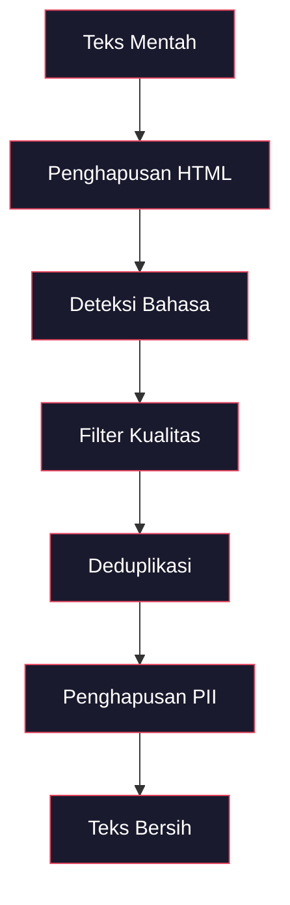
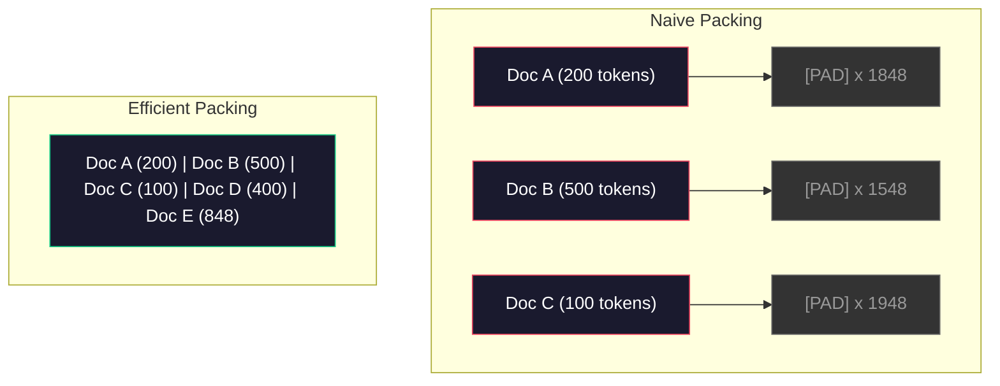

# Pipeline Data untuk Pra-pelatihan

> Model adalah cermin. Ia memantulkan apa pun data yang Anda berikan kepadanya. Beri ia sampah, dan ia memantulkan sampah itu dengan kelancaran yang sempurna.

**Jenis:** Build
**Bahasa:** Python, Rust
**Prasyarat:** Fase 10, Pelajaran 01-02 (Tokenizer, Membangun Tokenizer)
**Waktu:** ~90 menit

## Tujuan Pembelajaran

- Membangun pipeline data streaming yang melakukan tokenisasi, pemotongan, pengacakan, dan pembentukan batch terhadap terabyte teks tanpa memuat semuanya ke dalam memori
- Mengimplementasikan filter kualitas data (deduplikasi, deteksi bahasa, pemfilteran konten) yang digunakan dalam pipeline pra-pelatihan nyata
- Membuat urutan pelatihan berpanjang tetap dengan topeng atensi dan penanganan batas dokumen yang tepat
- Memprofiling throughput pipeline untuk memastikan dataloader mengimbangi kecepatan pelatihan GPU

## Masalahnya

Anda sudah punya tokenizer. Sekarang Anda butuh data.

Bukan sekadar dataset. Bukan berkas CSV. Melainkan terabyte teks -- dibersihkan, dideduplikasi, disaring untuk kualitas, ditokenisasi menjadi urutan berpanjang tetap, dan disajikan dalam batch acak dengan kecepatan yang cukup tinggi sehingga klaster 8-GPU Anda tidak pernah menunggu batch berikutnya.

Kebanyakan orang mengira melatih LLM itu soal arsitektur model. Bukan. Llama 3 menggunakan 15,6 triliun token. GPT-3 menggunakan 300 miliar. DeepSeek-V2 menggunakan 8,1 triliun. Arsitektur ketiganya kurang lebih sama: blok transformer bertumpuk dengan lapisan atensi dan feedforward. Perbedaan kualitas keluaran datanya overwhelmingly dari data.

Makalah Chinchilla dari DeepMind membuat ini menjadi presisi. Untuk anggaran komputasi tertentu, ada rasio optimal antara parameter model dan token pelatihan. Chinchilla menunjukkan bahwa sebagian besar model pada 2022 sangat kurang terlatih -- mereka memiliki terlalu banyak parameter untuk jumlah data yang mereka lihat. Model 70B parameter yang dilatih pada 1,4 triliun token (optimal-Chinchilla) mengungguli model 280B yang dilatih pada 300 miliar token (Gopher).

Pipeline data Anda menentukan apakah model Anda mempelajari bahasa atau mempelajari derau.

## Konsepnya

### Dari Mana Data Itu Berasal

Setiap model bahasa besar dilatih pada campuran sumber. Komposisi pastinya adalah rahasia yang dijaga ketat di sebagian besar laboratorium, tetapi kita tahu cukup banyak untuk memahami kategorinya.

| Sumber | Ukuran | Kualitas | Digunakan Oleh |
|--------|--------|----------|----------------|
| Common Crawl | ~250 TB mentah | Rendah (butuh pemfilteran berat) | GPT-3, Llama, sebagian besar model terbuka |
| Wikipedia | ~20 GB | Tinggi | Setiap LLM besar |
| Kode GitHub | ~1 TB+ | Sedang (banyak duplikat, kode mati) | StarCoder, CodeLlama, DeepSeek-Coder |
| Buku (BookCorpus, Pile) | ~100 GB | Tinggi | GPT-2, GPT-3, model awal |
| Makalah akademik (arXiv, S2ORC) | ~100 GB | Tinggi untuk STEM | Llama, Galactica |
| StackOverflow, Reddit | ~100 GB | Sedang | Llama, Falcon |
| Web terkurasi (C4, RefinedWeb) | ~5 TB | Sedang-Tinggi (disaring awal) | T5, Falcon |

Llama 3 mengungkap campuran datanya: kurang lebih 50% data web, 25% kode, 13% buku dan makalah akademik, 8% data matematika, dan 4% data web multibahasa. Totalnya 15,6 triliun token dari sumber yang melebihi 5 TB teks mentah.

Rasionya sama pentingnya dengan ukuran total. Terlalu banyak data web dan model menjadi beo Reddit. Terlalu sedikit kode dan ia tidak bisa memprogram. Terlalu sedikit matematika dan ia gagal dalam penalaran. Mendapatkan campuran yang tepat adalah salah satu bagian tersulit dalam melatih LLM, dan tidak ada rumusnya -- ini membutuhkan eksperimen dan evaluasi.

### Pembersihan Data

Data web mentah itu kotor. Dump Common Crawl yang khas berisi:

- Tag HTML dan JavaScript
- Header, footer, dan menu navigasi boilerplate
- Halaman duplikat (identik dan hampir-duplikat)
- Spam hasil mesin
- Informasi pribadi yang dapat diidentifikasi (PII)
- Teks berkualitas rendah (daftar kata kunci, spam SEO)
- Konten non-teks yang dikodekan sebagai teks

Membersihkannya tidak bisa diopsionalkan. Ini adalah perbedaan antara model yang menghasilkan paragraf koheren dan model yang mengeluarkan tag HTML bercampur daftar produk.



Setiap langkah menghilangkan satu kategori derau:

**Penghapusan HTML:** Buang semua markup. Simpan hanya konten teks yang terlihat. Pustaka seperti `trafilatura` atau `readability` mengekstrak konten artikel sembula membuang navigasi, iklan, dan boilerplate.

**Deteksi bahasa:** Gunakan model identifikasi bahasa dari fastText (lid.176.bin) untuk mengklasifikasikan setiap dokumen. Saring hanya bahasa target Anda. Dokumen yang diklasifikasikan sebagai Inggris dengan keyakinan di bawah 0,8 kemungkinan besar bukan Inggris yang bersih.

**Pemfilteran kualitas:** Di sinilah bagian yang menarik. RefinedWeb (dataset di balik Falcon) menggunakan filter berbasis perplexity: latih model bahasa kecil pada Wikipedia, lalu beri skor setiap dokumen. Perplexity tinggi berarti dokumen itu tidak seperti Wikipedia -- kemungkinan spam, daftar kata kunci, atau konten buatan mesin. Dokumen dengan perplexity di atas ambang batas dibuang.

**Deduplikasi:** Langkah pembersihan paling berdampak. Common Crawl berisi jumlah halaman duplikat yang sangat besar -- pernyataan hukum, pemberitahuan cookie, syarat layanan. Melatih pada duplikat membuang komputasi dan dapat menyebabkan model menghafal serta memuntahkan kembali bagian tertentu kata demi kata.

**Penghapusan PII:** Nama, alamat email, nomor telepon, nomor jaminan sosial. Deteksi berbasis regex untuk PII terstruktur, model NER untuk nama dalam konteks.

### Deduplikasi dengan MinHash

Deduplikasi eksak itu mudah: hash setiap dokumen, buang duplikatnya. Tetapi hampir-duplikat adalah masalah yang sebenarnya. Dua salinan artikel berita yang sama dengan iklan yang sedikit berbeda di sekitarnya adalah hampir-duplikat. Isinya 95% identik, tetapi byte per byte berbeda.

MinHash + Locality-Sensitive Hashing (LSH) menyelesaikan ini secara efisien.


Idenya:

1. **Shingling:** Ubah setiap dokumen menjadi himpunan n-gram (misalnya, 5-gram kata atau karakter). "the quick brown fox" dengan shingle 3-kata menjadi {"the quick brown", "quick brown fox"}.

2. **MinHash:** Untuk himpunan shingle setiap dokumen, hitung k nilai hash. Setiap nilai hash adalah hash minimum di seluruh shingle di bawah fungsi hash yang berbeda. Ini menghasilkan "tanda tangan" berukuran tetap yang mendekati kesamaan Jaccard antara dua dokumen apa pun.

3. **LSH:** Kelompokkan dokumen ke dalam ember berdasarkan band dari tanda tangan MinHash mereka. Dokumen dalam ember yang sama adalah kandidat hampir-duplikat. Ini menghindari perbandingan setiap pasangan -- Anda hanya membandingkan kandidat.

4. **Verifikasi:** Untuk setiap pasangan kandidat, hitung kesamaan Jaccard yang eksak. Buang salah satu salinan jika kesamaan melebihi ambang batas (biasanya 0,8).

Tim Llama melaporkan penghapusan sekitar 38% data web mereka melalui deduplikasi. Itu bukan angka kecil. Lebih dari sepertiga Common Crawl adalah konten duplikat atau hampir-duplikat.

### Sequence Packing

Model Anda mengharapkan urutan masukan berpanjang tetap. Dokumen Anda berpanjang variabel. Ada yang 50 token. Ada yang 50.000 token.

Pendekatan naif: beri padding pada setiap dokumen sampai panjang urutan maksimum. Ini membuang komputasi yang sangat besar pada token padding yang tidak menyumbang apa pun terhadap pembelajaran.

Pendekatan lebih baik: kemas beberapa dokumen menjadi satu urutan, dipisahkan oleh token end-of-sequence. Sebuah urutan 2048-token mungkin berisi tiga dokumen pendek yang digabungkan dengan token [EOS] di antaranya.



Topeng atensi harus diatur dengan benar. Token dari Dokumen A tidak boleh melakukan atensi terhadap token dari Dokumen B dalam satu urutan hasil kemasan yang sama. Ini memerlukan topeng atensi diagonal-blok.

Dokumen panjang dipotong atau dibagi menjadi potongan-potongan pada batas urutan. Titik pemotongan penting: memotong di tengah kalimat memaksa model melihat pikiran yang tidak lengkap. Beberapa pipeline menyelaraskan pemotongan dengan batas paragraf atau kalimat bila memungkinkan.

### Hukum Skala Chinchilla

Untuk anggaran komputasi tetap $C$ (diukur dalam FLOPs), ukuran model optimal $N$ dan ukuran dataset $D$ mengikuti:

```math
\begin{aligned}
N_{\text{opt}} &\sim C^{0.5} \\
D_{\text{opt}} &\sim C^{0.5}
\end{aligned}
```

Dalam praktiknya, ini berarti Anda harus menskalakan ukuran model dan ukuran dataset kurang lebih secara seimbang. Model dengan 10x lebih banyak parameter membutuhkan kurang lebih 10x lebih banyak token pelatihan untuk mencapai loss yang sama.

| Model | Parameter | Token Pelatihan | Optimal-Chinchilla? |
|-------|-----------|-----------------|---------------------|
| GPT-3 | 175B | 300B | Tidak (kurang terlatih 3-4x) |
| Chinchilla | 70B | 1.4T | Ya (berdasarkan desain) |
| Llama 2 | 70B | 2T | Terlatih berlebih (disengaja) |
| Llama 3 | 70B | 15T | Terlatih jauh berlebih |

Llama 3 dengan sengaja melanggar hukum Chinchilla. Meta menemukan bahwa pelatihan berlebih pada lebih banyak data -- jauh melebihi rasio optimal-komputasi -- menghasilkan model yang lebih baik untuk inferensi. Biaya pelatihan tambahan dibayar sekali, tetapi model yang lebih kecil lebih murah untuk dilayani selamanya. Ini kadang disebut pendekatan skala "optimal-inferensi", dan telah menjadi standar industri sejak 2024.

```figure
l5-data-pipeline
```

## Bangunlah

### Langkah 1: Pembersihan Teks

Hapus HTML, normalisasi spasi putih, buang konten non-teks. Kita akan menggunakan teks domain publik (Project Gutenberg) sebagai korpus kecil kita.

```python
import re

def clean_text(text):
    text = re.sub(r"<[^>]+>", "", text)
    text = re.sub(r"http\S+", "", text)
    text = re.sub(r"[^\x20-\x7E\n]", "", text)
    text = re.sub(r"\n{3,}", "\n\n", text)
    text = re.sub(r" {2,}", " ", text)
    return text.strip()

def quality_filter(text, min_words=50, max_ratio_caps=0.3, max_ratio_special=0.1):
    words = text.split()
    if len(words) < min_words:
        return False
    caps_ratio = sum(1 for w in words if w.isupper()) / len(words)
    if caps_ratio > max_ratio_caps:
        return False
    special_chars = sum(1 for c in text if not c.isalnum() and not c.isspace())
    if special_chars / max(len(text), 1) > max_ratio_special:
        return False
    return True
```

Filter kualitas menangkap spam SEO (SEMUA HURUF KAPITAL), derau buatan mesin (rasio karakter khusus tinggi), dan halaman pendek (terlalu singkat). Ketiga pemeriksaan ini saja menghilangkan jumlah sampah yang mengejutkan dari hasil crawl web.

### Langkah 2: Deduplikasi MinHash

Implementasikan MinHash dari awal. Tidak perlu pustaka eksternal -- cukup `hashlib`.

```python
import hashlib
from collections import defaultdict

def get_shingles(text, k=5):
    words = text.lower().split()
    if len(words) < k:
        return set()
    return {" ".join(words[i:i+k]) for i in range(len(words) - k + 1)}

def minhash_signature(shingles, num_hashes=128):
    signature = []
    for i in range(num_hashes):
        min_hash = float("inf")
        for shingle in shingles:
            h = int(hashlib.sha256(f"{i}:{shingle}".encode()).hexdigest(), 16)
            min_hash = min(min_hash, h)
        signature.append(min_hash)
    return signature

def lsh_buckets(signature, bands=16):
    rows_per_band = len(signature) // bands
    buckets = []
    for b in range(bands):
        start = b * rows_per_band
        band_data = tuple(signature[start:start + rows_per_band])
        bucket_hash = hashlib.md5(str(band_data).encode()).hexdigest()
        buckets.append((b, bucket_hash))
    return buckets

def deduplicate(documents, threshold=0.8, num_hashes=128, bands=16):
    signatures = []
    shingle_sets = []
    for doc in documents:
        shingles = get_shingles(doc)
        shingle_sets.append(shingles)
        signatures.append(minhash_signature(shingles, num_hashes))

    bucket_map = defaultdict(list)
    for doc_idx, sig in enumerate(signatures):
        for band_id, bucket_hash in lsh_buckets(sig, bands):
            bucket_map[(band_id, bucket_hash)].append(doc_idx)

    duplicate_pairs = set()
    for bucket_docs in bucket_map.values():
        if len(bucket_docs) < 2:
            continue
        for i in range(len(bucket_docs)):
            for j in range(i + 1, len(bucket_docs)):
                duplicate_pairs.add((bucket_docs[i], bucket_docs[j]))

    removed = set()
    for i, j in duplicate_pairs:
        if i in removed or j in removed:
            continue
        s1, s2 = shingle_sets[i], shingle_sets[j]
        if not s1 or not s2:
            continue
        jaccard = len(s1 & s2) / len(s1 | s2)
        if jaccard >= threshold:
            removed.add(j)

    return [doc for idx, doc in enumerate(documents) if idx not in removed], len(removed)
```

Parameter `num_hashes=128` dan `bands=16` mengontrol trade-off presisi-recall. Lebih banyak hash give estimasi kesamaan yang lebih akurat. Lebih banyak band meningkatkan recall (menangkap lebih banyak duplikat) dengan biaya lebih banyak false positive. Nilai-nilai ini bekerja baik untuk teks web pada umumnya.

### Langkah 3: Tokenisasi dan Pengemasan Urutan

Ambil teks yang bersih dan terdeduplikasi, tokenisasikan, lalu kemas menjadi urutan berpanjang tetap untuk pelatihan.

```python
def tokenize_corpus(documents, tokenizer):
    all_tokens = []
    for doc in documents:
        tokens = tokenizer.encode(doc)
        all_tokens.extend(tokens)
        all_tokens.append(tokenizer.eos_id)
    return all_tokens

def pack_sequences(token_ids, seq_length, pad_id=0):
    sequences = []
    attention_masks = []
    for i in range(0, len(token_ids), seq_length):
        seq = token_ids[i:i + seq_length]
        mask = [1] * len(seq)
        if len(seq) < seq_length:
            pad_count = seq_length - len(seq)
            seq = seq + [pad_id] * pad_count
            mask = mask + [0] * pad_count
        sequences.append(seq)
        attention_masks.append(mask)
    return sequences, attention_masks
```

### Langkah 4: DataLoader untuk Pelatihan

Hasilkan batch acak dari urutan yang sudah dikemas. Inilah yang dikonsumsi oleh loop pelatihan.

```python
import random

class PreTrainingDataLoader:
    def __init__(self, sequences, attention_masks, batch_size, shuffle=True):
        self.sequences = sequences
        self.attention_masks = attention_masks
        self.batch_size = batch_size
        self.shuffle = shuffle

    def __len__(self):
        return (len(self.sequences) + self.batch_size - 1) // self.batch_size

    def __iter__(self):
        indices = list(range(len(self.sequences)))
        if self.shuffle:
            random.shuffle(indices)
        for start in range(0, len(indices), self.batch_size):
            batch_idx = indices[start:start + self.batch_size]
            batch_seqs = [self.sequences[i] for i in batch_idx]
            batch_masks = [self.attention_masks[i] for i in batch_idx]
            yield batch_seqs, batch_masks
```

### Langkah 5: Statistik Dataset

Hitung angka-angka yang benar-benar penting: total token, token unik, rasio kompresi, distribusi panjang dokumen.

```python
from collections import Counter

def compute_statistics(documents, token_ids, sequences, tokenizer_vocab_size):
    total_chars = sum(len(d) for d in documents)
    total_tokens = len(token_ids)
    unique_tokens = len(set(token_ids))
    compression_ratio = total_chars / total_tokens

    doc_lengths = [len(d.split()) for d in documents]
    avg_doc_length = sum(doc_lengths) / max(len(doc_lengths), 1)
    max_doc_length = max(doc_lengths) if doc_lengths else 0
    min_doc_length = min(doc_lengths) if doc_lengths else 0

    token_counts = Counter(token_ids)
    top_tokens = token_counts.most_common(10)

    non_pad_tokens = sum(sum(1 for t in seq if t != 0) for seq in sequences)
    total_positions = sum(len(seq) for seq in sequences)
    utilization = non_pad_tokens / max(total_positions, 1)

    stats = {
        "total_documents": len(documents),
        "total_characters": total_chars,
        "total_tokens": total_tokens,
        "unique_tokens": unique_tokens,
        "vocab_utilization": unique_tokens / tokenizer_vocab_size,
        "compression_ratio": compression_ratio,
        "avg_doc_length_words": avg_doc_length,
        "max_doc_length_words": max_doc_length,
        "min_doc_length_words": min_doc_length,
        "num_sequences": len(sequences),
        "sequence_utilization": utilization,
        "top_10_tokens": top_tokens,
    }
    return stats
```

Rasio kompresi memberi tahu Anda seberapa efisien tokenizer pada korpus ini. Teks Inggris biasanya terkompresi menjadi sekitar 3-4 karakter per token. Jika Anda melihat 1,5 karakter per token, tokenizer Anda memecah terlalu agresif. Jika Anda melihat 8 ke atas, ia telah mempelajari penggabungan yang sangat spesifik untuk domain tertentu.

Sequence utilization memberi tahu Anda berapa banyak urutan hasil kemasan Anda berisi data nyata dibandingkan padding. Di bawah 90% berarti pengemasan Anda tidak efisien -- Anda membuang komputasi untuk token padding.

## Gunakan

### Bandingkan dengan HuggingFace Datasets

Muat korpus yang sama melalui pustaka datasets dari HuggingFace dan bandingkan kecepatan pipeline-nya.

```python
from datasets import load_dataset
from transformers import AutoTokenizer

ds = load_dataset("wikitext", "wikitext-2-raw-v1", split="train")
tokenizer = AutoTokenizer.from_pretrained("meta-llama/Meta-Llama-3-8B")

import time

start = time.time()
tokenized = ds.map(
    lambda x: tokenizer(x["text"], truncation=True, max_length=2048),
    batched=True,
    num_proc=4,
)
hf_time = time.time() - start
total_tokens = sum(len(t) for t in tokenized["input_ids"])
print(f"HuggingFace: {total_tokens:,} tokens in {hf_time:.2f}s ({total_tokens/hf_time:,.0f} tokens/sec)")
```

Pipeline HuggingFace menggunakan tokenizer Rust di balik layar dan pemrosesan paralel ke seluruh 4 core. Pipeline Python murni Anda akan 10-50x lebih lambat. Kesenjangan itulah sebabnya tim produksi menggunakan tokenizer terkompilasi. Algoritmanya sama. Bahasa implementasinya yang menjadi perbedaan.

## Kirimkan

Pelajaran ini menghasilkan sebuah prompt untuk memvalidasi dan men-debug kualitas data dalam pipeline pelatihan LLM. Lihat `outputs/prompt-data-quality-checker.md`.

## Latihan

1. **Mudah:** Tambahkan deteksi bahasa ke pipeline pembersihan menggunakan heuristik sederhana (analisis set karakter). Saring hanya dokumen berbahasa Inggris dan ukur berapa banyak dokumen yang dibuang.
2. **Sedang:** Implementasikan deduplikasi eksak menggunakan hash SHA-256 di samping deduplikasi hampir MinHash. Bandingkan jumlah duplikat yang tertangkap oleh tiap metode pada korpus hasil scrape web.
3. **Sulit:** Bangun filter kualitas berbasis perplexity. Latih model bahasa bigram kecil pada teks Wikipedia, beri skor setiap dokumen dengan perplexity, dan buang 20% ter bawah. Bandingkan kualitas keluaran model saat dilatih pada data tersaring versus data tak tersaring.

## Istilah Kunci

| Istilah | Yang Sering Diucapkan Orang | Arti Sebenarnya |
|---------|------------------------------|-----------------|
| Common Crawl | "Internet" | Organisasi nirlaba yang melakukan crawl web setiap bulan -- ~250TB mentah, titik awal sebagian besar data pelatihan LLM |
| MinHash | "Semua trik hashing" | Teknik untuk mengestimasi kesamaan Jaccard antarhimpunan menggunakan tanda tangan berukuran tetap -- memungkinkan deteksi hampir-duplikat dalam skala besar |
| LSH | "Locality-Sensitive Hashing" | Metode untuk mengelompokkan item serupa ke dalam ember yang sama -- mengurangi perbandingan berpasangan dari $O(n^2)$ menjadi mendekati linear |
| Sequence packing | "Menggabungkan dokumen" | Memasukkan beberapa dokumen ke dalam urutan berpanjang tetap dengan topeng atensi yang tepat -- menghilangkan pemborosan padding |
| Skala Chinchilla | "Latih dengan lebih banyak data" | Untuk anggaran komputasi tetap, kinerja optimal memerlukan penskalaan ukuran model dan token pelatihan secara kurang lebih seimbang |
| Fertility | "Token per kata" | Jumlah rata-rata token per kata -- 1,3 untuk bahasa Inggris pada GPT-4, lebih tinggi untuk aksara non-Latin |
| Data mixing | "Memilih data pelatihan" | Rasio kode versus teks versus matematika versus data multibahasa -- tanpa rumus, membutuhkan eksperimen |
| Filter perplexity | "Pemberian skor kualitas" | Gunakan model bahasa kecil untuk memberi skor dokumen -- perplexity tinggi berarti teks tidak seperti data referensi yang bersih |
| Deduplikasi | "Menghapus salinan" | Menghilangkan dokumen identik dan hampir-duplikat -- biasanya menghapus 30-40% data web mentah |
| Topeng atensi | "Token mana yang dilihat" | Topeng biner yang mencegah atensi melintasi batas dokumen dalam urutan hasil kemasan |

## Bacaan Lebih Lanjut

- [Hoffmann et al., 2022 -- Training Compute-Optimal Large Language Models (Chinchilla)](https://arxiv.org/abs/2203.15556) -- makalah yang mengubah cara kita memikirkan skala data
- [Penedo et al., 2023 -- The RefinedWeb Dataset for Falcon LLM](https://arxiv.org/abs/2306.01116) -- cara menyaring Common Crawl menjadi berkualitas tinggi
- [Touvron et al., 2023 -- Llama 2: Open Foundation and Fine-Tuned Chat Models](https://arxiv.org/abs/2307.09288) -- detail pipeline data untuk Llama 2
- [Lee et al., 2022 -- Deduplicating Training Data Makes Language Models Better](https://arxiv.org/abs/2107.06499) -- mengapa deduplikasi lebih penting dari yang Anda kira
- [Broder, 1997 -- On the Resemblance and Containment of Documents](https://ieeexplore.ieee.org/document/666900) -- makalah MinHash asli
- [Meta, 2024 -- Llama 3 Technical Report](https://arxiv.org/abs/2407.21783) -- 15,6T token, rasio pencampuran data, pipeline pemfilteran
