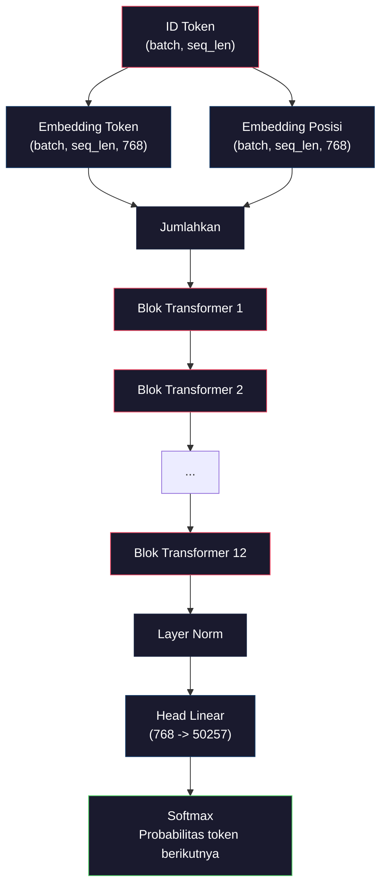
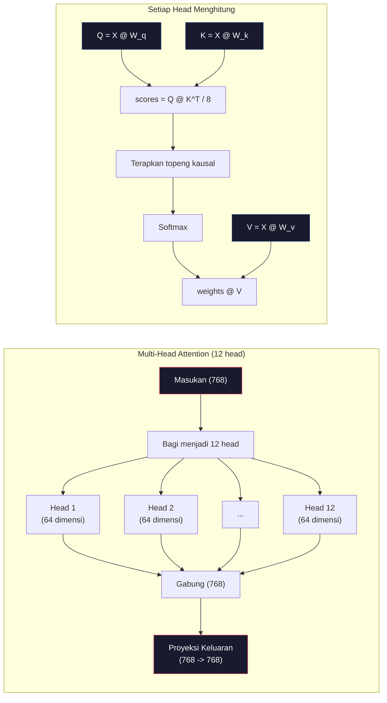
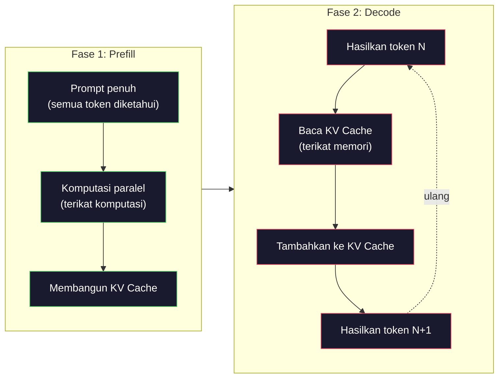

# Pra-pelatihan Mini GPT (124J Parameter)

> GPT-2 Small memiliki 124 juta parameter. Artinya 12 lapisan transformer, 12 head atensi, dan embedding berdimensi 768. Anda dapat melatihnya dari awal pada satu GPU dalam beberapa jam. Kebanyakan orang tidak pernah melakukannya. Mereka memakai checkpoint yang sudah dilatih. Tetapi jika Anda tidak pernah melatihnya sendiri, Anda tidak benar-benar memahami apa yang terjadi di dalam model yang Anda bangun produk Anda di atasnya.

**Jenis:** Build
**Bahasa:** Python (dengan numpy)
**Prasyarat:** Fase 10, Pelajaran 01-03 (Tokenizer, Membangun Tokenizer, Pipeline Data)
**Waktu:** ~120 menit

## Tujuan Pembelajaran

- Mengimplementasikan arsitektur GPT-2 lengkap (124 juta parameter) dari awal: embedding token, embedding posisi, blok transformer, dan head model bahasa
- Melatih model GPT pada korpus teks menggunakan prediksi token berikutnya dengan loss cross-entropy
- Mengimplementasikan generasi teks autoregresif dengan temperature sampling serta pemfilteran top-k/top-p
- Memantau kurva loss pelatihan dan memvalidasi bahwa model mempelajari pola bahasa yang koheren

## Masalahnya

Anda tahu apa itu transformer. Anda sudah membaca diagramnya. Anda bisa menghafal "attention is all you need" dan menggambar kotak berlabel "Multi-Head Attention" di papan tulis.

Tidak satu pun dari itu berarti Anda memahami apa yang terjadi ketika sebuah model menghasilkan teks.

Ada 124.438.272 parameter di GPT-2 Small (dengan weight tying). Setiap satu ditetapkan dengan menjalankan loop pelatihan: forward pass, hitung loss, backward pass, perbarui bobot. Dua belas blok transformer. Dua belas head atensi per blok. Ruang embedding berdimensi 768. Kosakata 50.257 token. Setiap kali model menghasilkan sebuah token, ke-124 juta parameter itu berpartisipasi dalam satu rantai perkalian matriks yang mengambil urutan ID token dan menghasilkan distribusi probabilitas untuk token berikutnya.

Jika Anda tidak pernah membangun ini sendiri, Anda bekerja dengan kotak hitam. Anda bisa memakai API. Anda bisa melakukan fine-tuning. Tetapi ketika sesuatu salah -- ketika model berhalusinasi, ketika ia mengulang diri, ketika ia menolak mengikuti instruksi -- Anda tidak punya model mental tentang *mengapa*.

Pelajaran ini membangun GPT-2 Small dari awal. Bukan di PyTorch. Di numpy. Setiap perkalian matriks terlihat. Setiap gradien dihitung oleh kode Anda. Anda akan melihat persis bagaimana 124 juta angka bersekongkol untuk memprediksi kata berikutnya.

## Konsepnya

### Arsitektur GPT

GPT adalah model bahasa autoregresif. "Autoregresif" berarti ia menghasilkan satu token pada satu waktu, masing-masing bersyarat pada semua token sebelumnya. Arsitekturnya adalah tumpukan blok decoder transformer.

Berikut graf komputasi lengkap dari ID token hingga probabilitas token berikutnya:

1. ID token masuk. Bentuk: (batch_size, seq_len).
2. Lookup embedding token. Setiap ID dipetakan ke vektor 768 dimensi. Bentuk: (batch_size, seq_len, 768).
3. Lookup embedding posisi. Setiap posisi (0, 1, 2, ...) dipetakan ke vektor 768 dimensi. Bentuk sama.
4. Jumlahkan embedding token + embedding posisi.
5. Lewati 12 blok transformer.
6. Layer normalization akhir.
7. Proyeksi linear ke ukuran kosakata. Bentuk: (batch_size, seq_len, vocab_size).
8. Softmax untuk mendapatkan probabilitas.

Itu saja seluruh modelnya. Tanpa konvolusi. Tanpa rekurensi. Hanya embedding, atensi, jaringan feedforward, dan layer norm yang ditumpuk 12 kali.



### Blok Transformer

Masing-masing dari 12 blok mengikuti pola yang sama. Arsitektur pre-norm (GPT-2 memakai pre-norm, bukan post-norm seperti transformer asli):

1. LayerNorm
2. Multi-Head Self-Attention
3. Koneksi residual (tambahkan masukan kembali)
4. LayerNorm
5. Feed-Forward Network (MLP)
6. Koneksi residual (tambahkan masukan kembali)

Koneksi residual itu krusial. Tanpa koneksi itu, gradien menghilang saat mencapai blok 1 selama propagasi balik. Dengan koneksi itu, gradien dapat mengalir langsung dari loss ke lapisan mana pun melalui jalur "skip". Inilah sebabnya Anda bisa menumpuk 12, 32, atau bahkan 96 blok (GPT-4 dikabarkan memakai 120).

### Atensi: Mekanisme Intinya

Self-attention memungkinkan setiap token melihat setiap token sebelumnya dan memutuskan seberapa besar atensi yang diberikan kepada masing-masing. Berikut matematikanya.

Untuk setiap posisi token, hitung tiga vektor dari masukan:
- **Query (Q)**: "Apa yang saya cari?"
- **Key (K)**: "Apa yang saya miliki?"
- **Value (V)**: "Informasi apa yang saya bawa?"

```
Q = input @ W_q    (768 -> 768)
K = input @ W_k    (768 -> 768)
V = input @ W_v    (768 -> 768)

attention_scores = Q @ K^T / sqrt(d_k)
attention_scores = mask(attention_scores)   # topeng kausal: -inf untuk posisi masa depan
attention_weights = softmax(attention_scores)
output = attention_weights @ V
```

Topeng kausal adalah yang membuat GPT bersifat autoregresif. Posisi 5 dapat melakukan atensi ke posisi 0-5 tetapi tidak ke 6, 7, 8, dan seterusnya. Ini mencegah model "bercuriga" dengan melihat token masa depan selama pelatihan.

**Multi-head attention** membagi ruang 768 dimensi menjadi 12 head masing-masing 64 dimensi. Setiap head mempelajari pola atensi yang berbeda. Satu head mungkin melacak hubungan sintaktis (kesesuaian subjek-kata kerja). Head lain mungkin melacak kesamaan semantik (sinonim). Head lain lagi mungkin melacak kedekatan posisi (kata-kata di dekatnya). Keluaran dari ke-12 head digabungkan dan diproyeksikan kembali ke 768 dimensi.



Pembagian dengan $\sqrt{d_k}$ -- $\sqrt{64} = 8$ -- adalah penskalaan. Tanpa itu, produk titik menjadi besar untuk vektor berdimensi tinggi, mendorong softmax ke wilayah di mana gradien hampir nol. Ini adalah salah satu wawasan utama dalam makalah "Attention Is All You Need" yang asli.

### KV Cache: Mengapa Inferensi Cepat

Selama pelatihan, Anda memproses seluruh urutan sekaligus. Selama inferensi, Anda menghasilkan satu token pada satu waktu. Tanpa optimasi, menghasilkan token $N$ memerlukan perhitungan ulang atensi untuk semua $N-1$ token sebelumnya. Itu $O(N^2)$ per token yang dihasilkan, atau $O(N^3)$ total untuk urutan panjang $N$.

KV Cache menyelesaikan ini. Setelah menghitung K dan V untuk setiap token, simpan keduanya. Saat menghasilkan token $N+1$, Anda hanya perlu menghitung Q untuk token baru dan mengambil K serta V yang tersimpan dari semua token sebelumnya. Ini mengurangi biaya per token dari $O(N)$ menjadi $O(1)$ untuk perhitungan K dan V. Perhitungan skor atensi tetap $O(N)$ karena Anda melakukan atensi ke semua posisi sebelumnya, tetapi Anda menghindari perkalian matriks yang redundan pada masukan.

Untuk GPT-2 dengan 12 lapisan dan 12 head, KV cache menyimpan 2 (K + V) x 12 lapisan x 12 head x 64 dimensi = 18.432 nilai per token. Untuk urutan 1024 token, itu sekitar 75MB dalam FP32. Untuk Llama 3 405B dengan 128 lapisan, KV cache untuk satu urutan dapat melebihi 10GB. Inilah sebabnya inferensi konteks-panjang terikat memori.

### Prefill vs Decode: Dua Fase Inferensi

Saat Anda mengirim prompt ke LLM, inferensi terjadi dalam dua fase yang berbeda.

**Prefill** memproses seluruh prompt Anda secara paralel. Semua token sudah diketahui, sehingga model dapat menghitung atensi untuk semua posisi secara bersamaan. Fase ini terikat komputasi -- GPU melakukan perkalian matriks dengan throughput penuh. Untuk prompt 1000 token pada A100, prefill memakan waktu kurang lebih 20-50ms.

**Decode** menghasilkan token satu per satu. Setiap token baru bergantung pada semua token sebelumnya. Fase ini terikat memori -- hambatannya adalah membaca bobot model dan KV cache dari memori GPU, bukan matematika matriksnya sendiri. Inti komputasi GPU sebagian besar menganggur sambil menunggu pembacaan memori. Untuk GPT-2, setiap langkah decode memakan waktu kurang lebih sama berapa pun FLOPs yang dibutuhkan oleh matmul, karena bandwidth memori adalah batasannya.

Pembedaan ini penting untuk sistem produksi. Throughput prefill berskala dengan komputasi GPU (lebih banyak FLOPS = prefill lebih cepat). Throughput decode berskala dengan bandwidth memori (memori lebih cepat = decode lebih cepat). Itulah sebabnya H100 dari NVIDIA berfokus pada perbaikan bandwidth memori dibanding A100 -- ini langsung mempercepat generasi token.



### Loop Pelatihan

Melatih LLM adalah prediksi token berikutnya. Diberi token [0, 1, 2, ..., N-1], prediksi token [1, 2, 3, ..., N]. Fungsi loss adalah cross-entropy antara distribusi probabilitas yang diprediksi model dan token berikutnya yang sebenarnya.

Satu langkah pelatihan:

1. **Forward pass**: Jalankan batch melalui ke-12 blok. Dapatkan logits (skor pra-softmax) untuk setiap posisi.
2. **Hitung loss**: Cross-entropy antara logits dan token target (masukan yang digeser satu posisi).
3. **Backward pass**: Hitung gradien untuk ke-124J parameter menggunakan propagasi balik.
4. **Langkah pengoptimal**: Perbarui bobot. GPT-2 memakai Adam dengan warmup laju pembelajaran dan cosine decay.

Jadwal laju pembelajaran lebih penting dari yang Anda bayangkan. GPT-2 melakukan warmup dari 0 ke laju pembelajaran puncak selama 2.000 langkah pertama, lalu menurun mengikuti kurva kosinus. Memulai dengan laju pembelajaran tinggi menyebabkan model diverge. Mempertahankan laju tinggi secara konstan menyebabkan osilasi di pelatihan lanjutan. Pola warmup-lalu-decay dipakai oleh setiap LLM besar.

### GPT-2 Small: Angka-Angkanya

| Komponen | Bentuk | Parameter |
|----------|--------|-----------|
| Embedding token | (50257, 768) | 38,597,376 |
| Embedding posisi | (1024, 768) | 786,432 |
| Atensi per blok ($W_q, W_k, W_v, W_{\text{out}}$) | 4 x (768, 768) | 2,359,296 |
| FFN per blok (up + down) | (768, 3072) + (3072, 768) | 4,718,592 |
| LayerNorm per blok (2x) | 2 x 768 x 2 | 3,072 |
| LayerNorm akhir | 768 x 2 | 1,536 |
| **Total per blok** | | **7,080,960** |
| **Total (12 blok)** | | **85,054,464 + 39,383,808 = 124,438,272** |

Proyeksi keluaran (head logits) berbagi bobot dengan matriks embedding token. Ini disebut weight tying -- ini mengurangi jumlah parameter sebanyak 38J dan meningkatkan kinerja karena memaksa model memakai ruang representasi yang sama untuk masukan dan keluaran.

## Bangunlah

```figure
iso-machine {"machine":"mini-gpt"}
```

### Langkah 1: Lapisan Embedding

Embedding token memetakan masing-masing dari 50.257 token yang mungkin ke vektor 768 dimensi. Embedding posisi menambahkan informasi tentang di mana setiap token berada dalam urutan. Keduanya dijumlahkan.

```python
import numpy as np

class Embedding:
    def __init__(self, vocab_size, embed_dim, max_seq_len):
        self.token_embed = np.random.randn(vocab_size, embed_dim) * 0.02
        self.pos_embed = np.random.randn(max_seq_len, embed_dim) * 0.02

    def forward(self, token_ids):
        seq_len = token_ids.shape[-1]
        tok_emb = self.token_embed[token_ids]
        pos_emb = self.pos_embed[:seq_len]
        return tok_emb + pos_emb
```

Simpangan baku 0,02 untuk inisialisasi berasal dari makalah GPT-2. Terlalu besar dan forward pass awal menghasilkan nilai ekstrem yang menstabilisasi pelatihan. Terlalu kecil dan keluaran awal hampir identik untuk semua masukan, membuat sinyal gradien awal tidak berguna.

### Langkah 2: Self-Attention dengan Topeng Kausal

Mulai dengan atensi satu head. Topeng kausal menetapkan posisi masa depan menjadi minus tak hingga sebelum softmax, memastikan setiap posisi hanya dapat melakukan atensi kepada dirinya sendiri dan posisi sebelumnya.

```python
def attention(Q, K, V, mask=None):
    d_k = Q.shape[-1]
    scores = Q @ K.transpose(0, -1, -2 if Q.ndim == 4 else 1) / np.sqrt(d_k)
    if mask is not None:
        scores = scores + mask
    weights = np.exp(scores - scores.max(axis=-1, keepdims=True))
    weights = weights / weights.sum(axis=-1, keepdims=True)
    return weights @ V
```

Implementasi softmax mengurangi nilai maksimum sebelum eksponensiasi. Tanpa ini, exp(bilangan_besar) meluap menjadi tak hingga. Ini adalah trik stabilitas numerik yang tidak mengubah keluaran karena $\mathop{\mathrm{softmax}}(x - c) = \mathop{\mathrm{softmax}}(x)$ untuk sebarang konstanta $c$.

### Langkah 3: Multi-Head Attention

Bagi masukan 768 dimensi menjadi 12 head masing-masing 64 dimensi. Setiap head menghitung atensi secara independen. Gabungkan hasilnya dan proyeksikan kembali ke 768 dimensi.

```python
class MultiHeadAttention:
    def __init__(self, embed_dim, num_heads):
        self.num_heads = num_heads
        self.head_dim = embed_dim // num_heads
        self.W_q = np.random.randn(embed_dim, embed_dim) * 0.02
        self.W_k = np.random.randn(embed_dim, embed_dim) * 0.02
        self.W_v = np.random.randn(embed_dim, embed_dim) * 0.02
        self.W_out = np.random.randn(embed_dim, embed_dim) * 0.02

    def forward(self, x, mask=None):
        batch, seq_len, d = x.shape
        Q = (x @ self.W_q).reshape(batch, seq_len, self.num_heads, self.head_dim).transpose(0, 2, 1, 3)
        K = (x @ self.W_k).reshape(batch, seq_len, self.num_heads, self.head_dim).transpose(0, 2, 1, 3)
        V = (x @ self.W_v).reshape(batch, seq_len, self.num_heads, self.head_dim).transpose(0, 2, 1, 3)

        scores = Q @ K.transpose(0, 1, 3, 2) / np.sqrt(self.head_dim)
        if mask is not None:
            scores = scores + mask
        weights = np.exp(scores - scores.max(axis=-1, keepdims=True))
        weights = weights / weights.sum(axis=-1, keepdims=True)
        attn_out = weights @ V

        attn_out = attn_out.transpose(0, 2, 1, 3).reshape(batch, seq_len, d)
        return attn_out @ self.W_out
```

Tarian reshape-transpose-reshape adalah bagian paling membingungkan dari multi-head attention. Ini yang terjadi: tensor (batch, seq_len, 768) menjadi (batch, seq_len, 12, 64), lalu (batch, 12, seq_len, 64). Sekarang masing-masing dari 12 head memiliki matriks (seq_len, 64) sendiri untuk menjalankan atensi. Setelah atensi, kita membalik prosesnya: (batch, 12, seq_len, 64) menjadi (batch, seq_len, 12, 64) menjadi (batch, seq_len, 768).

### Langkah 4: Blok Transformer

Satu blok transformer lengkap: LayerNorm, multi-head attention dengan residual, LayerNorm, feedforward dengan residual.

```python
class LayerNorm:
    def __init__(self, dim, eps=1e-5):
        self.gamma = np.ones(dim)
        self.beta = np.zeros(dim)
        self.eps = eps

    def forward(self, x):
        mean = x.mean(axis=-1, keepdims=True)
        var = x.var(axis=-1, keepdims=True)
        return self.gamma * (x - mean) / np.sqrt(var + self.eps) + self.beta


class FeedForward:
    def __init__(self, embed_dim, ff_dim):
        self.W1 = np.random.randn(embed_dim, ff_dim) * 0.02
        self.b1 = np.zeros(ff_dim)
        self.W2 = np.random.randn(ff_dim, embed_dim) * 0.02
        self.b2 = np.zeros(embed_dim)

    def forward(self, x):
        h = x @ self.W1 + self.b1
        h = np.maximum(0, h)  # aproksimasi GELU: ReLU demi kesederhanaan
        return h @ self.W2 + self.b2


class TransformerBlock:
    def __init__(self, embed_dim, num_heads, ff_dim):
        self.ln1 = LayerNorm(embed_dim)
        self.attn = MultiHeadAttention(embed_dim, num_heads)
        self.ln2 = LayerNorm(embed_dim)
        self.ffn = FeedForward(embed_dim, ff_dim)

    def forward(self, x, mask=None):
        x = x + self.attn.forward(self.ln1.forward(x), mask)
        x = x + self.ffn.forward(self.ln2.forward(x))
        return x
```

Jaringan feedforward memperluas masukan 768 dimensi menjadi 3.072 dimensi (4x), menerapkan fungsi nonlinearitas, lalu memproyeksikan kembali ke 768. Pola ekspansi-kontraksi ini memberi model representasi internal yang "lebih lebar" untuk dikerjakan di setiap posisi. GPT-2 memakai aktivasi GELU, tetapi kita memakai ReLU di sini demi kesederhanaan -- selisihnya kecil untuk memahami arsitektur.

### Langkah 5: Model GPT Lengkap

Tumpuk 12 blok transformer. Tambahkan lapisan embedding di depan dan proyeksi keluaran di belakang.

```python
class MiniGPT:
    def __init__(self, vocab_size=50257, embed_dim=768, num_heads=12,
                 num_layers=12, max_seq_len=1024, ff_dim=3072):
        self.embedding = Embedding(vocab_size, embed_dim, max_seq_len)
        self.blocks = [
            TransformerBlock(embed_dim, num_heads, ff_dim)
            for _ in range(num_layers)
        ]
        self.ln_f = LayerNorm(embed_dim)
        self.vocab_size = vocab_size
        self.embed_dim = embed_dim

    def forward(self, token_ids):
        seq_len = token_ids.shape[-1]
        mask = np.triu(np.full((seq_len, seq_len), -1e9), k=1)

        x = self.embedding.forward(token_ids)
        for block in self.blocks:
            x = block.forward(x, mask)
        x = self.ln_f.forward(x)

        logits = x @ self.embedding.token_embed.T
        return logits

    def count_parameters(self):
        total = 0
        total += self.embedding.token_embed.size
        total += self.embedding.pos_embed.size
        for block in self.blocks:
            total += block.attn.W_q.size + block.attn.W_k.size
            total += block.attn.W_v.size + block.attn.W_out.size
            total += block.ffn.W1.size + block.ffn.b1.size
            total += block.ffn.W2.size + block.ffn.b2.size
            total += block.ln1.gamma.size + block.ln1.beta.size
            total += block.ln2.gamma.size + block.ln2.beta.size
        total += self.ln_f.gamma.size + self.ln_f.beta.size
        return total
```

Perhatikan weight tying: `logits = x @ self.embedding.token_embed.T`. Proyeksi keluaran menggunakan kembali matriks embedding token (ditransposisikan). Ini bukan sekadar trik penghemat parameter. Ini berarti model memakai ruang vektor yang sama untuk memahami token (embedding) dan memprediksinya (keluaran).

### Langkah 6: Loop Pelatihan

Untuk pelatihan sungguhan pada 124J parameter, Anda membutuhkan GPU dan PyTorch. Loop pelatihan ini mendemonstrasikan mekanikanya pada model kecil yang berjalan dengan numpy murni. Kita memakai model sangat kecil (4 lapisan, 4 head, 128 dimensi) agar mudah dikerjakan.

```python
def cross_entropy_loss(logits, targets):
    batch, seq_len, vocab_size = logits.shape
    logits_flat = logits.reshape(-1, vocab_size)
    targets_flat = targets.reshape(-1)

    max_logits = logits_flat.max(axis=-1, keepdims=True)
    log_softmax = logits_flat - max_logits - np.log(
        np.exp(logits_flat - max_logits).sum(axis=-1, keepdims=True)
    )

    loss = -log_softmax[np.arange(len(targets_flat)), targets_flat].mean()
    return loss


def train_mini_gpt(text, vocab_size=256, embed_dim=128, num_heads=4,
                   num_layers=4, seq_len=64, num_steps=200, lr=3e-4):
    tokens = np.array(list(text.encode("utf-8")[:2048]))
    model = MiniGPT(
        vocab_size=vocab_size, embed_dim=embed_dim, num_heads=num_heads,
        num_layers=num_layers, max_seq_len=seq_len, ff_dim=embed_dim * 4
    )

    print(f"Model parameters: {model.count_parameters():,}")
    print(f"Training tokens: {len(tokens):,}")
    print(f"Config: {num_layers} layers, {num_heads} heads, {embed_dim} dims")
    print()

    for step in range(num_steps):
        start_idx = np.random.randint(0, max(1, len(tokens) - seq_len - 1))
        batch_tokens = tokens[start_idx:start_idx + seq_len + 1]

        input_ids = batch_tokens[:-1].reshape(1, -1)
        target_ids = batch_tokens[1:].reshape(1, -1)

        logits = model.forward(input_ids)
        loss = cross_entropy_loss(logits, target_ids)

        if step % 20 == 0:
            print(f"Step {step:4d} | Loss: {loss:.4f}")

    return model
```

Loss awalnya mendekati ln(vocab_size) -- untuk kosakata byte-level 256 token, itu ln(256) = 5,55. Model acak memberikan probabilitas yang sama kepada setiap token. Seiring pelatihan, loss turun karena model belajar memprediksi pola umum: "th" setelah "t", spasi setelah titik, dan sebagainya.

Dalam produksi, Anda akan memakai pengoptimal Adam dengan akumulasi gradien, warmup laju pembelajaran, dan gradient clipping. Loop forward-loss-backward-update-nya identik. Pengoptimalnya yang lebih canggih.

### Langkah 7: Generasi Teks

Generasi memakai model terlatih untuk memprediksi satu token pada satu waktu. Setiap prediksi diambil sampelnya dari distribusi keluaran (atau diambil secara greedy sebagai argmax).

```python
def generate(model, prompt_tokens, max_new_tokens=100, temperature=0.8):
    tokens = list(prompt_tokens)
    seq_len = model.embedding.pos_embed.shape[0]

    for _ in range(max_new_tokens):
        context = np.array(tokens[-seq_len:]).reshape(1, -1)
        logits = model.forward(context)
        next_logits = logits[0, -1, :]

        next_logits = next_logits / temperature
        probs = np.exp(next_logits - next_logits.max())
        probs = probs / probs.sum()

        next_token = np.random.choice(len(probs), p=probs)
        tokens.append(next_token)

    return tokens
```

Temperature mengontrol keacakan. Temperature 1,0 memakai distribusi mentah. Temperature 0,5 menajamkannya (lebih deterministik -- model lebih sering memilih pilihan teratasnya). Temperature 1,5 meratakannya (lebih acak -- token berprobabilitas rendah mendapat peluang lebih besar). Temperature 0,0 adalah dekode greedy (selalu memilih token dengan probabilitas tertinggi).

Jendela `tokens[-seq_len:]` diperlukan karena model memiliki panjang konteks maksimum (1024 untuk GPT-2). Begitu Anda melewatinya, Anda harus membuang token tertua. Ini adalah "jendela konteks" yang banyak dibicarakan orang.

```figure
sampling-decoder
```

## Gunakan

### Demo Pelatihan dan Generasi Lengkap

```python
corpus = """The transformer architecture has revolutionized natural language processing.
Attention mechanisms allow the model to focus on relevant parts of the input.
Self-attention computes relationships between all pairs of positions in a sequence.
Multi-head attention splits the representation into multiple subspaces.
Each attention head can learn different types of relationships.
The feedforward network provides nonlinear transformations at each position.
Residual connections enable gradient flow through deep networks.
Layer normalization stabilizes training by normalizing activations.
Position embeddings give the model information about token ordering.
The causal mask ensures autoregressive generation during training.
Pre-training on large text corpora teaches the model general language understanding.
Fine-tuning adapts the pre-trained model to specific downstream tasks."""

model = train_mini_gpt(corpus, num_steps=200)

prompt = list("The transformer".encode("utf-8"))
output_tokens = generate(model, prompt, max_new_tokens=100, temperature=0.8)
generated_text = bytes(output_tokens).decode("utf-8", errors="replace")
print(f"\nGenerated: {generated_text}")
```

Pada korpus kecil dengan model kecil, teks yang dihasilkan paling banter setengah koheren. Model akan mempelajari beberapa pola byte-level dari teks pelatihan tetapi tidak dapat menggeneralisasi seperti GPT-2 dengan 40GB data pelatihan dan arsitektur 124J parameter penuh. Intinya bukan kualitas keluaran. Intinya adalah Anda dapat menelusuri setiap langkah: lookup embedding, perhitungan atensi, transformasi feedforward, proyeksi logit, softmax, dan sampling. Setiap operasi terlihat.

## Kirimkan

Pelajaran ini menghasilkan `outputs/prompt-gpt-architecture-analyzer.md` -- sebuah prompt yang menganalisis pilihan arsitektur pada model bergaya GPT mana pun. Berikan model card atau laporan teknis, dan prompt itu akan merinci alokasi parameter, desain atensi, dan keputusan penskalaan.

## Latihan

1. Ubah model untuk memakai 24 lapisan dan 16 head alih-alih 12/12. Hitung jumlah parameternya. Bagaimana menggandakan kedalaman dibandingkan dengan menggandakan lebar (dimensi embedding)?

2. Implementasikan fungsi aktivasi GELU $(\mathop{\mathrm{GELU}}(x) = x \cdot 0.5 \cdot (1 + \mathop{\mathrm{erf}}(x / \sqrt{2})))$ dan gantikan ReLU dalam jaringan feedforward. Jalankan pelatihan selama 500 langkah dengan masing-masing aktivasi dan bandingkan loss akhirnya.

3. Tambahkan KV cache ke fungsi generasi. Simpan tensor K dan V untuk setiap lapisan setelah forward pass pertama, lalu gunakan kembali untuk token berikutnya. Ukur kecepatannya: hasilkan 200 token dengan dan tanpa cache, lalu bandingkan waktu wall-clock.

4. Implementasikan top-k sampling (hanya mempertimbangkan k token dengan probabilitas tertinggi) dan top-p sampling (nucleus sampling: mempertimbangkan himpunan terkecil token yang probabilitas kumulatifnya melebihi p). Bandingkan kualitas keluaran pada temperature 0,8 dengan top-k=50 versus top-p=0,95.

5. Bangun plotter kurva loss pelatihan. Latih model selama 1000 langkah dan plot loss terhadap langkah. Identifikasi tiga fase: penurunan awal cepat (mempelajari byte umum), fase tengah lebih lambat (mempelajari pola byte), dan plateau (overfitting pada korpus kecil). Bentuk kurva ini sama apakah Anda melatih model 128 dimensi atau GPT-4.

## Istilah Kunci

| Istilah | Yang Sering Diucapkan Orang | Arti Sebenarnya |
|---------|------------------------------|-----------------|
| Autoregresif | "Ia menghasilkan satu kata pada satu waktu" | Setiap token keluaran bersyarat pada semua token sebelumnya -- model memprediksi P(token_n \| token_0, ..., token_{n-1}) |
| Topeng kausal | "Ia tidak bisa melihat masa depan" | Matriks segitiga atas berisi nilai -tak-hingga yang mencegah atensi ke posisi masa depan selama pelatihan |
| Multi-head attention | "Beberapa pola atensi" | Membagi Q, K, V menjadi head paralel (misalnya 12 head masing-masing 64 dimensi pada GPT-2) agar tiap head dapat mempelajari jenis hubungan yang berbeda |
| KV Cache | "Penembolokan demi kecepatan" | Menyimpan tensor Key dan Value yang telah dihitung dari token sebelumnya untuk menghindari perhitungan ulang selama generasi autoregresif |
| Prefill | "Memproses prompt" | Fase inferensi pertama di mana semua token prompt diproses secara paralel -- terikat pada FLOPS GPU |
| Decode | "Menghasilkan token" | Fase inferensi kedua di mana token dihasilkan satu per satu -- terikat pada bandwidth memori GPU |
| Weight tying | "Embedding bersama" | Memakai matriks yang sama untuk embedding token masukan dan head proyeksi keluaran -- menghemat 38J parameter pada GPT-2 |
| Koneksi residual | "Skip connection" | Menjumlahkan masukan langsung ke keluaran sublapisan (x + sublayer(x)) -- memungkinkan aliran gradien dalam jaringan dalam |
| Layer normalization | "Menormalkan aktivasi" | Normalisasi sepanjang dimensi fitur menjadi mean 0 dan varians 1, dengan parameter skala dan bias yang dapat dipelajari |
| Loss cross-entropy | "Seberapa salah prediksinya" | $-\log(\text{probabilitas yang diberikan pada token berikutnya yang benar})$, dirata-ratakan di semua posisi -- objektif pelatihan LLM standar |

## Bacaan Lebih Lanjut

- [Radford et al., 2019 -- "Language Models are Unsupervised Multitask Learners" (GPT-2)](https://cdn.openai.com/better-language-models/language_models_are_unsupervised_multitask_learners.pdf) -- makalah GPT-2 yang memperkenalkan keluarga parameter 124J hingga 1,5B
- [Vaswani et al., 2017 -- "Attention Is All You Need"](https://arxiv.org/abs/1706.03762) -- makalah transformer asli dengan scaled dot-product attention dan multi-head attention
- [Llama 3 Technical Report](https://arxiv.org/abs/2407.21783) -- bagaimana Meta menskalakan arsitektur GPT menjadi 405B parameter dengan 16K GPU
- [Pope et al., 2022 -- "Efficiently Scaling Transformer Inference"](https://arxiv.org/abs/2211.05102) -- makalah yang merumuskan analisis prefill vs decode dan KV cache
