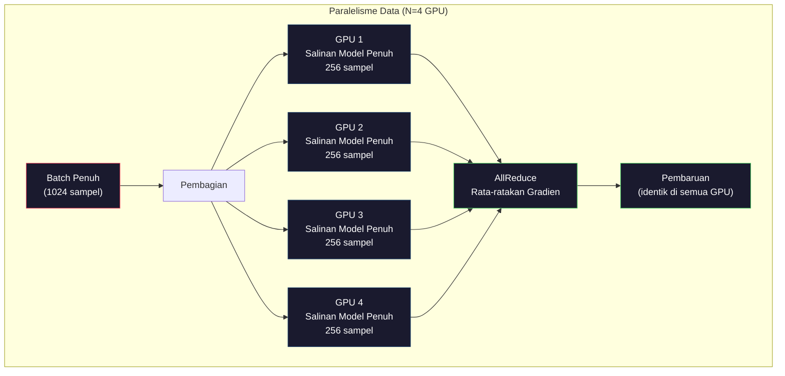
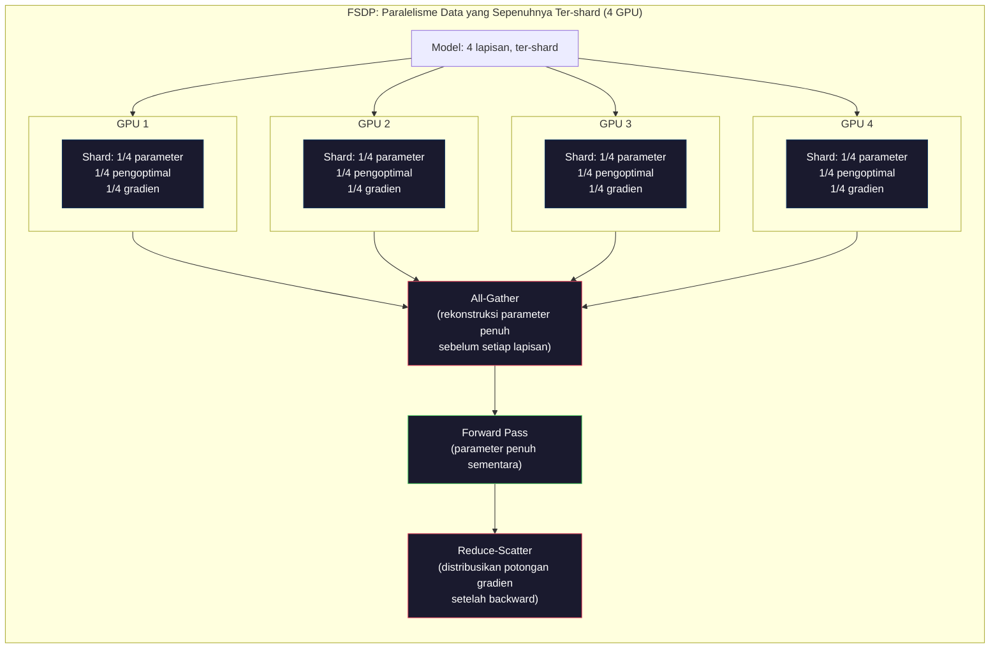
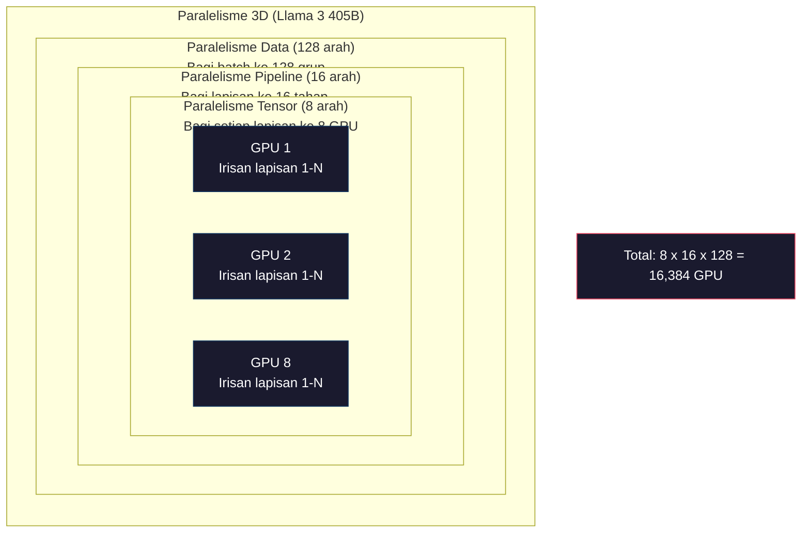

# Penskalaan: Pelatihan Terdistribusi, FSDP, DeepSpeed

> Model 124M Anda dilatih pada satu GPU. Sekarang coba 7 miliar parameter. Model itu tidak muat di memori. Datanya memakan waktu berminggu-minggu di satu mesin. Pelatihan terdistribusi bukan pilihan tambahan pada skala besar. Ia adalah satu-satunya jalan ke depan.

**Jenis:** Bangun
**Bahasa:** Python
**Prasyarat:** Fase 10, Pelajaran 04 (Pra-pelatihan Mini GPT)
**Waktu:** ~120 menit

## Tujuan Pembelajaran

- Menjelaskan tiga jenis paralelisme (data, tensor, pipeline) dan kapan masing-masing diperlukan berdasarkan ukuran model dan klaster
- Mengimplementasikan pelatihan paralel-data menggunakan PyTorch DDP dengan sinkronisasi gradien lintas beberapa GPU
- Menghitung anggaran memori untuk ukuran model tertentu (bobot + status pengoptimal + gradien + aktivasi) guna menentukan perangkat keras minimum
- Mengonfigurasi tahap FSDP atau DeepSpeed ZeRO untuk melakukan sharding status model ke beberapa GPU dan memuat model yang melebihi memori satu GPU

## Masalahnya

Model 7B parameter dalam FP16 membutuhkan 14GB hanya untuk bobotnya. Pengoptimal Adam menyimpan dua salinan tambahan dari setiap parameter (estimasi momen pertama dan kedua). Itu 28GB lagi. Gradien selama propagasi balik menambah 14GB lagi. Anda sudah berada di 56GB sebelum satu pun aktivasi disimpan.

NVIDIA A100 memiliki memori 80GB.

56GB dari 80GB terpakai. Itu menyisakan 24GB untuk aktivasi -- nilai-nilai antara yang dihitung selama forward pass dan harus disimpan untuk propagasi balik. Untuk urutan 2048 token dengan model berdimensi 4096, aktivasi satu lapisan memakan sekitar 64MB. Dengan 32 lapisan, Anda memerlukan 2GB per sampel. Ukuran batch 8 membutuhkan 16GB. Anda punya 24GB. Ukuran batch 12 membuatnya meledak (out of memory).

Sekarang coba 70B parameter. Bobot saja: 140GB dalam FP16. Tidak muat di satu GPU. Anda memerlukan minimal 2 A100 (2 x 80GB = 160GB) hanya untuk menampung bobot. Tambahkan status pengoptimal dan gradien, kebutuhannya jauh lebih besar: minimal 3+ GPU, dan secara realistis 8-16 tergantung strategi sharding.

Llama 3 405B dilatih pada 16,384 GPU NVIDIA H100. Proses pelatihannya menelan biaya komputasi sekitar $100 juta. DeepSeek V3 melatih model yang sebanding dengan biaya sekitar $5.6 juta berkat pendekatan cerdas pada arsitektur (Mixture of Experts berarti hanya sebagian parameter yang aktif per token) dan efisiensi pelatihan.

Pelajaran ini membahas empat strategi yang membuat pelatihan skala besar mungkin: paralelisme data, paralelisme tensor, paralelisme pipeline, dan paralelisme data yang sepenuhnya ter-shard (FSDP). Anda akan menyimulasikan masing-masing dengan Python murni untuk memahami mekanikanya sebelum menyentuh kerangka kerja pelatihan terdistribusi.

## Konsep

### Mengapa Distribusi Diperlukan

Berikut perhitungan memori untuk model nyata. Setiap angka dihitung, bukan sekadar diperkirakan.

| Model | Parameter | Bobot (FP16) | Status Adam | Gradien (FP16) | Total (tanpa aktivasi) |
|-------|-----------|--------------|-------------|----------------|------------------------|
| GPT-2 Small | 124M | 248 MB | 992 MB | 248 MB | 1.5 GB |
| Llama 3 8B | 8B | 16 GB | 64 GB | 16 GB | 96 GB |
| Llama 3 70B | 70B | 140 GB | 560 GB | 140 GB | 840 GB |
| Llama 3 405B | 405B | 810 GB | 3,240 GB | 810 GB | 4,860 GB |

Kolom "Status Adam" adalah pembunuhnya. Adam menyimpan rata-rata berjalan (m) dan varians berjalan (v) untuk setiap parameter, keduanya dalam FP32. Untuk model 70B, itu 70B x 4 byte x 2 = 560GB. Pengoptimalnya saja memerlukan tujuh A100.

Satu H100 memiliki 80GB. Llama 3 405B memerlukan minimal 61 H100 hanya untuk menampung bobot, pengoptimal, dan gradien. Tambahkan aktivasi dan jumlahnya semakin besar. Meta menggunakan 16,384 GPU bukan karena mereka menginginkannya -- melainkan karena terpaksa.

### Paralelisme Data

Strategi terdistribusi yang paling sederhana. Salin seluruh model ke N GPU. Bagi setiap batch pelatihan menjadi N bagian yang sama. Setiap GPU menjalankan forward pass dan backward pass pada bagian data miliknya. Setelah backward pass, rata-ratakan gradien lintas semua GPU. Setiap GPU memperbarui salinan bobotnya dengan gradien rata-rata yang sama, sehingga semua salinan tetap sinkron.

**Kelebihannya:** Penskalaan throughput linear. N GPU memproses N kali lebih banyak data per langkah. Komunikasi hanya terbatas pada perataan gradien, yang tumpang tindih dengan komputasi.

**Kekurangannya:** Setiap GPU menyimpan salinan lengkap model, status pengoptimal, dan gradien. Untuk model 70B, setiap GPU memerlukan 840GB. Paralelisme data tidak mengurangi memori per GPU sedikit pun. Ia hanya mempercepat waktu pelatihan.

**Perhitungannya:** Ukuran batch efektif = per_gpu_batch_size x N. Untuk N=64 GPU dengan batch per GPU 16, batch efektifnya adalah 1,024. Llama 3 menggunakan ukuran batch efektif 16 juta token per langkah.



### Paralelisme Tensor

Bagi lapisan individual ke beberapa GPU. Satu perkalian matriks dibagi di antara GPU, masing-masing menghitung sebagian hasilnya.

Perhatikan matriks bobot berbentuk (8192, 8192) pada lapisan feedforward. Dengan paralelisme tensor 4 arah, setiap GPU menyimpan potongan (8192, 2048). Setiap GPU mengalikan masukan dengan potongannya, menghasilkan hasil parsial. Hasil parsial itu digabungkan (melalui all-reduce atau all-gather) menjadi keluaran penuh.

**Kelebihannya:** Mengurangi memori per GPU untuk bobot model. Model 70B yang dibagi ke 8 GPU berarti setiap GPU menyimpan bobot setara ~8.75B parameter.

**Kekurangannya:** Memerlukan komunikasi antarGPU yang cepat setelah setiap lapisan. All-reduce setelah setiap matmul menambah latensi. Ini bekerja baik dengan NVLink (900 GB/s antarGPU dalam satu node), tetapi buruk antarnode yang terhubung melalui InfiniBand (400 Gb/s, sekitar 50 GB/s). Paralelisme tensor hampir selalu dibatasi di dalam satu node (8 GPU).

**Penggunaan nyata:** Megatron-LM memelopori paralelisme tensor. Llama 3 405B menggunakan paralelisme tensor 8 arah di dalam setiap node.

### Paralelisme Pipeline

Bagi model berdasarkan lapisan. GPU 1 menjalankan lapisan 1-8. GPU 2 menjalankan lapisan 9-16. GPU 3 menjalankan lapisan 17-24. GPU 4 menjalankan lapisan 25-32. Data mengalir melalui pipeline: GPU 1 menghitung lapisannya dan mengirim aktivasi ke GPU 2, yang menghitung lapisannya dan mengirim ke GPU 3, dan seterusnya.

**Kelebihannya:** Komunikasi antarGPU minimal -- hanya aktivasi pada batas lapisan, yang ukurannya kecil dibandingkan gradien atau bobot. Bekerja antarnode karena kebutuhan bandwidth rendah.

**Kekurangannya:** Gelembung pipeline. Saat GPU 4 menghitung forward pass pada micro-batch 1, GPU 1, 2, dan 3 menganggur (mereka sudah meneruskan bagiannya). Selama backward pass, polanya terbalik. Dengan pipeline naif, utilisasi GPU hanya 1/N untuk N tahap pipeline.

**GPipe dan PipeDream** mengatasi masalah gelembung dengan membagi batch menjadi micro-batch. GPU 1 mulai mengerjakan micro-batch 2 segera setelah selesai meneruskan micro-batch 1. Ini tumpang tindihkan komputasi antar tahap pipeline. Dengan M micro-batch dan N tahap, fraksi gelembung turun menjadi (N-1)/M. Gunakan M=16 micro-batch dengan N=4 tahap dan gelembungnya adalah 3/16 = 18.75% waktu menganggur.

### FSDP: Paralelisme Data yang Sepenuhnya Ter-shard

FSDP menggabungkan skalabilitas paralelisme data dengan efisiensi memori dari sharding. Alih-alih setiap GPU menyimpan salinan lengkap model, setiap GPU hanya menyimpan 1/N parameter, gradien, dan status pengoptimal.

Sebelum forward pass suatu lapisan, FSDP menjalankan **all-gather** untuk mengumpulkan parameter lengkap dari semua GPU ke memori masing-masing GPU. Setelah forward pass, setiap GPU membuang parameter nonlokal. Selama backward, all-gather dijalankan lagi untuk merekonstruksi parameter bagi perhitungan gradien. Setelah backward pass, **reduce-scatter** mendistribusikan potongan gradien sehingga setiap GPU hanya menyimpan 1/N dari gradien.

**Perhitungan untuk model 70B pada 8 GPU:**

| Komponen | Tanpa FSDP | Dengan FSDP |
|----------|------------|-------------|
| Bobot (FP16) | 140 GB per GPU | 17.5 GB per GPU |
| Status Adam (FP32) | 560 GB per GPU | 70 GB per GPU |
| Gradien (FP16) | 140 GB per GPU | 17.5 GB per GPU |
| **Total** | **840 GB per GPU** | **105 GB per GPU** |

Tanpa FSDP, model 70B tidak mungkin muat di satu GPU 80GB. Dengan FSDP pada 8 GPU, setiap GPU menggunakan 105GB -- tunggu, itu masih tidak muat. Anda memerlukan minimal 16 GPU untuk tetap di bawah 80GB per GPU, atau menggabungkan FSDP dengan checkpointing aktivasi (hitung ulang aktivasi selama backward, alih-alih menyimpannya).

Biaya komunikasi lebih tinggi daripada paralelisme data biasa karena all-gather sebelum setiap lapisan. Namun penghematan memori membuat proses pelatihan yang sebelumnya mustahil menjadi mungkin.



### DeepSpeed ZeRO

ZeRO (Zero Redundancy Optimizer) dari DeepSpeed secara konseptual identik dengan FSDP, tetapi dikembangkan secara independen oleh Microsoft. Ia mendefinisikan tiga tahap, masing-masing melakukan sharding lebih agresif:

| Tahap | Yang Di-shard | Penghematan Memori | Komunikasi |
|-------|---------------|--------------------|------------|
| ZeRO-1 | Hanya status pengoptimal | Pengurangan ~4x | Sama seperti paralelisme data |
| ZeRO-2 | + Gradien | Pengurangan ~8x | Sedikit lebih banyak |
| ZeRO-3 | + Parameter | Pengurangan ~Nx (N GPU) | All-gather per lapisan |

ZeRO-3 setara dengan FSDP. Namanya berbeda, mekanismenya sama. PyTorch menambahkan FSDP sebagai implementasi bawaan setelah DeepSpeed membuktikan konsepnya.

DeepSpeed juga memperkenalkan ZeRO-Offload (memindahkan status pengoptimal ke RAM CPU, yang lebih murah dan lebih besar) dan ZeRO-Infinity (memindahkan ke SSD NVMe). Keduanya mengorbankan kecepatan komputasi demi kapasitas memori -- operasi yang dipindahkan lebih lambat, tetapi membebaskan memori GPU.

### Pelatihan Presisi Campuran

Pelatihan modern menggunakan beberapa format floating-point secara bersamaan:

- **Forward pass**: FP16 atau BF16 (16-bit). Setengah memori FP32. Matmul berjalan 2x lebih cepat pada tensor core.
- **Bobot master**: FP32 (32-bit). Dipertahankan oleh pengoptimal untuk presisi numerik selama pembaruan bobot.
- **Loss scaling**: Kalikan loss dengan konstanta besar sebelum backward pass untuk mencegah gradien FP16 underflow menjadi nol. Bagi dengan konstanta yang sama sebelum langkah pengoptimal.

BF16 (Brain Float 16) memiliki rentang eksponen yang sama dengan FP32 (8 bit eksponen), tetapi presisi lebih rendah (7 bit mantissa versus 23 bit pada FP32). Ia jarang memerlukan loss scaling karena dapat mewakili rentang nilai yang sama. FP16 memiliki 5 bit eksponen dan 10 bit mantissa -- ia dapat mewakili nilai butir halus, tetapi mengalami overflow/underflow pada besaran ekstrem.

TPU Google menggunakan BF16 secara bawaan. A100 dan H100 NVIDIA mendukung FP16 dan BF16. Industri sebagian besar beralih ke BF16 karena menghilangkan kerumitan loss scaling.

**Perbandingan memori untuk model 7B:**

| Presisi | Bobot | Pengoptimal | Gradien | Total |
|---------|-------|-------------|---------|-------|
| FP32 di semua tempat | 28 GB | 56 GB | 28 GB | 112 GB |
| Campuran (BF16 + master FP32) | 14 GB | 56 GB | 14 GB | 84 GB |

Presisi campuran menghemat 28GB pada model ini. Status pengoptimal tetap dalam FP32 apa pun formatnya -- di sinilah sebagian besar memori terpakai.

### Megatron-LM dan Paralelisme 3D

Pelatihan skala besar yang sesungguhnya menggabungkan ketiga jenis paralelisme:

- **Paralelisme data** lintas grup node (menskalakan ukuran batch)
- **Paralelisme tensor** di dalam satu node (membagi lapisan ke 8 GPU)
- **Paralelisme pipeline** antarnode (membagi grup lapisan ke beberapa mesin)

Llama 3 405B pada 16,384 H100:
- Paralelisme tensor 8 arah di dalam setiap node (8 GPU per node)
- Paralelisme pipeline 16 arah antarnode (16 tahap pipeline)
- Paralelisme data 128 arah pada dimensi yang tersisa (16,384 / 8 / 16 = 128)

Dekomposisi 3D ini (8 x 16 x 128 = 16,384) adalah cara Anda menskalakan ke ribuan GPU. Setiap GPU melihat potongan data yang berbeda (paralelisme data), menyimpan satu irisan dari setiap lapisan (paralelisme tensor), dan menghitung sekumpulan lapisan yang berbeda (paralelisme pipeline).

DeepSeek V3 mengambil pendekatan berbeda. Arsitektur Mixture of Experts mereka hanya mengaktifkan 37B dari 671B parameter per token. Ini berarti setiap GPU hanya perlu menghitung (dan menyimpan aktivasi untuk) parameter yang aktif. Mereka melatih pada 2,048 GPU H800 -- kurang dari 1/8 jumlah GPU Meta -- dengan biaya $5.6M dibandingkan perkiraan $100M dari Meta.



```figure
paged-kv-cache
```

## Bangunlah

### Langkah 1: Menyimulasikan Paralelisme Data

Bagi sebuah batch ke GPU simulasi. Setiap GPU menghitung forward pass pada potongannya. Rata-ratakan "gradien" (kita simulasikan sebagai nilai loss).

```python
import numpy as np

def simulate_data_parallelism(data, num_gpus, model_fn):
    batch_size = len(data)
    shard_size = batch_size // num_gpus
    remainder = batch_size % num_gpus

    gpu_losses = []
    gpu_gradients = []

    offset = 0
    for gpu_id in range(num_gpus):
        extra = 1 if gpu_id < remainder else 0
        shard = data[offset:offset + shard_size + extra]
        offset += shard_size + extra

        loss, grad = model_fn(shard)
        gpu_losses.append(loss)
        gpu_gradients.append(grad)

    avg_loss = np.mean(gpu_losses)
    avg_gradient = np.mean(gpu_gradients, axis=0)

    return avg_loss, avg_gradient
```

Operasi all-reduce (merata-ratakan gradien) adalah satu-satunya komunikasi dalam paralelisme data. Dalam praktiknya, ini menggunakan pustaka NCCL pada GPU NVIDIA, yang menerapkan ring all-reduce: setiap GPU mengirim 1/N gradiennya ke tetangganya, menerima 1/N dari tetangga lainnya, dan setelah N-1 langkah setiap GPU memiliki rata-rata lengkap. Volume komunikasi total: 2 x gradient_size x (N-1)/N, mendekati 2x ukuran gradien untuk N besar.

### Langkah 2: Menyimulasikan Paralelisme Tensor

Bagi matriks bobot ke beberapa GPU. Setiap GPU menghitung perkalian matriks parsial. Gabungkan hasilnya.

```python
def simulate_tensor_parallelism(input_data, weight_matrix, num_gpus):
    d_in, d_out = weight_matrix.shape
    assert d_out % num_gpus == 0, f"d_out {d_out} not divisible by num_gpus {num_gpus}"
    shard_size = d_out // num_gpus

    partial_results = []
    for gpu_id in range(num_gpus):
        start = gpu_id * shard_size
        end = start + shard_size
        weight_shard = weight_matrix[:, start:end]

        partial = input_data @ weight_shard
        partial_results.append(partial)

    full_output = np.concatenate(partial_results, axis=-1)

    direct_output = input_data @ weight_matrix
    error = np.abs(full_output - direct_output).max()

    return full_output, error
```

Galatnya harus tepat nol (atau epsilon mesin). Paralelisme tensor secara matematis eksak -- ia menghasilkan hasil yang sama seperti menghitung matmul penuh di satu GPU. Pembagiannya dilakukan sepanjang dimensi keluaran, sehingga setiap GPU menghasilkan potongan kolom yang berbeda, dan konkatenasi merekonstruksi hasil penuh.

Untuk lapisan linear paralel-kolom (membagi dimensi keluaran), Anda melakukan konkatenasi. Untuk paralel-baris (membagi dimensi masukan), Anda menjumlahkan. Pada FFN transformer, linear pertama (ekspansi) menggunakan paralel-kolom dan linear kedua (kontraksi) menggunakan paralel-baris. Ini menghindari all-reduce di antara kedua lapisan.

### Langkah 3: Menyimulasikan Paralelisme Pipeline

Bagi lapisan model ke GPU virtual. Tunjukkan masalah gelembung, ketika tahap awal menganggur sementara tahap kemudian menghitung.

```python
def simulate_pipeline_parallelism(num_layers, num_stages, num_microbatches):
    layers_per_stage = num_layers // num_stages

    timeline = {}
    clock = 0

    for mb in range(num_microbatches):
        for stage in range(num_stages):
            start_time = max(
                timeline.get((stage, mb - 1, "fwd"), (0, 0))[1] if mb > 0 else 0,
                timeline.get((stage - 1, mb, "fwd"), (0, 0))[1] if stage > 0 else 0,
            )
            end_time = start_time + layers_per_stage
            timeline[(stage, mb, "fwd")] = (start_time, end_time)

    last_fwd_end = max(v[1] for v in timeline.values())

    for mb in range(num_microbatches - 1, -1, -1):
        for stage in range(num_stages - 1, -1, -1):
            deps = [last_fwd_end]
            if mb < num_microbatches - 1 and (stage, mb + 1, "bwd") in timeline:
                deps.append(timeline[(stage, mb + 1, "bwd")][1])
            if stage < num_stages - 1 and (stage + 1, mb, "bwd") in timeline:
                deps.append(timeline[(stage + 1, mb, "bwd")][1])
            start_time = max(deps)
            end_time = start_time + layers_per_stage
            timeline[(stage, mb, "bwd")] = (start_time, end_time)

    total_time = max(v[1] for v in timeline.values())
    compute_time = num_microbatches * num_stages * layers_per_stage * 2
    bubble_fraction = 1.0 - compute_time / (total_time * num_stages)

    return timeline, total_time, bubble_fraction
```

Dengan 4 tahap dan 1 micro-batch, fraksi gelembung adalah 75% -- tiga dari empat GPU menganggur kapan saja. Dengan 16 micro-batch, fraksi itu turun menjadi sekitar 19%. Biaya untuk menghilangkan gelembung adalah memori: Anda harus menyimpan aktivasi untuk semua micro-batch yang sedang berjalan secara bersamaan.

### Langkah 4: Kalkulator Memori

Hitung kebutuhan memori yang tepat untuk melatih model berukuran apa pun.

```python
def memory_calculator(
    params_billions,
    precision_bytes=2,
    optimizer="adam",
    num_gpus=1,
    sharding="none",
    sequence_length=2048,
    batch_size_per_gpu=1,
    hidden_dim=None,
    num_layers=None,
):
    params = params_billions * 1e9

    weight_memory = params * precision_bytes

    if optimizer == "adam":
        optimizer_memory = params * 4 * 2
    elif optimizer == "sgd":
        optimizer_memory = params * 4
    else:
        optimizer_memory = 0

    gradient_memory = params * precision_bytes

    total_no_activation = weight_memory + optimizer_memory + gradient_memory

    if hidden_dim and num_layers:
        activation_per_layer = (
            sequence_length * batch_size_per_gpu * hidden_dim * precision_bytes * 4
        )
        activation_memory = activation_per_layer * num_layers
    else:
        activation_memory = params * precision_bytes * 0.5

    if sharding == "fsdp" or sharding == "zero3":
        weight_memory /= num_gpus
        optimizer_memory /= num_gpus
        gradient_memory /= num_gpus
    elif sharding == "zero2":
        optimizer_memory /= num_gpus
        gradient_memory /= num_gpus
    elif sharding == "zero1":
        optimizer_memory /= num_gpus

    per_gpu_total = weight_memory + optimizer_memory + gradient_memory + activation_memory

    return {
        "params_billions": params_billions,
        "weights_gb": weight_memory / 1e9,
        "optimizer_gb": optimizer_memory / 1e9,
        "gradients_gb": gradient_memory / 1e9,
        "activations_gb": activation_memory / 1e9,
        "per_gpu_total_gb": per_gpu_total / 1e9,
        "total_across_gpus_gb": per_gpu_total * num_gpus / 1e9,
        "fits_on_80gb": per_gpu_total / 1e9 <= 80,
        "num_gpus": num_gpus,
        "sharding": sharding,
    }
```

Kalkulator ini menjawab pertanyaan yang diajukan setiap insinyur ML: "Berapa banyak GPU yang saya butuhkan?" Masukkan ukuran modelnya dan lihat apakah ia muat. Sesuaikan strategi sharding sampai total per GPU turun di bawah 80GB.

### Langkah 5: Simulasi Presisi Campuran

Bandingkan penggunaan memori antara pelatihan FP32, FP16, dan presisi campuran.

```python
def mixed_precision_comparison(params_billions):
    params = params_billions * 1e9

    fp32_weights = params * 4
    fp32_optimizer = params * 4 * 2
    fp32_gradients = params * 4
    fp32_total = fp32_weights + fp32_optimizer + fp32_gradients

    fp16_weights = params * 2
    fp16_master = params * 4
    fp16_optimizer = params * 4 * 2
    fp16_gradients = params * 2
    fp16_total = fp16_weights + fp16_master + fp16_optimizer + fp16_gradients

    mixed_weights = params * 2
    mixed_optimizer = params * 4 * 2
    mixed_gradients = params * 2
    mixed_total = mixed_weights + mixed_optimizer + mixed_gradients

    return {
        "fp32_total_gb": fp32_total / 1e9,
        "fp16_with_master_gb": fp16_total / 1e9,
        "mixed_bf16_gb": mixed_total / 1e9,
        "savings_vs_fp32": 1 - mixed_total / fp32_total,
    }
```

Kejutan terbesar bagi kebanyakan orang: presisi campuran tidak membelah memori menjadi setengah. Status pengoptimal (m dan v dari Adam) tetap dalam FP32, apa pun presisinya. Untuk model 7B, pelatihan FP32 menggunakan 112GB. Presisi campuran menggunakan 84GB. Itu pengurangan 25%, bukan 50%. Pengoptimallah yang mendominasi.

## Gunakanlah

### Jalankan Semua Simulasi

```python
def run_all_demos():
    print("=" * 70)
    print("DATA PARALLELISM SIMULATION")
    print("=" * 70)

    np.random.seed(42)
    data = np.random.randn(64, 32)
    weight = np.random.randn(32, 16)

    def model_fn(batch):
        output = batch @ weight
        loss = np.mean(output ** 2)
        grad = 2 * batch.T @ (batch @ weight) / len(batch)
        return loss, grad

    for n_gpus in [1, 2, 4, 8]:
        loss, grad = simulate_data_parallelism(data, n_gpus, model_fn)
        print(f"  {n_gpus} GPUs: loss={loss:.4f}, grad_norm={np.linalg.norm(grad):.4f}")

    print()
    print("=" * 70)
    print("TENSOR PARALLELISM SIMULATION")
    print("=" * 70)

    x = np.random.randn(4, 8192)
    W = np.random.randn(8192, 8192)

    for n_gpus in [1, 2, 4, 8]:
        output, error = simulate_tensor_parallelism(x, W, n_gpus)
        print(f"  {n_gpus} GPUs: output_shape={output.shape}, max_error={error:.2e}")

    print()
    print("=" * 70)
    print("PIPELINE PARALLELISM SIMULATION")
    print("=" * 70)

    for n_mb in [1, 4, 8, 16, 32]:
        _, total_t, bubble = simulate_pipeline_parallelism(32, 4, n_mb)
        print(f"  {n_mb:2d} micro-batches: total_time={total_t:4d}, bubble={bubble:.1%}")

    print()
    print("=" * 70)
    print("MEMORY CALCULATOR")
    print("=" * 70)

    configs = [
        (7, "none", 1),
        (7, "fsdp", 8),
        (70, "none", 1),
        (70, "fsdp", 8),
        (70, "fsdp", 16),
        (405, "fsdp", 64),
        (405, "fsdp", 128),
    ]

    print(f"  {'Model':>8} {'Sharding':>8} {'GPUs':>5} {'Per-GPU':>10} {'Fits 80GB':>10}")
    print("  " + "-" * 50)
    for params, shard, gpus in configs:
        result = memory_calculator(params, num_gpus=gpus, sharding=shard)
        fits = "Yes" if result["fits_on_80gb"] else "No"
        print(f"  {params:>6}B {shard:>8} {gpus:>5} {result['per_gpu_total_gb']:>8.1f}GB {fits:>10}")

    print()
    print("=" * 70)
    print("MIXED PRECISION COMPARISON")
    print("=" * 70)

    for params_b in [7, 13, 70, 405]:
        result = mixed_precision_comparison(params_b)
        print(f"  {params_b}B: FP32={result['fp32_total_gb']:.0f}GB, "
              f"Mixed BF16={result['mixed_bf16_gb']:.0f}GB, "
              f"Savings={result['savings_vs_fp32']:.0%}")
```

## Kirimkan

Pelajaran ini menghasilkan `outputs/prompt-distributed-training-planner.md` -- sebuah prompt yang menerima ukuran model dan perangkat keras yang tersedia, lalu menghasilkan rencana pelatihan terdistribusi yang lengkap: strategi paralelisme, anggaran memori, overhead komunikasi, dan perkiraan throughput.

## Latihan

1. Ubah kalkulator memori agar menyertakan checkpointing aktivasi. Dengan checkpointing, hanya simpan aktivasi pada setiap lapisan ke-K (biasanya K=1, artinya menghitung ulang semuanya). Tunjukkan trade-off memori-komputasi: berapa banyak memori yang dihemat checkpointing, dan seberapa besar ia memperlambat pelatihan (sekitar 33% komputasi tambahan untuk checkpointing penuh)?

2. Kembangkan simulasi paralelisme pipeline untuk menerapkan jadwal 1F1B (satu forward, satu backward) yang digunakan oleh PipeDream. Bandingkan fraksi gelembung dengan jadwal naif untuk 4 tahap dan 8 micro-batch. Jadwal 1F1B seharusnya memiliki memori puncak lebih kecil karena memulai backward pass lebih awal.

3. Implementasikan simulator akumulasi gradien. Alih-alih melakukan all-reduce setelah setiap micro-batch, akumulasikan gradien secara lokal selama K langkah, lalu lakukan all-reduce. Tunjukkan bagaimana ini mengurangi komunikasi sebesar K kali, tetapi menghasilkan gradien akhir yang identik (dan dengan demikian pelatihan yang identik).

4. Bangun penaksir biaya. Diberikan ukuran model, target jumlah token, jenis GPU (A100 seharga $2/jam, H100 seharga $3.50/jam), dan strategi paralelisme, taksirkan total biaya pelatihan dalam dolar. Validasi terhadap biaya yang diketahui: Llama 3 405B dilaporkan menelan ~$100M, DeepSeek V3 menelan ~$5.6M.

5. Tambahkan ZeRO-Offload ke kalkulator memori. Asumsikan RAM CPU 512GB per node dan NVMe 2TB. Tunjukkan bagaimana memindahkan status pengoptimal ke CPU memungkinkan model 70B dilatih pada 4 GPU, bukan 16, dengan konsekuensi langkah pengoptimal 30-50% lebih lambat.

## Istilah Kunci

| Istilah | Orang Bilang | Arti Sebenarnya |
|---------|--------------|-----------------|
| Paralelisme data | "Salin model ke setiap GPU" | Setiap GPU memproses potongan data yang berbeda; gradien dirata-ratakan melalui all-reduce setelah setiap langkah |
| Paralelisme tensor | "Bagi lapisan ke beberapa GPU" | Partisi matriks bobot sehingga setiap GPU menghitung sebagian matmul; memerlukan interkoneksi NVLink yang cepat |
| Paralelisme pipeline | "Bagi lapisan ke beberapa GPU" | Setiap GPU menjalankan grup lapisan yang berbeda; data mengalir melalui pipeline dengan micro-batch untuk mengurangi gelembung |
| FSDP | "Shard semuanya" | Paralelisme Data yang Sepenuhnya Ter-shard -- setiap GPU menyimpan 1/N bobot, gradien, dan status pengoptimal; all-gather sebelum komputasi |
| ZeRO | "Versi FSDP dari DeepSpeed" | Zero Redundancy Optimizer dengan 3 tahap: sharding pengoptimal (Tahap 1), + gradien (Tahap 2), + parameter (Tahap 3) |
| All-reduce | "Rata-ratakan lintas GPU" | Operasi kolektif di mana setiap GPU berakhir dengan jumlah (atau rata-rata) masukan semua GPU -- biasanya diterapkan sebagai ring all-reduce |
| All-gather | "Kumpulkan dari semua GPU" | Operasi kolektif di mana setiap GPU berakhir dengan konkatenasi data semua GPU -- digunakan dalam FSDP untuk merekonstruksi parameter penuh |
| Reduce-scatter | "Jumlahkan dan distribusikan" | Operasi kolektif yang mereduksi (menjumlahkan) data dan menyebarkan potongan berbeda ke GPU berbeda -- digunakan dalam FSDP untuk sharding gradien |
| Presisi campuran | "Latih dengan presisi setengah" | Gunakan FP16/BF16 untuk forward/backward dan FP32 untuk status pengoptimal -- menghemat ~25% memori, bukan 50%, karena pengoptimal mendominasi |
| Gelembung pipeline | "Waktu menganggur dalam pipeline" | Fraksi waktu GPU menganggur menunggu data dari tahap sebelumnya -- dikurangi dengan menggunakan lebih banyak micro-batch |

## Bacaan Lanjutan

- [Rajbhandari et al., 2020 -- "ZeRO: Memory Optimizations Toward Training Trillion Parameter Models"](https://arxiv.org/abs/1910.02054) -- makalah ZeRO DeepSpeed yang mendefinisikan tiga tahap sharding
- [Shoeybi et al., 2020 -- "Megatron-LM: Training Multi-Billion Parameter Language Models Using Model Parallelism"](https://arxiv.org/abs/1909.08053) -- paralelisme tensor NVIDIA untuk transformer
- [Narayanan et al., 2021 -- "Efficient Large-Scale Language Model Training on GPU Clusters Using Megatron-LM"](https://arxiv.org/abs/2104.04473) -- paralelisme 3D yang menggabungkan data, tensor, dan pipeline
- [Zhao et al., 2023 -- "PyTorch FSDP: Experiences on Scaling Fully Sharded Data Parallel"](https://arxiv.org/abs/2304.11277) -- implementasi FSDP bawaan PyTorch
- [Laporan Teknis Llama 3](https://arxiv.org/abs/2407.21783) -- rincian pelatihan dengan 16,384 GPU dan paralelisme 3D
- [Laporan Teknis DeepSeek-V3](https://arxiv.org/abs/2412.19437) -- bagaimana arsitektur MoE mengurangi biaya pelatihan hingga satu urutan besaran
